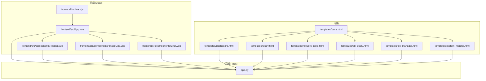
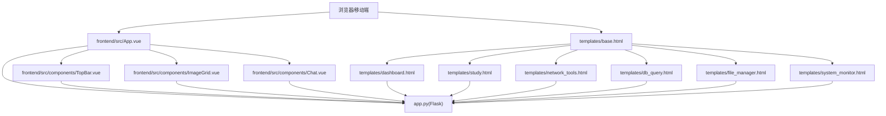
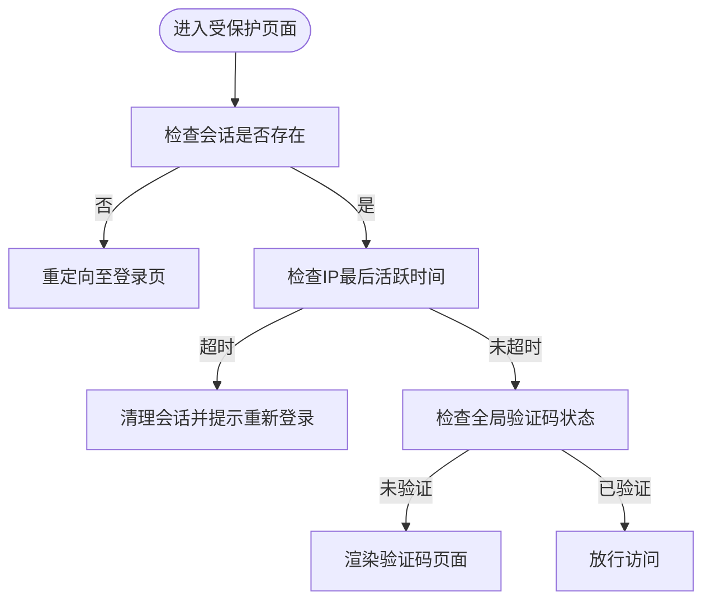
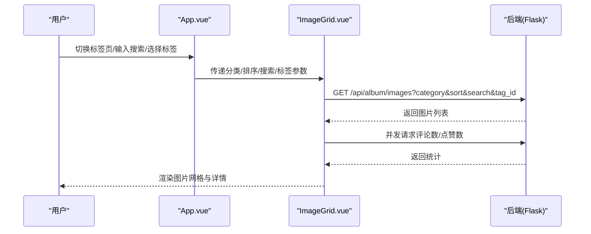
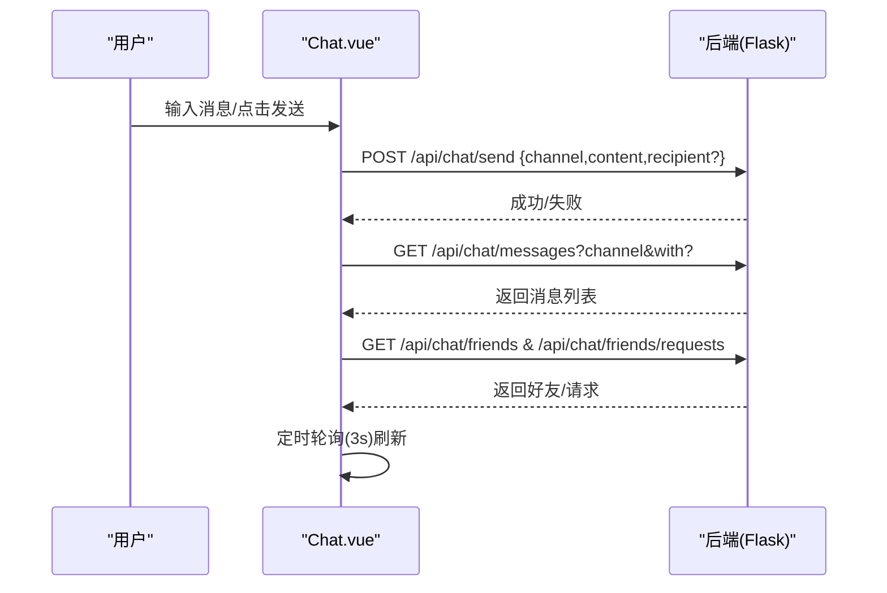
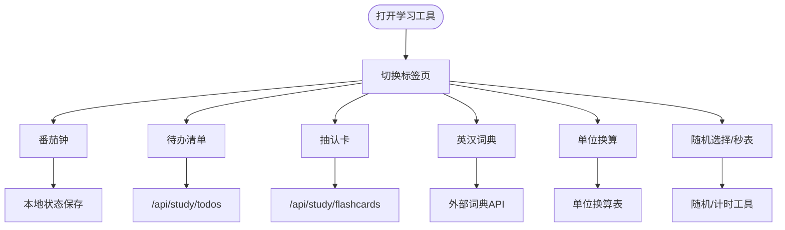
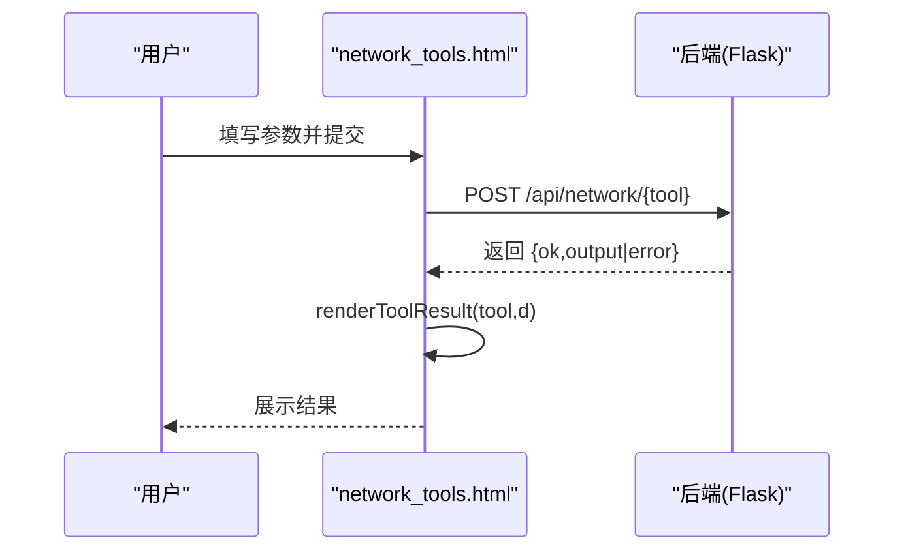
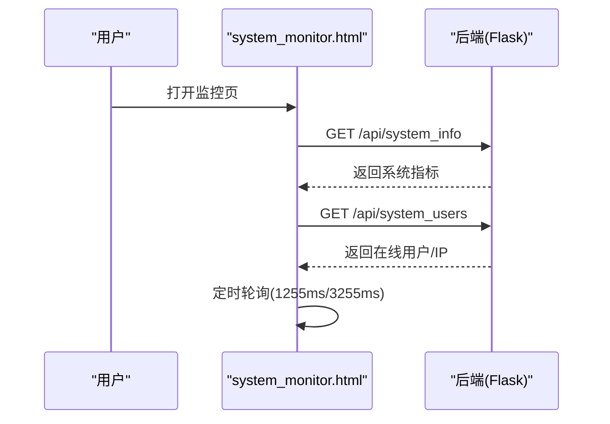
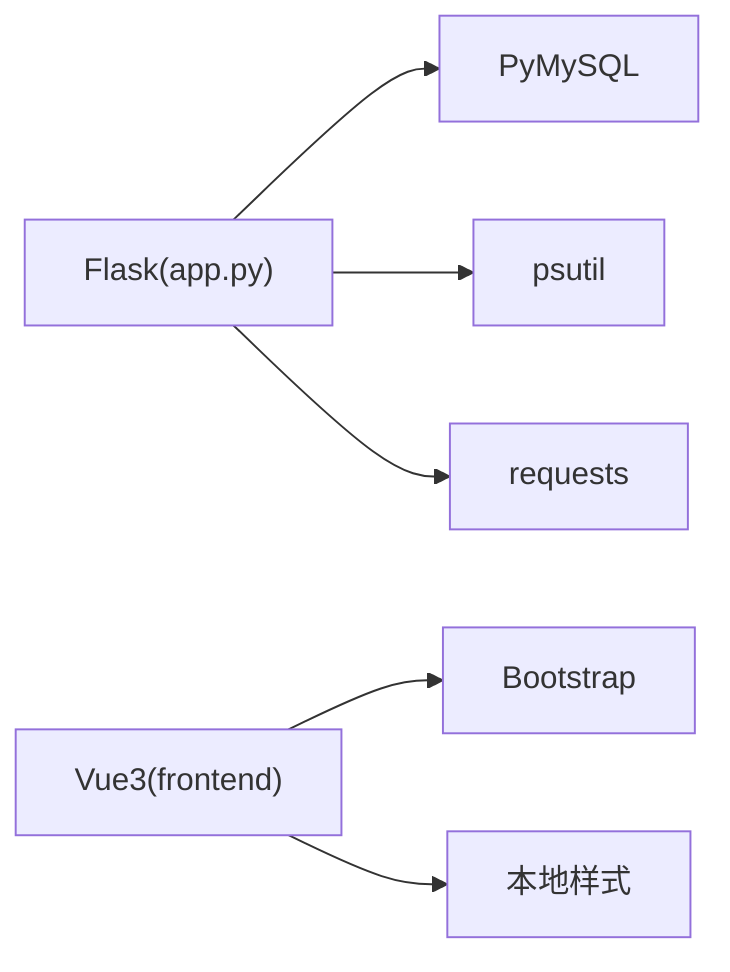

# 核心功能模块

<cite>
**本文档引用的文件**
- [app.py](file://app.py)
- [requirements.txt](file://requirements.txt)
- [templates/base.html](file://templates/base.html)
- [templates/dashboard.html](file://templates/dashboard.html)
- [templates/study.html](file://templates/study.html)
- [templates/network_tools.html](file://templates/network_tools.html)
- [templates/db_query.html](file://templates/db_query.html)
- [templates/file_manager.html](file://templates/file_manager.html)
- [templates/system_monitor.html](file://templates/system_monitor.html)
- [frontend/src/main.js](file://frontend/src/main.js)
- [frontend/src/App.vue](file://frontend/src/App.vue)
- [frontend/src/components/TopBar.vue](file://frontend/src/components/TopBar.vue)
- [frontend/src/components/ImageGrid.vue](file://frontend/src/components/ImageGrid.vue)
- [frontend/src/components/Chat.vue](file://frontend/src/components/Chat.vue)
</cite>

## 目录
1. [简介](#简介)
2. [项目结构](#项目结构)
3. [核心组件](#核心组件)
4. [架构总览](#架构总览)
5. [详细组件分析](#详细组件分析)
6. [依赖分析](#依赖分析)
7. [性能考虑](#性能考虑)
8. [故障排查指南](#故障排查指南)
9. [结论](#结论)
10. [附录](#附录)

## 简介
本项目是一个“多合一工具箱 Web 版”，围绕学校场景构建，提供统一的用户认证、相册管理、实时聊天、学习工具、网络工具、数据库查询、系统监控与文件管理等核心功能模块。前端采用 Vue3 + Vite，后端基于 Flask，通过模板渲染与 API 接口实现前后端协作。系统内置国际化、安全防护（CSP、速率限制、会话超时）、插件市场扩展能力，并提供仪表盘聚合入口。

## 项目结构
项目采用“模板 + 前端单页应用 + 后端接口”的分层组织方式：
- 后端：Flask 应用集中于 app.py，负责路由、模板渲染、API、安全策略与数据库初始化。
- 前端：Vue3 应用位于 frontend/src，包含页面组件、状态与交互逻辑，通过 API 与后端通信。
- 模板：Jinja2 模板位于 templates，用于服务端渲染页面与仪表盘聚合入口。
- 静态资源：静态文件、相册图片、头像、项目上传等位于 static 目录。
- 国际化：i18n 与 plugins 提供多语言与插件扩展支持。

图表来源
- [frontend/src/main.js:1-6](file://frontend/src/main.js#L1-L6)
- [frontend/src/App.vue:1-99](file://frontend/src/App.vue#L1-L99)
- [frontend/src/components/TopBar.vue:1-42](file://frontend/src/components/TopBar.vue#L1-L42)
- [frontend/src/components/ImageGrid.vue:1-129](file://frontend/src/components/ImageGrid.vue#L1-L129)
- [frontend/src/components/Chat.vue:1-214](file://frontend/src/components/Chat.vue#L1-L214)
- [app.py:1-800](file://app.py#L1-L800)
- [templates/base.html:1-337](file://templates/base.html#L1-L337)
- [templates/dashboard.html:1-350](file://templates/dashboard.html#L1-L350)
- [templates/study.html:1-669](file://templates/study.html#L1-L669)
- [templates/network_tools.html:1-328](file://templates/network_tools.html#L1-L328)
- [templates/db_query.html:1-52](file://templates/db_query.html#L1-L52)
- [templates/file_manager.html:1-60](file://templates/file_manager.html#L1-L60)
- [templates/system_monitor.html:1-271](file://templates/system_monitor.html#L1-L271)

章节来源
- [frontend/src/main.js:1-6](file://frontend/src/main.js#L1-L6)
- [frontend/src/App.vue:1-99](file://frontend/src/App.vue#L1-L99)
- [templates/base.html:1-337](file://templates/base.html#L1-L337)

## 核心组件
- 用户认证系统：基于 Flask Session 的登录/登出、会话超时、CSRF 保护、管理员与 VIP 权限模型；支持语言切换与多语言模板注入。
- 相册管理系统：相册图片浏览、标签筛选、搜索、排序、点赞/评论统计、教师端重命名/删除；支持弹幕、大事记、同学录、毕业寄语、歌单等扩展表。
- 实时聊天系统：世界频道与私信、好友搜索/请求/接受/删除、消息右键撤回、定时轮询刷新。
- 学习工具系统：番茄钟、待办清单、抽认卡、英汉词典、单位换算、随机选择、秒表。
- 网络工具系统：IP 查询、端口扫描、Ping、Traceroute、Whois、DNS、HTTP 头、SSL 证书、子网计算器。
- 数据库管理系统：数据库表查询与展示（仅管理员可见）。
- 系统监控系统：服务器 CPU/内存/磁盘/网络、在线用户/IP 活跃度、本机客户端信息采集与展示。
- 文件管理系统：目录浏览、文件列表、下载。
- 插件与国际化：插件市场与多语言支持，模板注入与脚本块扩展。

章节来源
- [app.py:122-232](file://app.py#L122-L232)
- [app.py:234-348](file://app.py#L234-L348)
- [app.py:351-416](file://app.py#L351-L416)
- [app.py:431-504](file://app.py#L431-L504)
- [app.py:506-596](file://app.py#L506-L596)
- [app.py:627-677](file://app.py#L627-L677)
- [app.py:680-800](file://app.py#L680-L800)
- [templates/dashboard.html:1-350](file://templates/dashboard.html#L1-L350)
- [templates/study.html:1-669](file://templates/study.html#L1-L669)
- [templates/network_tools.html:1-328](file://templates/network_tools.html#L1-L328)
- [templates/db_query.html:1-52](file://templates/db_query.html#L1-L52)
- [templates/file_manager.html:1-60](file://templates/file_manager.html#L1-L60)
- [templates/system_monitor.html:1-271](file://templates/system_monitor.html#L1-L271)
- [frontend/src/App.vue:1-99](file://frontend/src/App.vue#L1-L99)
- [frontend/src/components/TopBar.vue:1-42](file://frontend/src/components/TopBar.vue#L1-L42)
- [frontend/src/components/ImageGrid.vue:1-129](file://frontend/src/components/ImageGrid.vue#L1-L129)
- [frontend/src/components/Chat.vue:1-214](file://frontend/src/components/Chat.vue#L1-L214)

## 架构总览
系统采用“服务端模板 + 前端 SPA + API 接口”的混合架构：
- 服务端负责：路由与模板渲染、安全策略、数据库初始化与访问、系统信息采集、网络工具执行、文件系统访问。
- 前端负责：相册与聊天等交互组件、学习工具本地状态与 API 调用、仪表盘聚合入口。
- 模板负责：基础布局、导航、通知、语言切换、插件注入与脚本块。

图表来源
- [templates/base.html:1-337](file://templates/base.html#L1-L337)
- [templates/dashboard.html:1-350](file://templates/dashboard.html#L1-L350)
- [templates/study.html:1-669](file://templates/study.html#L1-L669)
- [templates/network_tools.html:1-328](file://templates/network_tools.html#L1-L328)
- [templates/db_query.html:1-52](file://templates/db_query.html#L1-L52)
- [templates/file_manager.html:1-60](file://templates/file_manager.html#L1-L60)
- [templates/system_monitor.html:1-271](file://templates/system_monitor.html#L1-L271)
- [frontend/src/App.vue:1-99](file://frontend/src/App.vue#L1-L99)
- [frontend/src/components/TopBar.vue:1-42](file://frontend/src/components/TopBar.vue#L1-L42)
- [frontend/src/components/ImageGrid.vue:1-129](file://frontend/src/components/ImageGrid.vue#L1-L129)
- [frontend/src/components/Chat.vue:1-214](file://frontend/src/components/Chat.vue#L1-L214)
- [app.py:122-232](file://app.py#L122-L232)

## 详细组件分析

### 用户认证系统
- 功能范围
  - 登录/登出、会话超时（IP 级别）、CSRF 令牌、语言切换、管理员/VIP 权限控制。
  - 全局验证码门禁、UA 黑名单拦截、CSP 防护、安全响应头。
- 核心特性
  - 会话超时：IP 90 秒无动作自动登出，提示重新登录。
  - 全站验证码：登录后访问非免检路径需二次验证。
  - 速率限制：基于内存桶与持久化文件的限流，支持白名单与手动封禁。
  - 安全头：X-Content-Type-Options、X-Frame-Options、X-XSS-Protection、CSP、HSTS（生产环境）。
- 技术实现
  - Flask before_request 拦截、CSP nonce 注入、模板上下文注入、会话 Cookie 安全设置。
- 使用场景与最佳实践
  - 在高并发场景建议结合 Nginx/CDN 与数据库限流策略；对管理员操作开启更严格验证码与日志审计。
- 扩展与自定义
  - 支持插件菜单项注入与模板块扩展；可新增权限等级与角色授权策略。

图表来源
- [app.py:516-596](file://app.py#L516-L596)
- [app.py:603-625](file://app.py#L603-L625)
- [templates/base.html:158-233](file://templates/base.html#L158-L233)

章节来源
- [app.py:136-198](file://app.py#L136-L198)
- [app.py:516-596](file://app.py#L516-L596)
- [app.py:603-625](file://app.py#L603-L625)
- [templates/base.html:158-233](file://templates/base.html#L158-L233)

### 相册管理系统
- 功能范围
  - 毕业图片/精彩瞬间分类浏览、标签筛选、搜索、排序；图片详情、点赞/评论统计；教师端重命名/删除。
  - 扩展功能：大事记时间轴、同学录、毕业寄语墙、歌单、弹幕。
- 核心特性
  - 前端组件化：App.vue 聚合标签页，ImageGrid 负责图片加载与交互，TopBar 提供用户态与返回入口。
  - 后端相册表扩展：events、classmates、wishes、playlist、danmaku、tags、image_tags 等。
- 技术实现
  - 前端通过 /api/album/* 与 /api/album/me 与后端交互；图片静态资源位于 /static/albums。
- 使用场景与最佳实践
  - 教师端批量管理图片与标签；学生端浏览与互动；建议对弹幕与寄语进行内容审核。
- 扩展与自定义
  - 可新增相册分类、标签颜色与排序规则；支持图片上传与缩略图生成。

图表来源
- [frontend/src/App.vue:1-99](file://frontend/src/App.vue#L1-L99)
- [frontend/src/components/ImageGrid.vue:1-129](file://frontend/src/components/ImageGrid.vue#L1-L129)
- [app.py:680-800](file://app.py#L680-L800)

章节来源
- [frontend/src/App.vue:1-99](file://frontend/src/App.vue#L1-L99)
- [frontend/src/components/TopBar.vue:1-42](file://frontend/src/components/TopBar.vue#L1-L42)
- [frontend/src/components/ImageGrid.vue:1-129](file://frontend/src/components/ImageGrid.vue#L1-L129)
- [app.py:680-800](file://app.py#L680-L800)

### 实时聊天系统
- 功能范围
  - 世界频道与私信、好友搜索、请求/接受/删除、消息右键撤回、定时轮询刷新。
- 核心特性
  - 前端组件 Chat.vue 独立运行，通过 /api/chat/* 与后端交互；支持移动端侧边栏折叠。
- 技术实现
  - 轮询机制：每 3 秒拉取一次消息与好友列表；右键菜单仅当前发送者可撤回。
- 使用场景与最佳实践
  - 适合小规模班级/社团即时沟通；建议配合管理员封禁与内容审核。
- 扩展与自定义
  - 可引入 WebSocket 实现实时推送；增加表情包、文件传输与消息加密。

图表来源
- [frontend/src/components/Chat.vue:1-214](file://frontend/src/components/Chat.vue#L1-L214)
- [app.py:122-232](file://app.py#L122-L232)

章节来源
- [frontend/src/components/Chat.vue:1-214](file://frontend/src/components/Chat.vue#L1-L214)

### 学习工具系统
- 功能范围
  - 番茄钟、待办清单、抽认卡、英汉词典、单位换算、随机选择、秒表。
- 核心特性
  - 本地状态持久化（localStorage）与服务端数据联动；标签页切换懒加载。
- 技术实现
  - 前端组件化，通过 /api/study/* 与后端交互；词典调用外部 API。
- 使用场景与最佳实践
  - 学生自主学习与复习；建议设定每日学习目标与反馈。
- 扩展与自定义
  - 可新增学习计划、成就系统、学习报告导出。

图表来源
- [templates/study.html:1-669](file://templates/study.html#L1-L669)
- [app.py:122-232](file://app.py#L122-L232)

章节来源
- [templates/study.html:1-669](file://templates/study.html#L1-L669)

### 网络工具系统
- 功能范围
  - IP 查询、端口扫描、Ping、Traceroute、Whois、DNS、HTTP 头、SSL 证书、子网计算器。
- 核心特性
  - 前端表单提交，后端 /api/network/* 执行并返回结果；纯文本或 HTML 渲染。
- 技术实现
  - 前端 toolSubmit 统一处理，renderToolResult 根据工具类型渲染。
- 使用场景与最佳实践
  - 网络调试与安全评估；注意端口扫描范围限制与合规性。
- 扩展与自定义
  - 可新增更多网络诊断工具与结果导出。

图表来源
- [templates/network_tools.html:1-328](file://templates/network_tools.html#L1-L328)
- [app.py:122-232](file://app.py#L122-L232)

章节来源
- [templates/network_tools.html:1-328](file://templates/network_tools.html#L1-L328)

### 数据库管理系统
- 功能范围
  - 管理员可见的数据库表查询页面，列出表名并展示数据。
- 核心特性
  - 仅管理员可见；展示列头与数据行。
- 技术实现
  - 模板渲染与后端数据库连接。
- 使用场景与最佳实践
  - 数据审计与运维查询；建议配合最小权限原则与操作日志。
- 扩展与自定义
  - 可新增增删改操作与复杂查询。

章节来源
- [templates/db_query.html:1-52](file://templates/db_query.html#L1-L52)
- [app.py:627-677](file://app.py#L627-L677)

### 系统监控系统
- 功能范围
  - 服务器 CPU/内存/磁盘/网络、在线用户/IP 活跃度、本机客户端信息采集。
- 核心特性
  - 前端定时轮询 /api/system_info 与 /api/system_users；标签页切换时按需渲染。
- 技术实现
  - 前端收集浏览器与设备信息，后端返回系统指标。
- 使用场景与最佳实践
  - 运维监控与容量规划；建议结合告警与日志。
- 扩展与自定义
  - 可新增进程监控、服务健康检查、自定义指标面板。

图表来源
- [templates/system_monitor.html:1-271](file://templates/system_monitor.html#L1-L271)
- [app.py:122-232](file://app.py#L122-L232)

章节来源
- [templates/system_monitor.html:1-271](file://templates/system_monitor.html#L1-L271)

### 文件管理系统
- 功能范围
  - 目录浏览、文件列表、下载。
- 核心特性
  - 表单提交切换目录；下载通过 /api/file/download 获取。
- 技术实现
  - 模板渲染与后端文件系统访问。
- 使用场景与最佳实践
  - 项目资料共享与归档；建议限制目录与文件类型。
- 扩展与自定义
  - 可新增上传、权限控制、文件预览。

章节来源
- [templates/file_manager.html:1-60](file://templates/file_manager.html#L1-L60)
- [app.py:122-232](file://app.py#L122-L232)

### 插件与国际化
- 功能范围
  - 插件市场与多语言支持；模板注入与脚本块扩展。
- 核心特性
  - 插件菜单项注入、模板块注入、语言切换 API。
- 技术实现
  - 插件系统与 i18n 模块集成。
- 使用场景与最佳实践
  - 第三方功能扩展与本地化部署。
- 扩展与自定义
  - 新增插件与语言包；遵循插件规范与模板注入接口。

章节来源
- [app.py:167-198](file://app.py#L167-L198)
- [app.py:217-232](file://app.py#L217-L232)
- [templates/base.html:220-224](file://templates/base.html#L220-L224)

## 依赖分析
- 后端依赖
  - Flask、PyMySQL、psutil、requests、Werkzeug 安全工具。
- 前端依赖
  - Vue3、Bootstrap、本地样式与脚本。
- 模块耦合
  - 前端组件与后端 API 强耦合；模板与后端上下文弱耦合；插件与模板强耦合。

图表来源
- [requirements.txt:1-5](file://requirements.txt#L1-L5)
- [frontend/src/main.js:1-6](file://frontend/src/main.js#L1-L6)

章节来源
- [requirements.txt:1-5](file://requirements.txt#L1-L5)

## 性能考虑
- 前端性能
  - 图片懒加载、组件按需渲染、定时轮询节流（3–5 秒）。
- 后端性能
  - 速率限制与会话超时降低无效请求；数据库连接池与表索引优化；静态资源缓存与 CSP。
- 安全与稳定性
  - CSP、HSTS、UA 黑名单、会话 Cookie 安全设置；异常捕获与降级提示。

## 故障排查指南
- 登录/会话问题
  - 检查会话超时与 Cookie 设置；确认 CSRF 令牌与语言偏好。
- 验证码与封禁
  - 查看全局验证码状态与封禁记录；核对白名单与手动封禁。
- 网络工具失败
  - 检查网络 API 可达性与跨域；确认工具参数格式。
- 监控数据为空
  - 检查 /api/system_info 与 /api/system_users 返回；确认权限与定时任务。
- 文件下载失败
  - 检查路径与权限；确认 /api/file/download 参数。

章节来源
- [app.py:516-596](file://app.py#L516-L596)
- [app.py:603-625](file://app.py#L603-L625)
- [templates/network_tools.html:200-328](file://templates/network_tools.html#L200-L328)
- [templates/system_monitor.html:36-271](file://templates/system_monitor.html#L36-L271)
- [templates/file_manager.html:1-60](file://templates/file_manager.html#L1-L60)

## 结论
本项目以模块化与可扩展为核心设计思想，通过 Flask 与 Vue3 的组合实现了从认证、相册、聊天到学习工具、网络工具、数据库与系统监控的完整能力矩阵。在安全与性能方面具备完善的策略与实现，适合中小规模教育场景的日常使用与二次开发。

## 附录
- 界面截图与交互流程
  - 仪表盘聚合入口：dashboard.html
  - 学习工具：study.html
  - 网络工具：network_tools.html
  - 数据库查询：db_query.html
  - 文件管理：file_manager.html
  - 系统监控：system_monitor.html
  - 相册与聊天：App.vue、ImageGrid.vue、Chat.vue
- 最佳实践
  - 权限最小化、日志审计、定期备份、速率限制与白名单策略。
- 扩展指南
  - 插件开发与多语言扩展；API 新增与前端组件对接；数据库表扩展与索引优化。