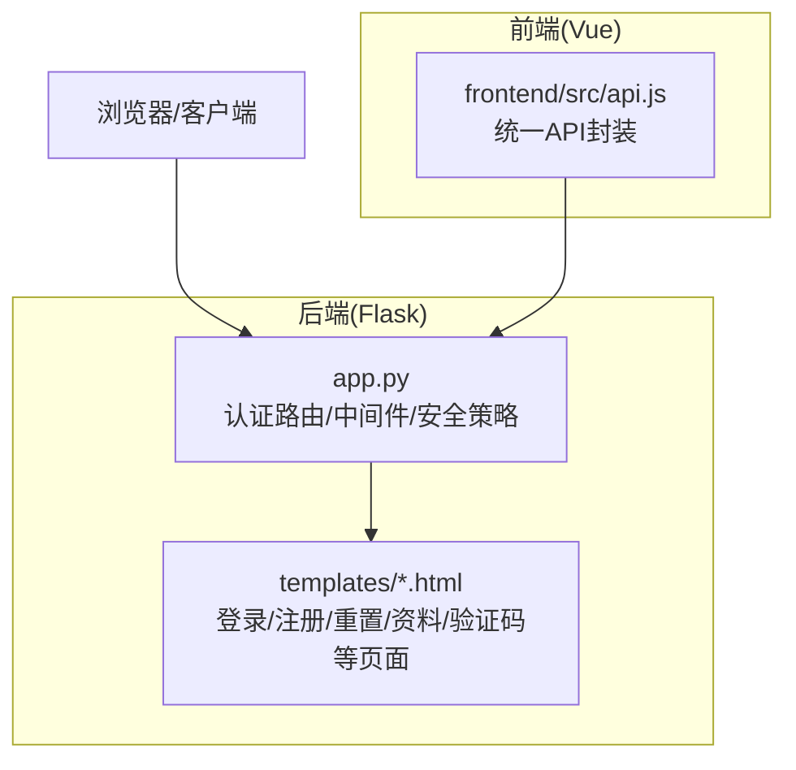
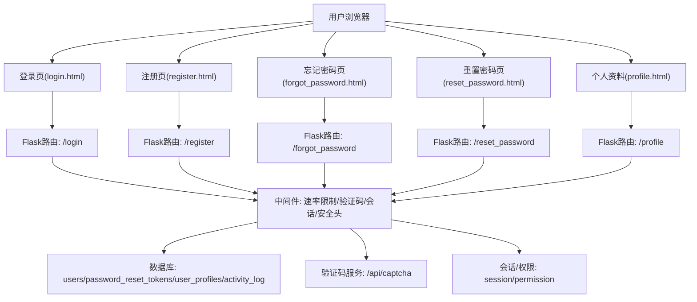
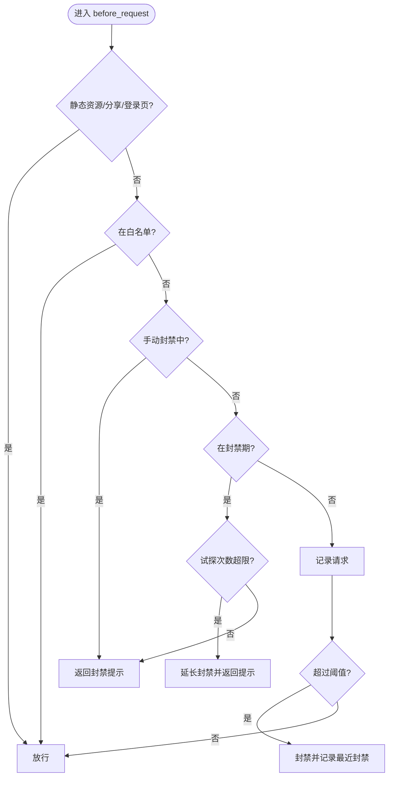
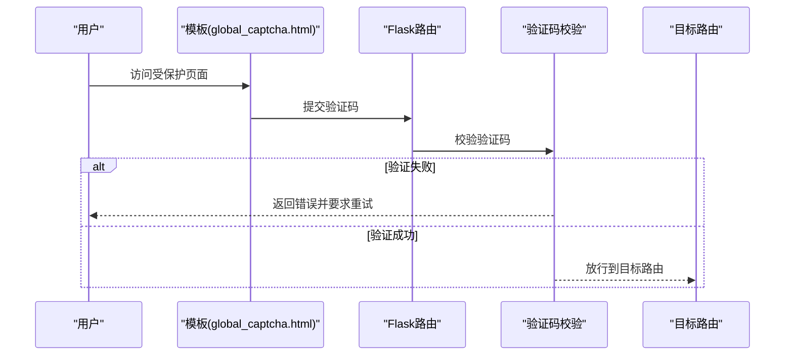
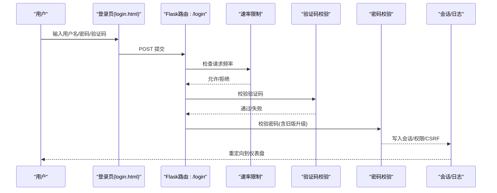
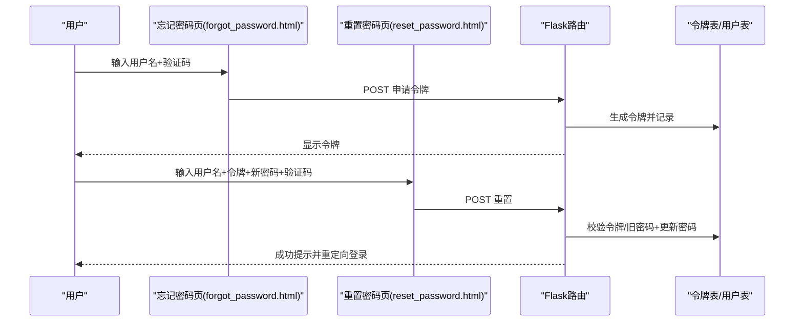
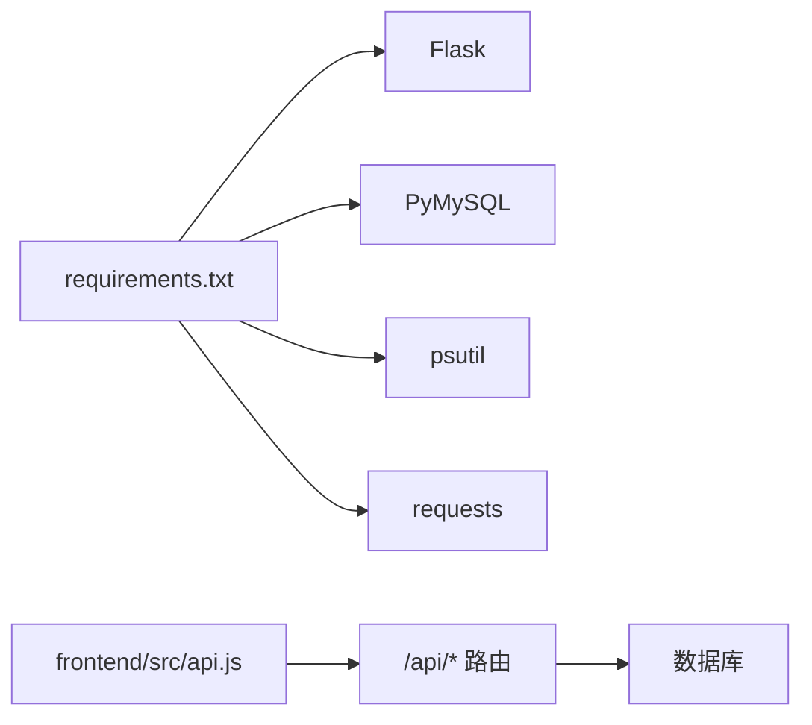

# 用户认证系统

<cite>
**本文引用的文件**
- [app.py](file://app.py)
- [login.html](file://templates/login.html)
- [register.html](file://templates/register.html)
- [forgot_password.html](file://templates/forgot_password.html)
- [reset_password.html](file://templates/reset_password.html)
- [profile.html](file://templates/profile.html)
- [global_captcha.html](file://templates/global_captcha.html)
- [logout_confirm.html](file://templates/logout_confirm.html)
- [change_password.html](file://templates/change_password.html)
- [api.js](file://frontend/src/api.js)
- [requirements.txt](file://requirements.txt)
</cite>

## 目录
1. [引言](#引言)
2. [项目结构](#项目结构)
3. [核心组件](#核心组件)
4. [架构总览](#架构总览)
5. [详细组件分析](#详细组件分析)
6. [依赖分析](#依赖分析)
7. [性能考虑](#性能考虑)
8. [故障排查指南](#故障排查指南)
9. [结论](#结论)
10. [附录](#附录)

## 引言
本文件面向“用户认证系统”的完整技术文档，覆盖用户注册、登录、密码重置与会话管理的端到端流程，详述密码哈希、会话安全、CSRF防护、全局验证码门禁与安全响应头策略。同时阐述权限体系（访客、普通用户、管理员、VIP）与访问控制设计，提供注册表单验证、登录防爆破机制、验证码系统、安全审计日志的实现要点，并给出用户资料管理、语言偏好设置与账户安全最佳实践。文档包含流程图与时序图，帮助非技术读者理解交互过程。

## 项目结构
后端采用 Python + Flask，前端为 Vue 应用，模板使用 Jinja2。认证相关的核心逻辑集中在后端应用文件中，模板位于 templates 目录，前端 API 封装位于 frontend/src。

图表来源
- [app.py:122-198](file://app.py#L122-L198)
- [api.js:1-45](file://frontend/src/api.js#L1-L45)

章节来源
- [app.py:122-198](file://app.py#L122-L198)
- [requirements.txt:1-5](file://requirements.txt#L1-L5)

## 核心组件
- 会话与安全中间件
  - 使用 Flask session 存储用户身份与权限，配置 HttpOnly、SameSite、Secure 等 Cookie 安全属性，设置会话有效期与空闲超时。
  - 全局 CSP nonce 注入，结合安全响应头策略，降低 XSS 与点击劫持风险。
- 速率限制与封禁
  - 内存级速率限制器与持久化配置，支持按 IP 与路径维度的请求节流；提供白名单、手动封禁与试探封禁延长机制。
- 验证码系统
  - 图形验证码生成与校验，支持全局验证码门禁，针对敏感操作与特定路由进行二次验证。
- 登录防爆破
  - 基于用户名的失败次数与锁定时间窗口，防止暴力破解。
- 密码重置令牌
  - 一次性、带过期时间的令牌表，配合验证码与严格校验，保障重置流程安全。
- 权限与访问控制
  - 用户权限字段与菜单注入，结合路由装饰器实现访问控制。
- 审计与活动记录
  - 关键操作写入日志与活动表，便于追踪与审计。

章节来源
- [app.py:136-142](file://app.py#L136-L142)
- [app.py:161-182](file://app.py#L161-L182)
- [app.py:644-677](file://app.py#L644-L677)
- [app.py:353-392](file://app.py#L353-L392)
- [app.py:417-428](file://app.py#L417-L428)
- [app.py:507-515](file://app.py#L507-L515)
- [app.py:1207-1322](file://app.py#L1207-L1322)
- [app.py:1711-1791](file://app.py#L1711-L1791)

## 架构总览
下图展示了认证系统的关键模块与交互关系：

图表来源
- [app.py:1029-1118](file://app.py#L1029-L1118)
- [app.py:1120-1205](file://app.py#L1120-L1205)
- [app.py:1207-1322](file://app.py#L1207-L1322)
- [app.py:1754-1791](file://app.py#L1754-L1791)
- [app.py:431-504](file://app.py#L431-L504)

## 详细组件分析

### 会话与安全中间件
- 会话安全
  - Cookie 属性：HttpOnly、SameSite=Lax、Secure（HTTPS 环境自动开启）、会话有效期 2 小时。
  - 空闲超时：IP 级空闲超时（默认 150 秒），超时后强制重新登录。
- 安全响应头
  - X-Content-Type-Options、X-Frame-Options、X-XSS-Protection、Referrer-Policy、Content-Security-Policy（nonce 注入）、HSTS（生产环境）、Permissions-Policy。
- CSP 与 nonce
  - 每请求生成随机 nonce 并注入模板，脚本/样式资源通过 nonce 白名单放行，避免 unsafe-inline。
- 全局 UA 拦截
  - 对常见安全扫描工具 User-Agent 直接返回 403。

章节来源
- [app.py:136-142](file://app.py#L136-L142)
- [app.py:567-596](file://app.py#L567-L596)
- [app.py:644-677](file://app.py#L644-L677)
- [app.py:161-182](file://app.py#L161-L182)
- [app.py:152-159](file://app.py#L152-L159)

### 速率限制与封禁
- 内存级桶算法
  - 每个 (IP, 路由) 维度维护滑动窗口计数，超过阈值即封禁。
- 持久化配置
  - 支持动态调整请求上限、窗口、封禁时长、试探阈值与延长规则。
- 白名单与手动封禁
  - 白名单 IP 跳过检查；管理员可手动封禁指定 IP。
- 试探封禁延长
  - 封禁期内持续试探将追加封禁时长。

图表来源
- [app.py:516-565](file://app.py#L516-L565)
- [app.py:363-385](file://app.py#L363-L385)
- [app.py:397-415](file://app.py#L397-L415)

章节来源
- [app.py:353-392](file://app.py#L353-L392)
- [app.py:516-565](file://app.py#L516-L565)

### 图形验证码与全局验证码门禁
- 验证码生成
  - 接口 /api/captcha 生成 4 位字符的图形验证码，存储于 session，图片禁缓存。
- 验证码校验
  - 通用校验函数对比用户输入与 session 中验证码，校验后清理。
- 全局验证码门禁
  - 已登录用户在访问非跳过列表的路由时，若未完成验证码验证，将被重定向至全局验证码页面进行二次验证。

图表来源
- [app.py:431-504](file://app.py#L431-L504)
- [app.py:417-428](file://app.py#L417-L428)
- [app.py:603-625](file://app.py#L603-L625)
- [global_captcha.html:1-23](file://templates/global_captcha.html#L1-L23)

章节来源
- [app.py:431-504](file://app.py#L431-L504)
- [app.py:417-428](file://app.py#L417-L428)
- [app.py:603-625](file://app.py#L603-L625)
- [global_captcha.html:1-23](file://templates/global_captcha.html#L1-L23)

### 登录流程
- 请求限制：每 IP 每 60 秒最多 5 次 POST。
- 参数校验：用户名与密码非空。
- 验证码校验：调用通用校验函数。
- 登录防爆破：基于用户名的失败次数与锁定时间窗口。
- 密码校验：支持哈希比对与旧版明文升级。
- 成功后：写入会话（用户名、权限、CSRF token），记录活动与审计日志。

图表来源
- [app.py:1029-1118](file://app.py#L1029-L1118)
- [login.html:1-37](file://templates/login.html#L1-L37)

章节来源
- [app.py:1029-1118](file://app.py#L1029-L1118)
- [login.html:1-37](file://templates/login.html#L1-L37)

### 注册流程
- 请求限制：每 IP 每 60 秒最多 5 次 POST。
- 参数校验：用户名、密码、确认密码非空；管理员口令可选。
- 验证码校验：调用通用校验函数。
- 密码强度：前端密码强度指示，后端可进一步校验（如长度、字符集）。
- 权限判定：管理员口令正确时授予管理员权限；否则普通用户。
- 成功后：写入会话与权限，记录活动与审计日志。

章节来源
- [app.py:1120-1205](file://app.py#L1120-L1205)
- [register.html:1-67](file://templates/register.html#L1-L67)

### 密码重置流程
- 忘记密码
  - 输入用户名与验证码，生成一次性令牌并记录日志；令牌有效期 10 分钟。
- 重置密码
  - 输入用户名、令牌、新密码与确认密码；验证码校验；新密码与旧密码不可相同；更新密码并标记令牌为已使用。
- 防滥用：每 IP 3 分钟最多 3 次申请。

图表来源
- [app.py:1207-1322](file://app.py#L1207-L1322)
- [forgot_password.html:1-37](file://templates/forgot_password.html#L1-L37)
- [reset_password.html:1-43](file://templates/reset_password.html#L1-L43)

章节来源
- [app.py:1207-1322](file://app.py#L1207-L1322)
- [forgot_password.html:1-37](file://templates/forgot_password.html#L1-L37)
- [reset_password.html:1-43](file://templates/reset_password.html#L1-L43)

### 会话管理与权限控制
- 会话字段
  - username、permission、csrf_token、lang 等。
- 权限级别
  - 访客(guest)、普通用户(user)、VIP(vip)、管理员(administrator)。
- 访问控制
  - 通过上下文处理器注入菜单项与权限相关的模板变量；敏感路由依赖会话存在性与权限判断。
- 仪表盘与资料
  - 仪表盘聚合排行榜与待处理请求；个人资料支持昵称、生日、电话、邮箱、简介等字段的增改。

章节来源
- [app.py:1711-1791](file://app.py#L1711-L1791)
- [profile.html:1-44](file://templates/profile.html#L1-L44)

### 登录防爆破机制
- 结构
  - 基于用户名的失败计数与锁定截止时间；连续失败达到阈值后锁定一段时间。
- 降级处理
  - 若发现旧版明文密码匹配，自动升级为哈希并继续登录流程。
- 日志
  - 失败尝试、锁定与升级均写入审计日志。

章节来源
- [app.py:1048-1118](file://app.py#L1048-L1118)

### CSRF 防护
- 生成与注入
  - 每次请求生成随机 CSRF token 并注入到会话与模板上下文。
- 表单使用
  - 登录、注册、忘记密码、重置密码、个人资料、验证码等页面均包含隐藏 CSRF token 字段。
- 作用范围
  - 保护敏感 POST 请求免受跨站伪造。

章节来源
- [app.py:1711-1791](file://app.py#L1711-L1791)
- [login.html:1-37](file://templates/login.html#L1-L37)
- [register.html:1-67](file://templates/register.html#L1-L67)
- [forgot_password.html:1-37](file://templates/forgot_password.html#L1-L37)
- [reset_password.html:1-43](file://templates/reset_password.html#L1-L43)
- [profile.html:1-44](file://templates/profile.html#L1-L44)
- [global_captcha.html:1-23](file://templates/global_captcha.html#L1-L23)
- [logout_confirm.html:1-18](file://templates/logout_confirm.html#L1-L18)
- [change_password.html:1-67](file://templates/change_password.html#L1-L67)

### 安全响应头与 CSP
- 响应头
  - X-Content-Type-Options、X-Frame-Options、X-XSS-Protection、Referrer-Policy、Content-Security-Policy（nonce）、HSTS（生产环境）、Permissions-Policy。
- 模板注入
  - 每请求生成 nonce 并注入模板上下文，CSP 规则允许使用该 nonce 的脚本/样式。
- 敏感页面
  - 禁用缓存，避免浏览器缓存敏感内容。

章节来源
- [app.py:644-677](file://app.py#L644-L677)
- [app.py:178-182](file://app.py#L178-L182)

### 语言偏好与国际化
- 语言检测
  - 每请求根据 Accept-Language 与会话设置语言；已登录用户语言偏好持久化到数据库。
- API 切换
  - 提供切换语言的 API，返回新语言并设置 Cookie。
- 模板注入
  - 上下文处理器注入翻译函数与支持语言列表。

章节来源
- [app.py:168-176](file://app.py#L168-L176)
- [app.py:217-232](file://app.py#L217-L232)
- [app.py:178-197](file://app.py#L178-L197)

### 用户资料管理与账户安全
- 资料字段
  - 昵称、生日、电话、邮箱、个人简介；支持新增与更新。
- 账户安全
  - 修改密码页面支持管理员模式批量修改；普通用户需提供旧密码；验证码二次校验；新旧密码不可相同。
- 退出登录
  - 提供确认页，防止误操作；清理会话并提示。

章节来源
- [app.py:1754-1791](file://app.py#L1754-L1791)
- [change_password.html:1-67](file://templates/change_password.html#L1-L67)
- [logout_confirm.html:1-18](file://templates/logout_confirm.html#L1-L18)

## 依赖分析
- 后端依赖
  - Flask、PyMySQL、psutil、requests。
- 前端依赖
  - Vue 3、样式与 API 封装。
- 数据库
  - 用户表、密码重置令牌表、用户资料表、活动日志表、管理员申请表等。

图表来源
- [requirements.txt:1-5](file://requirements.txt#L1-L5)
- [api.js:1-45](file://frontend/src/api.js#L1-L45)

章节来源
- [requirements.txt:1-5](file://requirements.txt#L1-L5)
- [api.js:1-45](file://frontend/src/api.js#L1-L45)

## 性能考虑
- 会话空闲超时：减少长时间占用的会话资源。
- 速率限制：通过滑动窗口与封禁策略抑制恶意请求与资源消耗。
- 验证码生成：轻量图像生成，禁用缓存，避免重复计算。
- CSP 与安全头：减少浏览器解析负担，提升安全性。
- 建议
  - 将速率限制与封禁状态持久化到 Redis 或数据库，实现多实例共享。
  - 对热点路由引入本地缓存与 CDN，降低数据库压力。
  - 将验证码图片缓存到对象存储，缩短生成耗时。

## 故障排查指南
- 登录失败过多
  - 检查是否触发登录防爆破；查看审计日志中的失败记录与锁定时间。
- 请求频繁被拒
  - 检查 IP 是否被封禁；核对速率配置文件；确认是否命中白名单。
- 验证码无法显示/验证失败
  - 检查 /api/captcha 接口是否正常；确认 session 中验证码是否过期；核对验证码输入大小写。
- 会话异常/频繁掉线
  - 检查会话空闲超时配置；确认浏览器 Cookie 设置；核对 SameSite/Secure 配置。
- 安全头导致资源加载失败
  - 检查 CSP nonce 注入是否生效；确认第三方资源域名是否在 CSP 白名单中。

章节来源
- [app.py:516-565](file://app.py#L516-L565)
- [app.py:1048-1118](file://app.py#L1048-L1118)
- [app.py:644-677](file://app.py#L644-L677)

## 结论
本认证系统通过会话安全、速率限制、验证码门禁、CSRF 防护与安全响应头构建了多层防护；结合权限模型与活动审计，实现了从注册、登录、密码重置到资料管理的完整闭环。建议在生产环境中引入分布式缓存与更强的令牌存储方案，并持续监控与优化安全策略与性能表现。

## 附录
- 界面与交互示例
  - 登录页：输入用户名、密码与验证码，提交后进行速率限制与验证码校验，成功后写入会话并跳转仪表盘。
  - 注册页：输入用户名、密码、确认密码与验证码，管理员口令可选，成功后写入会话。
  - 忘记密码页：输入用户名与验证码，系统生成一次性令牌并提示复制。
  - 重置密码页：输入用户名、令牌、新密码与验证码，校验通过后更新密码并跳转登录。
  - 个人资料页：支持昵称、生日、电话、邮箱、简介的增改。
  - 全局验证码页：已登录用户访问受保护路由时触发二次验证码验证。
  - 退出登录页：确认退出，清理会话并返回登录页。
  - 修改密码页：管理员可批量修改任意用户密码，普通用户需提供旧密码与验证码。

章节来源
- [login.html:1-37](file://templates/login.html#L1-L37)
- [register.html:1-67](file://templates/register.html#L1-L67)
- [forgot_password.html:1-37](file://templates/forgot_password.html#L1-L37)
- [reset_password.html:1-43](file://templates/reset_password.html#L1-L43)
- [profile.html:1-44](file://templates/profile.html#L1-L44)
- [global_captcha.html:1-23](file://templates/global_captcha.html#L1-L23)
- [logout_confirm.html:1-18](file://templates/logout_confirm.html#L1-L18)
- [change_password.html:1-67](file://templates/change_password.html#L1-L67)