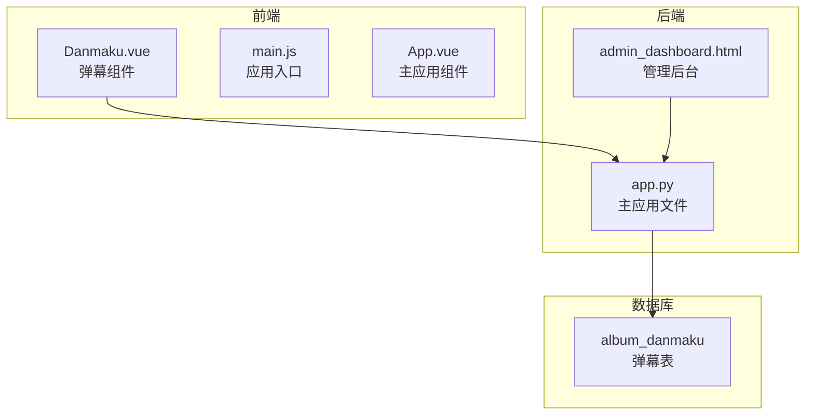
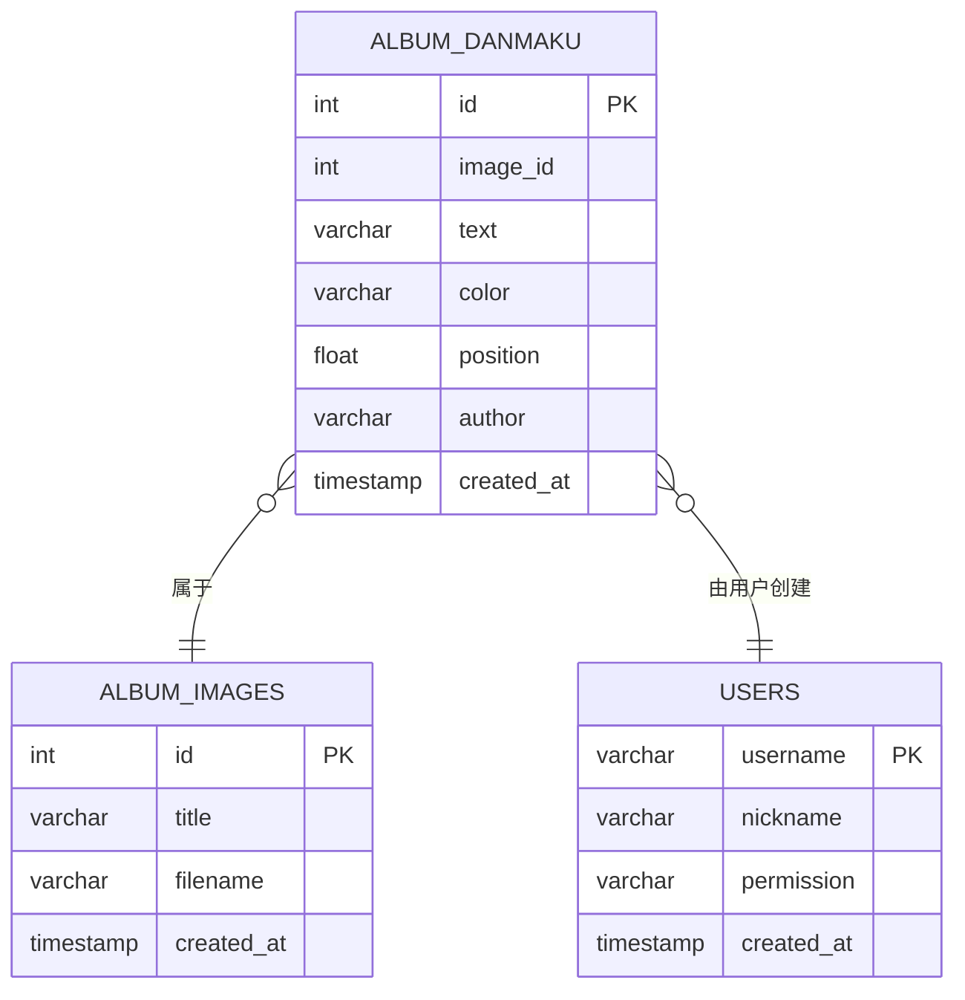
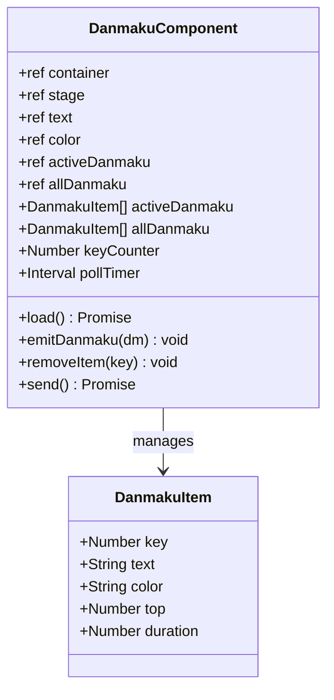
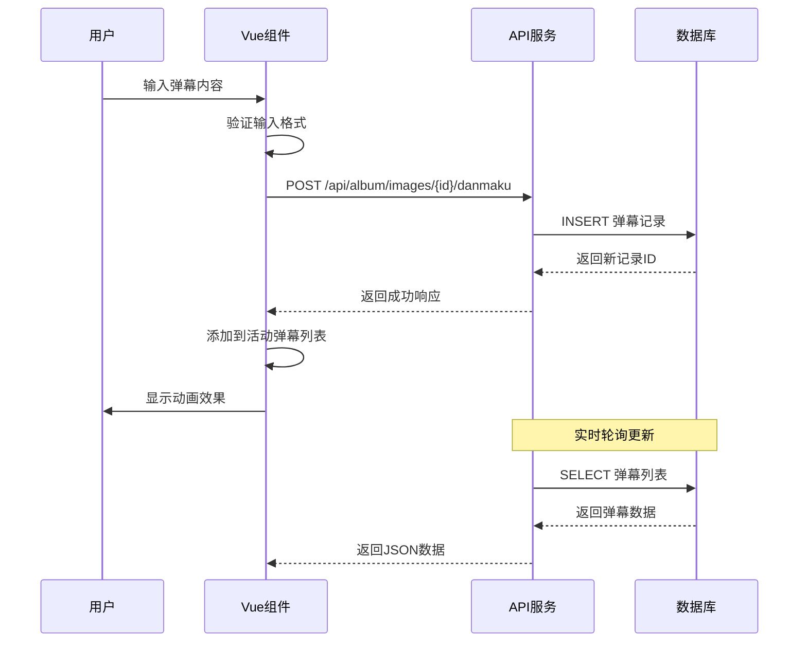
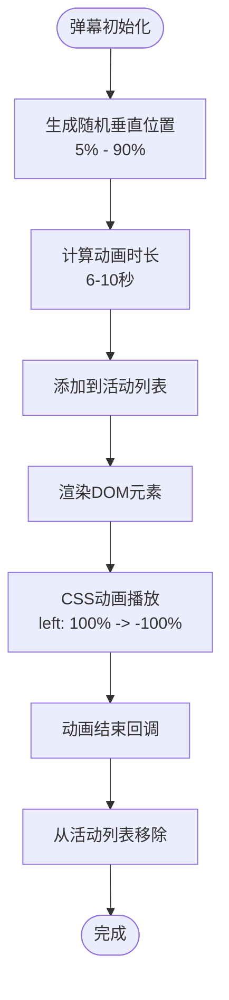
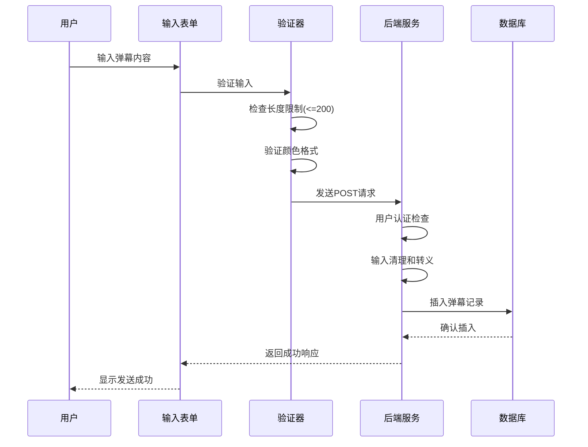
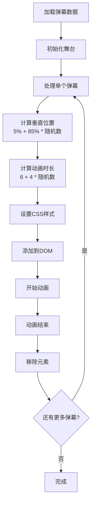
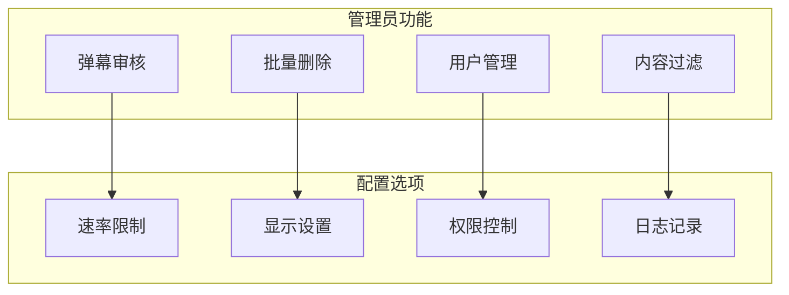
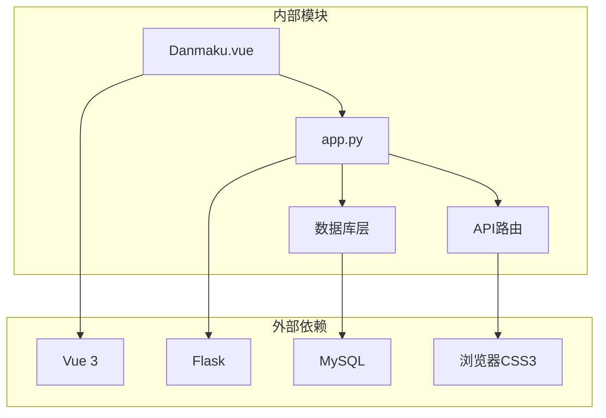

# 弹幕功能实现

<cite>
**本文档引用的文件**
- [Danmaku.vue](file://frontend/src/components/Danmaku.vue)
- [app.py](file://app.py)
- [admin_dashboard.html](file://templates/admin_dashboard.html)
- [main.js](file://frontend/src/main.js)
- [App.vue](file://frontend/src/App.vue)
</cite>

## 目录
1. [简介](#简介)
2. [项目结构](#项目结构)
3. [核心组件](#核心组件)
4. [架构概览](#架构概览)
5. [详细组件分析](#详细组件分析)
6. [依赖关系分析](#依赖关系分析)
7. [性能考虑](#性能考虑)
8. [故障排除指南](#故障排除指南)
9. [结论](#结论)

## 简介

弹幕功能是本项目中的一个重要特性，允许用户在图片上发送实时评论。该功能包含完整的前后端实现，包括数据库设计、渲染引擎、发送机制、显示算法以及管理功能。

## 项目结构

弹幕功能主要分布在以下文件中：

**图表来源**
- [Danmaku.vue:1-89](file://frontend/src/components/Danmaku.vue#L1-L89)
- [app.py:782-792](file://app.py#L782-L792)
- [admin_dashboard.html:1-200](file://templates/admin_dashboard.html#L1-L200)

**章节来源**
- [Danmaku.vue:1-89](file://frontend/src/components/Danmaku.vue#L1-L89)
- [app.py:782-792](file://app.py#L782-L792)
- [admin_dashboard.html:1-200](file://templates/admin_dashboard.html#L1-L200)

## 核心组件

### 数据库设计

弹幕功能的核心数据库表设计如下：

**图表来源**
- [app.py:782-792](file://app.py#L782-L792)

数据库表包含以下关键字段：
- `id`: 主键标识符
- `image_id`: 关联的图片ID
- `text`: 弹幕文本内容（最大200字符）
- `color`: 颜色配置（默认白色）
- `position`: 位置坐标（百分比，默认50）
- `author`: 发送者用户名
- `created_at`: 时间戳

**章节来源**
- [app.py:782-792](file://app.py#L782-L792)

### 前端组件架构

弹幕组件采用Vue 3 Composition API实现：

**图表来源**
- [Danmaku.vue:18-74](file://frontend/src/components/Danmaku.vue#L18-L74)

**章节来源**
- [Danmaku.vue:1-89](file://frontend/src/components/Danmaku.vue#L1-L89)

## 架构概览

弹幕功能的整体架构采用前后端分离设计：

**图表来源**
- [Danmaku.vue:50-59](file://frontend/src/components/Danmaku.vue#L50-L59)
- [app.py:3519-3541](file://app.py#L3519-L3541)

## 详细组件分析

### 弹幕渲染引擎

弹幕渲染引擎基于CSS动画实现：

**图表来源**
- [Danmaku.vue:36-49](file://frontend/src/components/Danmaku.vue#L36-L49)

渲染特性包括：
- **Canvas替代方案**: 使用CSS Transform而非Canvas，减少内存占用
- **硬件加速**: 利用GPU加速CSS动画
- **性能优化**: 通过CSS动画实现流畅的滚动效果

**章节来源**
- [Danmaku.vue:36-49](file://frontend/src/components/Danmaku.vue#L36-L49)
- [Danmaku.vue:84-87](file://frontend/src/components/Danmaku.vue#L84-L87)

### 弹幕发送机制

发送机制包含完整的验证和处理流程：

**图表来源**
- [Danmaku.vue:50-59](file://frontend/src/components/Danmaku.vue#L50-L59)
- [app.py:3519-3541](file://app.py#L3519-L3541)

发送机制特性：
- **实时提交**: 使用fetch API进行异步提交
- **频率限制**: 基于全局速率限制系统
- **内容审核**: 自动HTML/JS标签清理
- **用户认证**: 必须登录用户才能发送

**章节来源**
- [Danmaku.vue:50-59](file://frontend/src/components/Danmaku.vue#L50-L59)
- [app.py:3519-3541](file://app.py#L3519-L3541)

### 弹幕显示算法

显示算法实现智能的滚动和碰撞避免：

**图表来源**
- [Danmaku.vue:28-49](file://frontend/src/components/Danmaku.vue#L28-L49)

显示算法特点：
- **随机分布**: 垂直位置在5%-90%范围内随机分布
- **均匀速度**: 动画时长在6-10秒范围内随机，保证视觉均匀性
- **边界检测**: 自动检测舞台边界并清理超出范围的元素
- **内存管理**: 自动清理已完成动画的DOM元素

**章节来源**
- [Danmaku.vue:36-49](file://frontend/src/components/Danmaku.vue#L36-L49)

### 弹幕样式定制

样式系统提供灵活的自定义选项：

| 属性 | 默认值 | 说明 |
|------|--------|------|
| 颜色 | #fff | 支持任意CSS颜色值 |
| 字体大小 | 18px | 响应式设计适配 |
| 字体粗细 | 700 | 粗体显示增强可读性 |
| 文本阴影 | 1px 1px 2px rgba(0,0,0,.8) | 提升对比度 |
| 动画速度 | 6-10秒 | 可调节的滚动速度 |

**章节来源**
- [Danmaku.vue:82-87](file://frontend/src/components/Danmaku.vue#L82-L87)

### 管理功能

管理后台提供完整的弹幕管理能力：

**图表来源**
- [admin_dashboard.html:197-234](file://templates/admin_dashboard.html#L197-L234)

管理功能特性：
- **实时监控**: 实时显示弹幕发送情况
- **批量操作**: 支持批量删除功能
- **权限控制**: 基于角色的访问控制
- **日志审计**: 完整的操作日志记录

**章节来源**
- [admin_dashboard.html:197-234](file://templates/admin_dashboard.html#L197-L234)

## 依赖关系分析

弹幕功能的依赖关系如下：

**图表来源**
- [Danmaku.vue:1-16](file://frontend/src/components/Danmaku.vue#L1-L16)
- [app.py:1-25](file://app.py#L1-L25)

**章节来源**
- [Danmaku.vue:1-16](file://frontend/src/components/Danmaku.vue#L1-L16)
- [app.py:1-25](file://app.py#L1-L25)

## 性能考虑

### 前端性能优化

1. **虚拟DOM优化**: 使用Vue的响应式系统避免不必要的重渲染
2. **内存管理**: 自动清理已完成动画的DOM元素
3. **CSS硬件加速**: 利用transform属性启用GPU加速
4. **批量更新**: 合并多个弹幕的DOM更新操作

### 后端性能优化

1. **数据库索引**: 为`image_id`和`created_at`建立索引
2. **查询优化**: 使用LIMIT限制返回的弹幕数量
3. **连接池**: 复用数据库连接减少开销
4. **缓存策略**: 实现合理的数据缓存机制

## 故障排除指南

### 常见问题及解决方案

| 问题类型 | 症状 | 解决方案 |
|----------|------|----------|
| 弹幕无法发送 | 401未授权错误 | 检查用户登录状态 |
| 弹幕显示异常 | 位置错乱或重叠 | 检查CSS样式和动画冲突 |
| 性能问题 | 页面卡顿 | 减少同时显示的弹幕数量 |
| 数据库错误 | 500服务器错误 | 检查数据库连接和权限 |

### 调试建议

1. **前端调试**: 使用浏览器开发者工具检查网络请求和DOM结构
2. **后端调试**: 查看服务器日志和数据库查询结果
3. **性能分析**: 使用性能面板监控动画帧率
4. **内存监控**: 检查DOM元素数量和内存使用情况

**章节来源**
- [app.py:3519-3541](file://app.py#L3519-L3541)
- [Danmaku.vue:50-59](file://frontend/src/components/Danmaku.vue#L50-L59)

## 结论

弹幕功能实现了完整的实时评论系统，具有以下优势：

1. **技术实现**: 采用现代Web技术栈，前后端分离架构清晰
2. **用户体验**: 流畅的动画效果和直观的交互设计
3. **性能表现**: 优化的渲染引擎和内存管理机制
4. **安全性**: 完善的输入验证和权限控制系统
5. **可扩展性**: 模块化的架构便于功能扩展和维护

该实现为类似的应用场景提供了良好的参考模板，展示了如何在保证性能的前提下实现复杂的实时交互功能。