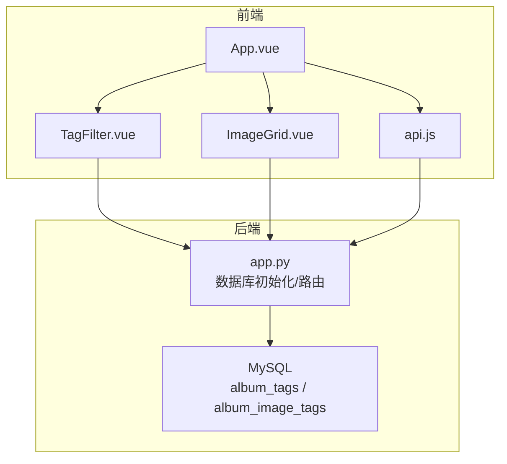
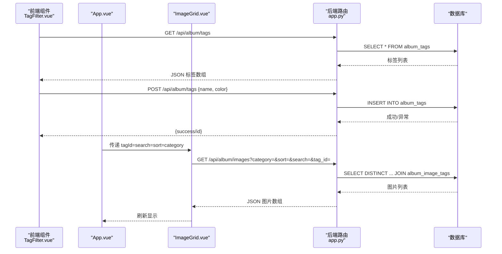
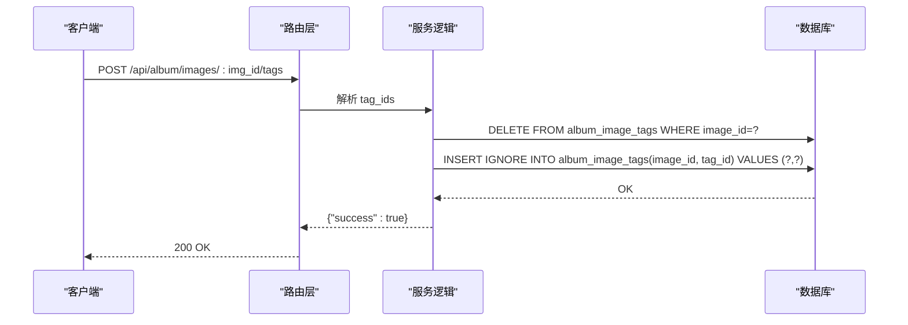
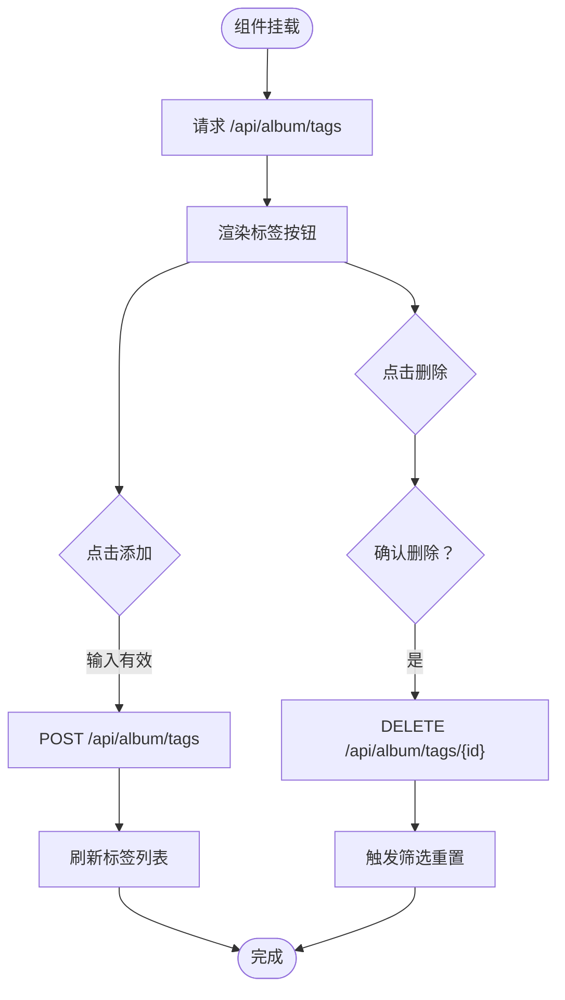
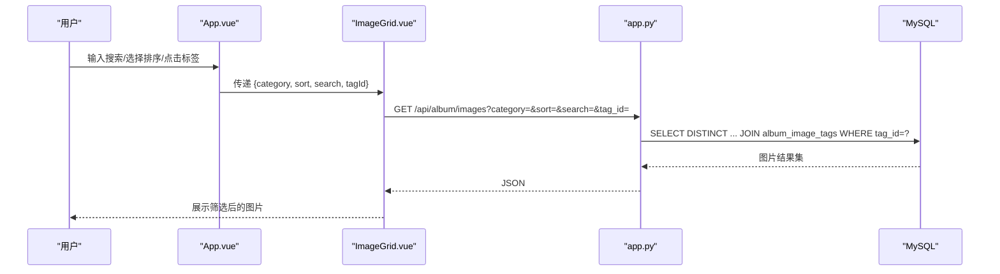
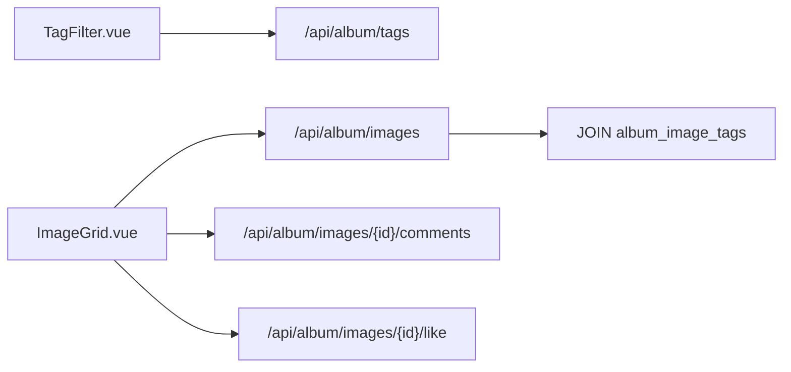

# 标签管理系统

<cite>
**本文档引用的文件**
- [app.py](file://app.py)
- [TagFilter.vue](file://frontend/src/components/TagFilter.vue)
- [ImageGrid.vue](file://frontend/src/components/ImageGrid.vue)
- [App.vue](file://frontend/src/App.vue)
- [api.js](file://frontend/src/api.js)
- [album_vue3.html](file://templates/album_vue3.html)
</cite>

## 目录
1. [简介](#简介)
2. [项目结构](#项目结构)
3. [核心组件](#核心组件)
4. [架构总览](#架构总览)
5. [详细组件分析](#详细组件分析)
6. [依赖分析](#依赖分析)
7. [性能考虑](#性能考虑)
8. [故障排查指南](#故障排查指南)
9. [结论](#结论)
10. [附录](#附录)

## 简介
本文件面向“标签管理系统”的综合技术文档，围绕以下目标展开：
- 标签表结构设计：字段、颜色配置与唯一性约束
- 标签与照片的多对多关联：album_image_tags 表设计与查询优化
- 前端标签过滤组件：标签选择、搜索与动态更新机制
- 标签颜色系统、标签云展示与热门标签统计
- 标签创建、编辑、删除与批量操作流程
- 标签搜索算法、自动补全与标签推荐系统实现思路

## 项目结构
标签管理功能横跨后端 Flask 应用与前端 Vue 组件，核心位置如下：
- 后端数据库初始化与标签相关 API：app.py 中的数据库建表与 /api/album/tags、/api/album/images/*/tags 等路由
- 前端标签过滤组件：frontend/src/components/TagFilter.vue
- 前端相册主界面与图片网格：frontend/src/App.vue、frontend/src/components/ImageGrid.vue
- 前端 API 封装：frontend/src/api.js
- 模板页面：templates/album_vue3.html



**图表来源**
- [app.py:753-792](file://app.py#L753-L792)
- [TagFilter.vue:1-51](file://frontend/src/components/TagFilter.vue#L1-L51)
- [ImageGrid.vue:1-129](file://frontend/src/components/ImageGrid.vue#L1-L129)
- [App.vue:1-99](file://frontend/src/App.vue#L1-L99)
- [api.js:1-45](file://frontend/src/api.js#L1-L45)

**章节来源**
- [app.py:753-792](file://app.py#L753-L792)
- [TagFilter.vue:1-51](file://frontend/src/components/TagFilter.vue#L1-L51)
- [ImageGrid.vue:1-129](file://frontend/src/components/ImageGrid.vue#L1-L129)
- [App.vue:1-99](file://frontend/src/App.vue#L1-L99)
- [api.js:1-45](file://frontend/src/api.js#L1-L45)

## 核心组件
- 标签表（album_tags）
  - 字段：id（自增主键）、name（非空且唯一）、color（颜色值，默认值）
  - 唯一性：name 字段具有唯一约束，防止重复标签名
- 关联表（album_image_tags）
  - 字段：image_id、tag_id（联合主键），形成多对多关系
  - 查询：通过 JOIN 实现按标签筛选照片列表
- 前端标签过滤组件（TagFilter.vue）
  - 功能：加载标签、添加新标签、删除标签、触发筛选
  - 交互：点击标签高亮、删除按钮、新增输入框
- 前端图片网格（ImageGrid.vue）
  - 功能：根据 category、sort、search、tag_id 参数加载图片
  - 与后端路由参数映射一致，支持标签筛选联动
- 前端应用入口（App.vue）
  - 功能：集成标签过滤条、搜索框、排序控件，驱动 ImageGrid 刷新

**章节来源**
- [app.py:753-792](file://app.py#L753-L792)
- [TagFilter.vue:1-51](file://frontend/src/components/TagFilter.vue#L1-L51)
- [ImageGrid.vue:47-77](file://frontend/src/components/ImageGrid.vue#L47-L77)
- [App.vue:17-34](file://frontend/src/App.vue#L17-L34)

## 架构总览
后端通过数据库初始化确保标签表与关联表存在，提供标签 CRUD 与图片-标签关联设置接口；前端通过组件化方式实现标签筛选与图片列表刷新。



**图表来源**
- [TagFilter.vue:30-37](file://frontend/src/components/TagFilter.vue#L30-L37)
- [ImageGrid.vue:55-77](file://frontend/src/components/ImageGrid.vue#L55-L77)
- [app.py:3348-3434](file://app.py#L3348-L3434)
- [app.py:2537-2567](file://app.py#L2537-L2567)

**章节来源**
- [TagFilter.vue:30-37](file://frontend/src/components/TagFilter.vue#L30-L37)
- [ImageGrid.vue:55-77](file://frontend/src/components/ImageGrid.vue#L55-L77)
- [app.py:3348-3434](file://app.py#L3348-L3434)
- [app.py:2537-2567](file://app.py#L2537-L2567)

## 详细组件分析

### 数据模型与表结构
- album_tags
  - 唯一约束：name 唯一，避免重复标签名
  - 默认颜色：color 默认值便于快速创建标签
- album_image_tags
  - 联合主键：(image_id, tag_id)，保证同一图片-标签组合唯一
  - 多对多：一张图片可有多个标签，一个标签可应用于多张图片

```mermaid
erDiagram
ALBUM_TAGS {
int id PK
varchar name UK
varchar color
}
ALBUM_IMAGE_TAGS {
int image_id
int tag_id
PK image_id, tag_id
}
ALBUM_IMAGES ||--o{ ALBUM_IMAGE_TAGS : "包含"
ALBUM_TAGS ||--o{ ALBUM_IMAGE_TAGS : "标记"
```

**图表来源**
- [app.py:753-792](file://app.py#L753-L792)

**章节来源**
- [app.py:753-792](file://app.py#L753-L792)

### 后端 API 设计
- 获取标签列表：GET /api/album/tags
- 添加标签：POST /api/album/tags（含 name、color）
- 删除标签：DELETE /api/album/tags/{id}
- 获取图片标签：GET /api/album/images/{img_id}/tags
- 设置图片标签：POST /api/album/images/{img_id}/tags（传入 tag_ids）



**图表来源**
- [app.py:3418-3434](file://app.py#L3418-L3434)

**章节来源**
- [app.py:3348-3434](file://app.py#L3348-L3434)

### 前端标签过滤组件（TagFilter.vue）
- 加载标签：首次挂载时调用 /api/album/tags
- 添加标签：输入 name 与 color，提交后刷新列表并清空输入
- 删除标签：确认后调用 /api/album/tags/{id}，删除成功后触发父组件筛选重置
- 样式：根据标签颜色设置边框与选中态背景色，hover 显示删除按钮



**图表来源**
- [TagFilter.vue:30-37](file://frontend/src/components/TagFilter.vue#L30-L37)

**章节来源**
- [TagFilter.vue:1-51](file://frontend/src/components/TagFilter.vue#L1-L51)

### 前端图片网格与筛选联动（ImageGrid.vue + App.vue）
- App.vue 提供搜索框与排序控件，同时维护 activeTag 状态
- 当 activeTag 或搜索条件变化时，通过 key 强制刷新 ImageGrid
- ImageGrid 根据 category、sort、search、tagId 拼接查询参数，请求 /api/album/images
- 后端路由解析 tag_id 并通过 JOIN album_image_tags 实现按标签筛选



**图表来源**
- [App.vue:69-76](file://frontend/src/App.vue#L69-L76)
- [ImageGrid.vue:55-77](file://frontend/src/components/ImageGrid.vue#L55-L77)
- [app.py:2537-2567](file://app.py#L2537-L2567)

**章节来源**
- [App.vue:17-34](file://frontend/src/App.vue#L17-L34)
- [ImageGrid.vue:47-77](file://frontend/src/components/ImageGrid.vue#L47-L77)
- [app.py:2537-2567](file://app.py#L2537-L2567)

### 标签颜色系统与标签云
- 颜色存储：标签表 color 字段存储颜色值，用于前端按钮样式
- 标签云：前端渲染时直接读取标签列表，按颜色与名称展示
- 标签云统计：当前仓库未提供专门的“热门标签统计”接口，但可通过聚合查询实现（见“性能考虑”建议）

**章节来源**
- [app.py:753-792](file://app.py#L753-L792)
- [TagFilter.vue:43-46](file://frontend/src/components/TagFilter.vue#L43-L46)

### 标签搜索算法与自动补全
- 当前实现：前端 TagFilter.vue 仅加载与展示标签列表，未提供搜索与自动补全
- 建议实现：
  - 后端提供 /api/album/tags/search?q=...，按 name 前缀匹配返回候选
  - 前端在输入框输入时发起防抖请求，展示候选列表
  - 与现有标签过滤联动，支持多选与快捷添加

[本节为概念性建议，不直接分析具体文件，故不附“章节来源”]

### 标签推荐系统
- 基于使用频率的推荐：统计各标签被使用的次数，返回高频标签作为推荐
- 基于相似图片的推荐：根据当前图片的标签，查找与之共同出现的其他标签，进行协同推荐
- 建议接口：/api/album/tags/recommend?img_id=...

[本节为概念性建议，不直接分析具体文件，故不附“章节来源”]

## 依赖分析
- 前端组件间依赖
  - App.vue 依赖 TagFilter.vue 与 ImageGrid.vue
  - ImageGrid.vue 依赖后端 /api/album/images 与 /api/album/images/{id}/comments、/api/album/images/{id}/like
- 后端路由依赖
  - /api/album/images 支持 tag_id 参数，内部通过 JOIN album_image_tags 实现筛选
  - /api/album/images/{img_id}/tags 与 /api/album/images/{img_id}/tags 支持标签设置



**图表来源**
- [TagFilter.vue:30-37](file://frontend/src/components/TagFilter.vue#L30-L37)
- [ImageGrid.vue:55-77](file://frontend/src/components/ImageGrid.vue#L55-L77)
- [app.py:2537-2567](file://app.py#L2537-L2567)

**章节来源**
- [TagFilter.vue:30-37](file://frontend/src/components/TagFilter.vue#L30-L37)
- [ImageGrid.vue:55-77](file://frontend/src/components/ImageGrid.vue#L55-L77)
- [app.py:2537-2567](file://app.py#L2537-L2567)

## 性能考虑
- 查询优化
  - 现有按标签筛选已通过 JOIN album_image_tags 实现，建议在 image_id、tag_id 上建立索引以提升连接效率
  - 对 album_tags.name 建立唯一索引（已具备唯一约束）
- 前端优化
  - TagFilter.vue 的标签加载建议增加本地缓存，减少重复请求
  - 搜索防抖：输入搜索时使用防抖（如 300ms）降低请求频率
- 统计与推荐
  - 热门标签统计：可基于 album_image_tags 聚合统计各标签使用次数
  - 推荐：基于 co-occurrence（共现）矩阵计算标签间的相似度

[本节提供通用优化建议，不直接分析具体文件，故不附“章节来源”]

## 故障排查指南
- 标签重复创建失败
  - 现象：POST /api/album/tags 返回“标签已存在”
  - 原因：name 唯一约束冲突
  - 处理：修改标签名或删除重复标签
- 删除标签后图片仍显示该标签
  - 现象：删除 album_tags 后，album_image_tags 中残留关联
  - 原因：删除顺序不当或未清理关联
  - 处理：后端已先清理 album_image_tags 再删除 album_tags，确认删除流程执行
- 按标签筛选无结果
  - 现象：传入 tag_id 后图片为空
  - 原因：album_image_tags 中无对应记录
  - 处理：确认图片是否已绑定该标签；检查前端传参 tagId 是否正确

**章节来源**
- [app.py:3386-3399](file://app.py#L3386-L3399)
- [app.py:3418-3434](file://app.py#L3418-L3434)
- [app.py:2556-2559](file://app.py#L2556-L2559)

## 结论
标签管理系统通过清晰的数据模型与前后端协作，实现了标签的创建、删除与按标签筛选图片的核心能力。当前前端未内置标签搜索与自动补全，建议在现有基础上扩展搜索接口与推荐机制，进一步提升用户体验。后端已具备按标签筛选的基础能力，后续可在索引与统计方面做进一步优化。

## 附录
- 前端 API 封装示例（api.js）
  - 提供统一的 /api/album 前缀封装，便于复用
  - 可在此基础上扩展标签相关 API（如搜索、推荐）

**章节来源**
- [api.js:1-45](file://frontend/src/api.js#L1-L45)