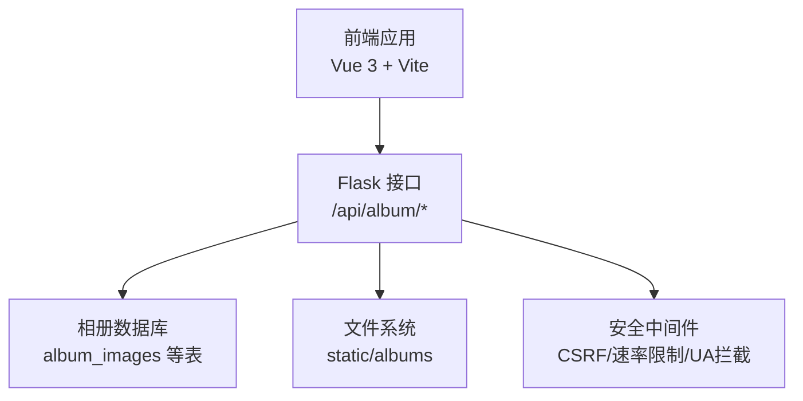
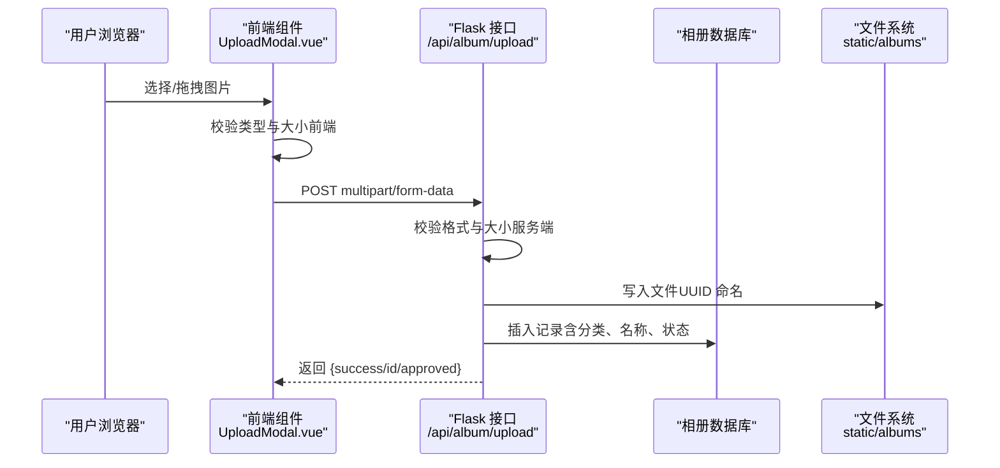
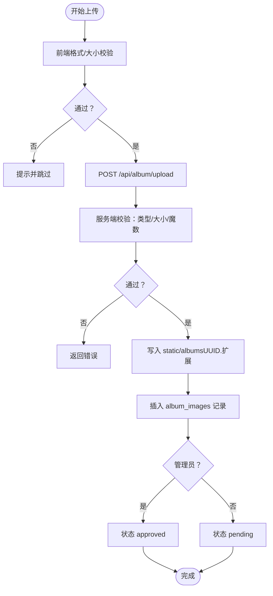
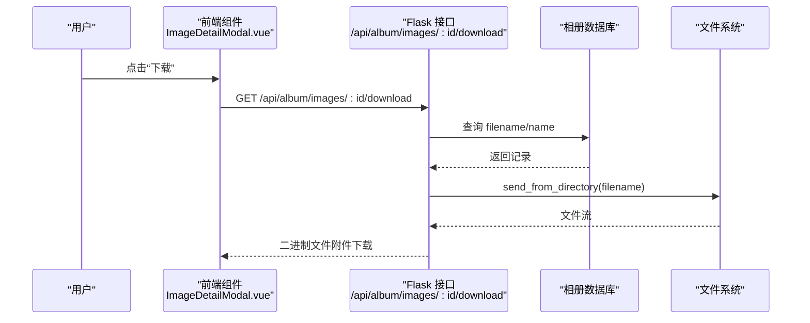
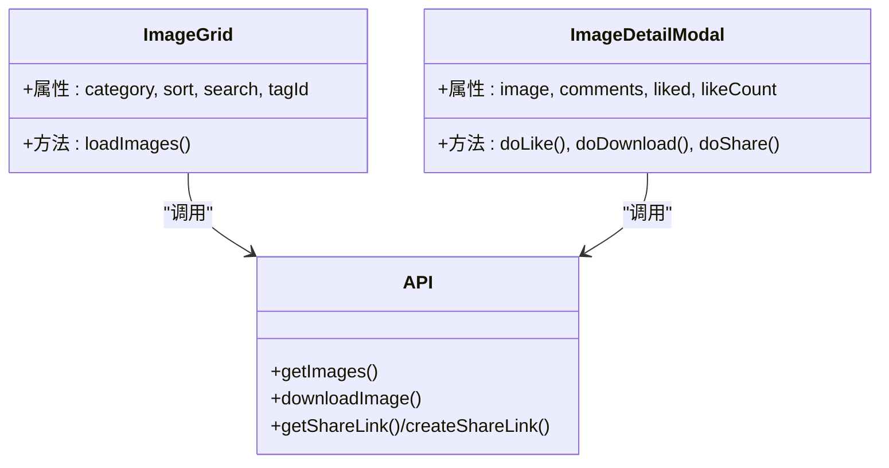
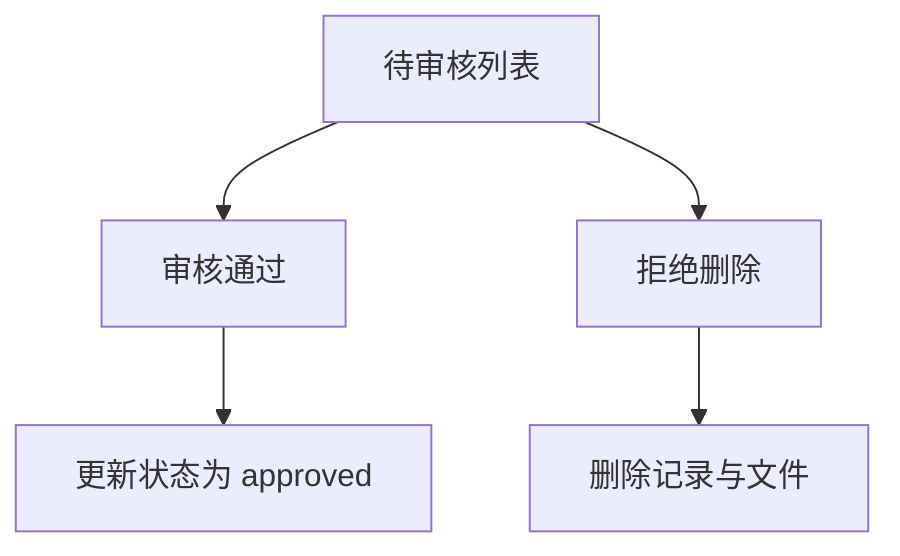
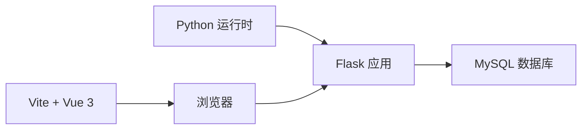

# 照片上传与下载

<cite>
**本文引用的文件**
- [app.py](file://app.py)
- [frontend/src/api.js](file://frontend/src/api.js)
- [frontend/src/components/UploadModal.vue](file://frontend/src/components/UploadModal.vue)
- [frontend/src/components/ImageGrid.vue](file://frontend/src/components/ImageGrid.vue)
- [frontend/src/components/ImageDetailModal.vue](file://frontend/src/components/ImageDetailModal.vue)
- [templates/dashboard.html](file://templates/dashboard.html)
- [requirements.txt](file://requirements.txt)
</cite>

## 目录
1. [简介](#简介)
2. [项目结构](#项目结构)
3. [核心组件](#核心组件)
4. [架构总览](#架构总览)
5. [详细组件分析](#详细组件分析)
6. [依赖分析](#依赖分析)
7. [性能考虑](#性能考虑)
8. [故障排查指南](#故障排查指南)
9. [结论](#结论)
10. [附录](#附录)

## 简介
本文件围绕“照片上传与下载”功能进行系统化技术文档说明，涵盖以下方面：
- 上传流程：文件格式验证、大小限制、安全检查、存储策略与数据库记录
- 下载机制：登录态要求、直接下载、分享链接下载
- 前端交互：多文件选择、拖拽上传、进度反馈、错误提示
- 安全与合规：CSRF保护、速率限制、白名单封禁、UA拦截、CSP、会话空闲控制
- 扩展能力：审核流程、标签、弹幕、评论、统计等

## 项目结构
后端基于 Flask，前端采用 Vue 3 单页应用，静态资源位于 static/albums。相册相关接口集中在 /api/album 路由下，图片文件落盘于服务器本地目录。

图表来源
- [app.py:2512-2515](file://app.py#L2512-L2515)
- [frontend/src/api.js:1-45](file://frontend/src/api.js#L1-L45)

章节来源
- [app.py:2512-2515](file://app.py#L2512-L2515)
- [frontend/src/api.js:1-45](file://frontend/src/api.js#L1-L45)

## 核心组件
- 上传接口：/api/album/upload，负责接收 multipart/form-data，执行格式与大小校验，写入磁盘并记录数据库
- 下载接口：/api/album/images/:id/download，受登录态保护，按 id 查询并返回文件
- 分享链接：/api/album/images/:id/share（GET/POST），生成一次性 token 并生成公开链接
- 列表与详情：/api/album/images，/api/album/images/:id，配合前端展示与交互
- 审核流程：/api/album/pending、/api/album/images/:id/approve、/api/album/images/:id/reject
- 前端 API 封装与组件：api.js、UploadModal.vue、ImageGrid.vue、ImageDetailModal.vue

章节来源
- [app.py:2536-2575](file://app.py#L2536-L2575)
- [app.py:2733-2810](file://app.py#L2733-L2810)
- [app.py:2858-2881](file://app.py#L2858-L2881)
- [app.py:2884-2918](file://app.py#L2884-L2918)
- [frontend/src/api.js:1-45](file://frontend/src/api.js#L1-L45)
- [frontend/src/components/UploadModal.vue:1-116](file://frontend/src/components/UploadModal.vue#L1-L116)
- [frontend/src/components/ImageGrid.vue:1-129](file://frontend/src/components/ImageGrid.vue#L1-L129)
- [frontend/src/components/ImageDetailModal.vue:1-232](file://frontend/src/components/ImageDetailModal.vue#L1-L232)

## 架构总览
后端采用装饰器实现权限与安全控制，结合数据库与文件系统完成相册功能闭环。前端通过封装的 api.js 统一调用 /api/album 下各接口，并以组件形式承载上传、列表、详情与下载等交互。

图表来源
- [frontend/src/components/UploadModal.vue:61-99](file://frontend/src/components/UploadModal.vue#L61-L99)
- [app.py:2733-2810](file://app.py#L2733-L2810)

章节来源
- [app.py:2733-2810](file://app.py#L2733-L2810)
- [frontend/src/components/UploadModal.vue:61-99](file://frontend/src/components/UploadModal.vue#L61-L99)

## 详细组件分析

### 上传流程与安全检查
- 前端校验
  - 支持格式：image/jpeg、image/png、image/gif、image/webp
  - 单文件大小限制：5MB（前端提示并跳过超限文件）
  - 预览与多选：拖拽/点击选择，预览缩略图
- 服务端校验
  - 必须登录且非访客（@login_required、@non_guest_required）
  - Content-Type 以 image/ 开头
  - 文件大小上限 10MB（服务端二次确认）
  - 文件头魔数校验（jpg/png/gif/webp/bmp）
  - 存储命名：UUID + 原扩展名
  - 数据库字段：category、name、filename、uploader、uploader_name、status
  - 状态策略：管理员直批，否则 pending
- 审核流程
  - 待审核列表：/api/album/pending
  - 审核通过：/api/album/images/:id/approve
  - 拒绝删除：/api/album/images/:id/reject

图表来源
- [frontend/src/components/UploadModal.vue:61-99](file://frontend/src/components/UploadModal.vue#L61-L99)
- [app.py:2733-2810](file://app.py#L2733-L2810)

章节来源
- [frontend/src/components/UploadModal.vue:61-99](file://frontend/src/components/UploadModal.vue#L61-L99)
- [app.py:2733-2810](file://app.py#L2733-L2810)

### 下载机制
- 直接下载（登录态）
  - /api/album/images/:id/download
  - 读取数据库 filename 与 name，构造安全文件名并返回附件下载
- 分享下载（公开链接）
  - /api/album/images/:id/share（POST 生成 token；GET 获取最新 token）
  - /share/{token} 展示页面，匿名可见
- 前端触发
  - api.js 的 downloadImage(id) 使用 window.open 打开下载地址

图表来源
- [frontend/src/components/ImageDetailModal.vue:118-119](file://frontend/src/components/ImageDetailModal.vue#L118-L119)
- [frontend/src/api.js:25-27](file://frontend/src/api.js#L25-L27)
- [app.py:2858-2881](file://app.py#L2858-L2881)

章节来源
- [app.py:2858-2881](file://app.py#L2858-L2881)
- [frontend/src/components/ImageDetailModal.vue:118-119](file://frontend/src/components/ImageDetailModal.vue#L118-L119)
- [frontend/src/api.js:25-27](file://frontend/src/api.js#L25-L27)

### 列表与详情（相册浏览）
- 列表接口：/api/album/images（支持 category、sort、search、tag_id）
- 详情弹窗：ImageDetailModal.vue 展示图片、点赞、评论、标签、分享
- 前端组件职责：
  - ImageGrid.vue：分页/搜索/排序/教师操作（重命名/删除）
  - ImageDetailModal.vue：下载/分享/弹幕/标签/评论

图表来源
- [frontend/src/components/ImageGrid.vue:43-106](file://frontend/src/components/ImageGrid.vue#L43-L106)
- [frontend/src/components/ImageDetailModal.vue:85-170](file://frontend/src/components/ImageDetailModal.vue#L85-L170)
- [frontend/src/api.js:7-44](file://frontend/src/api.js#L7-L44)

章节来源
- [frontend/src/components/ImageGrid.vue:43-106](file://frontend/src/components/ImageGrid.vue#L43-L106)
- [frontend/src/components/ImageDetailModal.vue:85-170](file://frontend/src/components/ImageDetailModal.vue#L85-L170)
- [frontend/src/api.js:7-44](file://frontend/src/api.js#L7-L44)

### 审核与管理
- 待审核列表与数量：/api/album/pending、/api/album/pending/count
- 审核操作：/api/album/images/:id/approve、/api/album/images/:id/reject
- 管理员删除：/api/album/images/:id（DELETE），同时清理文件与关联数据

图表来源
- [app.py:2633-2730](file://app.py#L2633-L2730)

章节来源
- [app.py:2633-2730](file://app.py#L2633-L2730)

## 依赖分析
- 后端框架与数据库驱动
  - Flask、PyMySQL、psutil、requests
- 前端构建与运行
  - Vite、Vue 3、浏览器 fetch
- 部署与运行
  - Python 3.x 环境，MySQL 数据库

图表来源
- [requirements.txt:1-5](file://requirements.txt#L1-L5)

章节来源
- [requirements.txt:1-5](file://requirements.txt#L1-L5)

## 性能考虑
- 上传
  - 前端限制单文件大小（5MB）与格式，降低无效请求
  - 服务端二次校验（10MB），避免超大文件占用带宽与磁盘
  - 文件以 UUID 命名，避免路径冲突与重名覆盖
- 下载
  - 使用 send_from_directory 提供安全文件读取
  - 登录态保护，防止未授权访问
- 审核
  - 管理员直批减少等待，pending 流程清晰
- 前端
  - 列表懒加载与预览，提升交互体验

[本节为通用建议，不直接分析具体文件]

## 故障排查指南
- 上传失败
  - 检查文件类型与大小（前端与服务端双重限制）
  - 确认登录态与权限（非访客）
  - 查看服务端日志与数据库异常返回
- 下载失败
  - 确认图片是否存在与状态（管理员可见全部，普通用户仅 approved）
  - 检查 static/albums 目录权限与磁盘空间
- 分享链接无效
  - 检查 token 是否存在与过期
  - 确认 /share/{token} 页面可访问
- 审核问题
  - 管理员权限不足时无法看到待审核
  - 审核通过后状态应变为 approved

章节来源
- [app.py:2858-2881](file://app.py#L2858-L2881)
- [app.py:2884-2918](file://app.py#L2884-L2918)
- [app.py:2633-2730](file://app.py#L2633-L2730)

## 结论
本方案通过前后端协同实现了安全、可控的照片上传与下载能力：前端负责直观的交互与基础校验，后端承担严格的安全与合规检查，并以数据库与文件系统完成持久化。配合审核流程与分享能力，满足校园相册场景的多样化需求。

[本节为总结性内容，不直接分析具体文件]

## 附录

### 接口一览（摘要）
- 上传：POST /api/album/upload（multipart/form-data）
- 列表：GET /api/album/images（支持 category/sort/search/tag_id）
- 详情：GET /api/album/images/:id
- 管理：PUT/DELETE /api/album/images/:id（管理员）
- 审核：GET /api/album/pending、POST /api/album/images/:id/approve、POST /api/album/images/:id/reject
- 下载：GET /api/album/images/:id/download
- 分享：GET/POST /api/album/images/:id/share（生成 token 与链接）

章节来源
- [app.py:2536-2575](file://app.py#L2536-L2575)
- [app.py:2577-2630](file://app.py#L2577-L2630)
- [app.py:2633-2730](file://app.py#L2633-L2730)
- [app.py:2858-2881](file://app.py#L2858-L2881)
- [app.py:2884-2918](file://app.py#L2884-L2918)

### 用户权限与页面入口
- 权限页面入口参考：dashboard.html（展示当前用户权限徽章）

章节来源
- [templates/dashboard.html:1-9](file://templates/dashboard.html#L1-L9)