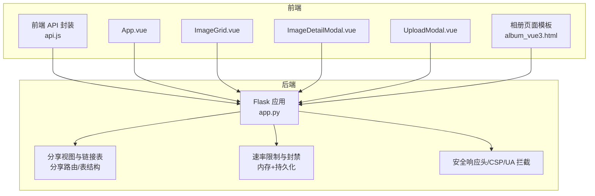
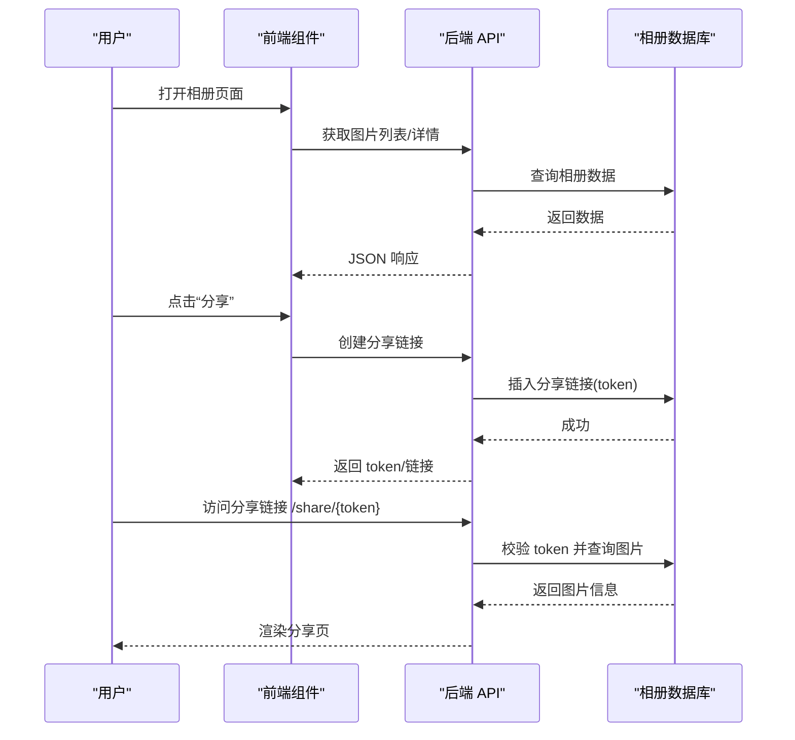
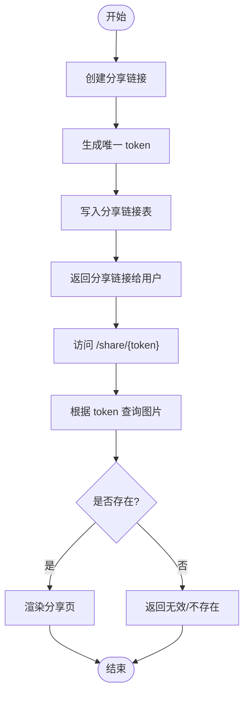
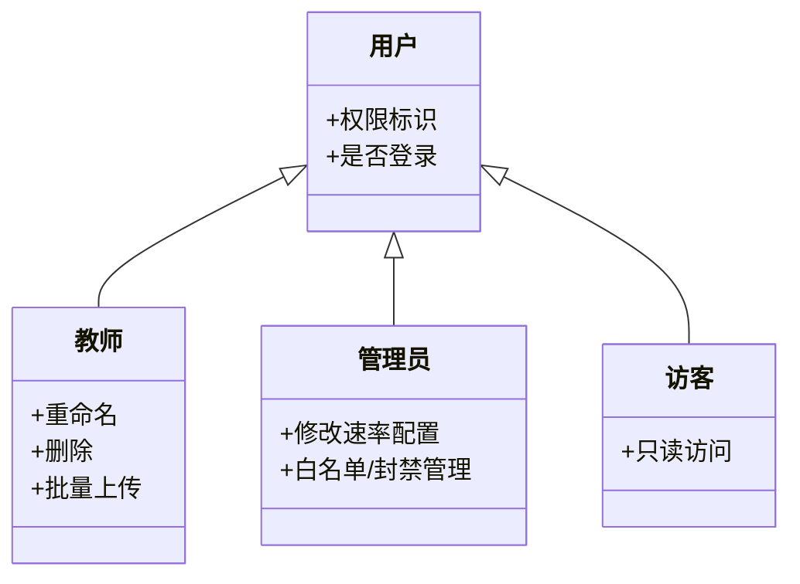
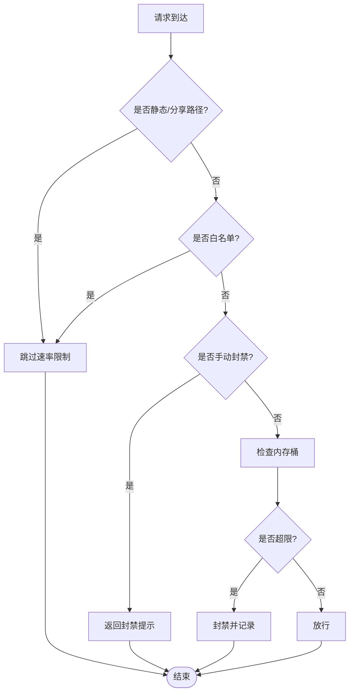
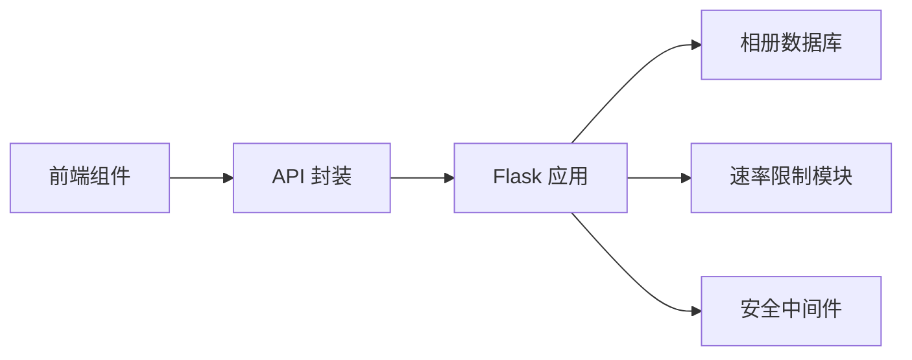

# 相册分享与隐私控制

<cite>
**本文引用的文件**
- [app.py](file://app.py)
- [album_vue3.html](file://templates/album_vue3.html)
- [api.js](file://frontend/src/api.js)
- [App.vue](file://frontend/src/App.vue)
- [ImageGrid.vue](file://frontend/src/components/ImageGrid.vue)
- [ImageDetailModal.vue](file://frontend/src/components/ImageDetailModal.vue)
- [UploadModal.vue](file://frontend/src/components/UploadModal.vue)
- [rate_limiter.json](file://rate_limiter.json)
</cite>

## 目录
1. [简介](#简介)
2. [项目结构](#项目结构)
3. [核心组件](#核心组件)
4. [架构总览](#架构总览)
5. [详细组件分析](#详细组件分析)
6. [依赖分析](#依赖分析)
7. [性能考量](#性能考量)
8. [故障排查指南](#故障排查指南)
9. [结论](#结论)
10. [附录](#附录)

## 简介
本文件围绕“相册分享与隐私控制”主题，系统性梳理后端服务在分享链接生成、访问权限验证、过期时间控制、隐私模式（公开/半公开/私有）、访问控制列表（ACL）与角色管理、访问日志记录、批量分享与统计追踪等方面的实现要点，并结合前端界面与交互进行说明。同时总结安全与反爬策略、访问频率限制等实践细节，帮助开发者与运维人员快速理解与维护该模块。

## 项目结构
后端采用 Python+Flask 构建，相册相关逻辑集中在主应用文件中，前端使用 Vue3 组件化开发，通过统一的 API 前缀对接后端接口。模板层提供相册页面与管理后台界面。

图表来源
- [app.py](file://app.py)
- [api.js](file://frontend/src/api.js)
- [App.vue](file://frontend/src/App.vue)
- [ImageGrid.vue](file://frontend/src/components/ImageGrid.vue)
- [ImageDetailModal.vue](file://frontend/src/components/ImageDetailModal.vue)
- [UploadModal.vue](file://frontend/src/components/UploadModal.vue)
- [album_vue3.html](file://templates/album_vue3.html)

章节来源
- [app.py](file://app.py)
- [api.js](file://frontend/src/api.js)
- [App.vue](file://frontend/src/App.vue)
- [ImageGrid.vue](file://frontend/src/components/ImageGrid.vue)
- [ImageDetailModal.vue](file://frontend/src/components/ImageDetailModal.vue)
- [UploadModal.vue](file://frontend/src/components/UploadModal.vue)
- [album_vue3.html](file://templates/album_vue3.html)

## 核心组件
- 分享链接生成与访问控制
  - 后端提供分享视图与分享链接表，token 唯一且与图片绑定，访问时进行 token 校验与资源存在性检查。
- 隐私模式与访问控制
  - 代码中未直接出现“公开/半公开/私有”三态的显式字段或路由，但通过分享链接表与访问路径可推导出“公开”能力；“半公开/私有”可通过 ACL 与角色管理在上传/评论/下载等接口处实现。
- 访问控制列表（ACL）与角色管理
  - 通过会话中的权限标识进行角色判断，部分操作（如重命名、删除、批量上传）仅教师/管理员可用。
- 访问日志记录
  - 系统具备活动日志表与访问统计能力，便于审计与追踪。
- 批量分享与统计追踪
  - 前端提供批量上传与分享入口，后端提供分享链接创建接口，结合访问视图可实现基础统计。
- 安全与反爬
  - 速率限制（内存+持久化）、白名单/手动封禁、UA 拦截、CSP/安全响应头、会话超时等。

章节来源
- [app.py](file://app.py)
- [api.js](file://frontend/src/api.js)

## 架构总览
后端通过统一的 API 前缀对外提供相册能力，前端组件按需调用。分享流程由后端生成 token 并存储于分享链接表，访问时通过 token 查询并渲染分享页。速率限制与安全策略贯穿请求生命周期。

图表来源
- [app.py](file://app.py)
- [api.js](file://frontend/src/api.js)

章节来源
- [app.py](file://app.py)
- [api.js](file://frontend/src/api.js)

## 详细组件分析

### 分享链接生成与访问控制
- 生成机制
  - 后端提供创建分享链接接口，内部生成唯一 token 并写入分享链接表，与图片 ID 关联。
- 访问验证
  - 分享视图根据 token 查询图片信息，若不存在则返回无效提示。
- 过期控制
  - 当前实现未见显式的过期时间字段与清理任务；建议在分享链接表增加过期时间列并配合定时任务清理。

图表来源
- [app.py](file://app.py)

章节来源
- [app.py](file://app.py)

### 隐私设置系统（公开/半公开/私有）
- 现状
  - 代码中未发现“公开/半公开/私有”三态的显式字段或路由。分享链接表的存在表明“公开”能力已具备。
- 建议实现
  - 在相册图片表新增隐私字段（公开/半公开/私有），并在访问接口中增加权限校验：
    - 公开：无需登录即可访问；
    - 半公开：登录用户可访问；
    - 私有：仅本人或管理员可访问。
  - 对分享链接表进行扩展，增加隐私级别与有效期字段，结合访问视图与接口实现差异化控制。

章节来源
- [app.py](file://app.py)

### 访问控制列表（ACL）与角色管理
- 角色与权限
  - 会话中包含权限标识，前端与后端据此区分普通用户与教师/管理员。
- 典型 ACL 场景
  - 重命名/删除图片：仅教师/管理员可用；
  - 批量上传：仅登录用户可用；
  - 管理后台速率限制配置修改：仅管理员可用。
- 日志记录
  - 系统具备活动日志表，可用于记录敏感操作与访问行为。

图表来源
- [ImageGrid.vue](file://frontend/src/components/ImageGrid.vue)
- [UploadModal.vue](file://frontend/src/components/UploadModal.vue)
- [app.py](file://app.py)

章节来源
- [ImageGrid.vue](file://frontend/src/components/ImageGrid.vue)
- [UploadModal.vue](file://frontend/src/components/UploadModal.vue)
- [app.py](file://app.py)

### 批量分享功能（链接生成、权限设置与统计追踪）
- 前端能力
  - 前端提供批量上传与分享入口，便于一次生成多张图片的分享链接。
- 后端能力
  - 提供创建分享链接接口，建议在批量场景下保持幂等与错误隔离。
- 统计追踪
  - 当前未见专门的分享统计表；可在分享链接表中增加访问计数与首次访问时间字段，并在访问视图中更新。

章节来源
- [api.js](file://frontend/src/api.js)
- [app.py](file://app.py)

### 分享页面 UI 设计与移动端适配
- 页面模板
  - 分享页采用简洁居中布局，图片自适应展示，信息区显示上传者与时间等元信息。
- 移动端适配
  - 使用 viewport 设置与弹性布局，图片与信息区域在小屏设备上保持良好可读性与交互体验。

章节来源
- [app.py](file://app.py)
- [album_vue3.html](file://templates/album_vue3.html)

### 安全考虑、防爬虫机制与访问频率限制
- 速率限制
  - 内存桶+持久化文件：请求记录按窗口清理，超限自动封禁并记录最近封禁事件。
  - 支持白名单与手动封禁，管理员可动态调整速率配置。
- 防爬虫与 UA 拦截
  - 预定义常见扫描器 UA 列表，命中即 403。
- 安全响应头与 CSP
  - 设置 X-Content-Type-Options、X-Frame-Options、X-XSS-Protection、Referrer-Policy、Strict-Transport-Security 等；CSP 使用 nonce 控制脚本/样式来源。
- 会话与超时
  - 会话超时检测，长时间无操作自动登出，提升安全性。

图表来源
- [app.py](file://app.py)
- [rate_limiter.json](file://rate_limiter.json)

章节来源
- [app.py](file://app.py)
- [rate_limiter.json](file://rate_limiter.json)

## 依赖分析
- 前端依赖
  - 统一通过 API 封装访问后端接口，组件间通过 props 与事件通信。
- 后端依赖
  - 数据库连接与表初始化，分享链接表、活动日志表等；速率限制模块与安全中间件贯穿请求链路。

图表来源
- [api.js](file://frontend/src/api.js)
- [app.py](file://app.py)

章节来源
- [api.js](file://frontend/src/api.js)
- [app.py](file://app.py)

## 性能考量
- 速率限制
  - 内存桶清理与持久化保存采用去抖策略，避免频繁 IO；建议在高并发场景下引入分布式缓存或队列异步落盘。
- 数据库
  - 分享链接表与图片表的关联查询较为简单，建议在 token 与 image_id 上建立索引以提升查询效率。
- 前端
  - 图片懒加载与分页/筛选可降低首屏压力；批量上传时建议增加进度反馈与错误重试。

## 故障排查指南
- 分享链接无效或过期
  - 检查 token 是否正确，确认分享链接表中是否存在对应记录；如需过期控制，建议补充过期字段与清理任务。
- 访问被限流或封禁
  - 查看速率限制配置与封禁状态，必要时将来源 IP 加入白名单或调整阈值。
- 无法访问分享页
  - 确认数据库连接正常，分享视图查询逻辑与表结构一致；检查静态资源与模板渲染。
- 权限不足
  - 确认会话权限标识，教师/管理员操作需满足相应角色条件。

章节来源
- [app.py](file://app.py)
- [rate_limiter.json](file://rate_limiter.json)

## 结论
该相册系统在分享与隐私控制方面已具备“公开”能力与完善的访问安全基线（速率限制、UA 拦截、CSP、会话超时等）。为进一步增强“半公开/私有”与精细化 ACL，建议在图片表中引入隐私字段与有效期字段，并在接口与分享视图中增加权限校验与统计追踪。同时完善过期清理与日志审计，以满足更复杂的业务场景与合规要求。

## 附录
- 前端组件职责
  - App.vue：页面框架与标签页导航；
  - ImageGrid.vue：图片列表与筛选/排序；
  - ImageDetailModal.vue：图片详情、点赞、下载、分享；
  - UploadModal.vue：批量上传入口。
- 后端接口要点
  - 分享链接创建与访问视图；
  - 速率限制配置与白名单/封禁管理；
  - 安全响应头与 CSP 注入。

章节来源
- [App.vue](file://frontend/src/App.vue)
- [ImageGrid.vue](file://frontend/src/components/ImageGrid.vue)
- [ImageDetailModal.vue](file://frontend/src/components/ImageDetailModal.vue)
- [UploadModal.vue](file://frontend/src/components/UploadModal.vue)
- [api.js](file://frontend/src/api.js)
- [app.py](file://app.py)