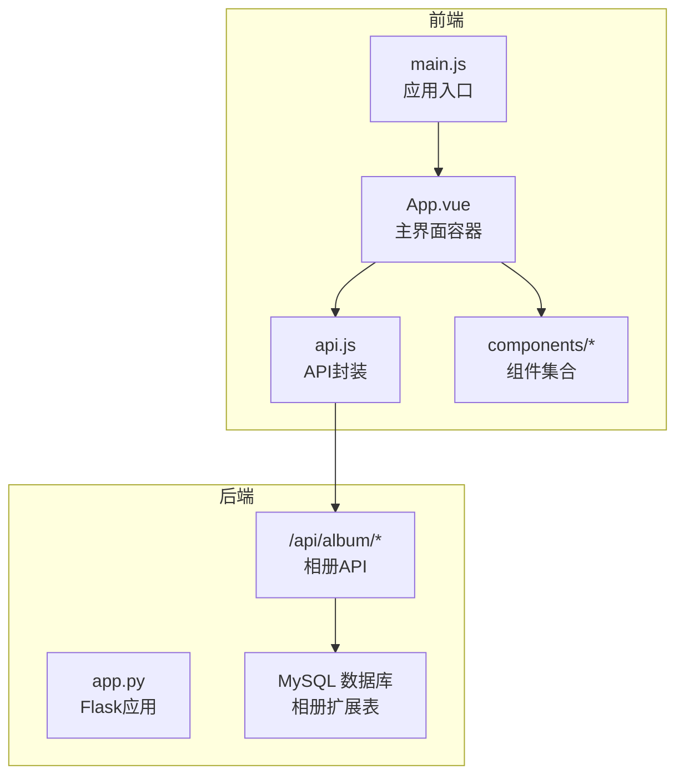
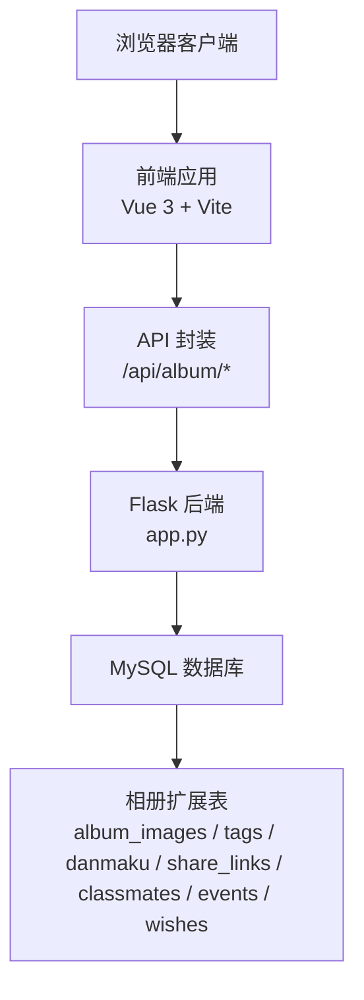
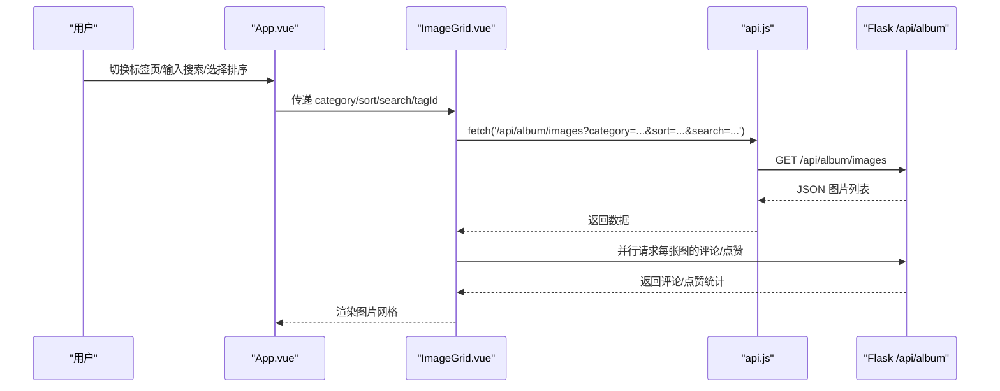
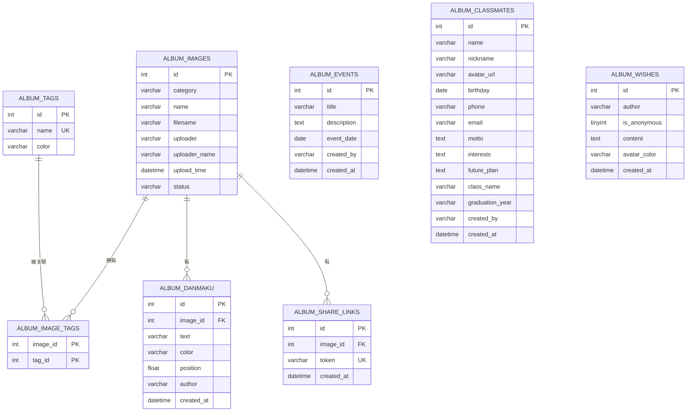
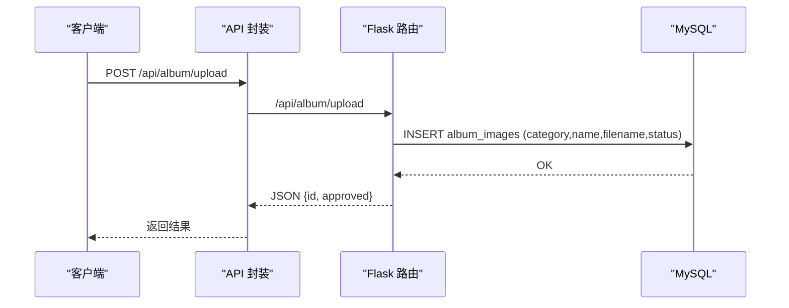
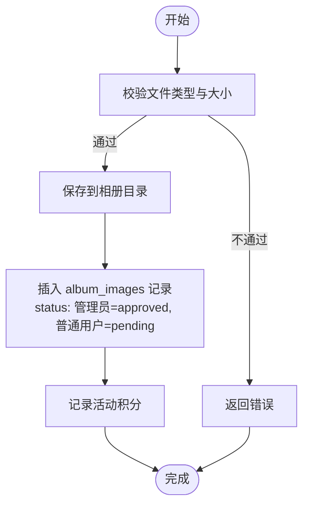
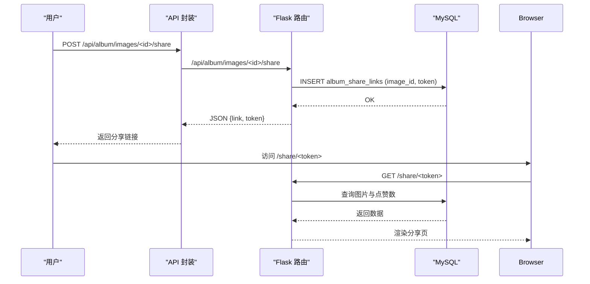
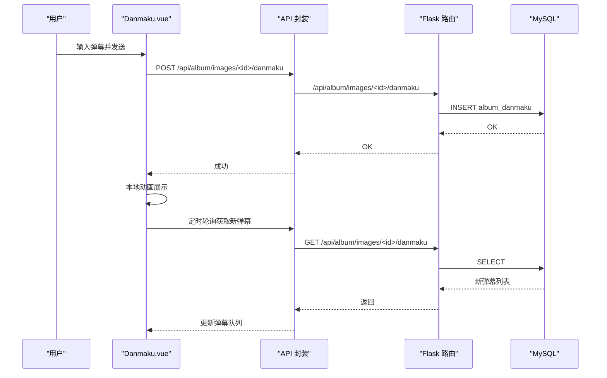
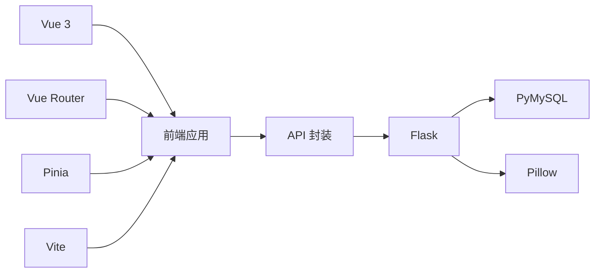

# 相册管理系统

<cite>
**本文档引用的文件**
- [app.py](file://app.py)
- [main.js](file://frontend/src/main.js)
- [App.vue](file://frontend/src/App.vue)
- [api.js](file://frontend/src/api.js)
- [ImageGrid.vue](file://frontend/src/components/ImageGrid.vue)
- [UploadModal.vue](file://frontend/src/components/UploadModal.vue)
- [Danmaku.vue](file://frontend/src/components/Danmaku.vue)
- [StatsChart.vue](file://frontend/src/components/StatsChart.vue)
- [album_vue3.html](file://templates/album_vue3.html)
- [package.json](file://frontend/package.json)
- [vite.config.js](file://frontend/vite.config.js)
- [requirements.txt](file://requirements.txt)
</cite>

## 目录
1. [简介](#简介)
2. [项目结构](#项目结构)
3. [核心组件](#核心组件)
4. [架构总览](#架构总览)
5. [详细组件分析](#详细组件分析)
6. [依赖分析](#依赖分析)
7. [性能考虑](#性能考虑)
8. [故障排查指南](#故障排查指南)
9. [结论](#结论)
10. [附录](#附录)

## 简介
本系统是一个基于 Vue 3 前端与 Flask 后端的相册管理平台，提供照片上传、下载、标签管理、弹幕互动、统计分析等能力。系统采用前后端分离架构，前端通过 API 封装模块与后端交互，后端提供相册相关 REST API 并维护 MySQL 数据库。系统还包含分享链接、权限控制、审核流程、速率限制与安全策略等企业级特性。

## 项目结构
- 前端位于 frontend/src，采用 Vue 3 Composition API，组件化开发，通过 Vite 构建与代理服务。
- 后端位于根目录，使用 Flask 提供 API，数据库连接通过 PyMySQL 实现。
- 模板位于 templates，包含独立的 Vue 2 相册页面（album_vue3.html），用于对比与兼容。

**图表来源**
- [main.js:1-6](file://frontend/src/main.js#L1-L6)
- [App.vue:1-99](file://frontend/src/App.vue#L1-L99)
- [api.js:1-45](file://frontend/src/api.js#L1-L45)
- [app.py:2536-2735](file://app.py#L2536-L2735)

**章节来源**
- [main.js:1-6](file://frontend/src/main.js#L1-L6)
- [App.vue:1-99](file://frontend/src/App.vue#L1-L99)
- [api.js:1-45](file://frontend/src/api.js#L1-L45)
- [package.json:1-21](file://frontend/package.json#L1-L21)
- [vite.config.js:1-21](file://frontend/vite.config.js#L1-L21)
- [requirements.txt:1-5](file://requirements.txt#L1-L5)

## 核心组件
- 应用入口与挂载：前端通过 main.js 创建 Vue 应用并挂载到 #app。
- 主界面容器：App.vue 提供顶部导航、标签页切换、搜索与排序、工具栏以及各功能区的条件渲染。
- API 封装：api.js 对 /api/album 的请求进行统一封装，便于组件调用。
- 图片网格：ImageGrid.vue 展示图片列表，支持懒加载、重命名、删除（教师权限）、详情弹窗。
- 上传模态框：UploadModal.vue 支持多文件拖拽上传、批量命名、进度反馈。
- 弹幕组件：Danmaku.vue 实现弹幕输入、实时滚动与轮询刷新。
- 统计图表：StatsChart.vue 展示总览数据与排行榜。

**章节来源**
- [main.js:1-6](file://frontend/src/main.js#L1-L6)
- [App.vue:1-99](file://frontend/src/App.vue#L1-L99)
- [api.js:1-45](file://frontend/src/api.js#L1-L45)
- [ImageGrid.vue:1-129](file://frontend/src/components/ImageGrid.vue#L1-L129)
- [UploadModal.vue:1-116](file://frontend/src/components/UploadModal.vue#L1-L116)
- [Danmaku.vue:1-89](file://frontend/src/components/Danmaku.vue#L1-L89)
- [StatsChart.vue:1-77](file://frontend/src/components/StatsChart.vue#L1-L77)

## 架构总览
系统采用前后端分离架构，前端通过 fetch 与后端 API 通信，后端提供相册管理、上传、下载、点赞、评论、分享、统计等接口。数据库包含基础用户表与相册扩展表，扩展表涵盖图片、标签、弹幕、分享链接、同学录、大事记、愿望墙等业务实体。

**图表来源**
- [api.js:1-45](file://frontend/src/api.js#L1-L45)
- [app.py:2536-2735](file://app.py#L2536-L2735)
- [app.py:695-800](file://app.py#L695-L800)

## 详细组件分析

### 前端组件架构
- 应用入口与挂载
  - main.js 使用 createApp 创建应用并挂载到 #app。
- 主界面容器 App.vue
  - 提供标签页切换（毕业图片、精彩瞬间、留言板、大事记、同学录、寄语墙、歌单、统计）。
  - 工具栏包含搜索框、排序选择与标签筛选（针对图片类标签）。
  - 条件渲染不同子组件，如 ImageGrid、UploadModal、StatsChart 等。
  - 通过 /api/album/me 获取当前用户权限，控制教师功能开关。
- API 封装 api.js
  - 统一封装 GET/POST/DELETE 请求，路径前缀 /api/album。
  - 包含图片查询、点赞、下载、分享、上传、评论、统计等方法。
- 图片网格 ImageGrid.vue
  - 通过 props 接收 category、sort、search、tagId。
  - 监听属性变化触发 loadImages，异步获取图片列表与评论、点赞数量。
  - 支持教师重命名与删除，调用后刷新列表。
- 上传模态框 UploadModal.vue
  - 支持多文件选择与拖拽，预览图片，限制文件大小与类型。
  - 批量上传时可统一命名，逐个提交并统计进度。
- 弹幕组件 Danmaku.vue
  - 输入框支持颜色选择，发送后本地模拟弹幕动画并轮询后端获取新增弹幕。
- 统计图表 StatsChart.vue
  - 加载 /api/album/stats，展示总数与排行榜（上传达人、最受欢迎照片）。

**图表来源**
- [App.vue:1-99](file://frontend/src/App.vue#L1-L99)
- [ImageGrid.vue:1-129](file://frontend/src/components/ImageGrid.vue#L1-L129)
- [api.js:1-45](file://frontend/src/api.js#L1-L45)
- [app.py:2536-2576](file://app.py#L2536-L2576)

**章节来源**
- [App.vue:1-99](file://frontend/src/App.vue#L1-L99)
- [ImageGrid.vue:1-129](file://frontend/src/components/ImageGrid.vue#L1-L129)
- [UploadModal.vue:1-116](file://frontend/src/components/UploadModal.vue#L1-L116)
- [Danmaku.vue:1-89](file://frontend/src/components/Danmaku.vue#L1-L89)
- [StatsChart.vue:1-77](file://frontend/src/components/StatsChart.vue#L1-L77)
- [api.js:1-45](file://frontend/src/api.js#L1-L45)

### 后端API与数据库设计

#### 相册数据库设计
- 相册扩展表初始化（首次访问时自动创建）
  - album_events：大事记时间轴
  - album_classmates：同学录
  - album_wishes：毕业寄语墙
  - album_tags：标签
  - album_image_tags：图片-标签关联
  - album_playlist：毕业歌单
  - album_danmaku：弹幕
  - album_share_links：分享链接
  - album_images：图片主表（包含 category、name、filename、uploader、uploader_name、upload_time、status）

**图表来源**
- [app.py:695-800](file://app.py#L695-L800)

#### 关键后端API
- 图片管理
  - GET /api/album/images：按分类、排序、搜索、标签筛选图片列表（非管理员仅返回已审核）。
  - PUT/DELETE /api/album/images/<int:img_id>：教师权限重命名/删除图片（级联删除评论、点赞、分享链接）。
  - GET /api/album/images/<int:img_id>/like：获取点赞数与当前用户是否已点赞。
  - POST/DELETE /api/album/images/<int:img_id>/like：点赞/取消点赞。
  - GET /api/album/images/<int:img_id>/download：下载图片（保持原文件后缀）。
  - GET/POST /api/album/images/<int:img_id>/share：获取/创建分享链接。
  - GET /share/<token>：分享页面渲染。
- 上传与审核
  - POST /api/album/upload：上传图片（管理员直接通过，普通用户进入待审核）。
  - GET /api/album/pending：获取待审核列表。
  - GET /api/album/pending/count：待审核数量。
  - POST /api/album/images/<int:img_id>/approve：审核通过。
  - POST /api/album/images/<int:img_id>/reject：拒绝并删除。
- 评论与弹幕
  - GET /api/album/images/<int:img_id>/comments：获取图片评论。
  - POST /api/album/images/<int:img_id>/comments：添加评论（支持回复）。
  - GET/POST /api/album/images/<int:img_id>/danmaku：获取/发送弹幕。
- 统计与用户
  - GET /api/album/stats：统计总数与排行榜。
  - GET /api/album/me：获取当前用户权限信息。

**图表来源**
- [api.js:32-33](file://frontend/src/api.js#L32-L33)
- [app.py:2733-2810](file://app.py#L2733-L2810)

**章节来源**
- [app.py:2536-2735](file://app.py#L2536-L2735)
- [app.py:2733-2810](file://app.py#L2733-L2810)
- [app.py:2812-2856](file://app.py#L2812-L2856)
- [app.py:2858-2881](file://app.py#L2858-L2881)
- [app.py:2884-2959](file://app.py#L2884-L2959)
- [app.py:3080-3116](file://app.py#L3080-L3116)
- [app.py:3118-3126](file://app.py#L3118-L3126)

### 功能流程图

#### 照片上传流程

**图表来源**
- [app.py:2733-2810](file://app.py#L2733-L2810)

#### 分享链接流程

**图表来源**
- [api.js:28-31](file://frontend/src/api.js#L28-L31)
- [app.py:2884-2959](file://app.py#L2884-L2959)

#### 弹幕功能流程

**图表来源**
- [Danmaku.vue:1-89](file://frontend/src/components/Danmaku.vue#L1-L89)
- [api.js:1-45](file://frontend/src/api.js#L1-L45)
- [app.py:2960-3011](file://app.py#L2960-L3011)

## 依赖分析
- 前端依赖
  - Vue 3、Vue Router、Pinia：构建响应式界面与状态管理。
  - Vite：开发服务器与构建工具，配置代理到后端 5800 端口。
- 后端依赖
  - Flask：Web 框架。
  - PyMySQL：MySQL 连接。
  - Pillow：图片处理（验证码等场景，上传流程未在此处生成缩略图）。
  - 其他：psutil、requests 等。

**图表来源**
- [package.json:1-21](file://frontend/package.json#L1-L21)
- [requirements.txt:1-5](file://requirements.txt#L1-L5)

**章节来源**
- [package.json:1-21](file://frontend/package.json#L1-L21)
- [requirements.txt:1-5](file://requirements.txt#L1-L5)

## 性能考虑
- 前端
  - 图片网格懒加载与骨架屏：ImageGrid.vue 使用懒加载与空状态提示，减少首屏压力。
  - 并行请求：同时获取每张图的评论与点赞，提升用户体验。
  - 节流搜索：App.vue 中对搜索输入进行 300ms 节流，避免频繁请求。
- 后端
  - 速率限制：基于内存的简单速率限制器，支持持久化到文件，防止滥用。
  - IP 白名单与封禁：支持白名单、手动封禁、试探封禁延长。
  - 数据库索引：activity_log、calendar_events 等表建立索引，优化查询。
- 存储
  - 上传文件大小限制与格式校验，避免过大或非法文件占用空间。
  - 分享页面直接读取静态资源，减少数据库压力。

[本节为通用性能建议，不直接分析具体文件]

## 故障排查指南
- 上传失败
  - 检查文件类型与大小限制（仅支持 jpg/png/gif/webp/bmp，最大 10MB）。
  - 确认 /api/album/upload 返回的错误信息，关注权限（普通用户需等待审核）。
- 下载失败
  - 确认图片是否存在与权限，检查 /api/album/images/<id>/download 返回状态。
- 分享链接无效
  - 检查 album_share_links 表中 token 是否存在，确认 /share/<token> 路由是否正确。
- 弹幕不显示
  - 检查 Danmaku.vue 是否成功轮询 /api/album/images/<id>/danmaku，确认数据库中是否插入成功。
- 统计数据为空
  - 确认 /api/album/stats 是否返回正常 JSON，检查 album_images、album_likes、album_image_comments 表是否有数据。
- 速率限制被触发
  - 查看后端日志与速率限制配置文件，确认是否达到阈值或被封禁。

**章节来源**
- [app.py:2733-2810](file://app.py#L2733-L2810)
- [app.py:2858-2881](file://app.py#L2858-L2881)
- [app.py:2884-2959](file://app.py#L2884-L2959)
- [app.py:2960-3011](file://app.py#L2960-L3011)
- [app.py:3080-3116](file://app.py#L3080-L3116)

## 结论
本相册管理系统通过清晰的前后端分层与完善的数据库设计，实现了照片上传、下载、标签管理、弹幕互动与统计分析等核心功能。前端组件化与 API 封装提升了可维护性，后端提供了严格的权限控制、审核流程与安全策略。系统具备良好的扩展性，可进一步引入缩略图生成、批量操作与更丰富的搜索过滤功能。

## 附录

### 相册管理界面使用指南
- 上传照片
  - 点击右下角“+”打开上传模态框，选择分类（毕业图片/精彩瞬间），选择图片或多文件拖拽，可统一命名，点击上传。
- 浏览与筛选
  - 使用顶部标签页切换不同分类，输入搜索关键词，选择排序方式，点击标签筛选器进行标签过滤。
- 详情与互动
  - 点击图片卡片打开详情弹窗，查看评论与点赞，支持发送评论与点赞。
- 弹幕功能
  - 在图片详情中打开弹幕输入框，选择颜色发送弹幕，弹幕会横向滚动显示，系统定时轮询新增弹幕。
- 分享
  - 在详情中创建分享链接，复制链接分享给他人，访客可在分享页查看图片与点赞数。
- 统计
  - 切换到“统计”标签页，查看总览数据与排行榜（上传达人、最受欢迎照片）。

### 最佳实践
- 前端
  - 使用节流与防抖优化搜索与筛选，减少不必要的请求。
  - 对图片加载使用懒加载与占位符，提升首屏性能。
- 后端
  - 严格校验上传文件类型与大小，避免存储非法或超大文件。
  - 审核流程中管理员应定期检查待审核列表，及时处理。
  - 合理设置速率限制参数，平衡安全与用户体验。
- 数据库
  - 为高频查询字段建立索引，定期清理过期分享链接与冗余数据。
- 安全
  - 使用 CSP、安全响应头与会话安全配置，防止常见 Web 攻击。
  - 对用户输入进行清洗与长度限制，避免 SQL 注入与 XSS。