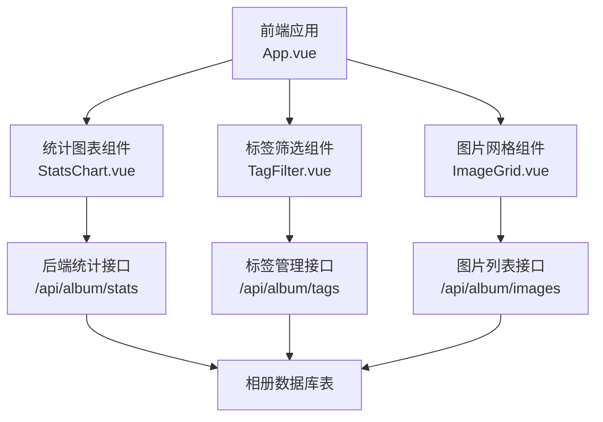
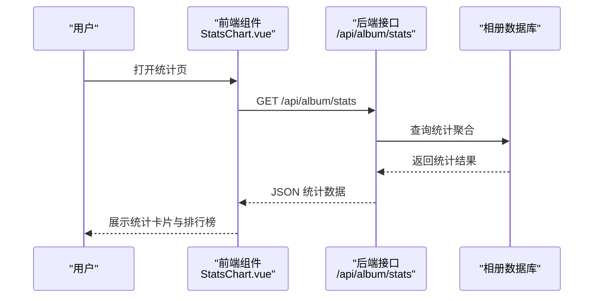
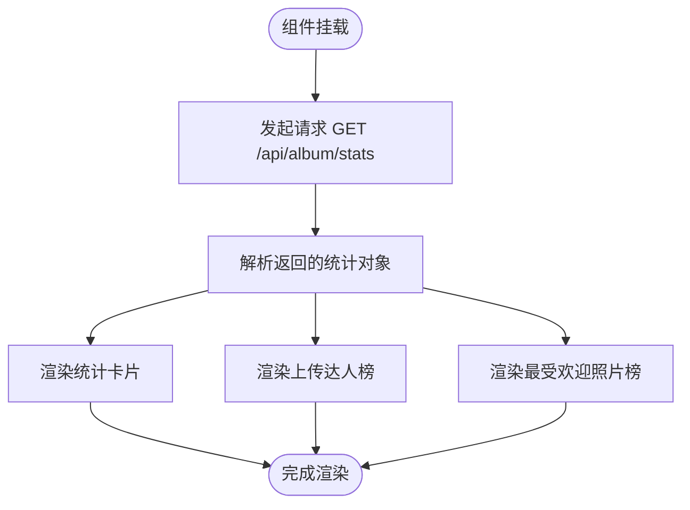
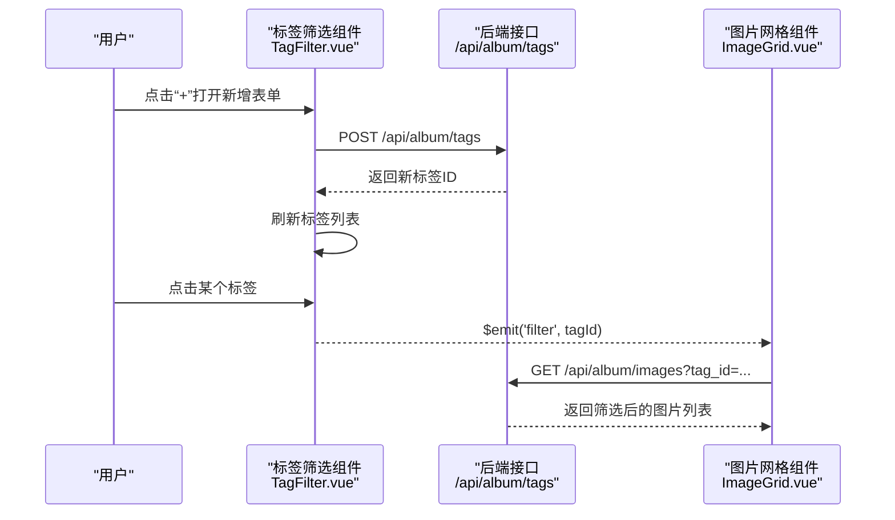
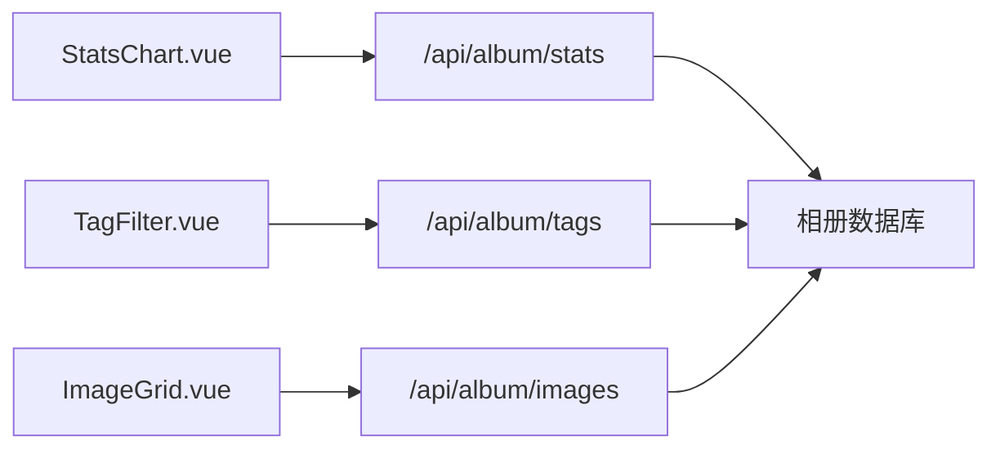

# 统计分析功能

<cite>
**本文引用的文件**
- [StatsChart.vue](file://frontend/src/components/StatsChart.vue)
- [TagFilter.vue](file://frontend/src/components/TagFilter.vue)
- [api.js](file://frontend/src/api.js)
- [App.vue](file://frontend/src/App.vue)
- [ImageGrid.vue](file://frontend/src/components/ImageGrid.vue)
- [app.py](file://app.py)
- [main.js](file://frontend/src/main.js)
</cite>

## 目录
1. [简介](#简介)
2. [项目结构](#项目结构)
3. [核心组件](#核心组件)
4. [架构总览](#架构总览)
5. [详细组件分析](#详细组件分析)
6. [依赖分析](#依赖分析)
7. [性能考虑](#性能考虑)
8. [故障排查指南](#故障排查指南)
9. [结论](#结论)
10. [附录](#附录)

## 简介
本文件系统性梳理相册统计分析功能，涵盖统计数据采集机制（照片数量、标签使用频率、弹幕互动、用户活跃度）、前端图表组件（ECharts集成、数据可视化与交互）、统计报表生成（时间趋势、用户行为、热门内容排行）、实时更新机制（WebSocket连接、增量更新、缓存策略）、自定义统计维度与筛选条件、以及导出能力。同时总结性能优化与大数据量处理的最佳实践。

## 项目结构
- 前端采用 Vue 3 单页应用，通过组件化组织统计相关界面与交互。
- 后端基于 Flask 提供相册相关的 API，包含统计接口与相册扩展表结构。
- 统计数据来源于相册数据库中的图片、评论、点赞、标签、弹幕等表。

**图示来源**
- [App.vue:14-41](file://frontend/src/App.vue#L14-L41)
- [StatsChart.vue:47-54](file://frontend/src/components/StatsChart.vue#L47-L54)
- [TagFilter.vue:30-37](file://frontend/src/components/TagFilter.vue#L30-L37)
- [ImageGrid.vue:55-77](file://frontend/src/components/ImageGrid.vue#L55-L77)
- [app.py:3081-3117](file://app.py#L3081-L3117)

**章节来源**
- [App.vue:14-41](file://frontend/src/App.vue#L14-L41)
- [main.js:1-6](file://frontend/src/main.js#L1-L6)

## 核心组件
- 统计图表组件：负责渲染照片总量、评论数、点赞数、上传达人榜、最受欢迎照片排行等。
- 标签筛选组件：提供标签的增删改查与筛选联动，支持按标签过滤图片列表。
- API 封装：统一处理相册相关接口调用，便于复用与维护。
- 图片网格组件：根据分类、排序、搜索与标签筛选加载图片，并补充评论与点赞计数。

**章节来源**
- [StatsChart.vue:1-77](file://frontend/src/components/StatsChart.vue#L1-L77)
- [TagFilter.vue:1-51](file://frontend/src/components/TagFilter.vue#L1-L51)
- [api.js:1-45](file://frontend/src/api.js#L1-L45)
- [ImageGrid.vue:55-77](file://frontend/src/components/ImageGrid.vue#L55-L77)

## 架构总览
前端通过 fetch 调用后端 /api/album/stats 获取统计聚合结果，组件内部进行本地渲染。标签筛选通过 /api/album/tags 实现标签的增删与查询，筛选结果通过 /api/album/images 的 tag_id 参数传递给后端。图片详情的评论与点赞通过独立接口补充，提升首屏加载性能。

**图示来源**
- [StatsChart.vue:47-54](file://frontend/src/components/StatsChart.vue#L47-L54)
- [app.py:3081-3117](file://app.py#L3081-L3117)

## 详细组件分析

### 统计图表组件（StatsChart.vue）
- 功能要点
  - 加载并展示全局统计：照片总数、评论总数、点赞总数。
  - 上传达人榜：按上传数量降序取前五，使用条形图直观对比。
  - 最受欢迎照片榜：按点赞数降序取前五，显示排名、名称与点赞数。
- 数据来源
  - 通过 /api/album/stats 获取聚合数据，字段包括 totalImages、totalComments、totalLikes、topUploaders、topLiked 等。
- 交互与样式
  - 使用 Vue 组合式 API 在挂载时发起请求。
  - 条形图宽度按最大值归一化，保证视觉对比一致。

**图示来源**
- [StatsChart.vue:47-54](file://frontend/src/components/StatsChart.vue#L47-L54)
- [StatsChart.vue:19-39](file://frontend/src/components/StatsChart.vue#L19-L39)

**章节来源**
- [StatsChart.vue:1-77](file://frontend/src/components/StatsChart.vue#L1-L77)
- [app.py:3081-3117](file://app.py#L3081-L3117)

### 标签筛选组件（TagFilter.vue）
- 功能要点
  - 展示现有标签按钮，支持点击切换激活状态。
  - 支持新增标签（名称与颜色），并自动刷新列表。
  - 支持删除标签，删除后触发父组件筛选重置。
- 数据来源
  - 标签列表：GET /api/album/tags
  - 新增标签：POST /api/album/tags
  - 删除标签：DELETE /api/album/tags/{id}
- 与图片网格联动
  - 通过 $emit('filter', tagId) 通知父组件更新筛选条件，进而影响 /api/album/images 的 tag_id 参数。

**图示来源**
- [TagFilter.vue:30-37](file://frontend/src/components/TagFilter.vue#L30-L37)
- [TagFilter.vue:4-12](file://frontend/src/components/TagFilter.vue#L4-L12)
- [ImageGrid.vue:55-77](file://frontend/src/components/ImageGrid.vue#L55-L77)
- [app.py:3362-3384](file://app.py#L3362-L3384)
- [app.py:3386-3399](file://app.py#L3386-L3399)

**章节来源**
- [TagFilter.vue:1-51](file://frontend/src/components/TagFilter.vue#L1-L51)
- [ImageGrid.vue:55-77](file://frontend/src/components/ImageGrid.vue#L55-L77)
- [app.py:3362-3399](file://app.py#L3362-L3399)

### API 封装（api.js）
- 统一封装相册相关接口，统一携带 cookies（credentials: 'include'），减少重复代码。
- 提供 getStats() 便捷方法，供统计页直接调用。

**章节来源**
- [api.js:1-45](file://frontend/src/api.js#L1-L45)

### 图片网格组件（ImageGrid.vue）
- 功能要点
  - 根据分类、排序、搜索与标签筛选加载图片列表。
  - 对每张图片并发请求其评论与点赞信息，补充到图片对象中，避免二次网络请求。
- 性能优化
  - 使用 Promise.all 并发获取评论与点赞，缩短等待时间。
  - 首屏仅加载图片元数据，详情信息异步补充，降低阻塞。

**章节来源**
- [ImageGrid.vue:55-77](file://frontend/src/components/ImageGrid.vue#L55-L77)

## 依赖分析
- 组件耦合
  - StatsChart.vue 与 TagFilter.vue 均依赖后端 /api/album/stats 与 /api/album/tags。
  - ImageGrid.vue 依赖 /api/album/images，并在组件内部对每张图片补充评论与点赞。
- 外部依赖
  - 前端使用 fetch 发起同源请求，后端通过 Flask 提供接口。
  - 相册扩展表结构由 app.py 初始化，包含标签、弹幕、分享链接等。

**图示来源**
- [StatsChart.vue:47-54](file://frontend/src/components/StatsChart.vue#L47-L54)
- [TagFilter.vue:30-37](file://frontend/src/components/TagFilter.vue#L30-L37)
- [ImageGrid.vue:55-77](file://frontend/src/components/ImageGrid.vue#L55-L77)
- [app.py:3081-3117](file://app.py#L3081-L3117)

**章节来源**
- [StatsChart.vue:1-77](file://frontend/src/components/StatsChart.vue#L1-L77)
- [TagFilter.vue:1-51](file://frontend/src/components/TagFilter.vue#L1-L51)
- [ImageGrid.vue:55-77](file://frontend/src/components/ImageGrid.vue#L55-L77)
- [app.py:3081-3117](file://app.py#L3081-L3117)

## 性能考虑
- 并发请求
  - 图片网格对每张图片并发请求评论与点赞，减少总等待时间。
- 归一化渲染
  - 条形图宽度按最大值归一化，避免极端值导致视觉失真。
- 首屏优化
  - 统计页仅加载聚合数据，不一次性拉取大量明细，降低首屏压力。
- 缓存策略建议
  - 前端可对 /api/album/stats 结果设置短期缓存（如 1 分钟），结合用户主动刷新按钮。
  - 对 /api/album/tags 列表可设置更长缓存，仅在新增/删除后失效。
- 大数据量处理
  - 后端统计接口使用 LIMIT 控制排行榜规模；若数据量增长，可引入分页或分段聚合。
  - 前端对长列表采用虚拟滚动或分页展示，避免 DOM 过多导致卡顿。

[本节为通用性能建议，无需特定文件引用]

## 故障排查指南
- 统计数据为空
  - 检查 /api/album/stats 是否返回正常 JSON；确认数据库中相册表是否存在且有数据。
  - 查看浏览器网络面板，确认请求状态码与响应体。
- 标签筛选无效
  - 确认 /api/album/tags 接口返回标签列表；检查 TagFilter.vue 是否正确触发父组件筛选。
  - 确认 /api/album/images 的 tag_id 参数是否随筛选变化。
- 评论与点赞计数异常
  - 检查 /api/album/images/{id}/comments 与 /api/album/images/{id}/like 的返回格式。
  - 确认 ImageGrid.vue 的并发请求逻辑是否捕获异常并回退为 0。

**章节来源**
- [StatsChart.vue:47-54](file://frontend/src/components/StatsChart.vue#L47-L54)
- [TagFilter.vue:30-37](file://frontend/src/components/TagFilter.vue#L30-L37)
- [ImageGrid.vue:55-77](file://frontend/src/components/ImageGrid.vue#L55-L77)
- [app.py:3081-3117](file://app.py#L3081-L3117)

## 结论
本统计分析功能以简洁的前后端分离架构实现：前端通过少量接口获取聚合统计与标签数据，配合本地渲染与并发请求优化，达成良好的用户体验。后续可在以下方面进一步增强：引入 ECharts 实现更丰富的可视化、增加时间维度的动态趋势图、完善实时更新与增量推送、扩展导出能力与自定义筛选维度。

[本节为总结性内容，无需特定文件引用]

## 附录

### 数据模型与表结构概览
- 相册扩展表（由后端初始化）
  - 标签表：存储标签名称与颜色。
  - 图片-标签关联表：建立图片与标签的多对多关系。
  - 弹幕表：存储图片对应的弹幕信息。
  - 分享链接表：存储图片分享令牌。
- 统计接口涉及的核心表
  - album_images：图片主表，统计总数与点赞排行。
  - album_image_comments：评论表，统计评论总数与评论者排行。
  - album_likes：点赞表，统计点赞总数与点赞排行。
  - album_tags、album_image_tags：标签统计与使用频率。

**章节来源**
- [app.py:753-801](file://app.py#L753-L801)
- [app.py:3081-3117](file://app.py#L3081-L3117)

### 接口一览（与统计相关）
- GET /api/album/stats：返回统计聚合（总数、上传/评论/点赞排行）。
- GET /api/album/me：返回当前用户身份信息。
- GET /api/album/tags：获取标签列表。
- POST /api/album/tags：新增标签。
- DELETE /api/album/tags/{id}：删除标签。
- GET /api/album/images：获取图片列表（支持分类、排序、搜索、标签筛选）。
- GET /api/album/images/{id}/comments：获取图片评论。
- GET /api/album/images/{id}/like：获取图片点赞状态与计数。

**章节来源**
- [app.py:3081-3117](file://app.py#L3081-L3117)
- [app.py:3362-3399](file://app.py#L3362-L3399)
- [app.py:2960-2980](file://app.py#L2960-L2980)
- [app.py:2822-2854](file://app.py#L2822-L2854)
- [api.js:7-45](file://frontend/src/api.js#L7-L45)