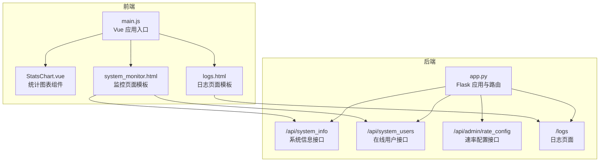
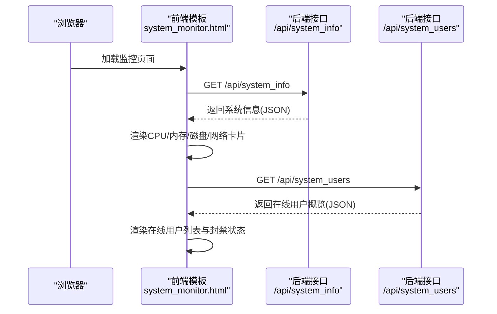
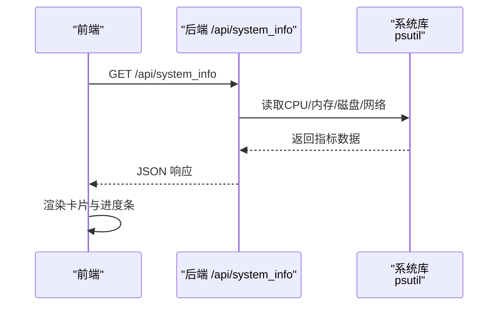
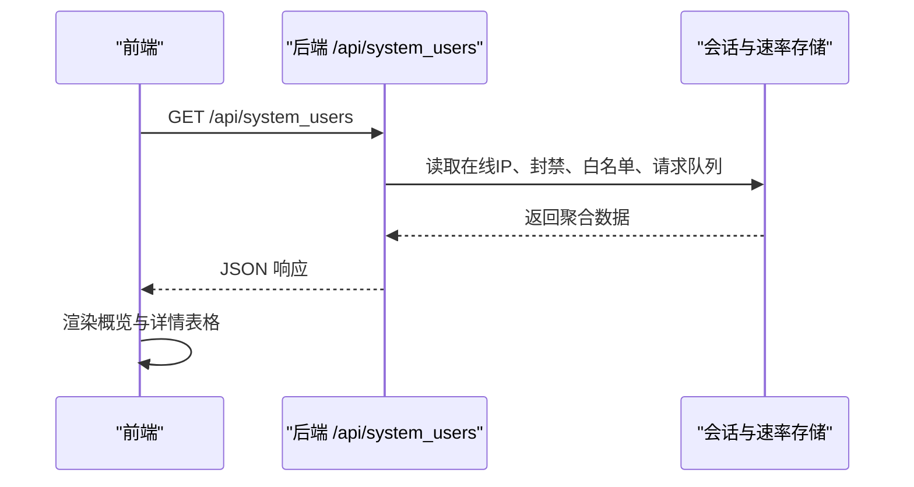
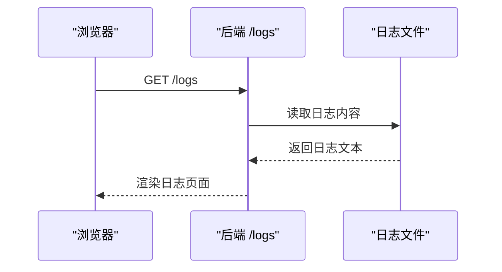
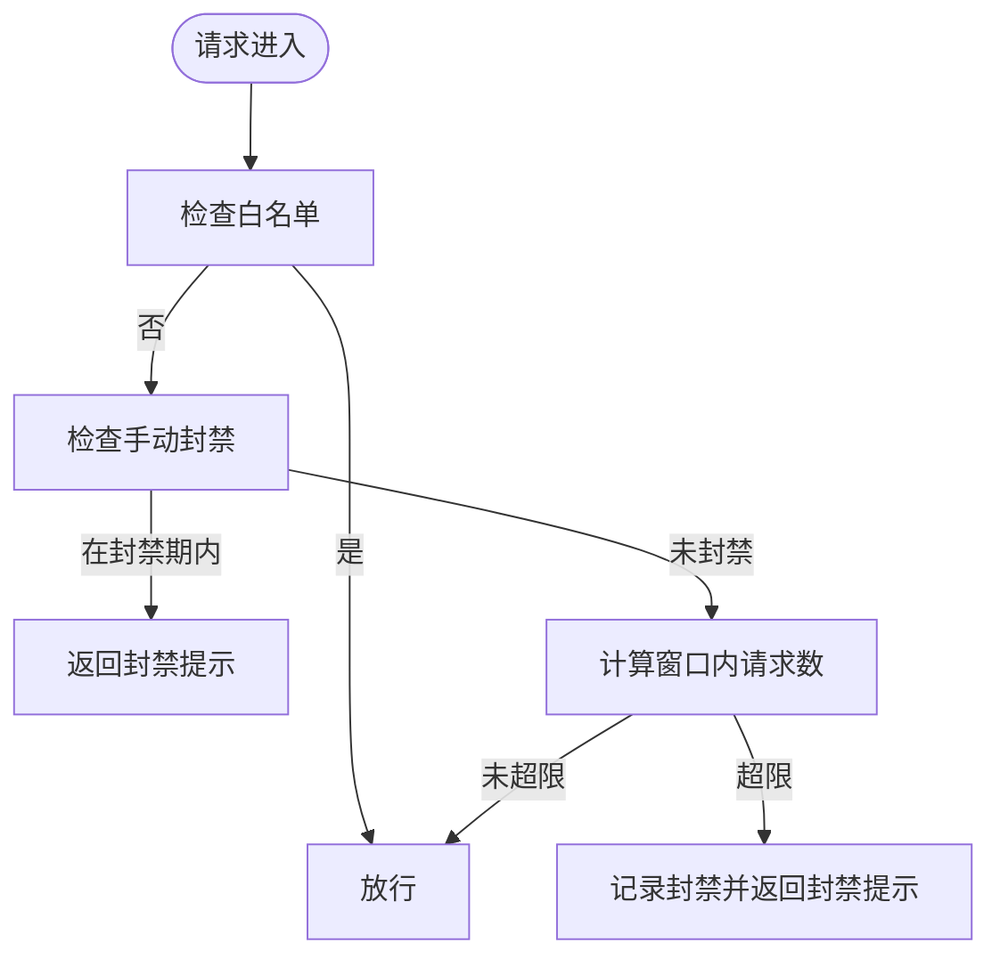
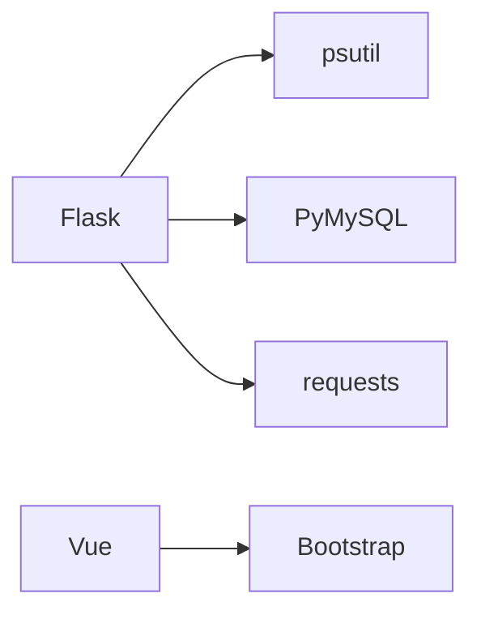

# 系统监控系统

<cite>
**本文引用的文件**
- [app.py](file://app.py)
- [system_monitor.html](file://templates/system_monitor.html)
- [logs.html](file://templates/logs.html)
- [requirements.txt](file://requirements.txt)
- [StatsChart.vue](file://frontend/src/components/StatsChart.vue)
- [main.js](file://frontend/src/main.js)
</cite>

## 目录
1. [简介](#简介)
2. [项目结构](#项目结构)
3. [核心组件](#核心组件)
4. [架构总览](#架构总览)
5. [组件详解](#组件详解)
6. [依赖关系分析](#依赖关系分析)
7. [性能与可靠性](#性能与可靠性)
8. [故障排查指南](#故障排查指南)
9. [结论](#结论)
10. [附录](#附录)

## 简介
本系统监控系统基于 Python/Flask 后端与 Vue 前端，提供实时硬件状态监控（CPU、内存、磁盘、网络）、在线用户活动监控、系统信息采集与展示、日志查看与清理等能力。管理员可通过专用页面查看服务器实时状态、在线用户分布与封禁情况，并通过日志页面进行日志查看与清理。

## 项目结构
- 后端入口与业务逻辑集中在应用主文件中，包含监控相关路由与工具函数。
- 前端采用 Vue 单页应用，入口位于前端目录，组件用于展示统计数据等。
- 模板层提供监控页面与日志页面，负责渲染与交互脚本。
- 依赖通过包管理文件声明，使用系统级库进行硬件信息采集与网络请求。

**图示来源**
- [main.js:1-6](file://frontend/src/main.js#L1-L6)
- [StatsChart.vue:1-77](file://frontend/src/components/StatsChart.vue#L1-L77)
- [system_monitor.html:1-271](file://templates/system_monitor.html#L1-L271)
- [logs.html:1-19](file://templates/logs.html#L1-L19)
- [app.py:1817-1888](file://app.py#L1817-L1888)
- [app.py:1890-1955](file://app.py#L1890-L1955)
- [app.py:4266-4295](file://app.py#L4266-L4295)
- [app.py:4287-4295](file://app.py#L4287-L4295)

**章节来源**
- [requirements.txt:1-5](file://requirements.txt#L1-L5)
- [main.js:1-6](file://frontend/src/main.js#L1-L6)
- [StatsChart.vue:1-77](file://frontend/src/components/StatsChart.vue#L1-L77)
- [system_monitor.html:1-271](file://templates/system_monitor.html#L1-L271)
- [logs.html:1-19](file://templates/logs.html#L1-L19)
- [app.py:1817-1888](file://app.py#L1817-L1888)
- [app.py:1890-1955](file://app.py#L1890-L1955)
- [app.py:4266-4295](file://app.py#L4266-L4295)
- [app.py:4287-4295](file://app.py#L4287-L4295)

## 核心组件
- 系统信息采集与展示
  - 后端通过系统库采集 CPU、内存、磁盘、网络等指标，提供 JSON 接口供前端轮询展示。
  - 前端模板负责渲染系统信息卡片、进度条与磁盘分区列表。
- 在线用户监控
  - 后端维护在线用户集合与请求速率桶，提供在线用户概览与详情。
  - 前端模板展示在线 IP、空闲时长、请求数与封禁状态。
- 日志管理
  - 后端提供日志读取与清理接口，前端模板展示日志内容并支持一键清空。
- 速率限制与安全
  - 后端内置速率限制与白名单机制，支持动态调整配置并通过管理接口下发。

**章节来源**
- [app.py:1827-1888](file://app.py#L1827-L1888)
- [system_monitor.html:38-118](file://templates/system_monitor.html#L38-L118)
- [app.py:1891-1955](file://app.py#L1891-L1955)
- [system_monitor.html:121-138](file://templates/system_monitor.html#L121-L138)
- [app.py:4287-4295](file://app.py#L4287-L4295)
- [logs.html:1-19](file://templates/logs.html#L1-L19)
- [app.py:4266-4295](file://app.py#L4266-L4295)

## 架构总览
系统采用前后端分离模式：前端负责页面与交互，后端提供 REST 风格 API 与模板渲染。监控数据通过定时轮询从后端接口拉取，日志页面支持手动刷新与一键清空。

**图示来源**
- [system_monitor.html:38-118](file://templates/system_monitor.html#L38-L118)
- [app.py:1827-1888](file://app.py#L1827-L1888)
- [app.py:1891-1955](file://app.py#L1891-L1955)

## 组件详解

### 系统信息采集与展示
- 后端接口
  - 路由：/api/system_info
  - 功能：采集系统基本信息、CPU 使用率、内存使用率与容量、磁盘分区使用情况、网络字节与包数。
  - 输出：JSON 结构包含系统版本、主机名、运行时长、CPU 物理/逻辑核数与百分比、内存总量/已用/可用与百分比、各分区设备/挂载点/容量/使用/百分比、网络发送/接收字节数与包数。
- 前端展示
  - 模板：system_monitor.html
  - 逻辑：定时轮询接口，渲染进度条、磁盘分区列表与网络统计卡片。
  - 视觉：根据使用率动态切换进度条颜色（低/中/高）。

**图示来源**
- [app.py:1827-1888](file://app.py#L1827-L1888)
- [system_monitor.html:38-76](file://templates/system_monitor.html#L38-L76)

**章节来源**
- [app.py:1827-1888](file://app.py#L1827-L1888)
- [system_monitor.html:38-76](file://templates/system_monitor.html#L38-L76)

### 在线用户监控与展示
- 后端接口
  - 路由：/api/system_users
  - 功能：统计在线用户（最近活动时间窗口内）、空闲时长、请求次数、封禁状态（自动/手动）、白名单状态；同时统计注册用户、管理员、VIP 数量。
  - 输出：JSON 包含在线数量、在线用户数组、注册总数、管理员数、VIP 数、封禁数、白名单数。
- 前端展示
  - 模板：system_monitor.html
  - 逻辑：定时轮询接口，渲染在线用户概览卡片与详情表格，按状态标注徽章。

**图示来源**
- [app.py:1891-1955](file://app.py#L1891-L1955)
- [system_monitor.html:78-138](file://templates/system_monitor.html#L78-L138)

**章节来源**
- [app.py:1891-1955](file://app.py#L1891-L1955)
- [system_monitor.html:78-138](file://templates/system_monitor.html#L78-L138)

### 日志管理
- 后端功能
  - 路由：/logs
  - 功能：读取日志文件内容并渲染到页面；提供清空日志的入口（由模板按钮触发）。
- 前端展示
  - 模板：logs.html
  - 逻辑：显示日志内容，提供刷新与清空按钮。

**图示来源**
- [app.py:4287-4295](file://app.py#L4287-L4295)
- [logs.html:1-19](file://templates/logs.html#L1-L19)

**章节来源**
- [app.py:4287-4295](file://app.py#L4287-L4295)
- [logs.html:1-19](file://templates/logs.html#L1-L19)

### 速率限制与配置管理
- 速率限制
  - 后端内置基于内存的滑动窗口速率限制，支持白名单与手动封禁，封禁期间探测将延长封禁时间。
- 配置管理
  - 路由：/api/admin/rate_config
  - 功能：管理员修改速率限制配置（最大请求数、时间窗口、封禁时长、探测阈值、追加封禁时长），并持久化到配置文件。

**图示来源**
- [app.py:513-562](file://app.py#L513-L562)
- [app.py:4266-4295](file://app.py#L4266-L4295)

**章节来源**
- [app.py:513-562](file://app.py#L513-L562)
- [app.py:4266-4295](file://app.py#L4266-L4295)

### 前端应用与组件
- 应用入口
  - 文件：frontend/src/main.js
  - 功能：创建 Vue 应用并挂载根组件。
- 统计图表组件
  - 文件：frontend/src/components/StatsChart.vue
  - 功能：展示相册类统计（如照片总数、评论数、点赞数）与排行榜条形图，演示前端数据拉取与渲染流程。

**章节来源**
- [main.js:1-6](file://frontend/src/main.js#L1-L6)
- [StatsChart.vue:1-77](file://frontend/src/components/StatsChart.vue#L1-L77)

## 依赖关系分析
- 后端依赖
  - Flask：Web 框架与路由。
  - PyMySQL：数据库连接与表初始化。
  - psutil：系统信息采集（CPU/内存/磁盘/网络）。
  - requests：外部服务调用（如公网 IP 查询）。
- 前端依赖
  - Vue：应用框架。
  - Bootstrap：页面样式与组件（监控页面使用了标签页与卡片布局）。

**图示来源**
- [requirements.txt:1-5](file://requirements.txt#L1-L5)
- [system_monitor.html:6-34](file://templates/system_monitor.html#L6-L34)

**章节来源**
- [requirements.txt:1-5](file://requirements.txt#L1-L5)
- [system_monitor.html:6-34](file://templates/system_monitor.html#L6-L34)

## 性能与可靠性
- 实时性
  - 前端定时轮询系统信息与用户接口，间隔分别为约 1.25 秒与 3.25 秒，保证监控面板的实时更新。
- 资源开销
  - 系统信息采集依赖系统库，开销较低；磁盘分区遍历与网络 IO 统计在少量分区下影响可忽略。
- 可靠性
  - 后端对异常进行捕获并返回错误信息，前端对错误进行友好提示。
  - 速率限制与封禁策略降低恶意请求风险，白名单与手动封禁提升运维灵活性。

[本节为通用性能讨论，无需特定文件引用]

## 故障排查指南
- 无法访问监控页面
  - 确认已登录且具备管理员权限；监控页面路由受权限装饰器保护。
- 无数据或报错
  - 检查后端接口返回的错误字段；确认系统库可用且无权限问题。
- 日志为空
  - 确认日志文件路径与权限；尝试刷新页面或清空日志后再次查看。
- 请求频繁被封禁
  - 检查速率限制配置与封禁状态；必要时加入白名单或调整配置。

**章节来源**
- [system_monitor.html:38-76](file://templates/system_monitor.html#L38-L76)
- [app.py:1827-1888](file://app.py#L1827-L1888)
- [app.py:4287-4295](file://app.py#L4287-L4295)

## 结论
本系统监控系统通过简洁的前后端分离架构，实现了对服务器硬件状态、在线用户活动与日志的可视化监控。后端基于系统库与轻量存储实现高效采集与展示，前端通过模板与定时轮询提供直观的仪表盘体验。结合速率限制与白名单机制，系统在可用性与安全性方面具备良好平衡。

[本节为总结性内容，无需特定文件引用]

## 附录
- 使用场景
  - 系统运维：监控 CPU/内存/磁盘/网络使用，及时发现资源瓶颈。
  - 安全运营：查看在线用户与封禁记录，识别异常访问。
  - 日志审计：集中查看与清理系统日志，辅助问题定位。
- 故障诊断
  - 采集异常：检查系统库安装与权限；确认接口返回错误。
  - 展示异常：检查前端模板与定时任务；确认网络连通性。
- 性能优化建议
  - 合理设置轮询间隔，避免过度刷新。
  - 对磁盘分区列表进行分页或缓存，减少 DOM 渲染压力。
  - 将日志文件改为滚动文件，避免单文件过大影响读取。

[本节为通用指导内容，无需特定文件引用]