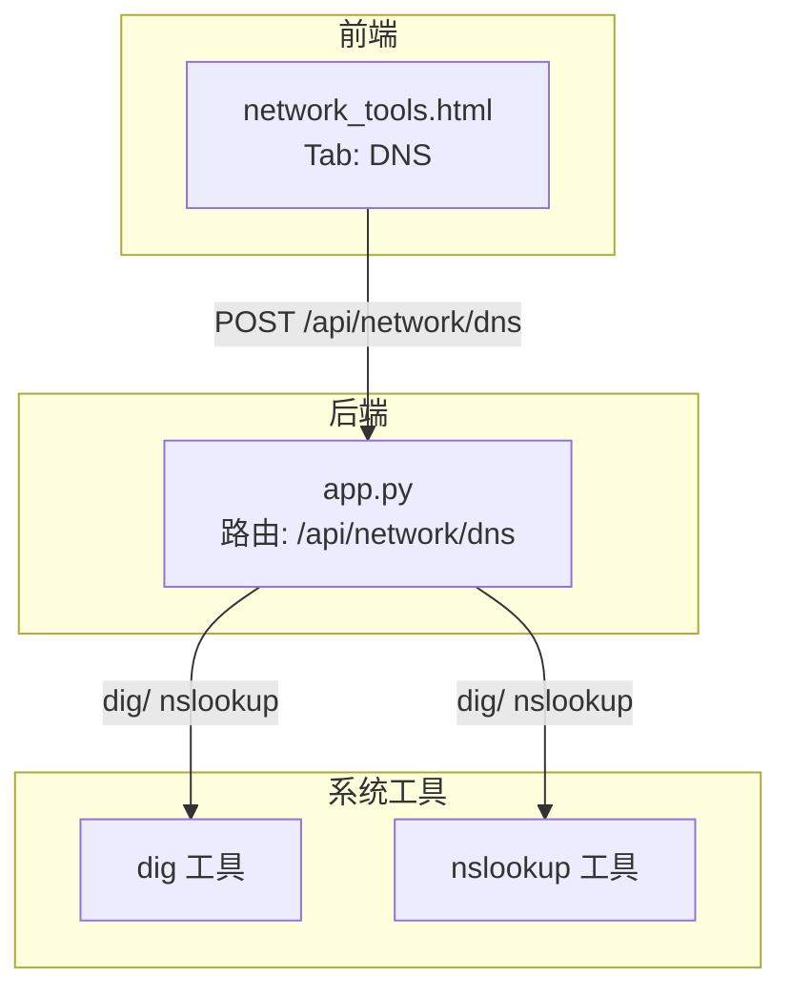
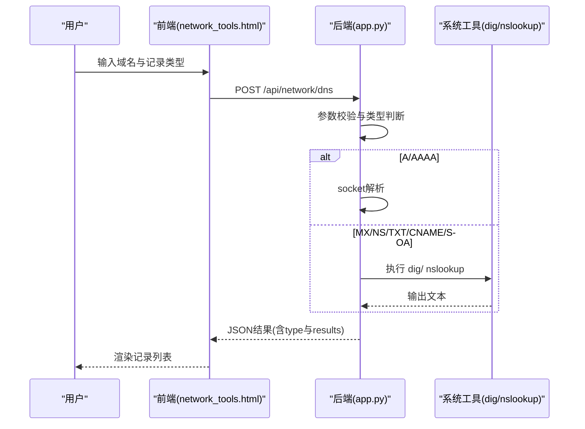
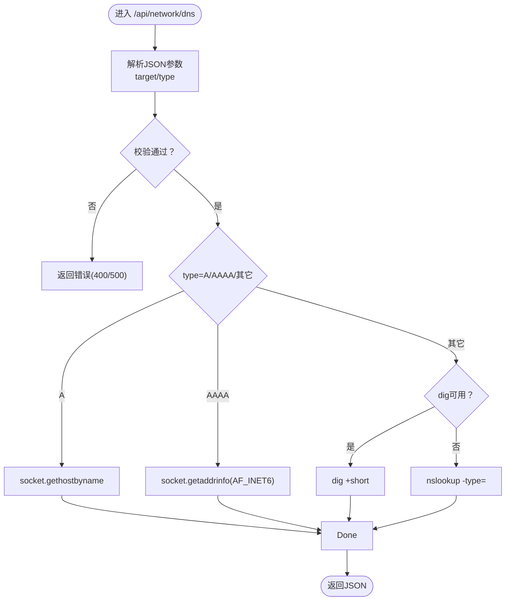
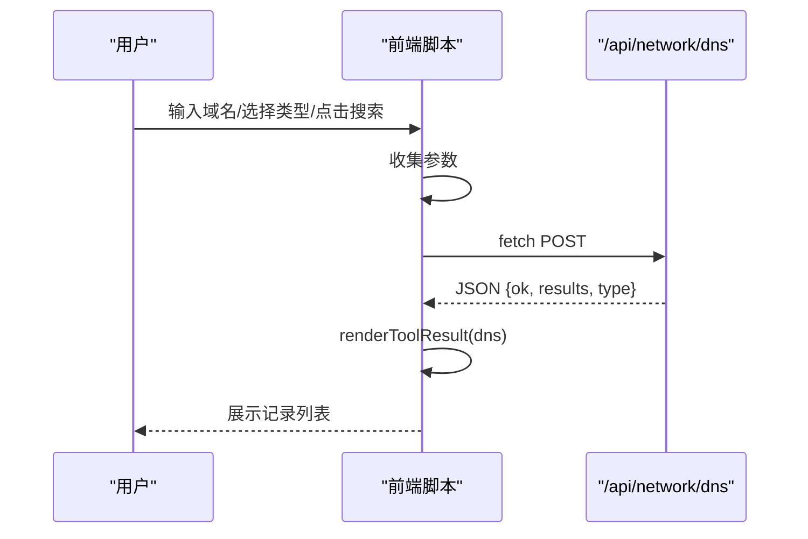
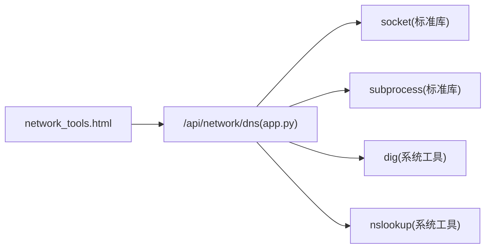

# DNS解析

<cite>
**本文引用的文件**
- [app.py](file://app.py)
- [network_tools.html](file://templates/network_tools.html)
- [安全措施清单.md](file://安全措施清单.md)
</cite>

## 目录
1. [简介](#简介)
2. [项目结构](#项目结构)
3. [核心组件](#核心组件)
4. [架构总览](#架构总览)
5. [详细组件分析](#详细组件分析)
6. [依赖关系分析](#依赖关系分析)
7. [性能考量](#性能考量)
8. [故障排除指南](#故障排除指南)
9. [结论](#结论)
10. [附录](#附录)

## 简介
本文件围绕系统中的DNS解析功能进行深入说明，覆盖以下方面：
- DNS解析流程与实现：递归查询、权威查询与外部工具调用路径
- 支持的记录类型：A、AAAA、MX、NS、TXT、CNAME、SOA
- 查询序列、TTL处理与循环解析检测现状
- 解析结果呈现与前端交互
- 性能优化策略（缓存、预解析、连接复用）与安全考虑（DNS劫持防护、查询加密、恶意域名检测）
- 实际应用场景与故障排除

## 项目结构
DNS解析功能位于后端Flask应用中，通过REST接口对外提供服务，并由前端页面发起请求、渲染结果。

**图表来源**
- [app.py:2153-2208](file://app.py#L2153-L2208)
- [network_tools.html:130-156](file://templates/network_tools.html#L130-L156)

**章节来源**
- [app.py:2153-2208](file://app.py#L2153-L2208)
- [network_tools.html:130-156](file://templates/network_tools.html#L130-L156)

## 核心组件
- 后端路由与业务逻辑
  - 路由：/api/network/dns
  - 功能：根据传入的目标域名与记录类型，调用系统工具 dig 或 nslookup 获取权威记录；对A/AAAA使用Python标准库socket解析
- 前端界面
  - 提供域名输入框与记录类型选择下拉框
  - 发起POST请求并渲染结果列表

关键实现要点：
- 输入校验：目标域名格式与记录类型白名单
- A/AAAA：使用socket解析，返回IP地址
- MX/NS/TXT/CNAME/SOA：优先使用dig，失败回退nslookup
- 超时控制：子进程调用超时5秒
- 错误处理：返回统一JSON结构，包含错误信息

**章节来源**
- [app.py:2153-2208](file://app.py#L2153-L2208)
- [network_tools.html:130-156](file://templates/network_tools.html#L130-L156)

## 架构总览
DNS解析采用“前端请求 -> 后端校验 -> 系统工具查询 -> 结果返回”的链路。后端对A/AAAA使用本地解析，其他类型委托dig/nslookup以获取权威信息。

**图表来源**
- [app.py:2153-2208](file://app.py#L2153-L2208)
- [network_tools.html:200-263](file://templates/network_tools.html#L200-L263)

## 详细组件分析

### 后端路由与解析逻辑
- 路由定义与鉴权
  - 路由：/api/network/dns
  - 装饰器：登录与VIP权限校验
- 请求参数与校验
  - target：去除空白，正则校验
  - type：默认A，转大写，集合白名单校验
- A记录解析
  - 使用socket.gethostbyname解析IPv4
  - gaierror捕获并返回错误
- AAAA记录解析
  - 使用socket.getaddrinfo解析IPv6，提取唯一IP
  - gaierror返回空列表
- 其他记录类型（MX/NS/TXT/CNAME/SOA）
  - 优先dig命令：dig +short <type> <target>
  - 失败回退nslookup：nslookup -type=<type> <target>
  - 超时5秒，异常时提示DNS工具不可用
- 返回结构
  - ok、results、type字段

**图表来源**
- [app.py:2153-2208](file://app.py#L2153-L2208)

**章节来源**
- [app.py:2153-2208](file://app.py#L2153-L2208)

### 前端交互与结果渲染
- 页面元素
  - 输入框：dnsTarget
  - 下拉框：dnsType（A/AAAA/MX/NS/TXT/CNAME/SOA）
  - 按钮：提交触发
- JavaScript逻辑
  - 收集参数并POST至/api/network/dns
  - 成功时调用renderToolResult渲染DNS结果列表
  - 失败时显示错误提示

**图表来源**
- [network_tools.html:200-263](file://templates/network_tools.html#L200-L263)
- [network_tools.html:265-278](file://templates/network_tools.html#L265-L278)

**章节来源**
- [network_tools.html:130-156](file://templates/network_tools.html#L130-L156)
- [network_tools.html:200-263](file://templates/network_tools.html#L200-L263)
- [network_tools.html:265-278](file://templates/network_tools.html#L265-L278)

### 支持的记录类型与解析行为
- A：IPv4地址解析
- AAAA：IPv6地址解析
- MX：邮件交换记录
- NS：权威域名服务器
- TXT：文本记录
- CNAME：规范名称记录
- SOA：权威起始信息

注意：当前实现未对TTL进行解析与展示；未实现递归/权威查询的内部算法，而是依赖dig/nslookup。

**章节来源**
- [app.py:2153-2208](file://app.py#L2153-L2208)

## 依赖关系分析
- 后端依赖
  - Python标准库：socket、subprocess、re、json等
  - 外部系统工具：dig、nslookup
- 前端依赖
  - Bootstrap + 自定义脚本
  - 通过fetch与后端API通信

**图表来源**
- [app.py:2153-2208](file://app.py#L2153-L2208)
- [network_tools.html:200-263](file://templates/network_tools.html#L200-L263)

**章节来源**
- [app.py:2153-2208](file://app.py#L2153-L2208)
- [network_tools.html:200-263](file://templates/network_tools.html#L200-L263)

## 性能考量
当前实现的性能特征与可优化方向：
- 当前实现
  - A/AAAA：本地socket解析，延迟低
  - 其他类型：依赖dig/nslookup，受系统解析器与网络影响
  - 超时：子进程调用超时5秒
- 可行的优化策略
  - DNS缓存：在后端维护轻量LRU缓存，结合记录类型与TTL字段（若dig输出包含TTL，可按TTL缓存）
  - 预解析：对常用域名建立定时任务，提前解析并写入缓存
  - 连接复用：将dig/nslookup封装为进程池或使用异步子进程，减少频繁启动开销
  - 并发控制：对同一域名的并发查询进行限速，避免DNS服务器压力
  - 结果聚合：批量查询多个记录类型时，尽量复用同一条查询链路
- 注意事项
  - TTL处理需解析dig/nslookup输出中的TTL字段，否则缓存命中策略难以准确
  - 循环解析检测：当前未实现，可在查询链路中加入已访问域名集合，避免重复查询

[本节为通用性能讨论，不直接分析具体文件，故无“章节来源”]

## 故障排除指南
- 常见问题与解决
  - DNS工具不可用
    - 现象：返回“DNS tools (dig/nslookup) not available”
    - 原因：系统未安装dig或nslookup
    - 处理：安装bind-tools或相应工具包
  - 目标域名非法
    - 现象：返回“Invalid target”
    - 原因：包含非允许字符
    - 处理：仅使用字母、数字、点、连字符
  - 记录类型不支持
    - 现象：返回“Invalid record type”
    - 处理：仅使用A/AAAA/MX/NS/TXT/CNAME/SOA
  - A/AAAA解析失败
    - 现象：gaierror错误
    - 处理：检查网络连通性与上游DNS配置
  - 超时
    - 现象：dig/nslookup超时
    - 处理：检查上游DNS响应速度与防火墙策略
- 前端调试
  - 查看网络面板：确认请求是否发送、响应状态码
  - 控制台：查看错误提示与异常堆栈
- 安全相关
  - 本功能涉及系统命令调用，需确保输入严格校验，避免命令注入
  - 建议：对用户输入进行白名单过滤与长度限制

**章节来源**
- [app.py:2153-2208](file://app.py#L2153-L2208)

## 结论
该DNS解析功能通过后端路由与系统工具结合的方式，实现了对多种DNS记录类型的权威查询能力。其优势在于快速集成与跨平台兼容，劣势在于缺乏内部递归/权威算法、TTL处理与缓存机制。建议后续引入缓存、TTL感知与更完善的错误处理，同时加强安全与性能方面的工程化改进。

[本节为总结性内容，不直接分析具体文件，故无“章节来源”]

## 附录

### 实际应用场景
- 网站诊断
  - A/AAAA记录用于确认域名解析到的IP是否正确
  - CNAME/SOA辅助检查域名权威与起始信息
- 邮件配置验证
  - MX记录用于确认邮件服务器配置
  - TXT记录用于SPF/DKIM/DMARC验证
- 网络故障排查
  - NS记录用于定位权威服务器
  - 结合dig/nslookup输出进行根因分析

[本节为概念性说明，不直接分析具体文件，故无“章节来源”]

### 安全考虑
- DNS劫持防护
  - 建议：在系统层面启用DNSSEC支持，或在应用层对返回记录进行完整性校验
- 查询加密
  - 建议：使用DoH/DoT替代明文UDP/TCP查询，降低中间人攻击风险
- 恶意域名检测
  - 建议：在解析前进行黑名单校验，结合威胁情报库进行阻断
- 代码安全
  - 当前实现使用subprocess执行系统命令，务必确保输入白名单与超时控制，避免命令注入与资源耗尽

**章节来源**
- [app.py:2153-2208](file://app.py#L2153-L2208)
- [安全措施清单.md:1-161](file://安全措施清单.md#L1-L161)