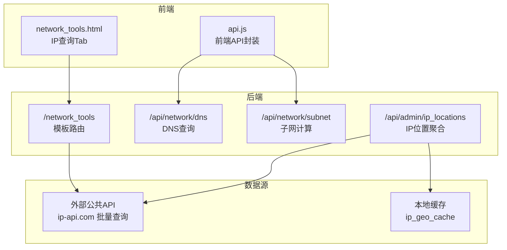
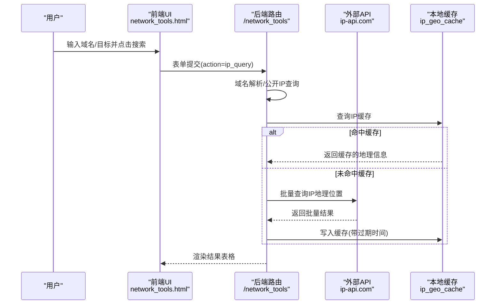
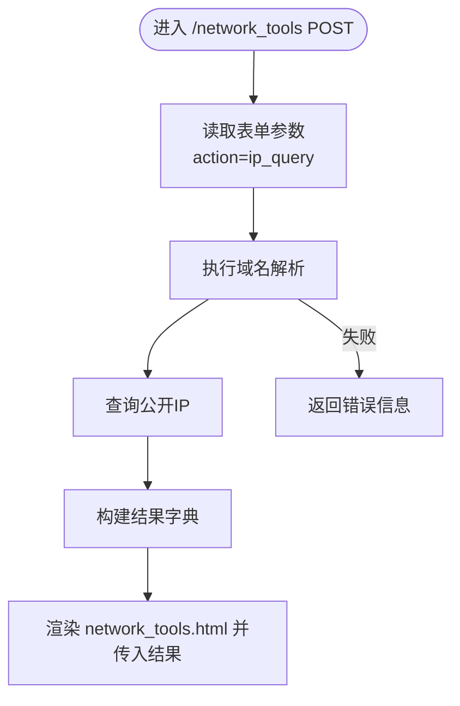
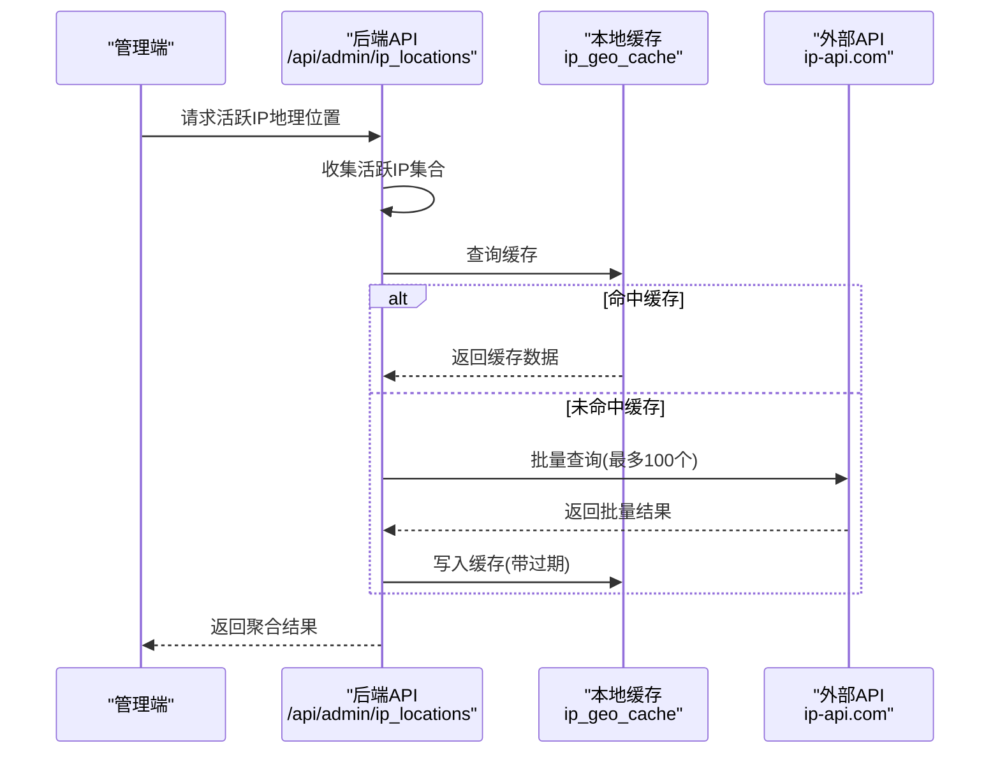
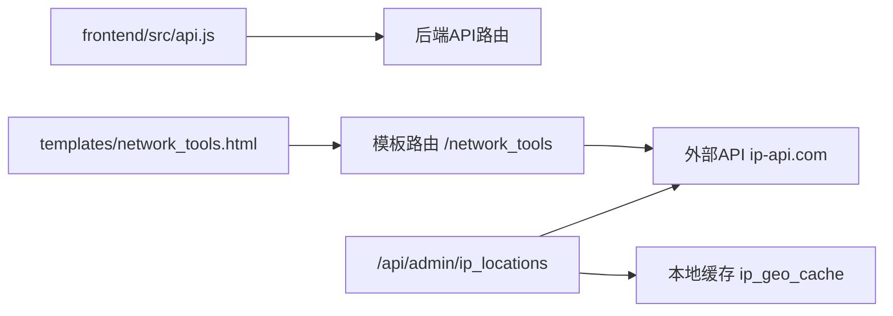

# IP地址查询

<cite>
**本文档引用的文件**
- [app.py](file://app.py)
- [network_tools.html](file://templates/network_tools.html)
- [calculator_net.html](file://templates/calculator_net.html)
- [api.js](file://frontend/src/api.js)
</cite>

## 目录
1. [简介](#简介)
2. [项目结构](#项目结构)
3. [核心组件](#核心组件)
4. [架构概览](#架构概览)
5. [详细组件分析](#详细组件分析)
6. [依赖分析](#依赖分析)
7. [性能考虑](#性能考虑)
8. [故障排查指南](#故障排查指南)
9. [结论](#结论)
10. [附录](#附录)

## 简介
本文件系统性梳理项目中的“IP地址查询”能力，涵盖前端交互、后端路由与API、数据源集成（公共API与本地缓存）、算法实现（IPv4/IPv6识别、CIDR计算、反向DNS）、结果数据结构、性能优化策略、安全与隐私保护，以及典型应用场景与使用示例。

## 项目结构
- 前端通过模板与脚本提供网络工具界面，其中包含“IP查询”标签页与通用网络工具Tab页。
- 后端提供两类入口：
  - 模板路由：用于渲染网络工具页面，并在表单提交时执行解析与查询。
  - API路由：提供独立的网络工具API，统一返回JSON结构，便于前端脚本调用。
- 数据源：
  - 公共API：使用外部服务进行地理位置批量查询与公开IP获取。
  - 本地缓存：基于内存的地理信息缓存，降低重复查询成本。
  - 本地算法：使用标准库进行CIDR解析与计算。

**图表来源**
- [network_tools.html:18-43](file://templates/network_tools.html#L18-L43)
- [app.py:1958-2072](file://app.py#L1958-L2072)
- [app.py:2153-2208](file://app.py#L2153-L2208)
- [app.py:2288-2315](file://app.py#L2288-L2315)
- [app.py:4335-4457](file://app.py#L4335-L4457)

**章节来源**
- [network_tools.html:1-196](file://templates/network_tools.html#L1-L196)
- [app.py:1958-2072](file://app.py#L1958-L2072)
- [app.py:2153-2208](file://app.py#L2153-L2208)
- [app.py:2288-2315](file://app.py#L2288-L2315)
- [app.py:4335-4457](file://app.py#L4335-L4457)

## 核心组件
- 前端IP查询UI与交互
  - 提供输入框与搜索按钮，提交后在同页面展示解析结果。
  - 结果包含输入域名、解析IP、本机IP、公开IP等字段。
- 后端模板路由
  - 处理表单提交，执行域名解析与公开IP查询，返回渲染模板。
- 后端API路由
  - 提供DNS查询、子网计算等API，统一返回JSON结构。
- 地理位置聚合API
  - 聚合活跃IP的地理位置，结合本地缓存与外部API批量查询。
- 本地缓存
  - 内存字典存储IP地理位置与过期时间，减少重复外部调用。

**章节来源**
- [network_tools.html:18-43](file://templates/network_tools.html#L18-L43)
- [app.py:1958-2072](file://app.py#L1958-L2072)
- [app.py:2153-2208](file://app.py#L2153-L2208)
- [app.py:2288-2315](file://app.py#L2288-L2315)
- [app.py:4335-4457](file://app.py#L4335-L4457)

## 架构概览
下图展示IP查询相关的关键交互流程：从前端发起请求，到后端路由处理、外部API调用与本地缓存，再到结果返回。

**图表来源**
- [network_tools.html:18-43](file://templates/network_tools.html#L18-L43)
- [app.py:1958-2072](file://app.py#L1958-L2072)
- [app.py:4335-4457](file://app.py#L4335-L4457)

## 详细组件分析

### 前端IP查询UI与交互
- 功能要点
  - 单一Tab页提供“IP查询”，输入框支持域名或IP。
  - 提交后在同页面展示解析结果，包含输入域名、解析IP、本机IP、公开IP。
- 交互流程
  - 表单提交触发模板路由处理，渲染结果区域。
  - 若发生错误，显示错误提示。

**章节来源**
- [network_tools.html:18-43](file://templates/network_tools.html#L18-L43)

### 后端模板路由：IP查询
- 处理逻辑
  - 接收表单参数，执行域名解析与公开IP查询。
  - 将解析结果组织为字典，传递给模板渲染。
- 错误处理
  - 当域名解析失败时，返回错误信息。

**图表来源**
- [app.py:1958-2072](file://app.py#L1958-L2072)

**章节来源**
- [app.py:1958-2072](file://app.py#L1958-L2072)

### 后端API：DNS查询
- 支持记录类型：A、AAAA、MX、NS、TXT、CNAME、SOA。
- 安全过滤：对目标进行正则校验，避免非法输入。
- 实现细节
  - A/AAAA记录直接使用系统socket解析。
  - 其他记录优先使用dig，若不可用则回退到nslookup。
- 返回结构：包含结果数组与记录类型。

**章节来源**
- [app.py:2153-2208](file://app.py#L2153-L2208)

### 后端API：子网计算
- 输入：CIDR字符串（如 192.168.1.0/24）。
- 算法：使用标准库解析CIDR，计算网络地址、广播地址、掩码、主机范围、私有/公网等。
- 返回结构：包含网络地址、广播地址、掩码、主机掩码、地址总数、可用主机数、首尾主机、私有/公网标记等。

**章节来源**
- [app.py:2288-2315](file://app.py#L2288-L2315)

### 地理位置聚合API：/api/admin/ip_locations
- 目标：返回活跃IP的地理位置，用于管理后台地图展示。
- 流程
  - 收集活跃IP集合（含被封禁与手动封禁的IP）。
  - 先查本地缓存，未命中则批量调用外部API查询。
  - 对未返回的IP写入“未知”占位缓存条目。
  - 清理过期缓存项。
- 返回结构：列表，每项包含IP、经纬度、国家、城市、请求次数、封禁状态等。

**图表来源**
- [app.py:4335-4457](file://app.py#L4335-L4457)

**章节来源**
- [app.py:4335-4457](file://app.py#L4335-L4457)

### 前端网络工具API封装
- 前端通过统一的API封装模块发起请求，便于复用与维护。
- 与后端网络工具API配合，实现DNS、子网等工具的交互。

**章节来源**
- [api.js:1-45](file://frontend/src/api.js#L1-L45)

## 依赖分析
- 前端依赖
  - 模板：network_tools.html提供IP查询UI与网络工具Tab页。
  - API封装：api.js统一fetch调用。
- 后端依赖
  - 标准库：socket、subprocess、re、ipaddress等。
  - 外部API：ip-api.com（批量地理位置查询）。
  - 本地缓存：内存字典缓存IP地理信息。
- 耦合关系
  - 前端模板与后端路由强耦合（表单提交与渲染）。
  - 后端API与外部服务弱耦合（通过HTTP请求）。
  - 后端API与本地缓存弱耦合（通过全局字典共享）。

**图表来源**
- [api.js:1-45](file://frontend/src/api.js#L1-L45)
- [network_tools.html:18-43](file://templates/network_tools.html#L18-L43)
- [app.py:1958-2072](file://app.py#L1958-L2072)
- [app.py:4335-4457](file://app.py#L4335-L4457)

**章节来源**
- [api.js:1-45](file://frontend/src/api.js#L1-L45)
- [network_tools.html:18-43](file://templates/network_tools.html#L18-L43)
- [app.py:1958-2072](file://app.py#L1958-L2072)
- [app.py:4335-4457](file://app.py#L4335-L4457)

## 性能考虑
- 缓存策略
  - 本地缓存：针对IP地理位置设置固定过期时间，减少重复外部调用。
  - 批量查询：对外部API采用批量请求（每次最多100个），提升吞吐。
- 并发与限速
  - 模板路由中的IP查询为同步阻塞调用，建议在高并发场景下引入异步任务队列或线程池。
  - 外部API调用设置合理超时（如10秒），避免阻塞主线程。
- 资源清理
  - 定期清理过期缓存条目，避免内存膨胀。
- 算法优化
  - 子网计算使用标准库，复杂度低且稳定。
  - DNS查询优先使用系统工具，减少第三方依赖。

**章节来源**
- [app.py:4335-4457](file://app.py#L4335-L4457)
- [app.py:2288-2315](file://app.py#L2288-L2315)
- [app.py:2153-2208](file://app.py#L2153-L2208)

## 故障排查指南
- 常见问题
  - 域名解析失败：检查输入是否为有效域名或IP，确认网络连通性。
  - 外部API不可达：检查网络代理与防火墙设置，关注超时与限流。
  - 缓存未命中：确认缓存键是否正确，检查过期时间与清理逻辑。
- 定位方法
  - 查看后端日志与异常堆栈。
  - 使用API路由进行独立测试，缩小问题范围。
- 修复建议
  - 增加重试与降级策略（如缓存占位、回退方案）。
  - 优化超时与重试参数，提升鲁棒性。

**章节来源**
- [app.py:1958-2072](file://app.py#L1958-L2072)
- [app.py:4335-4457](file://app.py#L4335-L4457)

## 结论
本项目提供了完整的IP查询能力：从前端交互到后端路由与API，再到外部数据源与本地缓存。通过标准化的API设计与缓存机制，实现了较好的性能与可维护性。后续可在并发处理、错误恢复与监控方面进一步增强。

## 附录

### IP查询结果数据结构
- 模板路由返回的查询结果包含以下字段：
  - 输入域名、解析IP、本机IP、公开IP。
- 地理位置聚合API返回的列表项包含：
  - IP、纬度、经度、国家、城市、请求次数、封禁状态、手动封禁状态。

**章节来源**
- [app.py:1958-2072](file://app.py#L1958-L2072)
- [app.py:4335-4457](file://app.py#L4335-L4457)

### IPv4/IPv6识别与CIDR计算
- IPv4/IPv6识别
  - DNS查询API支持A/AAAA记录，分别对应IPv4与IPv6解析。
- CIDR计算
  - 使用标准库解析CIDR，计算网络地址、广播地址、掩码、主机范围、私有/公网等。

**章节来源**
- [app.py:2153-2208](file://app.py#L2153-L2208)
- [app.py:2288-2315](file://app.py#L2288-L2315)

### 反向DNS解析
- 前端脚本提供反向DNS格式拼接（IPv4反向域），便于进一步查询。
- 后端未直接实现反向DNS查询API，但可通过其他工具链扩展。

**章节来源**
- [calculator_net.html:169-185](file://templates/calculator_net.html#L169-L185)

### 安全与隐私
- 安全措施
  - 速率限制：基于内存的请求计数与封禁策略，支持白名单与手动封禁。
  - 访问控制：部分路由要求登录与VIP权限。
  - 输入校验：对目标参数进行正则过滤，避免危险输入。
- 隐私保护
  - 仅返回必要地理信息，避免敏感数据泄露。
  - 管理端接口需管理员权限，限制访问范围。

**章节来源**
- [app.py:348-412](file://app.py#L348-L412)
- [app.py:1958-2072](file://app.py#L1958-L2072)
- [app.py:2153-2208](file://app.py#L2153-L2208)

### 应用场景与使用示例
- 场景
  - 网络诊断：查看目标域名解析结果与公开IP。
  - 地理分布：通过聚合API查看活跃用户的地理分布。
  - 子网规划：计算CIDR对应的网络范围与可用主机数。
- 示例
  - 在“IP查询”Tab输入域名，点击搜索，查看解析结果。
  - 在“DNS”Tab选择记录类型，查询相应DNS记录。
  - 在“子网计算器”Tab输入CIDR，查看网络参数。

**章节来源**
- [network_tools.html:18-196](file://templates/network_tools.html#L18-L196)
- [app.py:2153-2208](file://app.py#L2153-L2208)
- [app.py:2288-2315](file://app.py#L2288-L2315)