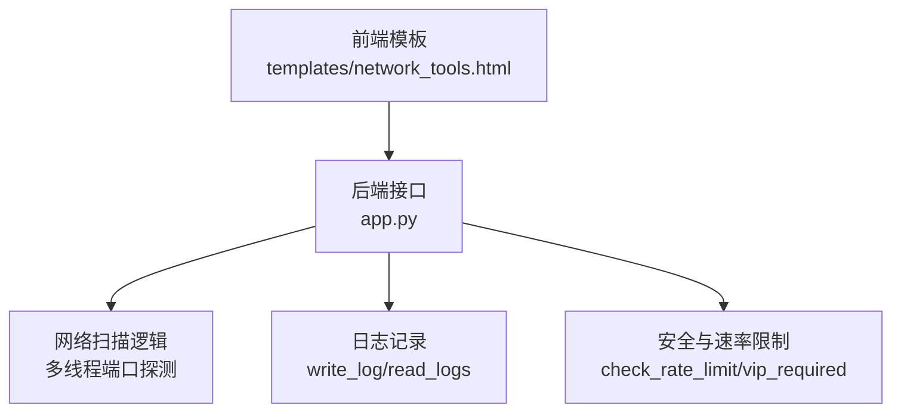
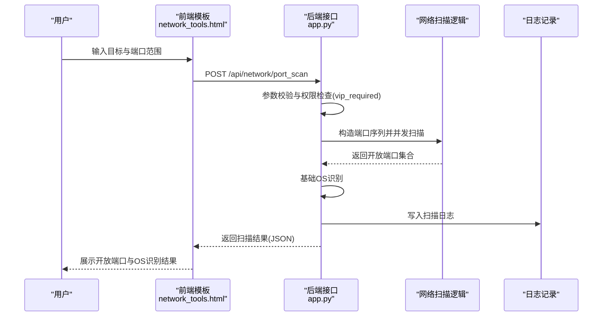
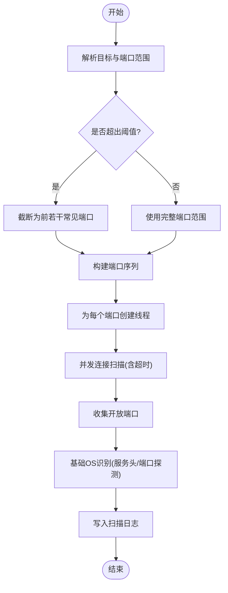
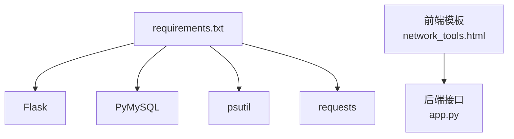

# 端口扫描

<cite>
**本文引用的文件列表**
- [app.py](file://app.py)
- [network_tools.html](file://templates/network_tools.html)
- [requirements.txt](file://requirements.txt)
</cite>

## 目录
1. [简介](#简介)
2. [项目结构](#项目结构)
3. [核心组件](#核心组件)
4. [架构总览](#架构总览)
5. [详细组件分析](#详细组件分析)
6. [依赖分析](#依赖分析)
7. [性能考量](#性能考量)
8. [故障排查指南](#故障排查指南)
9. [结论](#结论)
10. [附录](#附录)

## 简介
本文件围绕“端口扫描”功能进行系统化说明，结合前端模板与后端实现，解释其工作原理、并发机制、性能优化、安全与合规、错误处理以及典型使用场景。当前实现采用基于浏览器的前端界面与后端 Flask 接口配合的方式，后端通过多线程并发对目标主机的端口进行快速探测，并在有限范围内尝试进行操作系统特征识别。

## 项目结构
与端口扫描功能直接相关的文件与职责如下：
- 前端模板：提供用户输入与结果显示，负责调用后端 API 并渲染结果。
- 后端应用：接收请求、执行端口扫描逻辑、并发控制、超时与异常处理、日志记录与安全策略。

图表来源
- [network_tools.html:45-88](file://templates/network_tools.html#L45-L88)
- [app.py:2000-2072](file://app.py#L2000-L2072)
- [app.py:886-896](file://app.py#L886-L896)
- [app.py:514-562](file://app.py#L514-L562)
- [app.py:953-963](file://app.py#L953-L963)

章节来源
- [network_tools.html:1-328](file://templates/network_tools.html#L1-L328)
- [app.py:1-120](file://app.py#L1-L120)

## 核心组件
- 前端端口扫描界面与交互
  - 提供目标主机、起始/结束端口输入，触发扫描并展示结果。
  - 当端口范围超过一定数量时，自动截断为前若干常见端口，避免过度扫描。
- 后端端口扫描处理
  - 解析参数，构造端口序列，按需截断。
  - 多线程并发探测每个端口，设置连接超时。
  - 收集开放端口并进行基础操作系统特征识别。
  - 记录操作日志，受速率限制与权限控制保护。
- 安全与速率限制
  - 全局速率限制与封禁策略，支持白名单与手动封禁。
  - VIP 权限控制，限制高风险工具的使用。
  - 拦截常见安全扫描工具的 User-Agent。

章节来源
- [network_tools.html:45-88](file://templates/network_tools.html#L45-L88)
- [app.py:2000-2072](file://app.py#L2000-L2072)
- [app.py:514-562](file://app.py#L514-L562)
- [app.py:953-963](file://app.py#L953-L963)
- [app.py:149-156](file://app.py#L149-L156)

## 架构总览
端口扫描的端到端流程如下：

图表来源
- [network_tools.html:230-235](file://templates/network_tools.html#L230-L235)
- [app.py:2000-2072](file://app.py#L2000-L2072)
- [app.py:886-896](file://app.py#L886-L896)
- [app.py:953-963](file://app.py#L953-L963)

## 详细组件分析

### 前端界面与交互
- 功能入口
  - “端口扫描”标签页提供表单，包含目标主机、起始端口、结束端口输入框与扫描按钮。
  - 当端口范围超过一定数量时，提示仅扫描前若干常见端口，防止过度扫描。
- 结果展示
  - 成功时显示目标、端口范围、识别到的操作系统以及开放端口列表。
  - 失败时显示错误信息。
- 异步调用
  - 通过 fetch 发送 JSON 请求至 /api/network/port_scan，接收并渲染结果。

章节来源
- [network_tools.html:45-88](file://templates/network_tools.html#L45-L88)
- [network_tools.html:230-235](file://templates/network_tools.html#L230-L235)
- [network_tools.html:236-262](file://templates/network_tools.html#L236-L262)

### 后端扫描逻辑与并发机制
- 参数解析与范围控制
  - 解析起始/结束端口，校验范围有效性；若超出阈值，自动截断为前若干常见端口。
- 并发扫描
  - 为每个端口创建独立线程，使用共享数组收集结果。
  - 设置连接超时，避免长时间阻塞。
- 开放端口识别
  - 通过连接返回码判断端口是否开放。
- 基础操作系统识别
  - 对目标主机的常用端口发起简单请求，解析响应头中的服务器标识，或探测特定端口（如远程桌面端口）以推断操作系统。
- 日志记录
  - 扫描完成后写入操作日志，便于审计。

图表来源
- [app.py:2000-2072](file://app.py#L2000-L2072)

章节来源
- [app.py:2000-2072](file://app.py#L2000-L2072)

### 并发连接测试与资源管理
- 多线程模型
  - 为每个端口分配一个线程，使用 join 等待全部完成。
- 超时控制
  - 连接超时设置为较短时间，避免长时间等待。
- 资源管理
  - 每个连接在使用后及时关闭，减少资源泄漏风险。

章节来源
- [app.py:2003-2023](file://app.py#L2003-L2023)

### 开放端口识别算法
- 端口状态判断
  - 通过连接返回码判断端口开放与否。
- 服务Banner获取
  - 对特定端口发送简单请求，解析响应头中的服务器标识，辅助识别服务类型与版本。
- 操作系统指纹识别
  - 基于服务头与常见端口组合进行启发式判断，给出操作系统类别或特征。

章节来源
- [app.py:2027-2056](file://app.py#L2027-L2056)

### 性能优化策略
- 批量扫描与范围截断
  - 当端口范围过大时，自动截断为前若干常见端口，降低扫描时间与资源消耗。
- 并发控制
  - 多线程并发扫描，缩短整体耗时。
- 超时与异常处理
  - 为连接设置超时，避免长时间阻塞；捕获异常并返回空结果，保证流程稳定。

章节来源
- [network_tools.html:67](file://templates/network_tools.html#L67)
- [app.py:2001](file://app.py#L2001)
- [app.py:2003-2011](file://app.py#L2003-L2011)

### 安全考虑与合规
- 权限控制
  - 端口扫描接口受 VIP 权限保护，普通访客无法直接使用。
- 速率限制与封禁
  - 全局速率限制与封禁策略，支持白名单与手动封禁，防止滥用。
- 用户代理拦截
  - 对常见安全扫描工具的 User-Agent 进行拦截，降低被识别的风险。
- 日志审计
  - 所有扫描行为均写入日志，便于审计与追溯。

章节来源
- [app.py:953-963](file://app.py#L953-L963)
- [app.py:514-562](file://app.py#L514-L562)
- [app.py:149-156](file://app.py#L149-L156)
- [app.py:886-896](file://app.py#L886-L896)

### 错误处理机制
- 参数错误
  - 端口范围无效或端口非数值时，返回错误信息。
- 网络超时
  - 连接超时或扫描过程异常时，返回空结果或错误提示。
- 权限不足
  - 非 VIP 用户访问时，返回权限不足提示。
- 速率限制
  - 超过请求阈值时，触发封禁并提示剩余封禁时间。

章节来源
- [app.py:1996-2066](file://app.py#L1996-L2066)
- [app.py:514-562](file://app.py#L514-L562)
- [app.py:953-963](file://app.py#L953-L963)

## 依赖分析
- Python 运行时与依赖
  - Flask：Web 框架，提供路由与请求处理。
  - PyMySQL：数据库连接（用于用户权限与日志等）。
  - psutil：系统监控（用于系统监控页面，与端口扫描无直接耦合）。
  - requests：网络请求（用于外部服务集成，与端口扫描无直接耦合）。
- 前端交互
  - 使用 fetch 发送异步请求，接收 JSON 响应并渲染结果。

图表来源
- [requirements.txt:1-5](file://requirements.txt#L1-L5)
- [network_tools.html:230-235](file://templates/network_tools.html#L230-L235)

章节来源
- [requirements.txt:1-5](file://requirements.txt#L1-L5)
- [network_tools.html:230-235](file://templates/network_tools.html#L230-L235)

## 性能考量
- 扫描范围控制
  - 自动截断为前若干常见端口，显著降低扫描时间。
- 并发策略
  - 多线程并发扫描，缩短整体耗时；但需注意线程数量与系统资源平衡。
- 超时与异常
  - 合理设置超时，避免长时间阻塞；异常捕获保证流程稳定性。
- 速率限制
  - 全局速率限制与封禁策略，防止滥用导致系统负载过高。

章节来源
- [network_tools.html:67](file://templates/network_tools.html#L67)
- [app.py:2001](file://app.py#L2001)
- [app.py:2003-2011](file://app.py#L2003-L2011)
- [app.py:514-562](file://app.py#L514-L562)

## 故障排查指南
- 无法看到开放端口
  - 检查端口范围是否过大，确认是否被截断。
  - 确认目标主机防火墙或安全策略是否阻断连接。
- 权限不足
  - 确认当前用户是否具备 VIP 权限。
- 请求过于频繁
  - 观察是否触发速率限制与封禁，等待封禁期结束后再试。
- 日志审计
  - 通过日志页面查看扫描记录，定位问题。

章节来源
- [network_tools.html:67](file://templates/network_tools.html#L67)
- [app.py:953-963](file://app.py#L953-L963)
- [app.py:514-562](file://app.py#L514-L562)
- [app.py:886-896](file://app.py#L886-L896)

## 结论
当前端口扫描功能通过前端表单与后端接口配合，实现了对目标主机的并发端口探测与基础操作系统识别。其实现特点包括：范围截断、多线程并发、连接超时控制、权限与速率限制、日志审计等。建议在实际部署中进一步完善并发上限、连接池管理与更精细的超时策略，同时严格遵守目标主机与所在网络的使用规范与法律法规。

## 附录
- 实际应用场景
  - 网络安全评估：识别开放端口与潜在风险服务。
  - 系统维护：检查服务端口连通性与暴露面。
- 使用示例
  - 在前端界面输入目标主机与端口范围，点击扫描按钮，查看开放端口与操作系统识别结果。

章节来源
- [network_tools.html:45-88](file://templates/network_tools.html#L45-L88)
- [app.py:2000-2072](file://app.py#L2000-L2072)