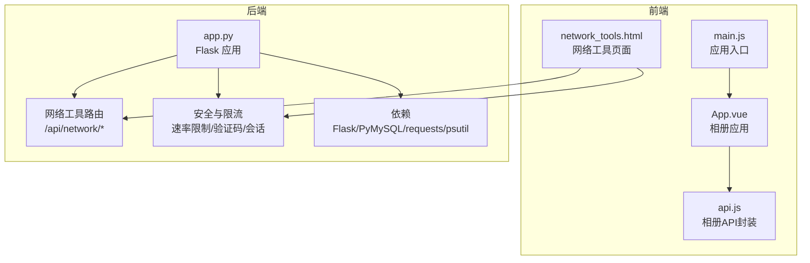
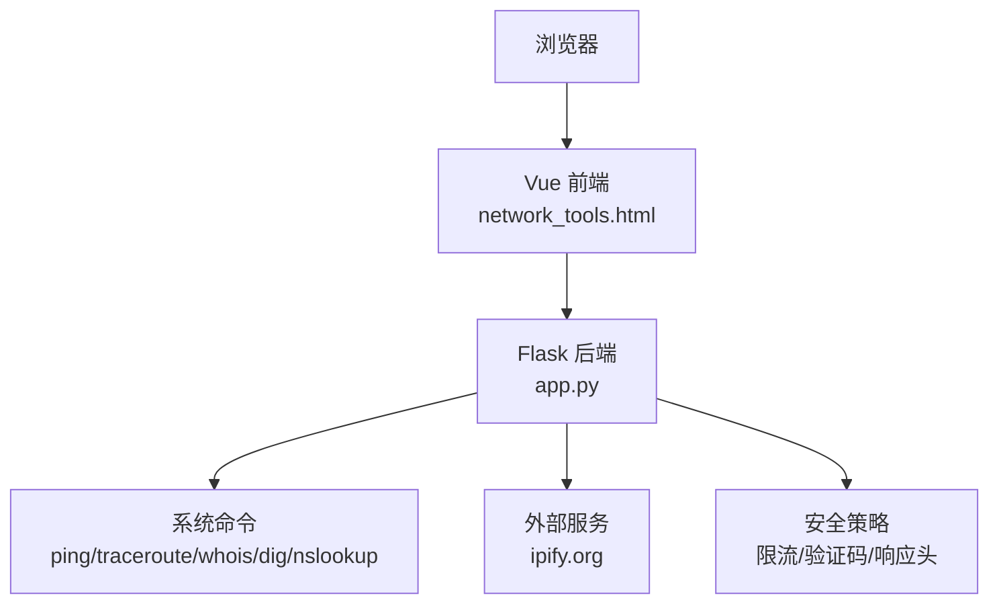
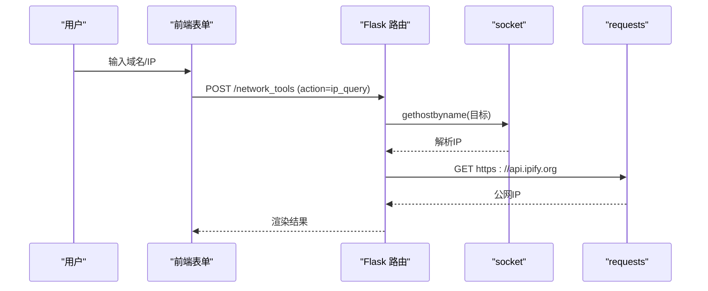
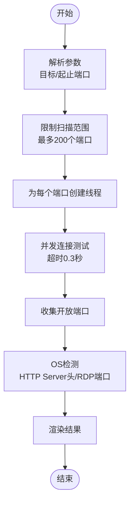
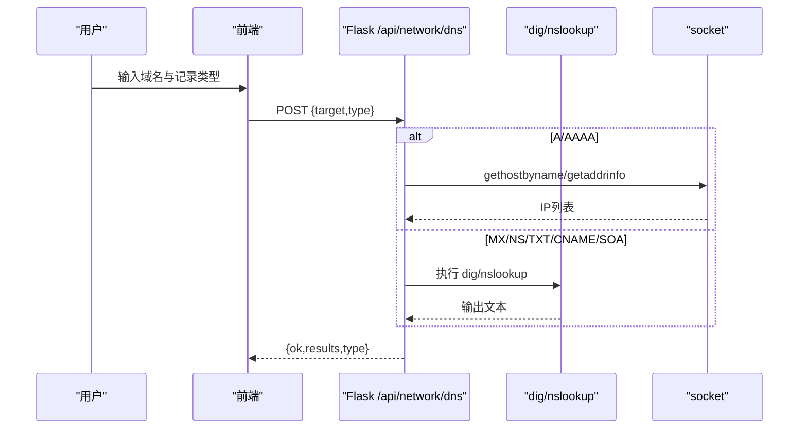
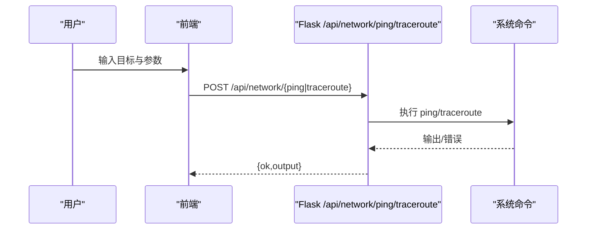
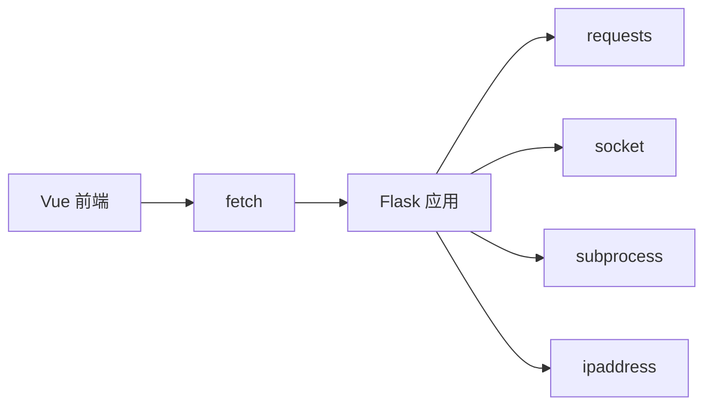

# 网络工具系统

<cite>
**本文档引用的文件**
- [app.py](file://app.py)
- [network_tools.html](file://templates/network_tools.html)
- [api.js](file://frontend/src/api.js)
- [main.js](file://frontend/src/main.js)
- [App.vue](file://frontend/src/App.vue)
- [requirements.txt](file://requirements.txt)
- [zh-CN.json](file://i18n/zh-CN.json)
- [.gitignore](file://.gitignore)
</cite>

## 目录
1. [简介](#简介)
2. [项目结构](#项目结构)
3. [核心组件](#核心组件)
4. [架构总览](#架构总览)
5. [详细组件分析](#详细组件分析)
6. [依赖分析](#依赖分析)
7. [性能考量](#性能考量)
8. [故障排查指南](#故障排查指南)
9. [结论](#结论)
10. [附录](#附录)

## 简介
本项目是一个基于 Flask 的网络工具系统，提供 IP 地址查询、端口扫描、DNS 解析、连通性测试（Ping）、路由追踪（Traceroute）、Whois 查询、HTTP 头检查、SSL 证书检查以及子网计算器等能力。系统采用前后端分离架构，前端使用 Vue 3 构建，后端通过 RESTful API 提供网络诊断能力，并内置速率限制、会话超时、验证码门禁与安全响应头等安全机制。

## 项目结构
- 后端核心：Flask 应用位于根目录的 app.py，负责路由、业务逻辑、安全策略与网络工具 API。
- 模板层：Jinja2 模板位于 templates/，其中 network_tools.html 提供网络工具页面与前端交互脚本。
- 前端层：frontend/src/ 包含 Vue 3 应用入口与组件，通过 fetch 调用 /api/network/* 接口。
- 国际化：i18n/ 下的 JSON 文件提供多语言支持。
- 依赖：requirements.txt 声明 Python 依赖，包括 Flask、PyMySQL、psutil、requests。
- 配置与持久化：.secret_key、ip_whitelist.json、rate_config.json 由 .gitignore 排除，避免泄露敏感信息。

图表来源
- [app.py](file://app.py)
- [network_tools.html](file://templates/network_tools.html)
- [api.js](file://frontend/src/api.js)
- [main.js](file://frontend/src/main.js)
- [requirements.txt](file://requirements.txt)

章节来源
- [app.py](file://app.py)
- [network_tools.html](file://templates/network_tools.html)
- [requirements.txt](file://requirements.txt)

## 核心组件
- 网络工具路由与 API
  - /api/network/ping：执行系统 ping 并返回输出。
  - /api/network/traceroute：执行系统 traceroute/tracert 并返回输出。
  - /api/network/whois：执行 whois 查询并返回输出。
  - /api/network/dns：解析 A/AAAA/MX/NS/TXT/CNAME/SOA 记录，优先使用 dig，回退 nslookup。
  - /api/network/http_headers：发起 HTTP(S) 请求并返回状态码、重定向次数与响应头。
  - /api/network/ssl：抓取目标域名证书信息并计算剩余天数。
  - /api/network/subnet：解析 CIDR 并计算网络地址、广播地址、可用主机范围等。
- 传统表单路由
  - /network_tools：支持 IP 查询与端口扫描（表单提交），并渲染结果。
- 安全与限流
  - 速率限制：基于内存队列与文件持久化的滑动窗口限流，支持白名单与手动封禁。
  - 会话超时：IP 级别的空闲超时自动登出。
  - 全站验证码门禁：对非白名单路径进行验证码校验。
  - 安全响应头：CSP、X-Frame-Options、X-Content-Type-Options、Strict-Transport-Security 等。
- 前端交互
  - network_tools.html 中的 JavaScript 通过 fetch 调用 /api/network/*，根据返回结果渲染纯文本或 HTML 卡片。

章节来源
- [app.py](file://app.py)
- [network_tools.html](file://templates/network_tools.html)

## 架构总览
系统采用“浏览器（Vue）—Flask 后端”的前后端分离架构。前端负责用户交互与结果展示，后端负责网络诊断与系统命令调用。安全策略贯穿请求生命周期，包括速率限制、验证码门禁与会话超时。

图表来源
- [app.py](file://app.py)
- [network_tools.html](file://templates/network_tools.html)

## 详细组件分析

### IP 地址查询
- 功能概述
  - 解析输入的域名或 IP，获取本地 IP、解析 IP 与公网 IP。
  - 公网 IP 通过外部服务查询，失败时降级为空。
- 实现要点
  - 使用 socket.gethostbyname 解析域名。
  - 使用 requests 访问外部服务获取公网 IP。
  - 错误处理：域名解析失败返回错误信息。
- 结果展示
  - 表格形式展示输入、解析 IP、本地 IP、公网 IP。

图表来源
- [app.py](file://app.py)

章节来源
- [app.py](file://app.py)
- [network_tools.html](file://templates/network_tools.html)

### 端口扫描
- 功能概述
  - 支持指定起止端口范围，最多扫描前 200 个常见端口。
  - 并发线程扫描，收集开放端口并进行操作系统推断。
- 实现要点
  - 线程池并发扫描：每个端口启动独立线程，超时 0.3 秒。
  - 开放端口识别：connect_ex 返回 0 表示开放。
  - OS 检测：尝试连接 80 发送 HTTP HEAD，解析 Server 头；或探测 3389（RDP）判断 Windows。
- 结果展示
  - 展示目标、范围、开放端口列表与 OS 推断结果。

图表来源
- [app.py](file://app.py)

章节来源
- [app.py](file://app.py)
- [network_tools.html](file://templates/network_tools.html)

### DNS 解析
- 功能概述
  - 支持 A、AAAA、MX、NS、TXT、CNAME、SOA 记录查询。
  - 优先使用 dig，若不可用则回退 nslookup。
- 实现要点
  - A/AAAA：使用 socket/getaddrinfo 获取 IPv4/IPv6 地址。
  - MX/NS/TXT/CNAME/SOA：调用 dig 或 nslookup，解析输出。
  - 参数校验：仅允许字母、数字、点、连字符与冒号。
- 结果展示
  - 以列表形式展示查询结果，或提示无记录。

图表来源
- [app.py](file://app.py)

章节来源
- [app.py](file://app.py)
- [network_tools.html](file://templates/network_tools.html)

### 连通性测试（Ping）与路由追踪（Traceroute）
- 功能概述
  - Ping：跨平台支持 Linux/macOS（-c）与 Windows（-n），限制最大次数 20。
  - Traceroute：跨平台支持 traceroute/tracert，设置最大跳数与超时。
- 实现要点
  - 使用 subprocess 调用系统命令，设置超时与异常处理。
  - 参数校验：仅允许字母、数字、点、连字符与冒号。
- 结果展示
  - 返回原始文本输出，前端以 <pre> 显示。

图表来源
- [app.py](file://app.py)

章节来源
- [app.py](file://app.py)
- [network_tools.html](file://templates/network_tools.html)

### Whois 查询
- 功能概述
  - 调用系统 whois 命令查询域名注册信息。
- 实现要点
  - 参数校验：仅允许字母、数字、点、连字符。
  - 超时与异常处理：返回输出或错误信息。
- 结果展示
  - 返回原始文本输出，前端以 <pre> 显示。

章节来源
- [app.py](file://app.py)
- [network_tools.html](file://templates/network_tools.html)

### HTTP 头检查
- 功能概述
  - 对输入 URL 发起请求，返回最终 URL、状态码、原因短语、响应头与重定向次数。
- 实现要点
  - 自动补全 http:// 或 https://。
  - 设置 User-Agent 与超时，允许重定向。
- 结果展示
  - 渲染为卡片表格，包含 URL、状态、重定向次数与响应头列表。

章节来源
- [app.py](file://app.py)
- [network_tools.html](file://templates/network_tools.html)

### SSL 证书检查
- 功能概述
  - 通过 socket.ssl 获取目标域名证书，解析主题、颁发者、有效期、SAN 与剩余天数。
- 实现要点
  - 使用默认 SSL 上下文，连接 443 端口并握手。
  - 日期解析与剩余天数计算。
- 结果展示
  - 渲染为卡片，包含主题、颁发者、有效期、剩余天数与 SAN 列表。

章节来源
- [app.py](file://app.py)
- [network_tools.html](file://templates/network_tools.html)

### 子网计算器
- 功能概述
  - 解析 CIDR，计算网络地址、广播地址、子网掩码、可用主机范围等。
- 实现要点
  - 使用 ipaddress 模块解析与计算。
- 结果展示
  - 渲染为表格，包含网络地址、广播地址、掩码、可用主机数等。

章节来源
- [app.py](file://app.py)
- [network_tools.html](file://templates/network_tools.html)

## 依赖分析
- Python 依赖
  - Flask：Web 框架与路由。
  - PyMySQL：数据库连接（与网络工具无直接耦合）。
  - psutil：系统监控（与网络工具无直接耦合）。
  - requests：外部 API 调用（公网 IP 查询）。
- 前端依赖
  - Vue 3：应用入口与组件。
  - Bootstrap：样式与组件基础。
- 系统命令
  - ping/traceroute/whois/dig/nslookup：网络诊断能力的基础。

图表来源
- [app.py](file://app.py)
- [requirements.txt](file://requirements.txt)

章节来源
- [requirements.txt](file://requirements.txt)
- [app.py](file://app.py)

## 性能考量
- 并发与超时
  - 端口扫描使用线程池并发，单端口超时 0.3 秒，限制扫描范围至 200 个端口，避免资源耗尽。
  - DNS 解析对 dig/nslookup 设置超时，Ping/Traceroute/Whois 设置超时，防止阻塞。
- I/O 与系统命令
  - 通过 subprocess 调用系统命令，注意跨平台兼容与命令可用性。
- 网络请求
  - HTTP 头检查与公网 IP 查询设置合理超时，避免长时间等待。
- 前端渲染
  - 大文本输出使用 <pre> 渲染，减少 DOM 复杂度；HTML 卡片按需渲染，避免重复计算。

## 故障排查指南
- 无法访问网络工具页面
  - 确认已登录且具备 VIP 权限，路由受装饰器保护。
- 速率限制触发
  - 查看 /api/admin/whitelist 与 /api/admin/rate_config 接口，检查白名单与封禁状态。
  - 检查 ip_whitelist.json 与 rate_config.json 是否存在且格式正确。
- 系统命令不可用
  - Ping/Traceroute/Whois/DNS 依赖系统命令，若报“command not available”，请在服务器安装对应工具。
- DNS 查询失败
  - dig 不可用时回退 nslookup，仍失败则检查网络与 DNS 配置。
- SSL 证书检查失败
  - 目标端口 443 不可达或证书链异常，检查防火墙与证书有效性。
- 前端无输出或报错
  - 检查 /api/network/* 返回的 ok 字段与错误信息，确认目标格式与参数合法性。

章节来源
- [app.py](file://app.py)
- [.gitignore](file://.gitignore)

## 结论
本网络工具系统通过 Flask 提供统一的 RESTful API，结合前端 Vue 与 Jinja2 模板，实现了从基础 IP 查询到复杂网络诊断的完整能力集。系统在安全性方面具备完善的限流、验证码与响应头策略，在性能方面通过并发与超时控制保障用户体验。建议在生产环境中确保系统命令可用性与外部服务稳定性，并定期审查白名单与速率配置以平衡安全与可用性。

## 附录
- 使用场景
  - IT 运维：快速定位网络连通性、端口开放情况与 DNS 解析问题。
  - 安全审计：检查目标站点 SSL 证书状态与 HTTP 头安全配置。
  - 教学演示：展示子网计算、路由追踪与 Whois 查询的实际效果。
- 最佳实践
  - 限制扫描范围，避免对目标造成过大压力。
  - 合理配置速率限制与白名单，防止滥用。
  - 对外部服务调用增加重试与降级策略。
  - 前端对用户输入进行严格校验，避免注入与误用。