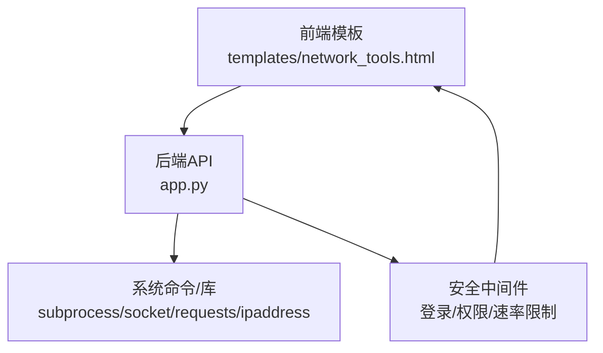
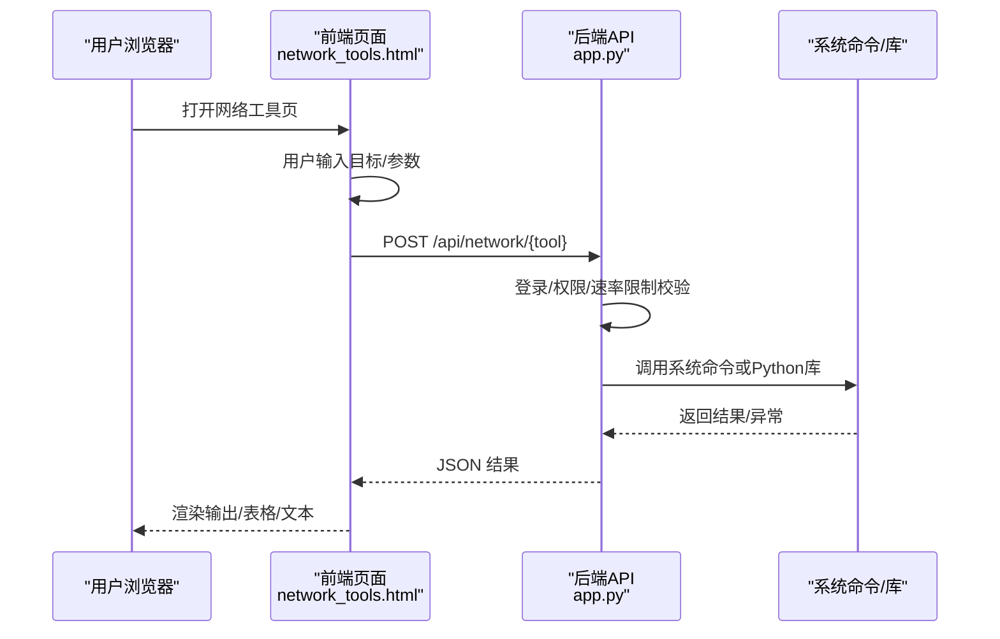
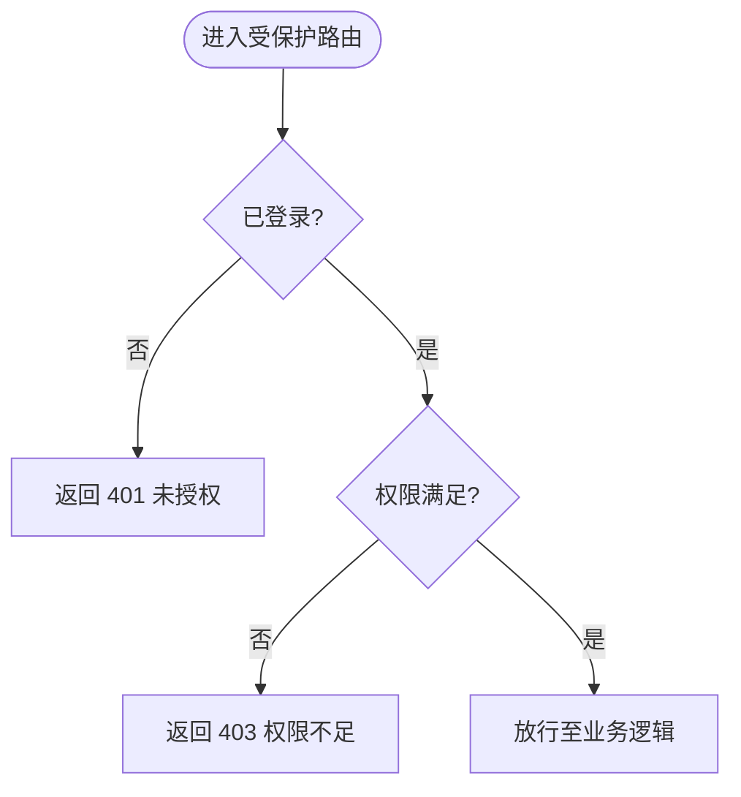
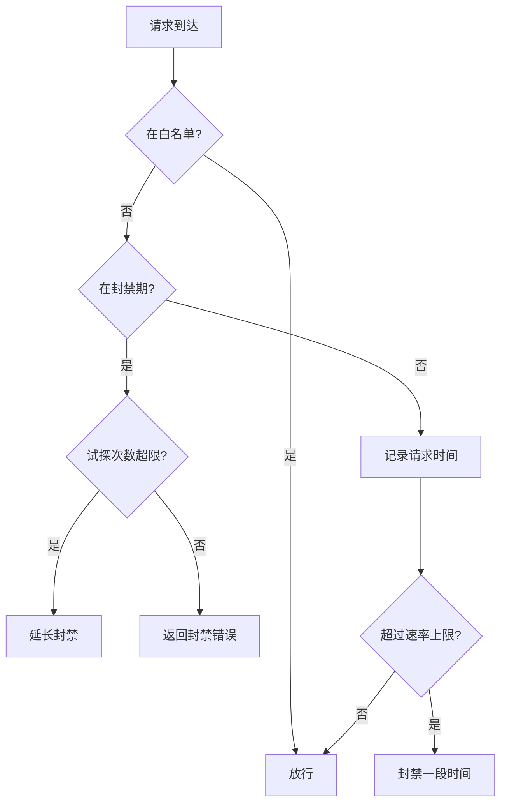
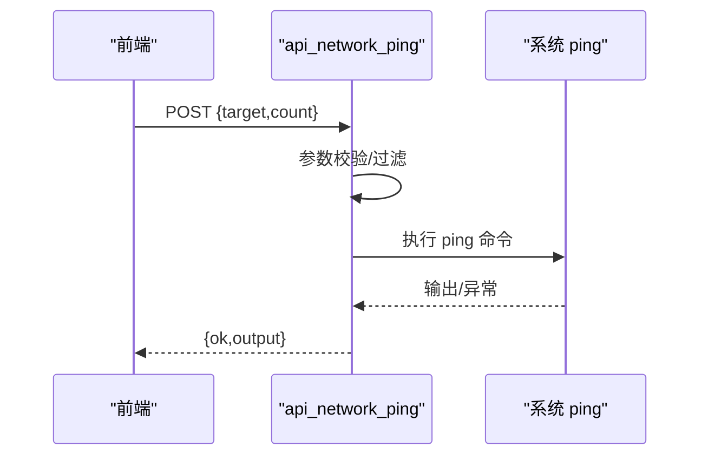
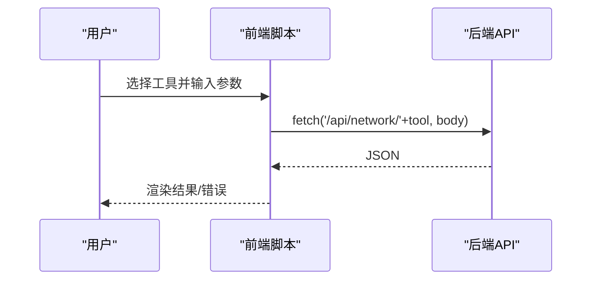
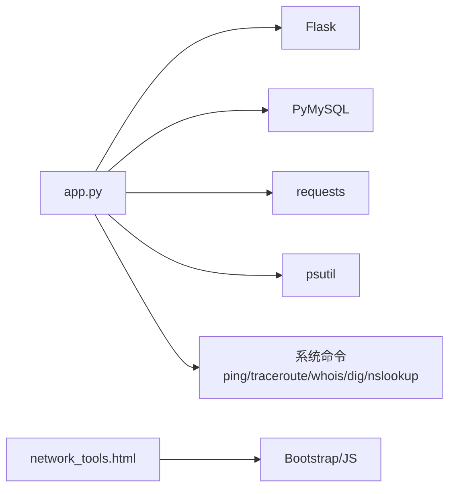

# 网络诊断

<cite>
**本文引用的文件**
- [app.py](file://app.py)
- [network_tools.html](file://templates/network_tools.html)
- [requirements.txt](file://requirements.txt)
- [zh-CN.json](file://i18n/zh-CN.json)
</cite>

## 目录
1. [简介](#简介)
2. [项目结构](#项目结构)
3. [核心组件](#核心组件)
4. [架构总览](#架构总览)
5. [详细组件分析](#详细组件分析)
6. [依赖分析](#依赖分析)
7. [性能考量](#性能考量)
8. [故障排查指南](#故障排查指南)
9. [结论](#结论)
10. [附录](#附录)

## 简介
本文件面向“网络诊断工具”的实现与使用，基于仓库中的网络工具模块，系统梳理其前端界面、后端API、安全策略与可扩展能力。当前实现覆盖以下能力：
- 连通性测试：ICMP Ping、Traceroute（路由追踪）
- 协议与解析：HTTP 响应头检查、SSL/TLS 证书检查、DNS 记录查询、Whois 查询
- 网络辅助：IP 地址解析、子网计算器
- 安全与访问控制：登录鉴权、VIP 权限、速率限制、命令调用安全过滤

说明：仓库未包含带宽测试（上/下行）、端口扫描（TCP）与自动化脚本（定时健康检查、告警与报告）。后续可在现有API基础上扩展。

## 项目结构
- 后端采用 Flask 应用，集中于 app.py，提供网络工具相关 API 与通用安全中间件
- 前端界面位于 templates/network_tools.html，提供 Tab 化的网络工具入口与交互
- 国际化文案位于 i18n/zh-CN.json，统一多语言支持
- 依赖声明位于 requirements.txt

图表来源
- [network_tools.html:1-196](file://templates/network_tools.html#L1-L196)
- [app.py:2075-2286](file://app.py#L2075-L2286)

章节来源
- [network_tools.html:1-196](file://templates/network_tools.html#L1-L196)
- [app.py:2075-2286](file://app.py#L2075-L2286)
- [requirements.txt:1-5](file://requirements.txt#L1-L5)

## 核心组件
- 登录与权限控制
  - 登录鉴权、CSRF 校验、管理员/访客/VIP 权限分级
- 速率限制与封禁
  - 基于内存的滑动窗口速率限制，支持白名单、手动封禁、封禁试探延长
- 网络工具API
  - Ping、Traceroute、Whois、DNS、HTTP 头、SSL、子网计算器
- 前端交互
  - Tab 切换、表单参数收集、fetch 调用、结果渲染

章节来源
- [app.py:907-963](file://app.py#L907-L963)
- [app.py:348-411](file://app.py#L348-L411)
- [app.py:2075-2286](file://app.py#L2075-L2286)
- [network_tools.html:199-327](file://templates/network_tools.html#L199-L327)

## 架构总览
网络诊断工具的前后端交互流程如下：

图表来源
- [network_tools.html:200-263](file://templates/network_tools.html#L200-L263)
- [app.py:2075-2286](file://app.py#L2075-L2286)

## 详细组件分析

### 1) 登录与权限控制
- 登录鉴权：未登录访问 /api/* 将返回 401
- VIP 权限：网络工具API均标注 @vip_required，访客无法直接调用
- CSRF 校验：对非 GET 的表单提交进行 CSRF token 校验
- 管理员权限：用于系统管理与白名单/封禁等后台功能

图表来源
- [app.py:907-963](file://app.py#L907-L963)

章节来源
- [app.py:907-963](file://app.py#L907-L963)

### 2) 速率限制与封禁
- 内存滑动窗口：按 IP+路由维度统计请求，超限封禁
- 封禁试探：封禁期内若继续试探，延长封禁时间
- 白名单：可持久化保存，绕过速率限制
- 动态配置：速率上限、窗口、封禁时长、试探阈值等可持久化配置

图表来源
- [app.py:348-411](file://app.py#L348-L411)
- [app.py:513-562](file://app.py#L513-L562)

章节来源
- [app.py:348-411](file://app.py#L348-L411)
- [app.py:513-562](file://app.py#L513-L562)

### 3) 网络工具API（当前实现）

#### 3.1 Ping 检测
- 功能：跨平台执行 ping，支持 Linux/macOS/Windows
- 参数：target、count（1~20）
- 输出：纯文本结果或错误信息
- 安全：正则过滤 target，超时/异常处理

图表来源
- [app.py:2075-2102](file://app.py#L2075-L2102)

章节来源
- [app.py:2075-2102](file://app.py#L2075-L2102)

#### 3.2 Traceroute（路由追踪）
- 功能：跨平台执行 traceroute/tracert
- 参数：target
- 输出：纯文本路由轨迹
- 安全：正则过滤 target，超时/异常处理

章节来源
- [app.py:2104-2127](file://app.py#L2104-L2127)

#### 3.3 Whois 查询
- 功能：查询域名 Whois 信息
- 参数：target
- 输出：纯文本结果
- 安全：正则过滤 target，超时/异常处理

章节来源
- [app.py:2130-2150](file://app.py#L2130-L2150)

#### 3.4 DNS 记录解析
- 功能：支持 A/AAAA/MX/NS/TXT/CNAME/SOA
- 参数：target、record_type
- 输出：记录列表或错误
- 安全：正则过滤 target，类型白名单，优先使用 dig，回退 nslookup

章节来源
- [app.py:2153-2208](file://app.py#L2153-L2208)

#### 3.5 HTTP 响应头检查
- 功能：获取目标 URL 的响应头、状态码、重定向次数
- 参数：target（自动补全 http/https）
- 输出：JSON 包含 url/status/headers/redirect_count
- 安全：URL 前缀校验与异常捕获

章节来源
- [app.py:2211-2236](file://app.py#L2211-L2236)

#### 3.6 SSL 证书检查
- 功能：连接 443 端口，提取证书主题/颁发者/有效期/SAN 等
- 参数：target
- 输出：JSON 包含 subject/issuer/notBefore/notAfter/daysLeft/san/version
- 安全：正则过滤 target，异常捕获

章节来源
- [app.py:2239-2285](file://app.py#L2239-L2285)

#### 3.7 子网计算器
- 功能：输入 CIDR，输出网络/广播/掩码/可用主机等
- 参数：cidr
- 输出：JSON 包含网络地址、广播地址、主机范围、私有/全局等属性

章节来源
- [app.py:2288-2315](file://app.py#L2288-L2315)

### 4) 前端交互与结果渲染
- Tab 切换：IP查询、端口扫描、Ping、Traceroute、Whois、DNS、HTTP头、SSL、子网计算器
- 表单参数：根据工具类型收集 target/count/type/cidr 等
- fetch 调用：统一 POST 到 /api/network/{tool}
- 结果渲染：纯文本或 HTML 表格/卡片

图表来源
- [network_tools.html:200-263](file://templates/network_tools.html#L200-L263)

章节来源
- [network_tools.html:1-196](file://templates/network_tools.html#L1-L196)
- [network_tools.html:199-327](file://templates/network_tools.html#L199-L327)

## 依赖分析
- Python 依赖：Flask、PyMySQL、psutil、requests
- 前端依赖：Bootstrap（通过模板引入），Vue3 前端工程（独立于网络工具页）
- 系统命令：ping、traceroute/tracert、whois、dig/nslookup

图表来源
- [requirements.txt:1-5](file://requirements.txt#L1-L5)
- [app.py:2075-2286](file://app.py#L2075-L2286)

章节来源
- [requirements.txt:1-5](file://requirements.txt#L1-L5)
- [app.py:2075-2286](file://app.py#L2075-L2286)

## 性能考量
- 命令执行超时控制：各工具均设置超时，避免阻塞
- 跨平台兼容：针对 Windows/Linux/macOS 分支处理命令参数
- I/O 与 CPU：DNS/SSL 等网络请求受远端影响，建议在前端做进度提示与重试策略
- 速率限制：防止滥用导致系统负载升高

章节来源
- [app.py:2094-2121](file://app.py#L2094-L2121)
- [app.py:2142-2150](file://app.py#L2142-L2150)
- [app.py:2195-2205](file://app.py#L2195-L2205)
- [app.py:2222-2236](file://app.py#L2222-L2236)
- [app.py:2254-2285](file://app.py#L2254-L2285)

## 故障排查指南
- 401 未登录：需先登录，再访问网络工具
- 403 权限不足：需 VIP 或管理员权限
- 408/500：命令执行超时或工具不可用（dig/nslookup/whois/ping/traceroute）
- 429 速率超限：请求过于频繁，等待封禁结束或联系管理员加入白名单
- DNS/SSL 失败：检查网络连通性、DNS 服务器、证书链有效性

章节来源
- [app.py:907-963](file://app.py#L907-L963)
- [app.py:513-562](file://app.py#L513-L562)
- [app.py:2094-2101](file://app.py#L2094-L2101)
- [app.py:2120-2127](file://app.py#L2120-L2127)
- [app.py:2142-2150](file://app.py#L2142-L2150)
- [app.py:2195-2205](file://app.py#L2195-L2205)
- [app.py:2222-2236](file://app.py#L2222-L2236)
- [app.py:2254-2285](file://app.py#L2254-L2285)

## 结论
- 当前网络诊断工具提供了基础的连通性与协议验证能力，具备良好的跨平台与安全基线
- 未包含带宽测试、TCP 端口扫描、自动化健康检查与告警/报告生成功能
- 建议在现有API基础上扩展：增加带宽测试、端口扫描、定时任务调度、指标采集与可视化

## 附录

### A. 使用指南与结果解读
- Ping/Traceroute/Whois/DNS/HTTP头/SSL/子网计算器：在前端 Tab 中选择对应工具，填写目标并执行
- 结果解读要点：
  - Ping：关注丢包率与平均延迟
  - Traceroute：观察路由路径与跳数
  - DNS：核对记录类型与解析结果
  - HTTP 头：关注安全头、缓存策略、重定向链路
  - SSL：关注有效期、SAN、版本
  - 子网：核对网络/广播/可用主机范围

章节来源
- [network_tools.html:1-196](file://templates/network_tools.html#L1-L196)
- [zh-CN.json:50-60](file://i18n/zh-CN.json#L50-L60)

### B. 安全考虑
- 测试流量控制：速率限制、封禁策略、白名单
- 目标主机保护：命令参数过滤、超时控制、最小权限原则
- 隐私保护：敏感字段脱敏、日志记录与审计、CSP 与 CSRF 保护

章节来源
- [app.py:348-411](file://app.py#L348-L411)
- [app.py:513-562](file://app.py#L513-L562)
- [app.py:641-676](file://app.py#L641-L676)

### C. 实际应用场景
- 网络故障定位：Ping/Traceroute/Whois/DNS/SSL 快速定位
- 性能优化：结合 DNS/SSL/HTTP 头分析优化
- 容量规划：子网计算器辅助网络规划

章节来源
- [app.py:2075-2286](file://app.py#L2075-L2286)
- [network_tools.html:1-196](file://templates/network_tools.html#L1-L196)