# 用户认证系统

<cite>
**本文引用的文件**
- [app.py](file://app.py)
- [templates/login.html](file://templates/login.html)
- [templates/register.html](file://templates/register.html)
- [templates/forgot_password.html](file://templates/forgot_password.html)
- [templates/reset_password.html](file://templates/reset_password.html)
- [templates/global_captcha.html](file://templates/global_captcha.html)
- [templates/base.html](file://templates/base.html)
- [frontend/src/api.js](file://frontend/src/api.js)
- [requirements.txt](file://requirements.txt)
</cite>

## 目录
1. [简介](#简介)
2. [项目结构](#项目结构)
3. [核心组件](#核心组件)
4. [架构总览](#架构总览)
5. [详细组件分析](#详细组件分析)
6. [依赖分析](#依赖分析)
7. [性能考虑](#性能考虑)
8. [故障排查指南](#故障排查指南)
9. [结论](#结论)
10. [附录](#附录)

## 简介
本技术文档面向“用户认证系统”，围绕用户注册、登录、密码重置与权限管理进行深入解析，并详细说明会话管理、CSRF防护、验证码系统、安全响应头配置、角色权限体系、密码加密存储、会话安全与防暴力破解机制。同时提供API接口说明、安全最佳实践与常见攻击防护建议，帮助开发者与运维人员全面掌握系统的安全设计与实现细节。

## 项目结构
系统采用前后端分离模式：
- 后端基于Flask，提供认证相关路由、会话与安全中间件、CSP与安全响应头、验证码生成与校验、速率限制与封禁策略、权限控制装饰器等。
- 前端为静态页面模板与少量JavaScript，通过fetch API与后端交互，统一携带Cookie凭据。

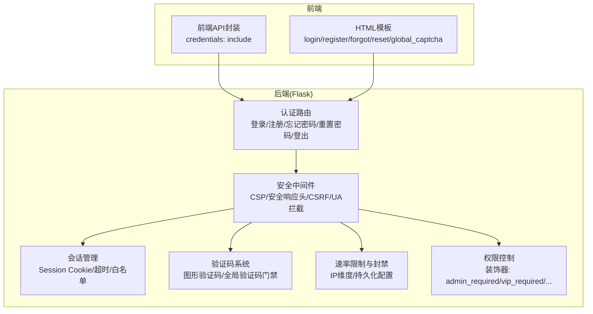

图表来源
- [app.py:122-142](file://app.py#L122-L142)
- [app.py:644-677](file://app.py#L644-L677)
- [app.py:920-964](file://app.py#L920-L964)
- [app.py:431-504](file://app.py#L431-L504)
- [app.py:603-625](file://app.py#L603-L625)
- [app.py:516-596](file://app.py#L516-L596)

章节来源
- [app.py:122-142](file://app.py#L122-L142)
- [app.py:644-677](file://app.py#L644-L677)
- [app.py:920-964](file://app.py#L920-L964)
- [app.py:431-504](file://app.py#L431-L504)
- [app.py:603-625](file://app.py#L603-L625)
- [app.py:516-596](file://app.py#L516-L596)

## 核心组件
- 会话与安全响应头
  - 使用Flask内置Session，配置HttpOnly、SameSite、Secure（按HTTPS环境自动启用）、会话有效期。
  - 在响应头中设置X-Content-Type-Options、X-Frame-Options、X-XSS-Protection、Referrer-Policy、Content-Security-Policy（含nonce）、HSTS（生产环境）、Permissions-Policy等。
- CSRF防护
  - 通过装饰器对非GET请求进行CSRF校验，使用HMAC比较token。
- 验证码系统
  - 图形验证码生成与校验；全站验证码门禁，针对已登录用户在特定路径触发二次验证。
- 速率限制与封禁
  - 内存+文件持久化的速率限制器；IP维度统计与封禁；白名单与手动封禁支持。
- 登录防爆破
  - 用户名维度的尝试次数与锁定时间控制。
- 权限体系
  - 角色：访客、普通用户、VIP、管理员；通过装饰器实现不同资源访问控制。
- 密码与日志
  - 使用Werkzeug安全哈希存储密码；记录活动日志与敏感操作日志。

章节来源
- [app.py:136-142](file://app.py#L136-L142)
- [app.py:644-677](file://app.py#L644-L677)
- [app.py:920-964](file://app.py#L920-L964)
- [app.py:431-504](file://app.py#L431-L504)
- [app.py:603-625](file://app.py#L603-L625)
- [app.py:516-596](file://app.py#L516-L596)
- [app.py:1207-1321](file://app.py#L1207-L1321)

## 架构总览
认证系统的关键交互流程如下：

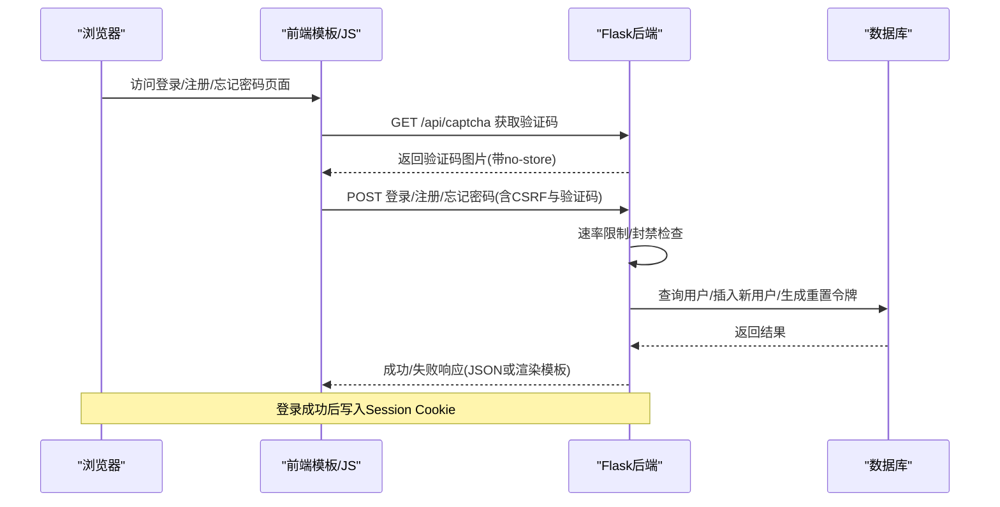

图表来源
- [app.py:431-504](file://app.py#L431-L504)
- [app.py:1029-1117](file://app.py#L1029-L1117)
- [app.py:1120-1189](file://app.py#L1120-L1189)
- [app.py:1207-1321](file://app.py#L1207-L1321)

## 详细组件分析

### 会话管理与安全设置
- Session配置
  - HttpOnly、SameSite=Lax、Secure按HTTPS环境自动启用、会话有效期2小时。
- 会话超时
  - IP维度空闲超时（默认约2.5分钟无操作强制重新登录）。
- 安全响应头
  - X-Content-Type-Options、X-Frame-Options、X-XSS-Protection、Referrer-Policy、CSP（nonce）、HSTS（生产）、Permissions-Policy。
- CSP与nonce
  - 每请求生成随机nonce，注入到模板与响应头，内联脚本/样式需nonce方可生效。

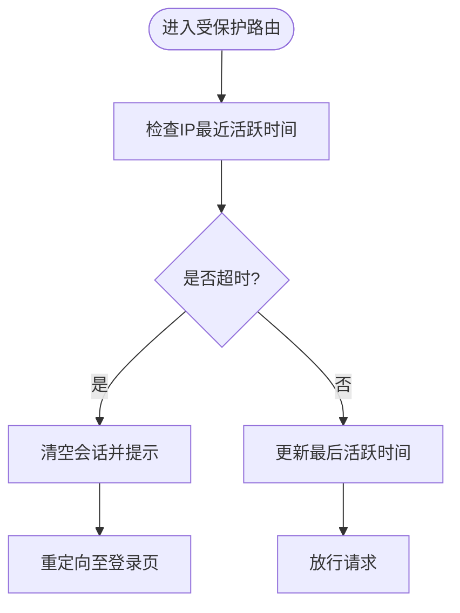

图表来源
- [app.py:567-596](file://app.py#L567-L596)
- [app.py:136-142](file://app.py#L136-L142)
- [app.py:644-677](file://app.py#L644-L677)

章节来源
- [app.py:136-142](file://app.py#L136-L142)
- [app.py:567-596](file://app.py#L567-L596)
- [app.py:644-677](file://app.py#L644-L677)

### CSRF防护机制
- 生成与校验
  - 每个会话生成唯一CSRF token；非GET请求需携带_form或Header中的token并与session中token做HMAC比较。
- 应用范围
  - 对登录、注册、忘记密码、重置密码、登出等关键表单提交生效。

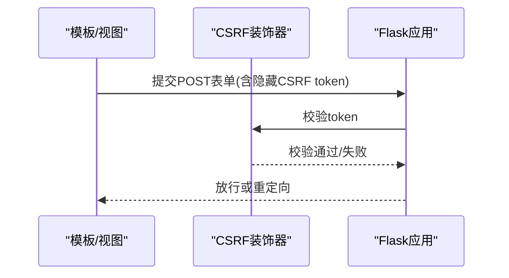

图表来源
- [app.py:920-933](file://app.py#L920-L933)

章节来源
- [app.py:920-933](file://app.py#L920-L933)

### 验证码系统
- 图形验证码
  - 生成4位字符验证码（排除易混淆字符），带噪点、曲线、轻微模糊；返回图片并设置no-store等缓存头。
- 全局验证码门禁
  - 已登录用户在非跳过路径进行POST时，若未完成验证码二次验证，则弹出验证码页面或返回JSON错误。
- 数据库操作验证码
  - 针对某些数据库敏感操作，额外要求二次验证码验证。

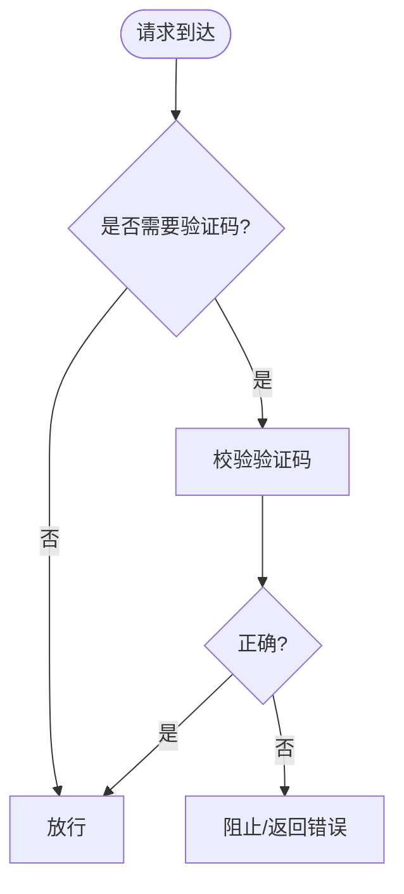

图表来源
- [app.py:431-504](file://app.py#L431-L504)
- [app.py:603-625](file://app.py#L603-L625)
- [app.py:967-989](file://app.py#L967-L989)

章节来源
- [app.py:431-504](file://app.py#L431-L504)
- [app.py:603-625](file://app.py#L603-L625)
- [app.py:967-989](file://app.py#L967-L989)

### 速率限制与防暴力破解
- 速率限制
  - 内存队列统计IP在时间窗口内的请求次数；超过阈值封禁；支持白名单与手动封禁；配置持久化到文件，支持运行时调整。
- 登录防爆破
  - 用户名维度记录尝试次数与锁定截止时间，锁定期内禁止登录。
- IP会话超时
  - 非活跃IP在设定时间内强制重新登录。

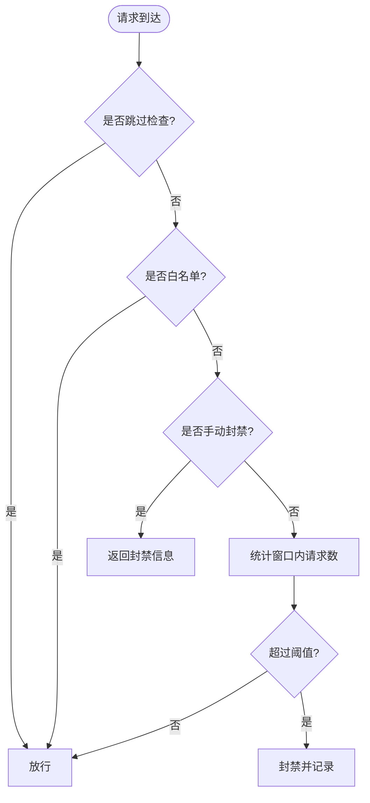

图表来源
- [app.py:516-596](file://app.py#L516-L596)
- [app.py:506-515](file://app.py#L506-L515)
- [app.py:353-392](file://app.py#L353-L392)

章节来源
- [app.py:516-596](file://app.py#L516-L596)
- [app.py:506-515](file://app.py#L506-L515)
- [app.py:353-392](file://app.py#L353-L392)

### 用户注册流程
- 输入校验与验证码
  - 校验用户名、密码、确认密码、可选管理员口令、验证码。
- 权限判定
  - 正确填写管理员口令可直接授予管理员权限；否则默认访客。
- 密码存储
  - 使用安全哈希算法存储密码。
- 成功与异常
  - 成功后跳转登录；用户名冲突、数据库错误等返回相应提示。

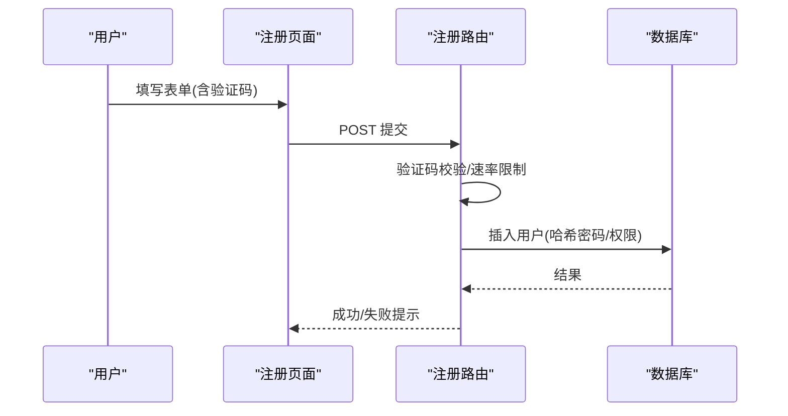

图表来源
- [app.py:1120-1189](file://app.py#L1120-L1189)
- [templates/register.html:8-44](file://templates/register.html#L8-L44)

章节来源
- [app.py:1120-1189](file://app.py#L1120-L1189)
- [templates/register.html:8-44](file://templates/register.html#L8-L44)

### 用户登录流程
- 输入校验与验证码
  - 校验用户名、密码、验证码。
- 登录防爆破
  - 若用户名被锁定则提示剩余锁定时间。
- 数据库查询与密码校验
  - 查询用户并校验密码哈希。
- 会话写入
  - 登录成功后写入Session（包含权限信息），并记录活动日志。
- 速率限制
  - 登录接口同样受速率限制保护。

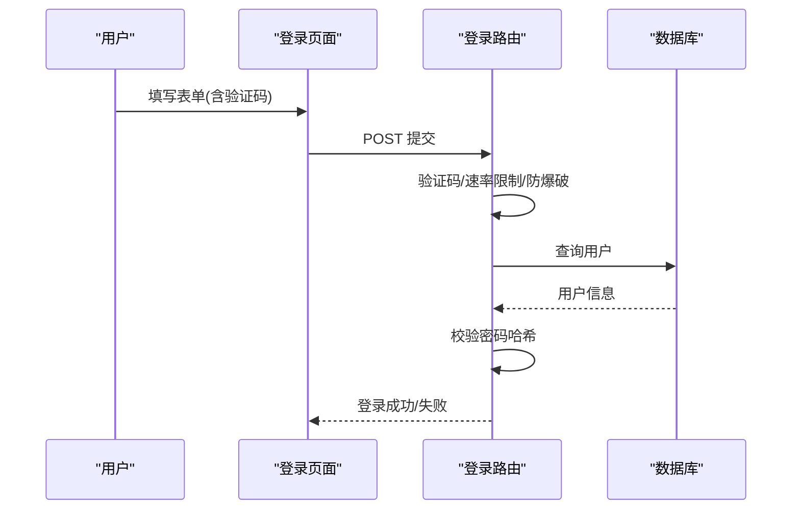

图表来源
- [app.py:1029-1117](file://app.py#L1029-L1117)
- [templates/login.html:8-35](file://templates/login.html#L8-L35)

章节来源
- [app.py:1029-1117](file://app.py#L1029-L1117)
- [templates/login.html:8-35](file://templates/login.html#L8-L35)

### 密码重置流程
- 忘记密码
  - 输入用户名与验证码，系统生成一次性令牌并记录到期时间，提示用户复制令牌。
- 重置密码
  - 输入用户名、令牌、新密码、确认密码、验证码；校验令牌有效性、时效性、新旧密码差异、强度规则；更新密码并标记令牌为已使用。
- 安全要点
  - 令牌有效期短（示例10分钟）；不允许与旧密码相同；验证码二次校验。

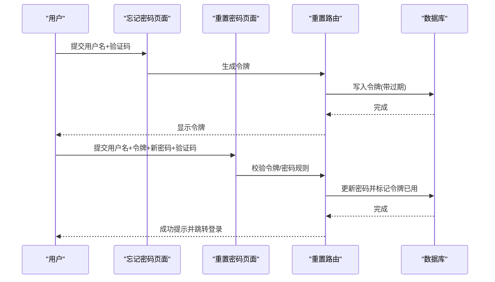

图表来源
- [app.py:1207-1259](file://app.py#L1207-L1259)
- [app.py:1262-1321](file://app.py#L1262-L1321)
- [templates/forgot_password.html:9-35](file://templates/forgot_password.html#L9-L35)
- [templates/reset_password.html:8-42](file://templates/reset_password.html#L8-L42)

章节来源
- [app.py:1207-1259](file://app.py#L1207-L1259)
- [app.py:1262-1321](file://app.py#L1262-L1321)
- [templates/forgot_password.html:9-35](file://templates/forgot_password.html#L9-L35)
- [templates/reset_password.html:8-42](file://templates/reset_password.html#L8-L42)

### 权限管理与角色体系
- 角色定义
  - 访客、普通用户、VIP、管理员。
- 控制方式
  - 通过装饰器实现细粒度权限控制：管理员专用、VIP及以上、非访客等。
- 模板注入
  - 上下文处理器向模板注入权限信息，便于界面展示。

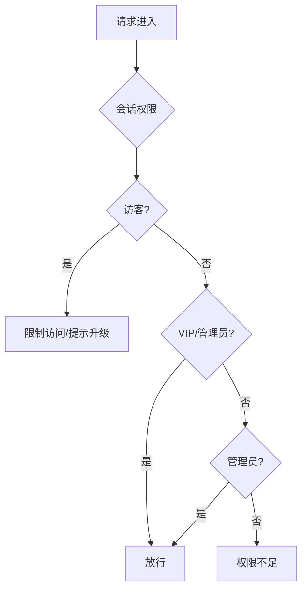

图表来源
- [app.py:935-964](file://app.py#L935-L964)
- [templates/base.html:178-201](file://templates/base.html#L178-L201)

章节来源
- [app.py:935-964](file://app.py#L935-L964)
- [templates/base.html:178-201](file://templates/base.html#L178-L201)

### 密码加密存储与日志
- 密码存储
  - 使用Werkzeug安全哈希算法生成不可逆摘要，避免明文存储。
- 日志记录
  - 记录用户注册、密码重置、VIP审核等关键操作，便于审计与追踪。

章节来源
- [app.py:1170-1183](file://app.py#L1170-L1183)
- [app.py:1245-1253](file://app.py#L1245-L1253)
- [app.py:1547-1576](file://app.py#L1547-L1576)

### API接口文档（认证相关）
以下为与认证相关的API说明（参数、返回值、错误处理）：

- 获取验证码
  - 方法与路径: GET /api/captcha
  - 功能: 生成图形验证码图片
  - 请求头: 无特殊要求
  - 响应: PNG图片；设置no-store等缓存头
  - 速率限制: 每IP每窗口最多N次（见速率限制配置）
  - 错误: 请求过于频繁时返回429

- 登录
  - 方法与路径: POST /login
  - 参数: username、password、captcha、_csrf_token
  - 响应: JSON或渲染登录页
  - 速率限制: 每IP每窗口最多N次
  - 错误: 验证码错误、账户锁定、数据库错误、CSRF失败等

- 注册
  - 方法与路径: POST /register
  - 参数: username、password、confirm、admin_pwd（可选）、captcha、_csrf_token
  - 响应: JSON或渲染注册页
  - 速率限制: 每IP每窗口最多N次
  - 错误: 验证码错误、用户名冲突、数据库错误、CSRF失败等

- 忘记密码
  - 方法与路径: POST /forgot_password
  - 参数: username、captcha、_csrf_token
  - 响应: JSON或渲染忘记密码页
  - 速率限制: 每IP每窗口最多M次
  - 错误: 验证码错误、用户名不存在、请求过于频繁等

- 重置密码
  - 方法与路径: POST /reset_password
  - 参数: username、token、new_pwd、confirm_pwd、captcha、_csrf_token
  - 响应: JSON或渲染重置密码页
  - 速率限制: 令牌相关校验与强度规则
  - 错误: 令牌无效/过期、两次密码不一致、密码强度不足、验证码错误等

- 登出
  - 方法与路径: POST /logout
  - 参数: _csrf_token
  - 响应: 重定向至登录页
  - 错误: CSRF失败时重定向

章节来源
- [app.py:431-504](file://app.py#L431-L504)
- [app.py:1029-1117](file://app.py#L1029-L1117)
- [app.py:1120-1189](file://app.py#L1120-L1189)
- [app.py:1207-1259](file://app.py#L1207-L1259)
- [app.py:1262-1321](file://app.py#L1262-L1321)
- [app.py:1192-1204](file://app.py#L1192-L1204)

## 依赖分析
- 后端依赖
  - Flask、PyMySQL、psutil、requests等。
- 前端依赖
  - Bootstrap CDN、本地JS；API封装统一携带Cookie凭据。

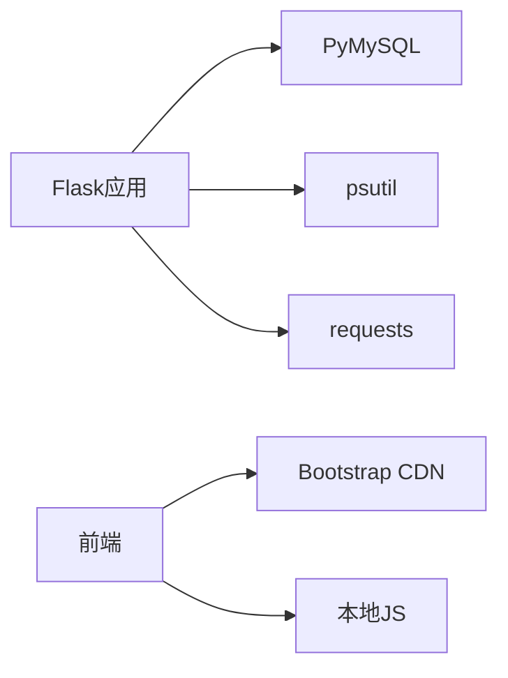

图表来源
- [requirements.txt:1-5](file://requirements.txt#L1-L5)
- [frontend/src/api.js:1-45](file://frontend/src/api.js#L1-L45)

章节来源
- [requirements.txt:1-5](file://requirements.txt#L1-L5)
- [frontend/src/api.js:1-45](file://frontend/src/api.js#L1-L45)

## 性能考虑
- 会话与缓存
  - Session Cookie为HttpOnly+SameSite+Secure，减少跨站风险；CSP nonce避免内联脚本导致的缓存污染。
- 速率限制
  - 内存队列+文件持久化配置，降低高并发下的CPU压力；合理设置窗口与阈值。
- 数据库
  - 关键表建立索引（如用户权限、令牌过期时间、活动日志索引），减少查询开销。
- 前端
  - fetch统一携带credentials，避免重复发送凭据；模板内联脚本尽量迁移到外链以减少nonce变更频率。

## 故障排查指南
- 登录频繁被限流
  - 检查IP是否被封禁或达到阈值；查看速率配置文件；确认白名单设置。
- 验证码无效
  - 确认验证码接口可用且未被缓存；检查会话中验证码是否过期；确认提交格式正确。
- CSRF失败
  - 确认表单中携带_csrf_token或请求头携带X-CSRF-Token；确保会话中token存在且未过期。
- 会话超时频繁
  - 检查客户端网络状况与请求频率；适当调整空闲超时阈值。
- 安全响应头问题
  - 确认CSP nonce生成与注入；检查HSTS仅在生产环境启用；核对CORS配置。

章节来源
- [app.py:516-596](file://app.py#L516-L596)
- [app.py:431-504](file://app.py#L431-L504)
- [app.py:920-933](file://app.py#L920-L933)
- [app.py:644-677](file://app.py#L644-L677)

## 结论
本认证系统通过会话安全、CSRF防护、验证码与速率限制、权限控制与安全响应头等多层机制，构建了较为完整的Web安全基线。结合密码哈希存储与日志审计，能够有效抵御常见攻击并保障用户隐私与系统稳定。建议在生产环境中进一步完善证书与反向代理配置、定期审查安全策略与依赖版本，并持续监控与优化性能与可用性。

## 附录
- 模板与页面
  - 登录、注册、忘记密码、重置密码、全局验证码等页面均集成CSRF与验证码控件。
- 前端API
  - 统一使用fetch并携带Cookie凭据，便于与后端会话机制配合。

章节来源
- [templates/login.html:8-35](file://templates/login.html#L8-L35)
- [templates/register.html:8-44](file://templates/register.html#L8-L44)
- [templates/forgot_password.html:9-35](file://templates/forgot_password.html#L9-L35)
- [templates/reset_password.html:8-42](file://templates/reset_password.html#L8-L42)
- [templates/global_captcha.html:10-21](file://templates/global_captcha.html#L10-L21)
- [frontend/src/api.js:1-45](file://frontend/src/api.js#L1-L45)