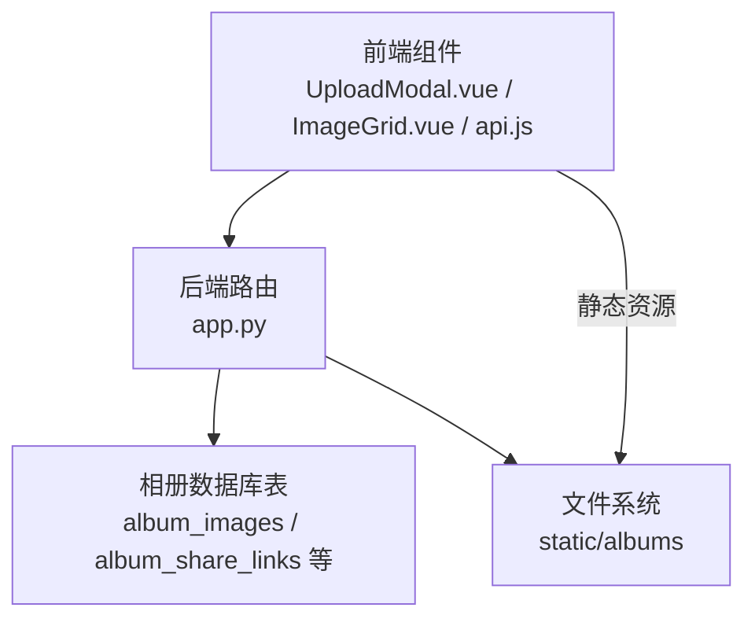
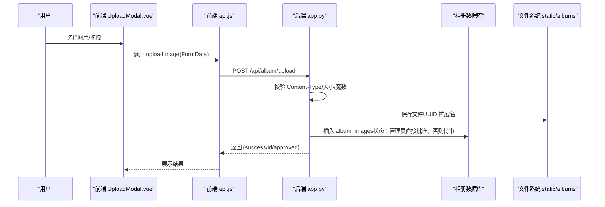
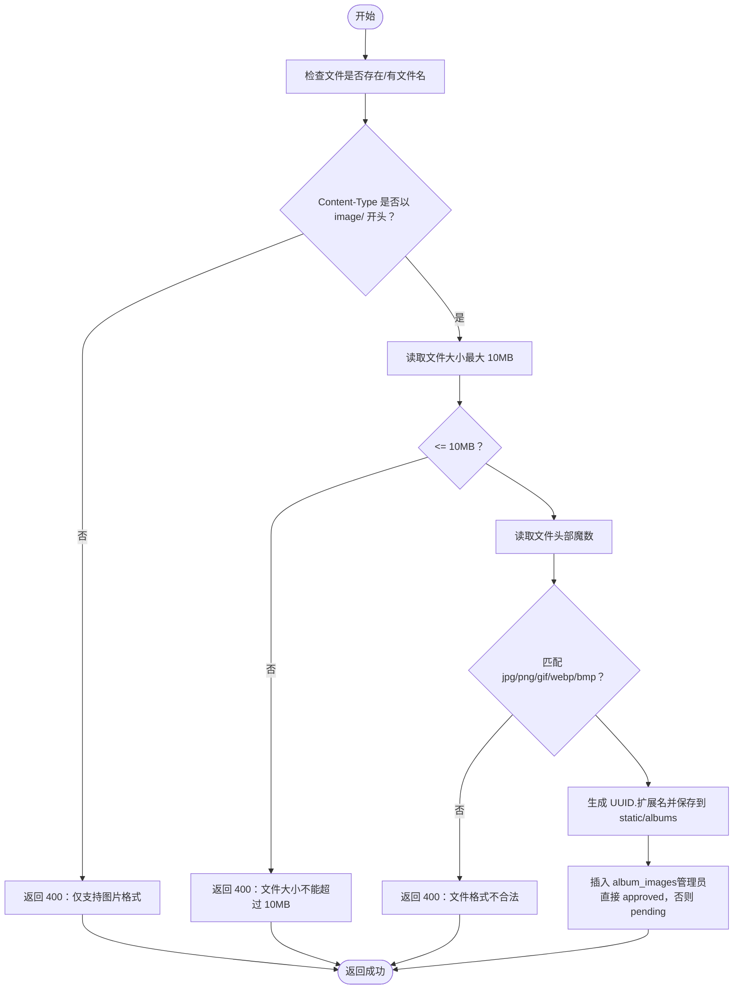
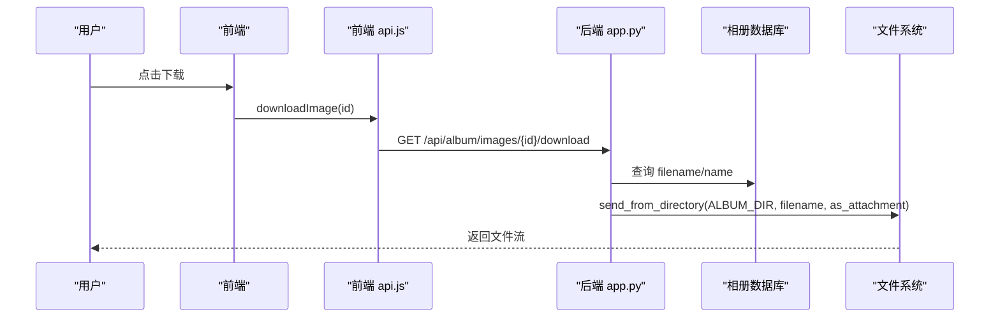
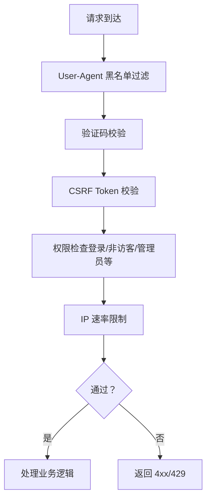
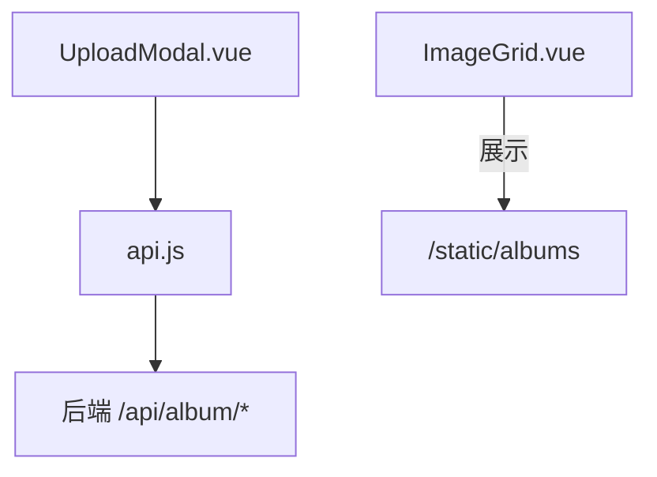
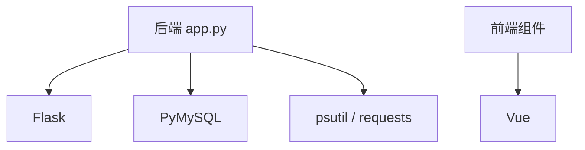

# 图片上传与下载

<cite>
**本文引用的文件**   
- [app.py](file://app.py)
- [frontend/src/api.js](file://frontend/src/api.js)
- [frontend/src/components/UploadModal.vue](file://frontend/src/components/UploadModal.vue)
- [frontend/src/components/ImageGrid.vue](file://frontend/src/components/ImageGrid.vue)
- [templates/album_vue3.html](file://templates/album_vue3.html)
- [requirements.txt](file://requirements.txt)
- [安全措施清单.md](file://安全措施清单.md)
</cite>

## 目录
1. [简介](#简介)
2. [项目结构](#项目结构)
3. [核心组件](#核心组件)
4. [架构总览](#架构总览)
5. [详细组件分析](#详细组件分析)
6. [依赖分析](#依赖分析)
7. [性能考虑](#性能考虑)
8. [故障排查指南](#故障排查指南)
9. [结论](#结论)
10. [附录](#附录)

## 简介
本文件围绕“图片上传与下载”功能，系统性梳理前端交互、后端接口、数据存储与安全防护的设计与实现。重点覆盖：
- 上传流程：文件验证（类型、大小、魔数）、格式转换（UUID 命名）、入库与状态控制
- 下载流程：直链下载、分享链接访问、缩略图策略建议
- 存储策略：文件命名、目录结构、备份机制
- 安全机制：速率限制、CSRF/验证码、权限控制、XSS/CSP、路径穿越防护
- 性能优化：并发上传、断点续传与压缩处理建议

## 项目结构
- 后端基于 Flask，提供相册相关的上传、下载、分享等 API，并集成数据库表结构初始化与日志记录
- 前端采用 Vue 组件与 fetch API，负责图片选择、预览、批量上传与列表展示
- 静态资源目录 static/albums 用于存放图片文件

**图表来源**
- [app.py:2513-2514](file://app.py#L2513-L2514)
- [frontend/src/api.js:1-45](file://frontend/src/api.js#L1-L45)
- [frontend/src/components/UploadModal.vue:1-116](file://frontend/src/components/UploadModal.vue#L1-L116)
- [frontend/src/components/ImageGrid.vue:1-129](file://frontend/src/components/ImageGrid.vue#L1-L129)

**章节来源**
- [app.py:2513-2514](file://app.py#L2513-L2514)
- [frontend/src/api.js:1-45](file://frontend/src/api.js#L1-L45)
- [frontend/src/components/UploadModal.vue:1-116](file://frontend/src/components/UploadModal.vue#L1-L116)
- [frontend/src/components/ImageGrid.vue:1-129](file://frontend/src/components/ImageGrid.vue#L1-L129)

## 核心组件
- 上传接口：/api/album/upload（POST，multipart/form-data）
- 下载接口：/api/album/images/{id}/download（GET）
- 分享接口：/api/album/images/{id}/share（GET/POST）
- 前端上传组件：UploadModal.vue
- 前端 API 封装：frontend/src/api.js
- 前端相册网格：ImageGrid.vue

**章节来源**
- [app.py:2734-2810](file://app.py#L2734-L2810)
- [app.py:2859-2882](file://app.py#L2859-L2882)
- [app.py:2887-2920](file://app.py#L2887-L2920)
- [frontend/src/api.js:1-45](file://frontend/src/api.js#L1-L45)
- [frontend/src/components/UploadModal.vue:1-116](file://frontend/src/components/UploadModal.vue#L1-L116)
- [frontend/src/components/ImageGrid.vue:1-129](file://frontend/src/components/ImageGrid.vue#L1-L129)

## 架构总览
后端通过路由装饰器实现鉴权与安全控制，上传接口完成文件校验与入库，下载接口提供直链下载与分享访问。

**图表来源**
- [frontend/src/components/UploadModal.vue:81-99](file://frontend/src/components/UploadModal.vue#L81-L99)
- [frontend/src/api.js:33](file://frontend/src/api.js#L33)
- [app.py:2734-2810](file://app.py#L2734-L2810)

## 详细组件分析

### 上传流程与接口设计
- 请求方式：POST
- 路径：/api/album/upload
- 鉴权：需登录且非访客
- 请求体：multipart/form-data
  - image：必填，图片文件
  - category：可选，默认“graduation”
  - name：可选，自定义名称
- 响应：
  - 成功：{"success": true, "id": 图片ID, "approved": 是否已批准}
  - 失败：{"error": "..."}

**图表来源**
- [app.py:2734-2810](file://app.py#L2734-L2810)

**章节来源**
- [app.py:2734-2810](file://app.py#L2734-L2810)
- [frontend/src/components/UploadModal.vue:81-99](file://frontend/src/components/UploadModal.vue#L81-L99)
- [frontend/src/api.js:33](file://frontend/src/api.js#L33)

### 下载流程与分享
- 直接下载
  - 路径：/api/album/images/{id}/download
  - 方法：GET
  - 行为：根据图片 ID 查询文件名与显示名，按原扩展名拼接安全文件名，通过 send_from_directory 提供下载
- 分享链接
  - 创建：POST /api/album/images/{id}/share，生成唯一 token 并写入 album_share_links
  - 访问：GET /api/album/images/{id}/share 获取最新 token 对应链接
  - 公共页：/share/{token} 展示图片与基本信息

**图表来源**
- [frontend/src/api.js:26](file://frontend/src/api.js#L26)
- [app.py:2859-2882](file://app.py#L2859-L2882)

**章节来源**
- [app.py:2859-2882](file://app.py#L2859-L2882)
- [app.py:2887-2920](file://app.py#L2887-L2920)
- [frontend/src/api.js:26](file://frontend/src/api.js#L26)

### 存储策略与命名规则
- 目录结构：static/albums
- 文件命名：UUID + 原始扩展名（由魔数检测决定）
- 数据库存储字段：category、name、filename、uploader、uploader_name、status
- 状态控制：管理员上传直接 approved，普通用户上传为 pending，等待审核

**图表来源**
- [app.py:2734-2810](file://app.py#L2734-L2810)
- [app.py:2513-2514](file://app.py#L2513-L2514)

**章节来源**
- [app.py:2513-2514](file://app.py#L2513-L2514)
- [app.py:2734-2810](file://app.py#L2734-L2810)

### 安全机制
- 速率限制：全局 IP 速率限制与持久化配置，支持白名单与手动封禁
- 验证码：登录、数据库操作、验证码接口均进行图形验证码校验
- 权限控制：登录必需、非访客限制、管理员/ VIP 权限装饰器
- CSRF：CSRF token 校验
- 输入清洗：sanitize_input 去除脚本与 HTML 标签，限制长度
- 安全响应头：CSP、X-Content-Type-Options、X-Frame-Options、X-XSS-Protection、Referrer-Policy、HSTS（生产环境）
- 路径穿越：send_from_directory 限制在指定目录内

**图表来源**
- [app.py:144-159](file://app.py#L144-L159)
- [app.py:603-625](file://app.py#L603-L625)
- [app.py:908-952](file://app.py#L908-L952)
- [app.py:920-933](file://app.py#L920-L933)
- [app.py:517-565](file://app.py#L517-L565)

**章节来源**
- [app.py:144-159](file://app.py#L144-L159)
- [app.py:603-625](file://app.py#L603-L625)
- [app.py:908-952](file://app.py#L908-L952)
- [app.py:920-933](file://app.py#L920-L933)
- [app.py:517-565](file://app.py#L517-L565)
- [安全措施清单.md:69-98](file://安全措施清单.md#L69-L98)

### 前端交互与展示
- UploadModal.vue
  - 支持多选、拖拽、预览
  - 本地 5MB 限制与格式过滤
  - 构造 FormData 并调用 uploadImage
- api.js
  - 统一封装 /api/album 前缀
  - downloadImage 使用 window.open 触发下载
- ImageGrid.vue
  - 列表展示 /static/albums/{filename}
  - 支持教师角色重命名/删除

**图表来源**
- [frontend/src/components/UploadModal.vue:1-116](file://frontend/src/components/UploadModal.vue#L1-L116)
- [frontend/src/api.js:1-45](file://frontend/src/api.js#L1-L45)
- [frontend/src/components/ImageGrid.vue:1-129](file://frontend/src/components/ImageGrid.vue#L1-L129)

**章节来源**
- [frontend/src/components/UploadModal.vue:1-116](file://frontend/src/components/UploadModal.vue#L1-L116)
- [frontend/src/api.js:1-45](file://frontend/src/api.js#L1-L45)
- [frontend/src/components/ImageGrid.vue:1-129](file://frontend/src/components/ImageGrid.vue#L1-L129)

## 依赖分析
- 后端依赖：Flask、PyMySQL、psutil、requests
- 前端依赖：Vue（在组件中使用）

**图表来源**
- [requirements.txt:1-5](file://requirements.txt#L1-L5)

**章节来源**
- [requirements.txt:1-5](file://requirements.txt#L1-L5)

## 性能考虑
- 并发上传：前端逐个发送请求，可改为并发队列与进度反馈（当前实现为顺序上传）
- 断点续传：当前未实现，建议引入分片上传与服务端校验（需额外接口与存储策略）
- 压缩处理：当前未实现，建议在上传前进行尺寸/质量压缩（需前端裁剪与后端转码）

[本节为通用性能建议，不直接分析具体文件]

## 故障排查指南
- 上传失败
  - 检查文件类型与大小：仅支持图片且不超过 10MB（魔数检测）
  - 确认登录状态与权限：非访客用户才可上传
  - 查看后端日志与活动记录
- 下载失败
  - 确认图片 ID 存在且文件仍存在于 static/albums
  - 检查权限：需登录
- 分享链接无效
  - 确认 token 是否存在且未过期
  - 检查 album_share_links 表记录
- 频繁请求被拒
  - 检查 IP 是否被封禁或达到速率限制
  - 查看 rate_config.json 与 rate_limiter.json

**章节来源**
- [app.py:2734-2810](file://app.py#L2734-L2810)
- [app.py:2859-2882](file://app.py#L2859-L2882)
- [app.py:2887-2920](file://app.py#L2887-L2920)
- [app.py:517-565](file://app.py#L517-L565)

## 结论
本项目在图片上传与下载方面实现了基础而稳健的功能：严格的文件校验、安全的命名与存储、完善的鉴权与速率限制、以及清晰的前后端交互。后续可在并发上传、断点续传与压缩处理等方面进一步优化，同时可增加缩略图生成与 CDN 分发策略以提升用户体验与性能。

## 附录
- 相关路由与职责
  - /api/album/upload：上传图片
  - /api/album/images/{id}/download：下载图片
  - /api/album/images/{id}/share：分享链接管理
  - /share/{token}：公共分享页
- 目录与文件
  - static/albums：图片存储根目录
  - 相册数据库表：album_images、album_share_links 等

**章节来源**
- [app.py:2513-2514](file://app.py#L2513-L2514)
- [app.py:2734-2810](file://app.py#L2734-L2810)
- [app.py:2859-2882](file://app.py#L2859-L2882)
- [app.py:2887-2920](file://app.py#L2887-L2920)
- [app.py:2922-2959](file://app.py#L2922-L2959)