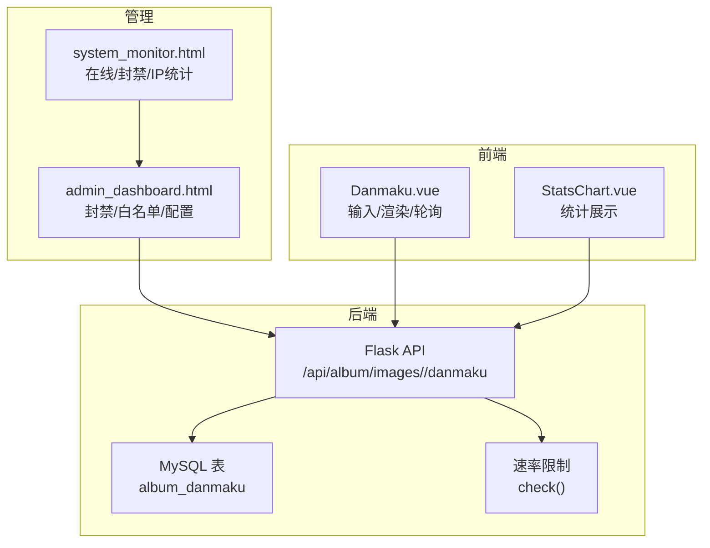
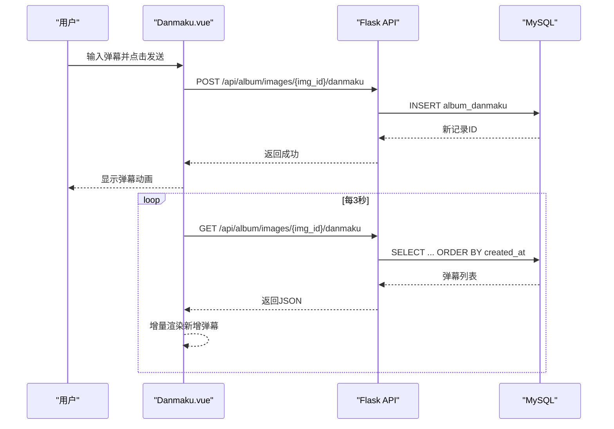
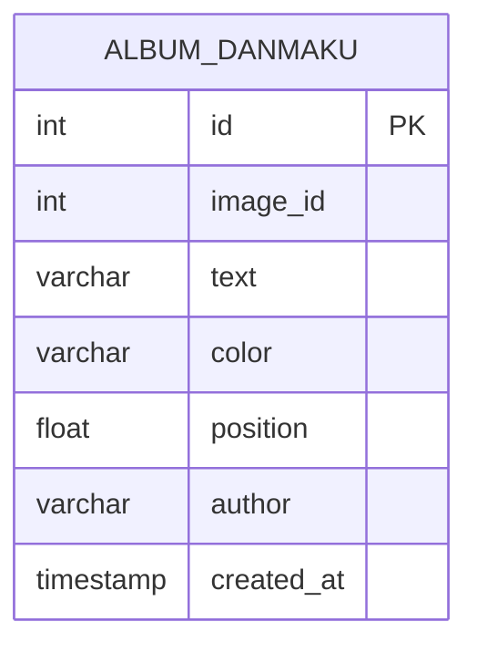
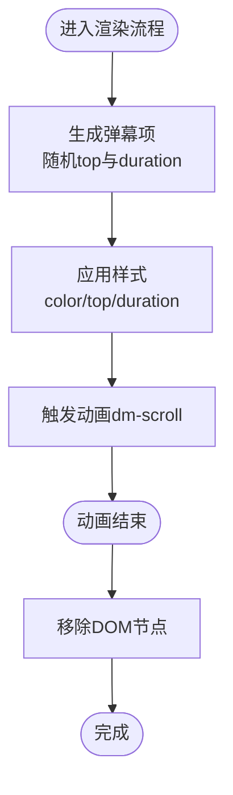
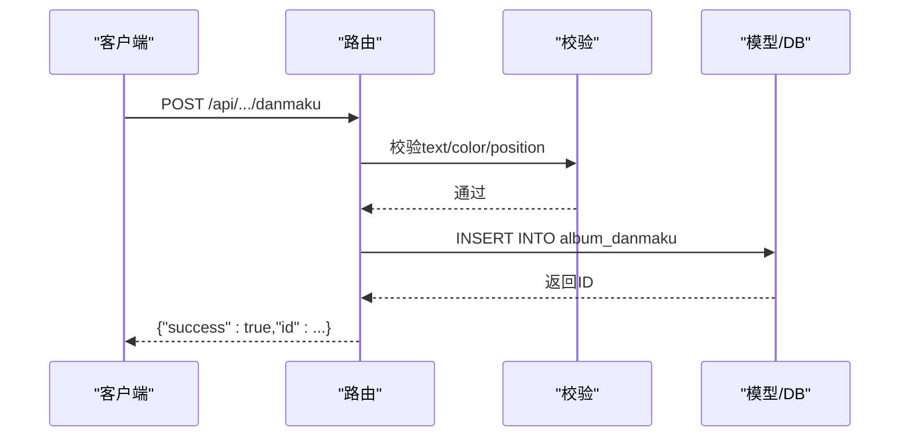
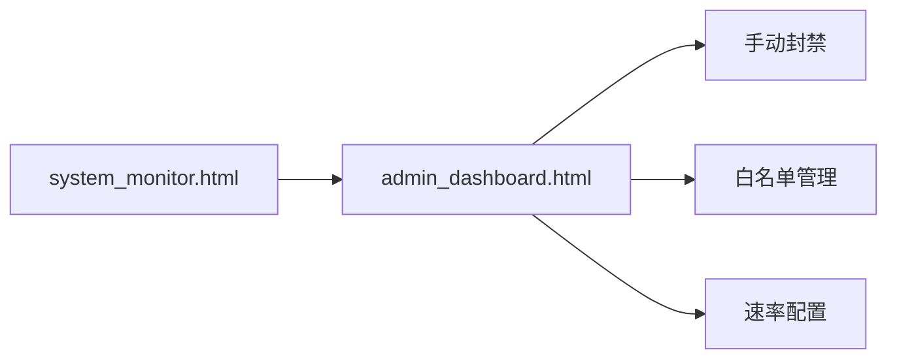
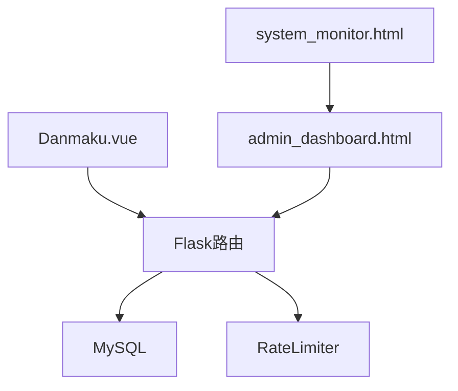

# 弹幕功能实现

<cite>
**本文档引用的文件**
- [Danmaku.vue](file://frontend/src/components/Danmaku.vue)
- [app.py](file://app.py)
- [admin_dashboard.html](file://templates/admin_dashboard.html)
- [StatsChart.vue](file://frontend/src/components/StatsChart.vue)
- [system_monitor.html](file://templates/system_monitor.html)
</cite>

## 目录
1. [简介](#简介)
2. [项目结构](#项目结构)
3. [核心组件](#核心组件)
4. [架构概览](#架构概览)
5. [详细组件分析](#详细组件分析)
6. [依赖分析](#依赖分析)
7. [性能考虑](#性能考虑)
8. [故障排查指南](#故障排查指南)
9. [结论](#结论)
10. [附录](#附录)

## 简介
本文件面向弹幕功能的技术实现，围绕数据库设计、渲染引擎、发送接口、显示机制、性能优化、管理功能与统计分析进行系统化梳理。当前仓库中的弹幕实现采用前端Vue组件负责渲染与交互，后端Flask提供REST API与数据库存储，辅以速率限制与管理员后台能力。

## 项目结构
弹幕功能涉及前后端协作：
- 前端：Vue组件负责输入、渲染、轮询与动画
- 后端：Flask路由提供弹幕增删查与速率限制
- 管理：管理员后台用于封禁、白名单与统计监控

**图表来源**
- [Danmaku.vue:1-88](file://frontend/src/components/Danmaku.vue#L1-L88)
- [app.py:3504-3544](file://app.py#L3504-L3544)
- [admin_dashboard.html:24-679](file://templates/admin_dashboard.html#L24-L679)
- [system_monitor.html:94-119](file://templates/system_monitor.html#L94-L119)

**章节来源**
- [Danmaku.vue:1-88](file://frontend/src/components/Danmaku.vue#L1-L88)
- [app.py:3504-3544](file://app.py#L3504-L3544)
- [admin_dashboard.html:24-679](file://templates/admin_dashboard.html#L24-L679)
- [system_monitor.html:94-119](file://templates/system_monitor.html#L94-L119)

## 核心组件
- 前端弹幕组件：负责输入、颜色选择、渲染、动画与轮询拉取
- 后端弹幕API：提供弹幕列表查询与新增
- 速率限制：保护接口免受滥用
- 管理后台：封禁、白名单与配置管理
- 统计模块：活跃度与排行榜

**章节来源**
- [Danmaku.vue:18-74](file://frontend/src/components/Danmaku.vue#L18-L74)
- [app.py:3504-3544](file://app.py#L3504-L3544)
- [app.py:3519-3541](file://app.py#L3519-L3541)
- [app.py:348-400](file://app.py#L348-L400)

## 架构概览
弹幕系统采用“前端渲染 + 后端API + 数据库存储”的三层架构。前端组件通过轮询增量更新弹幕，后端提供REST接口并执行速率限制策略，数据库持久化弹幕数据。

**图表来源**
- [Danmaku.vue:50-71](file://frontend/src/components/Danmaku.vue#L50-L71)
- [app.py:3504-3517](file://app.py#L3504-L3517)
- [app.py:3519-3541](file://app.py#L3519-L3541)

## 详细组件分析

### 数据库设计
弹幕表结构包含以下关键字段：
- 主键：自增ID
- 关联：图片ID（image_id）
- 文本：弹幕内容（text，长度限制）
- 颜色：十六进制颜色值（color）
- 位置：百分比位置（position，浮点）
- 作者：发表者用户名（author）
- 时间：创建时间（created_at）

**图表来源**
- [app.py:781-792](file://app.py#L781-L792)

**章节来源**
- [app.py:781-792](file://app.py#L781-L792)

### 渲染引擎实现
- 渲染容器：相对定位的舞台区域，高度固定，隐藏溢出
- 弹幕项：绝对定位的行内块元素，使用CSS动画实现从右到左滚动
- 动画参数：随机垂直起点与随机动画时长，保证视觉多样性
- 生命周期：动画结束触发移除逻辑，避免DOM堆积

**图表来源**
- [Danmaku.vue:36-49](file://frontend/src/components/Danmaku.vue#L36-L49)
- [Danmaku.vue:84-87](file://frontend/src/components/Danmaku.vue#L84-L87)

**章节来源**
- [Danmaku.vue:1-88](file://frontend/src/components/Danmaku.vue#L1-L88)

### 发送接口设计
- 路径：POST /api/album/images/{img_id}/danmaku
- 参数：text（必填，长度限制）、color（可选，默认白色）、position（可选，默认50）
- 校验：非空校验、长度裁剪
- 响应：返回新增记录ID与成功标志
- 安全：登录态要求（装饰器保护）

**图表来源**
- [app.py:3519-3541](file://app.py#L3519-L3541)

**章节来源**
- [app.py:3519-3541](file://app.py#L3519-L3541)

### 显示机制
- 滚动效果：CSS keyframes定义从右到左平滑移动
- 固定位置：通过随机top百分比实现多行滚动
- 透明度控制：当前实现未显式设置透明度，可通过样式扩展
- 碰撞检测：当前未实现碰撞检测算法，建议在Canvas方案中引入

**章节来源**
- [Danmaku.vue:84-87](file://frontend/src/components/Danmaku.vue#L84-L87)

### 性能优化
- 渲染队列管理：使用数组维护活动弹幕，动画结束后及时移除
- 内存回收：DOM节点移除，避免长期累积
- 帧率控制：CSS动画由浏览器合成层驱动，减少JS循环开销
- 轮询节流：3秒间隔拉取，避免频繁请求
- 速率限制：后端全局IP请求限制，防止接口滥用

**章节来源**
- [Danmaku.vue:60-73](file://frontend/src/components/Danmaku.vue#L60-L73)
- [app.py:514-562](file://app.py#L514-L562)

### 管理功能
- 封禁与白名单：管理员可对IP进行手动封禁与批量操作
- 配置管理：动态调整速率限制参数
- 统计监控：在线IP、封禁数量、白名单等可视化展示

**图表来源**
- [admin_dashboard.html:24-679](file://templates/admin_dashboard.html#L24-L679)
- [system_monitor.html:94-119](file://templates/system_monitor.html#L94-L119)

**章节来源**
- [admin_dashboard.html:24-679](file://templates/admin_dashboard.html#L24-L679)
- [system_monitor.html:94-119](file://templates/system_monitor.html#L94-L119)

### 统计分析与热门弹幕排行
- 活跃度排行榜：按用户累计积分排序，支持API查询
- 统计图表：上传达人、最受欢迎照片等统计展示组件
- 弹幕统计：当前弹幕表未内置聚合统计字段，可在后端增加聚合查询或离线统计任务

**章节来源**
- [app.py:1341-1393](file://app.py#L1341-L1393)
- [StatsChart.vue:1-55](file://frontend/src/components/StatsChart.vue#L1-L55)

## 依赖分析
- 前端依赖：Vue响应式与生命周期钩子
- 后端依赖：Flask路由、数据库连接、速率限制类
- 管理依赖：模板与脚本用于IP封禁与配置管理

**图表来源**
- [Danmaku.vue:18-74](file://frontend/src/components/Danmaku.vue#L18-L74)
- [app.py:3504-3544](file://app.py#L3504-L3544)
- [app.py:31-116](file://app.py#L31-L116)
- [admin_dashboard.html:24-679](file://templates/admin_dashboard.html#L24-L679)
- [system_monitor.html:94-119](file://templates/system_monitor.html#L94-L119)

**章节来源**
- [Danmaku.vue:18-74](file://frontend/src/components/Danmaku.vue#L18-L74)
- [app.py:31-116](file://app.py#L31-L116)
- [app.py:3504-3544](file://app.py#L3504-L3544)
- [admin_dashboard.html:24-679](file://templates/admin_dashboard.html#L24-L679)
- [system_monitor.html:94-119](file://templates/system_monitor.html#L94-L119)

## 性能考虑
- 前端
  - 使用CSS动画而非JS逐帧更新，降低CPU占用
  - 控制同时渲染的弹幕数量，避免过多DOM节点
  - 合理设置轮询间隔，平衡实时性与带宽
- 后端
  - 速率限制结合白名单与手动封禁，提升抗压能力
  - 数据库索引：按image_id与created_at建立索引，优化查询
- 存储
  - 定期清理历史弹幕，控制表规模

[本节为通用指导，无需特定文件引用]

## 故障排查指南
- 弹幕无法发送
  - 检查登录态与路由权限
  - 查看后端返回错误信息
  - 确认text非空且长度符合限制
- 弹幕不显示
  - 检查轮询是否正常工作
  - 确认imageId有效
  - 查看控制台是否有网络错误
- 速率受限
  - 检查IP是否被封禁或达到阈值
  - 管理员可调整速率配置或加入白名单

**章节来源**
- [app.py:514-562](file://app.py#L514-L562)
- [app.py:3519-3541](file://app.py#L3519-L3541)
- [Danmaku.vue:60-73](file://frontend/src/components/Danmaku.vue#L60-L73)

## 结论
当前弹幕功能以简洁高效的方式实现了基本需求：前端渲染、后端存储与速率保护。若需进一步增强，建议引入Canvas渲染与碰撞检测、内容审核与屏蔽词过滤、举报处理与热门弹幕排行等高级特性，并完善统计与运营工具链。

[本节为总结性内容，无需特定文件引用]

## 附录

### API定义
- 查询弹幕
  - 方法：GET
  - 路径：/api/album/images/{img_id}/danmaku
  - 响应：弹幕数组（含text、color、position、author、created_at）
- 发送弹幕
  - 方法：POST
  - 路径：/api/album/images/{img_id}/danmaku
  - 请求体：{text, color, position}
  - 响应：{success, id}

**章节来源**
- [app.py:3504-3517](file://app.py#L3504-L3517)
- [app.py:3519-3541](file://app.py#L3519-L3541)