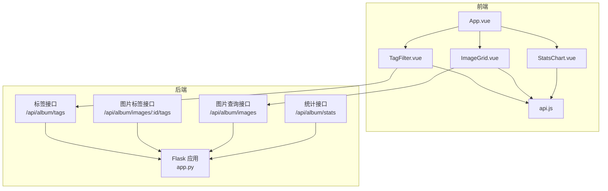
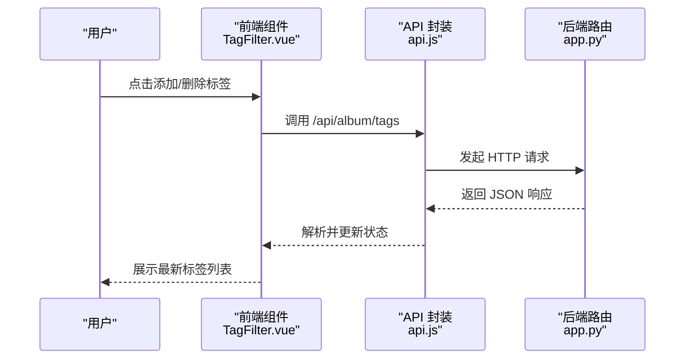
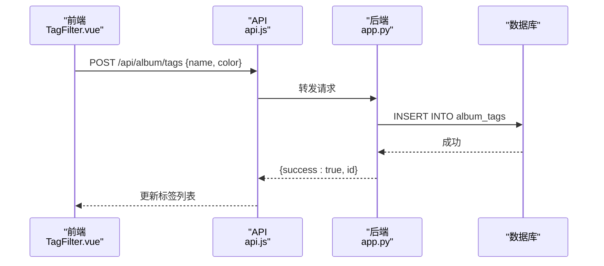
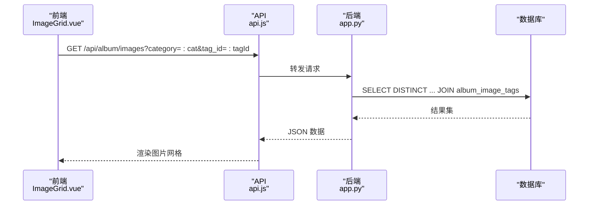
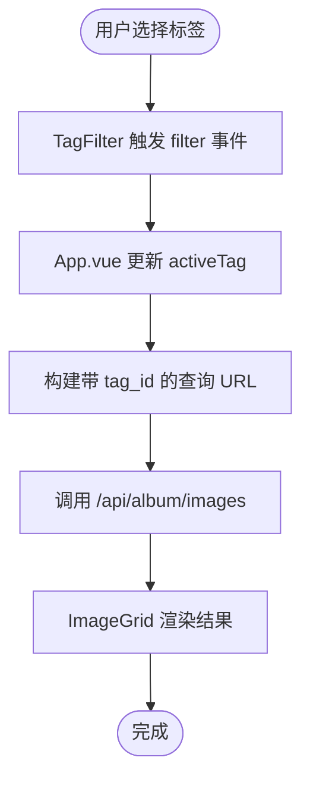
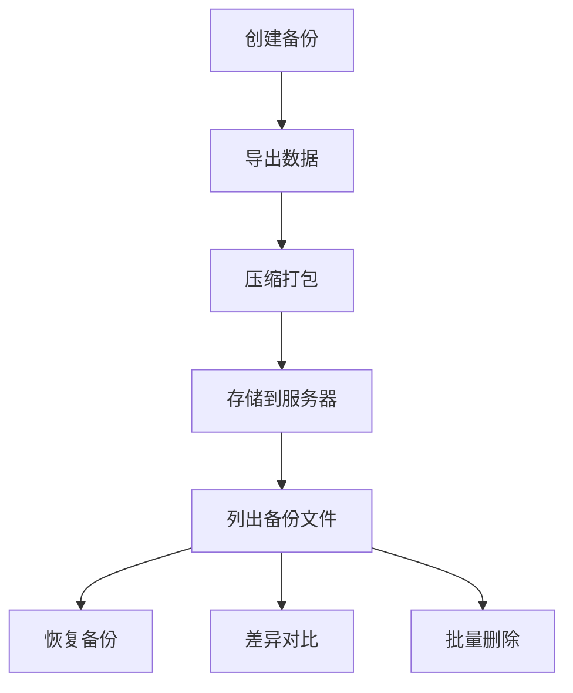
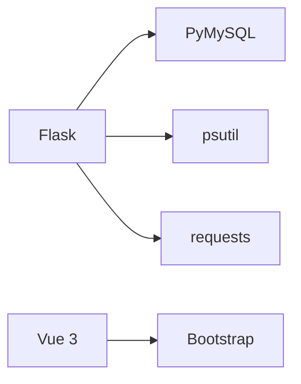

# 标签管理系统

<cite>
**本文档引用的文件**
- [app.py](file://app.py)
- [TagFilter.vue](file://frontend/src/components/TagFilter.vue)
- [ImageGrid.vue](file://frontend/src/components/ImageGrid.vue)
- [StatsChart.vue](file://frontend/src/components/StatsChart.vue)
- [App.vue](file://frontend/src/App.vue)
- [api.js](file://frontend/src/api.js)
- [backup.html](file://templates/backup.html)
- [requirements.txt](file://requirements.txt)
</cite>

## 目录
1. [简介](#简介)
2. [项目结构](#项目结构)
3. [核心组件](#核心组件)
4. [架构总览](#架构总览)
5. [详细组件分析](#详细组件分析)
6. [依赖分析](#依赖分析)
7. [性能考虑](#性能考虑)
8. [故障排查指南](#故障排查指南)
9. [结论](#结论)
10. [附录](#附录)

## 简介
本项目是一个基于 Flask + Vue 的相册与标签管理子系统，重点围绕“标签”这一核心实体展开，提供标签的创建、编辑、删除、与图片的多对多关联、前端筛选组件、后端查询接口、标签颜色系统、统计与热门标签推荐等能力。同时，系统具备基础的导入导出与批量操作能力（通过通用备份模块实现），并提供完善的权限控制与安全机制。

## 项目结构
- 后端采用 Flask 应用，数据库初始化与相册相关表结构在应用启动时完成。
- 前端使用 Vue 3 组件化开发，标签筛选组件与图片网格组件协同工作，支持按标签过滤展示。
- 统计图表组件提供基础的数据可视化，便于观察系统使用情况。



**图示来源**
- [App.vue:1-99](file://frontend/src/App.vue#L1-L99)
- [TagFilter.vue:1-51](file://frontend/src/components/TagFilter.vue#L1-L51)
- [ImageGrid.vue:55-77](file://frontend/src/components/ImageGrid.vue#L55-L77)
- [StatsChart.vue:1-55](file://frontend/src/components/StatsChart.vue#L1-L55)
- [api.js:1-45](file://frontend/src/api.js#L1-L45)
- [app.py:2537-2567](file://app.py#L2537-L2567)
- [app.py:3348-3434](file://app.py#L3348-L3434)
- [app.py:3081-3116](file://app.py#L3081-L3116)

**章节来源**
- [App.vue:1-99](file://frontend/src/App.vue#L1-L99)
- [TagFilter.vue:1-51](file://frontend/src/components/TagFilter.vue#L1-L51)
- [ImageGrid.vue:55-77](file://frontend/src/components/ImageGrid.vue#L55-L77)
- [StatsChart.vue:1-55](file://frontend/src/components/StatsChart.vue#L1-L55)
- [api.js:1-45](file://frontend/src/api.js#L1-L45)
- [app.py:2537-2567](file://app.py#L2537-L2567)
- [app.py:3348-3434](file://app.py#L3348-L3434)
- [app.py:3081-3116](file://app.py#L3081-L3116)

## 核心组件
- 标签表结构与约束
  - 表名：album_tags
  - 字段：id（主键）、name（非空且唯一）、color（默认值）
  - 唯一约束：name 唯一
- 关联表设计
  - 表名：album_image_tags
  - 字段：image_id、tag_id
  - 主键：(image_id, tag_id)，实现图片与标签的多对多关联
- 查询优化
  - 图片查询接口支持通过 tag_id 参数进行关联过滤，并在非管理员场景下默认只显示已审核状态的图片
- 标签颜色系统
  - 前端使用原生颜色选择器，支持自定义颜色；后端存储颜色值，前端渲染时直接应用
- 统计与热门标签
  - 提供基础统计接口，后续可扩展热门标签推荐逻辑（如基于使用频率）

**章节来源**
- [app.py:753-768](file://app.py#L753-L768)
- [app.py:2537-2567](file://app.py#L2537-L2567)
- [app.py:3081-3116](file://app.py#L3081-L3116)
- [TagFilter.vue:13-17](file://frontend/src/components/TagFilter.vue#L13-L17)

## 架构总览
系统采用前后端分离架构：
- 前端负责用户交互与视图渲染，通过统一的 API 封装访问后端接口
- 后端提供 RESTful 接口，处理标签与图片的增删改查、统计与权限控制
- 数据库存储在 MySQL 中，初始化时自动创建所需表结构



**图示来源**
- [TagFilter.vue:30-37](file://frontend/src/components/TagFilter.vue#L30-L37)
- [api.js:1-5](file://frontend/src/api.js#L1-L5)
- [app.py:3348-3384](file://app.py#L3348-L3384)

## 详细组件分析

### 标签表结构与颜色系统
- 表结构
  - album_tags：包含 id、name（唯一）、color 字段
  - album_image_tags：包含 image_id、tag_id，联合主键保证唯一性
- 颜色系统
  - 前端使用原生颜色输入控件，支持自定义颜色
  - 后端存储颜色值，前端渲染时直接应用到标签按钮的边框与背景
- 唯一约束
  - name 字段唯一，避免重复标签名

```mermaid
erDiagram
ALBUM_TAGS {
int id PK
varchar name UK
varchar color
}
ALBUM_IMAGE_TAGS {
int image_id
int tag_id
PRIMARY KEY image_id, tag_id
}
ALBUM_IMAGES {
int id PK
varchar name
varchar filename
varchar uploader
datetime upload_time
enum status
}
ALBUM_TAGS ||--o{ ALBUM_IMAGE_TAGS : "被图片引用"
ALBUM_IMAGES ||--o{ ALBUM_IMAGE_TAGS : "拥有"
```

**图示来源**
- [app.py:753-768](file://app.py#L753-L768)

**章节来源**
- [app.py:753-768](file://app.py#L753-L768)
- [TagFilter.vue:13-17](file://frontend/src/components/TagFilter.vue#L13-L17)

### 标签创建、编辑与删除流程
- 创建标签
  - 前端提交 name 与 color
  - 后端插入 album_tags，返回新标签 id
- 删除标签
  - 后端先清理关联表中的对应记录，再删除标签本身
- 编辑标签
  - 当前实现未提供直接编辑接口；如需编辑 name，建议删除旧标签并创建新标签



**图示来源**
- [TagFilter.vue:31-34](file://frontend/src/components/TagFilter.vue#L31-L34)
- [app.py:3362-3384](file://app.py#L3362-L3384)

**章节来源**
- [TagFilter.vue:30-37](file://frontend/src/components/TagFilter.vue#L30-L37)
- [app.py:3362-3384](file://app.py#L3362-L3384)

### 标签与图片的多对多关联与查询优化
- 关联关系
  - album_image_tags 实现图片与标签的多对多映射
- 查询优化
  - 图片查询接口支持 tag_id 参数，内部通过 JOIN album_image_tags 实现过滤
  - 非管理员仅显示已审核状态的图片，保障内容安全
- 设置图片标签
  - 支持一次性设置多个标签，后端先清空旧关联，再插入新关联



**图示来源**
- [ImageGrid.vue:58-60](file://frontend/src/components/ImageGrid.vue#L58-L60)
- [app.py:2556-2559](file://app.py#L2556-L2559)
- [app.py:2561-2563](file://app.py#L2561-L2563)

**章节来源**
- [ImageGrid.vue:55-77](file://frontend/src/components/ImageGrid.vue#L55-L77)
- [app.py:2537-2567](file://app.py#L2537-L2567)
- [app.py:3418-3434](file://app.py#L3418-L3434)

### 标签过滤功能实现
- 前端筛选组件
  - TagFilter.vue 提供标签按钮组，点击后触发父组件回调，传递 tagId
  - 支持添加新标签与删除现有标签
- 后端查询接口
  - /api/album/tags 获取所有标签
  - /api/album/images?tag_id=... 实现按标签过滤
- 应用集成
  - App.vue 在毕业图片与精彩瞬间标签页中渲染 TagFilter，并将选中的标签 ID 传入 ImageGrid



**图示来源**
- [TagFilter.vue:4-12](file://frontend/src/components/TagFilter.vue#L4-L12)
- [App.vue:17-34](file://frontend/src/App.vue#L17-L34)
- [ImageGrid.vue:58-60](file://frontend/src/components/ImageGrid.vue#L58-L60)

**章节来源**
- [TagFilter.vue:1-51](file://frontend/src/components/TagFilter.vue#L1-L51)
- [App.vue:17-34](file://frontend/src/App.vue#L17-L34)
- [ImageGrid.vue:55-77](file://frontend/src/components/ImageGrid.vue#L55-L77)

### 标签颜色系统与视觉效果
- 颜色来源
  - 前端使用原生颜色选择器，支持任意十六进制颜色
  - 后端存储颜色值，用于渲染标签按钮的边框与背景
- 视觉效果
  - 活跃标签：边框与背景色一致，文字为白色
  - 悬停效果：删除按钮透明度提升
  - 添加按钮：使用浅色强调新增意图

**章节来源**
- [TagFilter.vue:40-50](file://frontend/src/components/TagFilter.vue#L40-L50)

### 标签统计与热门标签推荐
- 现有统计
  - /api/album/stats 提供上传排行、评论排行、最受欢迎图片等基础统计
- 热门标签推荐
  - 可基于 album_image_tags 与 album_tags 的关联统计使用频率，按频率排序输出热门标签
  - 建议在后端新增 /api/album/tags/recommend 或类似接口，返回高频标签列表

**章节来源**
- [app.py:3081-3116](file://app.py#L3081-L3116)

### 导入导出与批量操作支持
- 导入导出
  - 通过通用备份模块实现数据的导出、下载、差异对比、恢复与批量删除
- 批量操作
  - 支持批量删除旧备份、保留 N 份等操作
- 与标签系统的结合
  - 标签数据属于相册扩展表的一部分，可通过备份模块进行整体备份与恢复



**图示来源**
- [backup.html:247-289](file://templates/backup.html#L247-L289)
- [backup.html:301-332](file://templates/backup.html#L301-L332)

**章节来源**
- [backup.html:1-463](file://templates/backup.html#L1-L463)

## 依赖分析
- 后端依赖
  - Flask：Web 框架
  - PyMySQL：MySQL 驱动
  - psutil、requests：系统监控与网络请求
- 前端依赖
  - Vue 3：组件化框架
  - Bootstrap：UI 组件库



**图示来源**
- [requirements.txt:1-5](file://requirements.txt#L1-L5)

**章节来源**
- [requirements.txt:1-5](file://requirements.txt#L1-L5)

## 性能考虑
- 数据库查询
  - 图片查询通过 JOIN album_image_tags 实现标签过滤，建议在 image_id 与 tag_id 上建立索引以提升性能
- 前端渲染
  - 使用虚拟滚动或分页策略减少大量图片时的渲染压力
- 接口调用
  - 对于需要同时获取评论与点赞的场景，可采用并发请求以缩短等待时间（当前实现已使用 Promise.all 并发获取）

## 故障排查指南
- 标签创建失败
  - 检查标签名是否为空或重复（唯一约束）
  - 查看后端返回的错误信息，确认数据库连接状态
- 标签删除后图片仍显示
  - 确认后端是否正确清理 album_image_tags 中的关联记录
- 图片筛选无结果
  - 检查 tag_id 参数是否正确传递
  - 非管理员用户仅能看到已审核的图片，确认图片状态

**章节来源**
- [app.py:3362-3384](file://app.py#L3362-L3384)
- [app.py:3386-3399](file://app.py#L3386-L3399)
- [app.py:2556-2559](file://app.py#L2556-L2559)
- [app.py:2561-2563](file://app.py#L2561-L2563)

## 结论
本标签管理系统以清晰的表结构与简洁的接口设计实现了标签的全生命周期管理，并通过多对多关联与查询优化满足了实际使用需求。前端组件与后端接口配合良好，具备良好的扩展性。建议后续增强标签编辑能力、热门标签推荐与更丰富的统计维度，以进一步提升用户体验与运营效率。

## 附录
- 快速开始
  - 启动后端：运行 Flask 应用
  - 启动前端：使用 Vite 启动 Vue 开发服务器
  - 访问地址：前端本地开发地址（如 http://localhost:3000）
- 数据库初始化
  - 应用启动时自动创建相册相关表，包括标签与图片关联表