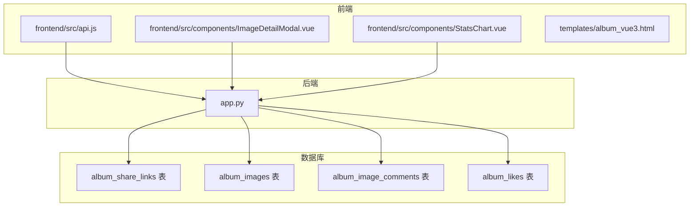
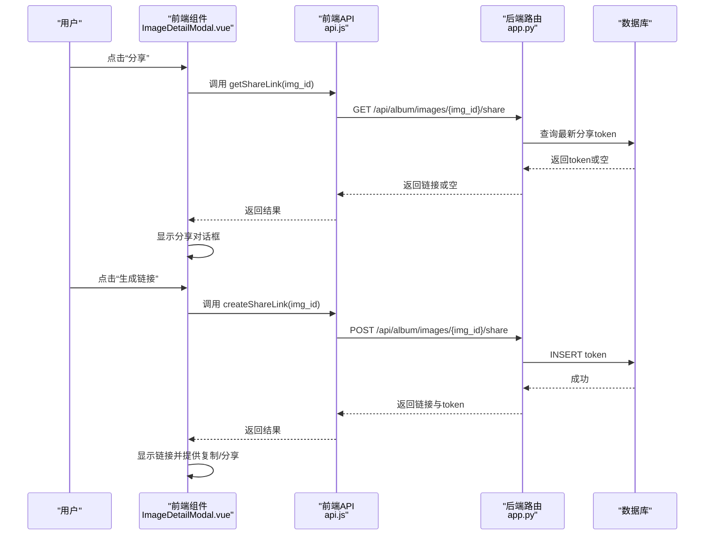
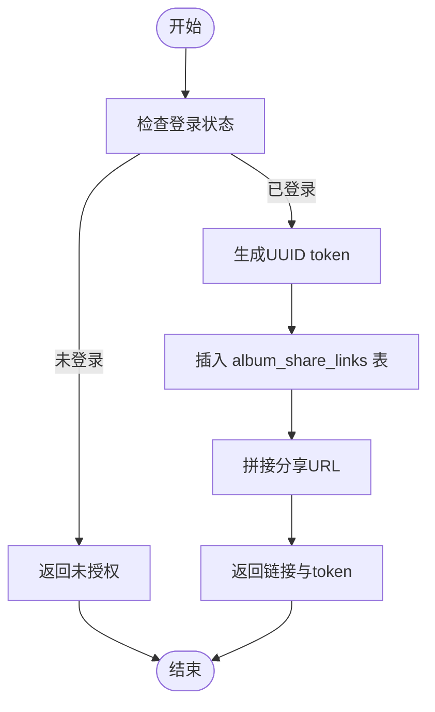
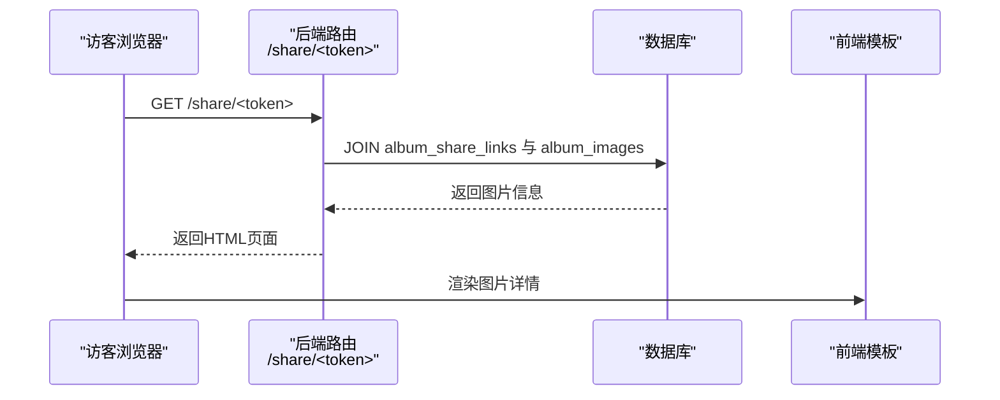
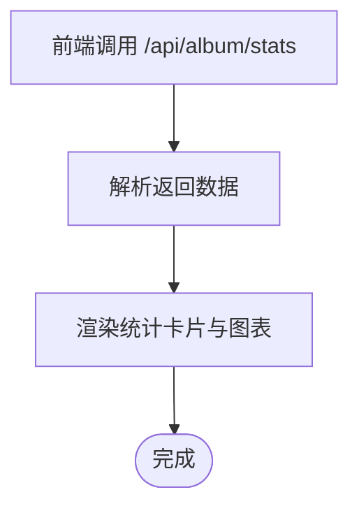
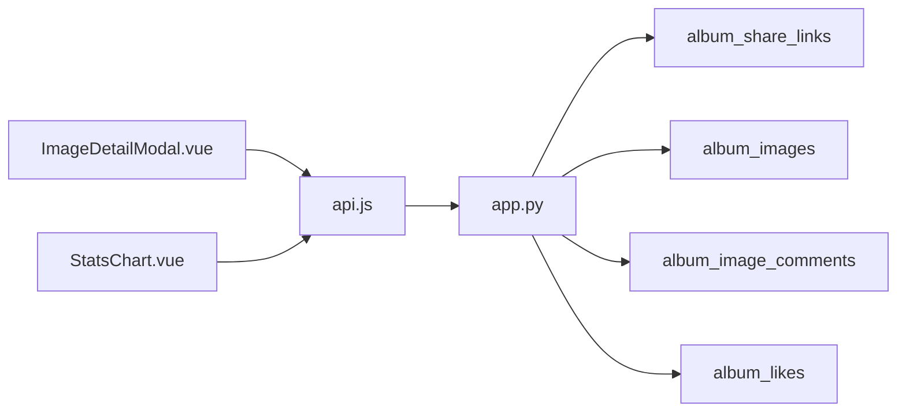

# 相册分享机制

<cite>
**本文档引用的文件**
- [app.py](file://app.py)
- [frontend/src/api.js](file://frontend/src/api.js)
- [frontend/src/components/ImageDetailModal.vue](file://frontend/src/components/ImageDetailModal.vue)
- [templates/album_vue3.html](file://templates/album_vue3.html)
- [frontend/src/components/StatsChart.vue](file://frontend/src/components/StatsChart.vue)
</cite>

## 目录
1. [简介](#简介)
2. [项目结构](#项目结构)
3. [核心组件](#核心组件)
4. [架构总览](#架构总览)
5. [详细组件分析](#详细组件分析)
6. [依赖分析](#依赖分析)
7. [性能考虑](#性能考虑)
8. [故障排查指南](#故障排查指南)
9. [结论](#结论)
10. [附录](#附录)

## 简介
本文件面向“相册分享机制”的技术实现，围绕分享链接生成系统、数据库设计、权限控制、分享页面实现、统计功能、管理能力以及安全机制进行系统性梳理。文档同时给出可视化图示，帮助开发者快速理解整体流程与关键路径。

## 项目结构
相册分享机制涉及后端 Flask 应用、前端 Vue 组件与模板，以及数据库表结构。核心模块如下：
- 后端路由与业务逻辑：负责分享链接的生成、查询、访问视图渲染与统计
- 前端交互：提供分享对话框、复制链接、QQ 分享等交互
- 数据库表：存储分享链接、图片元数据、评论、点赞等

图表来源
- [app.py](file://app.py)
- [frontend/src/api.js](file://frontend/src/api.js)
- [frontend/src/components/ImageDetailModal.vue](file://frontend/src/components/ImageDetailModal.vue)
- [frontend/src/components/StatsChart.vue](file://frontend/src/components/StatsChart.vue)
- [templates/album_vue3.html](file://templates/album_vue3.html)

章节来源
- [app.py](file://app.py)
- [frontend/src/api.js](file://frontend/src/api.js)
- [frontend/src/components/ImageDetailModal.vue](file://frontend/src/components/ImageDetailModal.vue)
- [frontend/src/components/StatsChart.vue](file://frontend/src/components/StatsChart.vue)
- [templates/album_vue3.html](file://templates/album_vue3.html)

## 核心组件
- 分享链接生成与查询 API：提供 POST 生成与 GET 查询分享链接
- 分享视图渲染：根据 token 渲染图片详情页
- 前端分享对话框：触发生成、复制、社交分享
- 统计接口：提供上传排行、评论排行、热门图片等统计

章节来源
- [app.py](file://app.py)
- [frontend/src/api.js](file://frontend/src/api.js)
- [frontend/src/components/ImageDetailModal.vue](file://frontend/src/components/ImageDetailModal.vue)
- [frontend/src/components/StatsChart.vue](file://frontend/src/components/StatsChart.vue)

## 架构总览
分享机制的关键流程：
- 用户在图片详情弹窗中点击“分享”，前端调用后端接口生成分享链接
- 后端生成唯一 token 并写入数据库，返回链接
- 访客通过 /share/token 访问分享页面，后端查询图片信息并渲染
- 前端提供复制链接与 QQ 分享入口

图表来源
- [frontend/src/components/ImageDetailModal.vue](file://frontend/src/components/ImageDetailModal.vue)
- [frontend/src/api.js](file://frontend/src/api.js)
- [app.py](file://app.py)

## 详细组件分析

### 分享链接生成系统
- UUID 生成：使用标准库生成唯一 token
- 有效期策略：当前实现未内置过期字段，建议在表结构中增加 expires_at 字段并在查询时校验
- 访问权限控制：分享视图未做登录校验，但生成接口要求登录

图表来源
- [app.py](file://app.py)

章节来源
- [app.py](file://app.py)

### 分享链接数据库设计
- 表名：album_share_links
- 关键字段
  - id：自增主键
  - image_id：外键关联图片
  - token：唯一标识，长度 64
  - created_at：创建时间，默认当前时间
- 建表语句位置：[app.py](file://app.py)

章节来源
- [app.py](file://app.py)

### 分享权限体系
- 当前实现
  - 生成接口：需要登录
  - 分享视图：无需登录，直接渲染
- 权限模式建议
  - 公开分享：默认模式，无需登录
  - 密码保护：新增 password 字段，访问时校验
  - 私密分享：仅授权用户可访问，结合用户身份与 token 绑定
- 有效期控制：建议新增 expires_at 字段，查询时判断过期

章节来源
- [app.py](file://app.py)

### 分享页面实现
- 路由：/share/<token>
- 功能：根据 token 关联查询图片元数据，渲染图片、上传者、上传时间、点赞数
- 前端交互：分享对话框提供复制与 QQ 分享入口

图表来源
- [app.py](file://app.py)

章节来源
- [app.py](file://app.py)
- [frontend/src/components/ImageDetailModal.vue](file://frontend/src/components/ImageDetailModal.vue)

### 分享统计功能
- 统计接口：提供总数、评论数、点赞数、上传排行、评论排行、热门图片
- 前端展示：StatsChart 组件拉取并渲染统计卡片与柱状图

图表来源
- [frontend/src/components/StatsChart.vue](file://frontend/src/components/StatsChart.vue)
- [app.py](file://app.py)

章节来源
- [frontend/src/components/StatsChart.vue](file://frontend/src/components/StatsChart.vue)
- [app.py](file://app.py)

### 分享管理功能
- 当前能力
  - 生成分享链接
  - 查询最近一次分享链接
- 建议扩展
  - 撤销分享：删除对应 token 记录
  - 修改权限：更新 token 的访问策略（公开/密码/私密）
  - 批量管理：按图片批量生成/撤销分享
  - 访问统计：记录访问次数、来源、时间等

章节来源
- [app.py](file://app.py)
- [frontend/src/components/ImageDetailModal.vue](file://frontend/src/components/ImageDetailModal.vue)

### 分享安全机制
- 防盗链：当前未实现 Referer 校验或来源限制
- 访问频率限制：全局速率限制对静态资源与分享路由有豁免，建议对分享视图也实施限制
- 恶意访问防护：未发现专门的反爬虫或验证码机制
- 建议增强
  - 对 /share/<token> 实施访问频率限制
  - 添加来源校验或白名单
  - 对敏感操作（如撤销、修改）增加二次验证

章节来源
- [app.py](file://app.py)

## 依赖分析
- 前端到后端
  - ImageDetailModal.vue 通过 api.js 调用 /api/album/images/{img_id}/share 的 GET/POST
  - StatsChart.vue 调用 /api/album/stats 获取统计
- 后端到数据库
  - 分享路由读写 album_share_links 表
  - 分享视图 JOIN album_images 获取图片信息
  - 评论、点赞等接口读写相应表

图表来源
- [frontend/src/components/ImageDetailModal.vue](file://frontend/src/components/ImageDetailModal.vue)
- [frontend/src/components/StatsChart.vue](file://frontend/src/components/StatsChart.vue)
- [frontend/src/api.js](file://frontend/src/api.js)
- [app.py](file://app.py)

章节来源
- [frontend/src/components/ImageDetailModal.vue](file://frontend/src/components/ImageDetailModal.vue)
- [frontend/src/components/StatsChart.vue](file://frontend/src/components/StatsChart.vue)
- [frontend/src/api.js](file://frontend/src/api.js)
- [app.py](file://app.py)

## 性能考虑
- 数据库索引
  - 建议在 album_share_links.token 上建立唯一索引（已定义唯一约束）
  - 在 album_share_links.image_id 上建立索引，加速按图片查询
- 查询优化
  - 分享视图 JOIN 查询应限定字段，避免 SELECT *
  - 统计接口可添加 LIMIT 与分页
- 前端优化
  - 分享对话框仅在需要时发起请求
  - 统计数据可缓存一定时间

## 故障排查指南
- 生成分享链接失败
  - 检查数据库连接与 album_share_links 表是否存在
  - 查看后端日志与返回的错误信息
- 分享页面提示无效或过期
  - 确认 token 是否存在且未被删除
  - 若引入有效期，检查是否过期
- 前端无法显示统计
  - 检查 /api/album/stats 接口返回
  - 确认网络与跨域配置

章节来源
- [app.py](file://app.py)
- [frontend/src/components/StatsChart.vue](file://frontend/src/components/StatsChart.vue)

## 结论
当前相册分享机制实现了基础的链接生成与分享视图渲染，具备良好的扩展空间。建议下一步完善：
- 引入有效期与权限字段，支持密码保护与私密分享
- 增强访问频率限制与来源校验，提升安全性
- 扩展管理能力，支持撤销、修改与批量操作
- 丰富统计维度，提供访问来源与效果追踪

## 附录
- 数据库建表参考位置：[app.py](file://app.py)
- 分享路由与视图：[app.py](file://app.py)
- 前端分享对话框：[frontend/src/components/ImageDetailModal.vue](file://frontend/src/components/ImageDetailModal.vue)
- 前端统计组件：[frontend/src/components/StatsChart.vue](file://frontend/src/components/StatsChart.vue)
- 前端 API 封装：[frontend/src/api.js](file://frontend/src/api.js)
- 相册模板（含主题与交互）：[templates/album_vue3.html](file://templates/album_vue3.html)