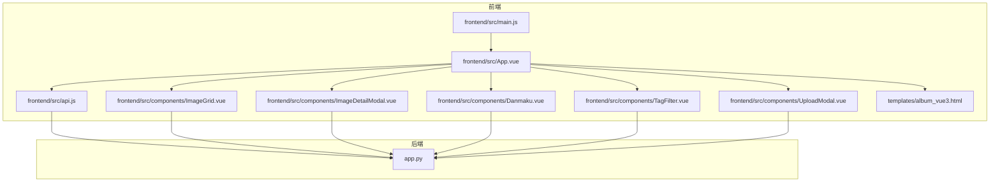
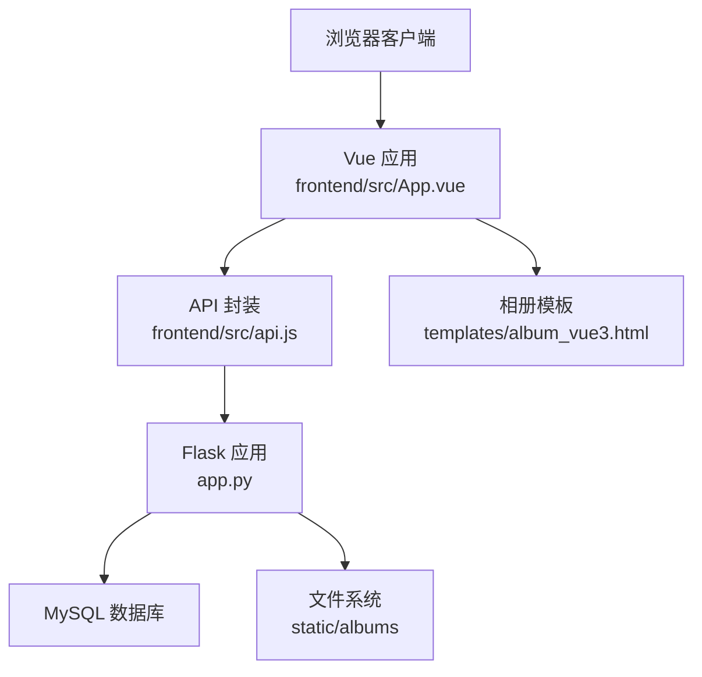
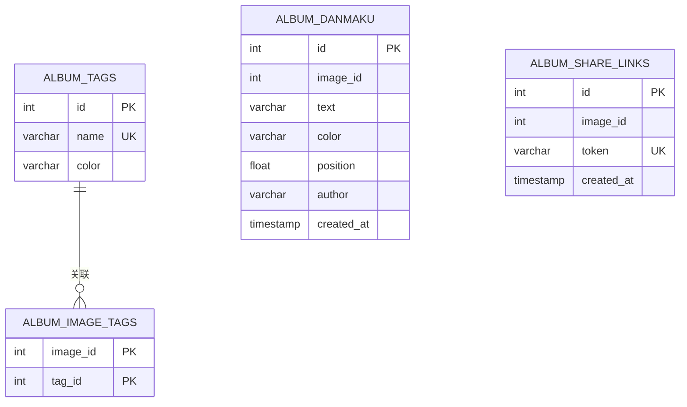
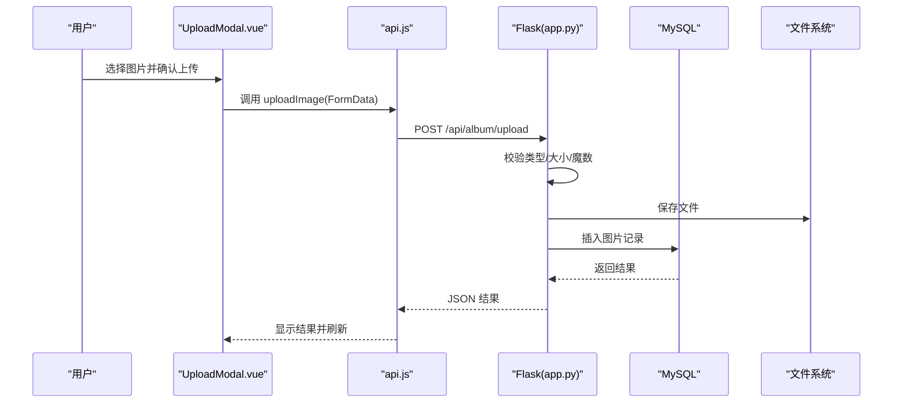
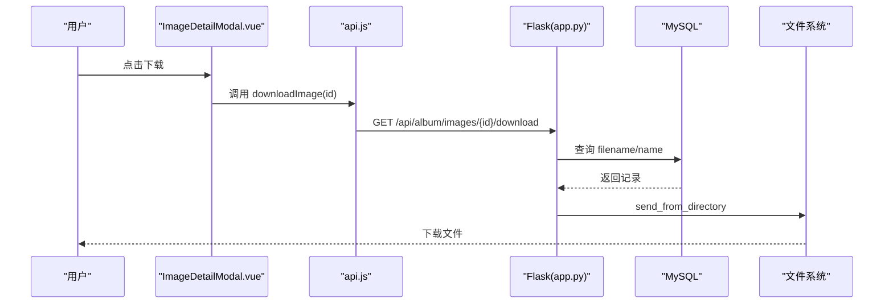
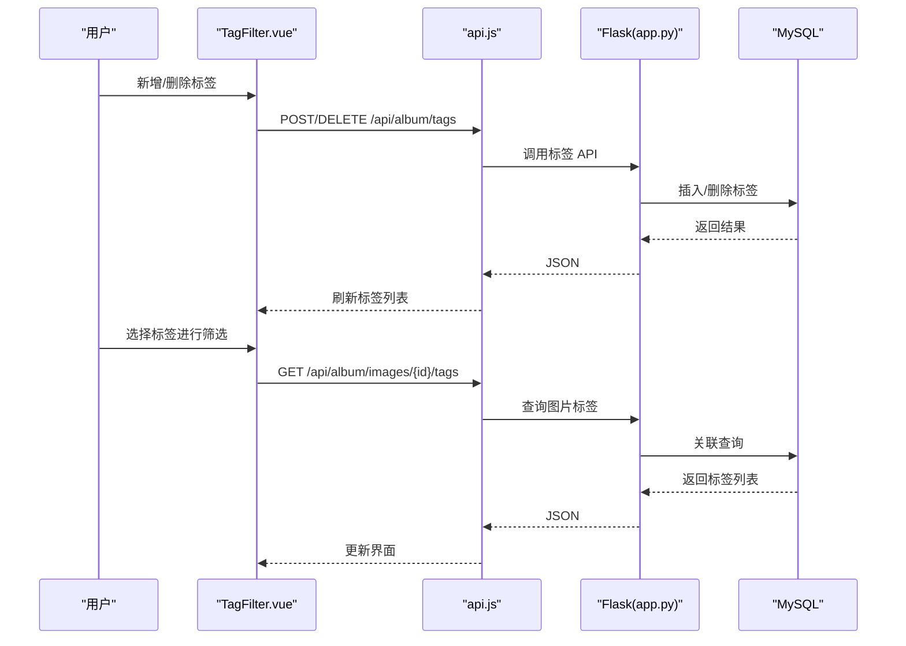
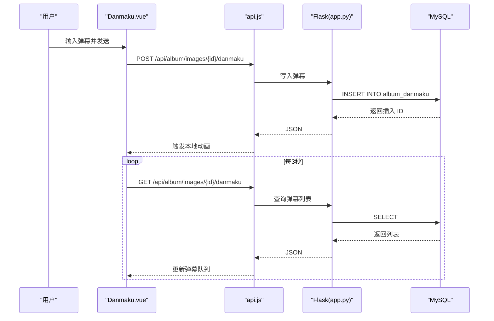
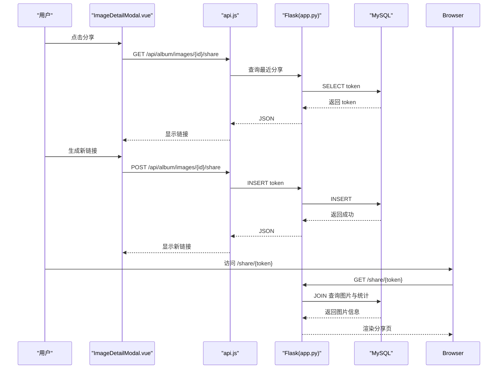
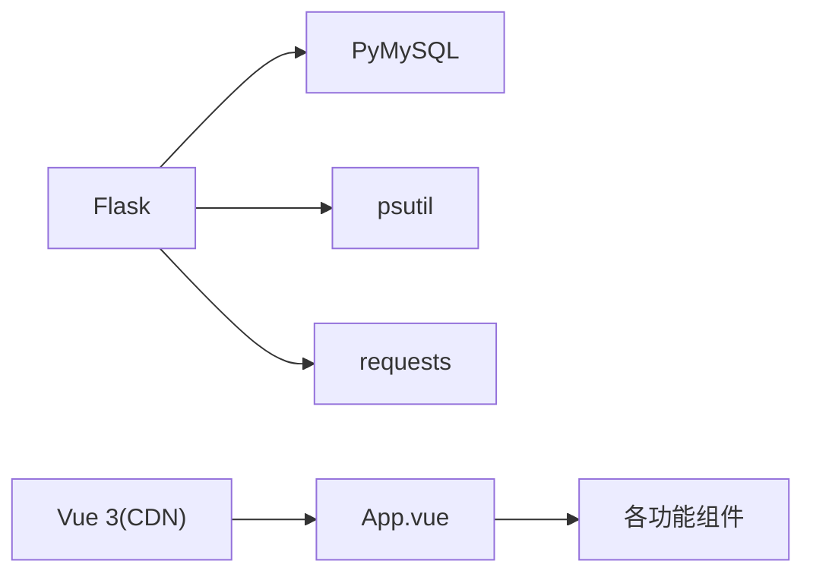

# 相册管理系统

<cite>
**本文档引用的文件**
- [app.py](file://app.py)
- [frontend/src/main.js](file://frontend/src/main.js)
- [frontend/src/api.js](file://frontend/src/api.js)
- [templates/album_vue3.html](file://templates/album_vue3.html)
- [frontend/src/App.vue](file://frontend/src/App.vue)
- [frontend/src/components/ImageGrid.vue](file://frontend/src/components/ImageGrid.vue)
- [frontend/src/components/ImageDetailModal.vue](file://frontend/src/components/ImageDetailModal.vue)
- [frontend/src/components/UploadModal.vue](file://frontend/src/components/UploadModal.vue)
- [frontend/src/components/Danmaku.vue](file://frontend/src/components/Danmaku.vue)
- [frontend/src/components/TagFilter.vue](file://frontend/src/components/TagFilter.vue)
- [requirements.txt](file://requirements.txt)
</cite>

## 目录
1. [简介](#简介)
2. [项目结构](#项目结构)
3. [核心组件](#核心组件)
4. [架构总览](#架构总览)
5. [详细组件分析](#详细组件分析)
6. [依赖分析](#依赖分析)
7. [性能考虑](#性能考虑)
8. [故障排查指南](#故障排查指南)
9. [结论](#结论)
10. [附录](#附录)

## 简介
本项目是一个基于 Flask 的相册管理系统，提供照片上传、下载、标签管理、弹幕互动与分享功能。前端采用 Vue 3 构建，后端通过 MySQL 存储相册数据，包含图片表、标签表、标签关联表、弹幕表、分享链接表等。系统还集成了基础的访问控制、速率限制、安全响应头与国际化支持。

## 项目结构
- 后端入口与路由：app.py 提供相册相关的 API、数据库初始化与安全策略
- 前端应用：Vue 3 单页应用，组件化管理相册展示、上传、弹幕、标签筛选等功能
- 模板：templates/album_vue3.html 提供相册页面的模板与样式
- 静态资源：static/albums 用于存放上传的图片文件
- 依赖：requirements.txt 指定 Flask、PyMySQL、psutil、requests 等依赖

图表来源
- [frontend/src/main.js:1-6](file://frontend/src/main.js#L1-L6)
- [frontend/src/App.vue:1-99](file://frontend/src/App.vue#L1-L99)
- [frontend/src/api.js:1-45](file://frontend/src/api.js#L1-L45)
- [templates/album_vue3.html:1-396](file://templates/album_vue3.html#L1-L396)
- [app.py:1-120](file://app.py#L1-L120)

章节来源
- [frontend/src/main.js:1-6](file://frontend/src/main.js#L1-L6)
- [frontend/src/App.vue:1-99](file://frontend/src/App.vue#L1-L99)
- [frontend/src/api.js:1-45](file://frontend/src/api.js#L1-L45)
- [templates/album_vue3.html:1-396](file://templates/album_vue3.html#L1-L396)
- [app.py:627-694](file://app.py#L627-L694)

## 核心组件
- 相册数据库初始化与表结构：后端在启动时初始化相册扩展表，包括图片标签、标签关联、弹幕、分享链接等
- 照片上传：校验文件类型与大小，写入静态目录并记录到数据库
- 照片下载：根据图片 ID 查询并返回文件流
- 标签系统：支持标签创建、删除、查询以及图片与标签的关联
- 弹幕功能：支持弹幕发送与轮询刷新，前端负责动画渲染
- 分享机制：生成带 token 的分享链接，支持公开访问
- 速率限制与安全：基于内存的速率限制、白名单、封禁策略与安全响应头

章节来源
- [app.py:696-802](file://app.py#L696-L802)
- [app.py:2734-2793](file://app.py#L2734-L2793)
- [app.py:2859-2882](file://app.py#L2859-L2882)
- [app.py:3348-3435](file://app.py#L3348-L3435)
- [app.py:3520-3542](file://app.py#L3520-L3542)
- [app.py:2885-2959](file://app.py#L2885-L2959)

## 架构总览
系统采用前后端分离架构，前端通过 /api/album 前缀调用后端 API，后端连接 MySQL 数据库完成数据持久化。相册页面由模板渲染，同时支持 Vue 组件化的交互体验。

图表来源
- [frontend/src/App.vue:1-99](file://frontend/src/App.vue#L1-L99)
- [frontend/src/api.js:1-45](file://frontend/src/api.js#L1-L45)
- [app.py:627-694](file://app.py#L627-L694)
- [templates/album_vue3.html:1-396](file://templates/album_vue3.html#L1-L396)

## 详细组件分析

### 数据库设计与表结构
相册扩展表包括：
- album_tags：标签表，含唯一名称与颜色
- album_image_tags：图片与标签的多对多关联
- album_danmaku：弹幕表，包含文本、颜色、位置与作者
- album_share_links：分享链接表，包含图片 ID 与 token
- album_images：相册图片主表（由其他模块初始化）

图表来源
- [app.py:754-793](file://app.py#L754-L793)

章节来源
- [app.py:696-802](file://app.py#L696-L802)

### 照片上传流程
- 前端 UploadModal 支持多文件选择、预览与批量上传
- 后端校验文件类型与大小，写入 static/albums 并记录数据库
- 成功后触发前端刷新

图表来源
- [frontend/src/components/UploadModal.vue:1-116](file://frontend/src/components/UploadModal.vue#L1-L116)
- [frontend/src/api.js:32-33](file://frontend/src/api.js#L32-L33)
- [app.py:2734-2793](file://app.py#L2734-L2793)

章节来源
- [frontend/src/components/UploadModal.vue:1-116](file://frontend/src/components/UploadModal.vue#L1-L116)
- [frontend/src/api.js:32-33](file://frontend/src/api.js#L32-L33)
- [app.py:2734-2793](file://app.py#L2734-L2793)

### 照片下载流程
- 前端调用 /api/album/images/{id}/download
- 后端查询图片元数据并以附件形式返回文件

图表来源
- [frontend/src/components/ImageDetailModal.vue:118-119](file://frontend/src/components/ImageDetailModal.vue#L118-L119)
- [frontend/src/api.js:25-26](file://frontend/src/api.js#L25-L26)
- [app.py:2859-2882](file://app.py#L2859-L2882)

章节来源
- [frontend/src/components/ImageDetailModal.vue:118-119](file://frontend/src/components/ImageDetailModal.vue#L118-L119)
- [frontend/src/api.js:25-26](file://frontend/src/api.js#L25-L26)
- [app.py:2859-2882](file://app.py#L2859-L2882)

### 标签系统设计与实现
- 标签创建/删除：支持新增标签与删除标签（同时清理关联）
- 图片标签关联：支持按图片查询标签列表与批量设置标签
- 前端 TagFilter 提供标签筛选与新增删除操作

图表来源
- [frontend/src/components/TagFilter.vue:1-51](file://frontend/src/components/TagFilter.vue#L1-L51)
- [frontend/src/api.js:30-33](file://frontend/src/api.js#L30-L33)
- [app.py:3348-3435](file://app.py#L3348-L3435)

章节来源
- [frontend/src/components/TagFilter.vue:1-51](file://frontend/src/components/TagFilter.vue#L1-L51)
- [frontend/src/api.js:30-33](file://frontend/src/api.js#L30-L33)
- [app.py:3348-3435](file://app.py#L3348-L3435)

### 弹幕功能实现
- 发送弹幕：用户输入文本、颜色，提交到后端存储
- 渲染弹幕：前端定时轮询弹幕列表，生成随机轨道与动画
- 碰撞检测：前端通过随机轨道与固定时间间隔实现视觉上的“碰撞避免”

图表来源
- [frontend/src/components/Danmaku.vue:1-89](file://frontend/src/components/Danmaku.vue#L1-L89)
- [frontend/src/api.js:30-33](file://frontend/src/api.js#L30-L33)
- [app.py:3520-3542](file://app.py#L3520-L3542)

章节来源
- [frontend/src/components/Danmaku.vue:1-89](file://frontend/src/components/Danmaku.vue#L1-L89)
- [app.py:3520-3542](file://app.py#L3520-L3542)

### 分享机制
- 生成分享链接：POST /api/album/images/{id}/share，返回带 token 的链接
- 查看分享：访问 /share/{token} 展示图片详情页

图表来源
- [frontend/src/components/ImageDetailModal.vue:121-141](file://frontend/src/components/ImageDetailModal.vue#L121-L141)
- [frontend/src/api.js:28-31](file://frontend/src/api.js#L28-L31)
- [app.py:2885-2959](file://app.py#L2885-L2959)

章节来源
- [frontend/src/components/ImageDetailModal.vue:121-141](file://frontend/src/components/ImageDetailModal.vue#L121-L141)
- [frontend/src/api.js:28-31](file://frontend/src/api.js#L28-L31)
- [app.py:2885-2959](file://app.py#L2885-L2959)

### 前端组件与路由
- App.vue：主导航与工具栏，集成标签筛选、搜索与排序
- ImageGrid.vue：相册网格展示，支持懒加载与空状态
- ImageDetailModal.vue：图片详情、下载、分享、弹幕与评论
- UploadModal.vue：多文件上传与预览
- Danmaku.vue：弹幕输入与渲染
- TagFilter.vue：标签筛选与管理

章节来源
- [frontend/src/App.vue:1-99](file://frontend/src/App.vue#L1-L99)
- [frontend/src/components/ImageGrid.vue:1-25](file://frontend/src/components/ImageGrid.vue#L1-L25)
- [frontend/src/components/ImageDetailModal.vue:1-232](file://frontend/src/components/ImageDetailModal.vue#L1-L232)
- [frontend/src/components/UploadModal.vue:1-116](file://frontend/src/components/UploadModal.vue#L1-L116)
- [frontend/src/components/Danmaku.vue:1-89](file://frontend/src/components/Danmaku.vue#L1-L89)
- [frontend/src/components/TagFilter.vue:1-51](file://frontend/src/components/TagFilter.vue#L1-L51)

## 依赖分析
- 后端依赖：Flask、PyMySQL、psutil、requests
- 前端依赖：Vue 3（通过 CDN 引入）、组件化开发

图表来源
- [requirements.txt:1-5](file://requirements.txt#L1-L5)
- [templates/album_vue3.html:7-7](file://templates/album_vue3.html#L7-L7)

章节来源
- [requirements.txt:1-5](file://requirements.txt#L1-L5)
- [templates/album_vue3.html:7-7](file://templates/album_vue3.html#L7-L7)

## 性能考虑
- 上传限制：后端对文件大小与类型进行严格校验，防止异常文件占用资源
- 前端轮询：弹幕每 3 秒轮询一次，可根据业务量调整频率
- 静态资源：图片通过静态目录直接提供，减少后端 IO 压力
- 速率限制：基于内存的速率限制与封禁策略，防止滥用
- 建议优化：
  - 对于大文件：可引入分块上传与断点续传（当前未实现）
  - 对于高并发：建议引入 CDN 与缓存层，减少数据库压力
  - 对于弹幕：可考虑服务端推送（WebSocket）替代轮询

[本节为通用性能指导，无需特定文件来源]

## 故障排查指南
- 上传失败
  - 检查文件类型与大小限制
  - 确认后端日志与数据库连接
- 下载失败
  - 确认文件是否存在且可读
  - 检查路径与权限
- 弹幕不显示
  - 检查轮询间隔与网络状况
  - 确认数据库弹幕表是否正确写入
- 分享链接无效
  - 检查 token 是否存在与过期
  - 确认分享页路由与数据库查询

章节来源
- [app.py:2734-2793](file://app.py#L2734-L2793)
- [app.py:2859-2882](file://app.py#L2859-L2882)
- [app.py:3520-3542](file://app.py#L3520-L3542)
- [app.py:2885-2959](file://app.py#L2885-L2959)

## 结论
本相册管理系统通过清晰的前后端分离架构与完善的数据库设计，实现了照片上传、下载、标签管理、弹幕与分享等核心功能。系统具备基础的安全与性能保护机制，适合中小规模场景使用。后续可在大文件处理、实时推送与缓存优化方面进一步增强。

## 附录
- 相关文件路径与用途
  - [app.py](file://app.py)：后端应用、数据库初始化与 API 实现
  - [frontend/src/main.js](file://frontend/src/main.js)：前端应用入口
  - [frontend/src/api.js](file://frontend/src/api.js)：API 封装
  - [templates/album_vue3.html](file://templates/album_vue3.html)：相册页面模板
  - [frontend/src/App.vue](file://frontend/src/App.vue)：主应用组件
  - [frontend/src/components/ImageGrid.vue](file://frontend/src/components/ImageGrid.vue)：相册网格
  - [frontend/src/components/ImageDetailModal.vue](file://frontend/src/components/ImageDetailModal.vue)：图片详情
  - [frontend/src/components/UploadModal.vue](file://frontend/src/components/UploadModal.vue)：上传组件
  - [frontend/src/components/Danmaku.vue](file://frontend/src/components/Danmaku.vue)：弹幕组件
  - [frontend/src/components/TagFilter.vue](file://frontend/src/components/TagFilter.vue)：标签筛选
  - [requirements.txt](file://requirements.txt)：后端依赖