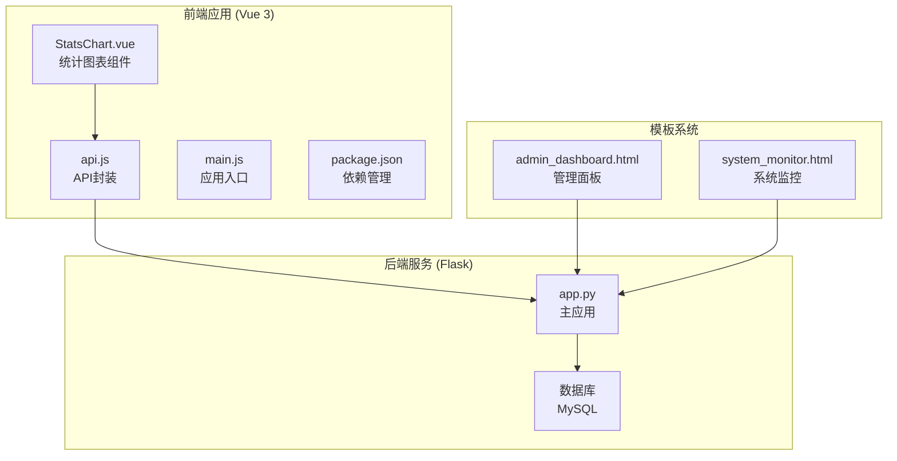
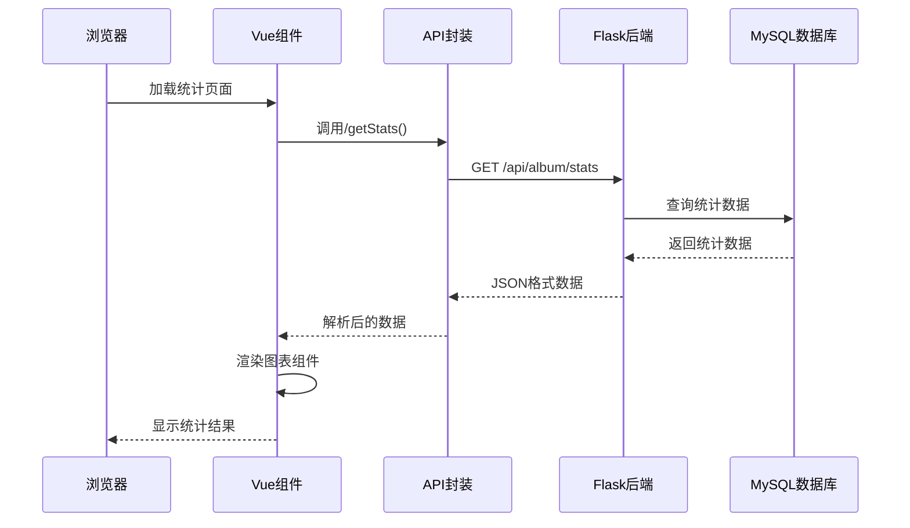
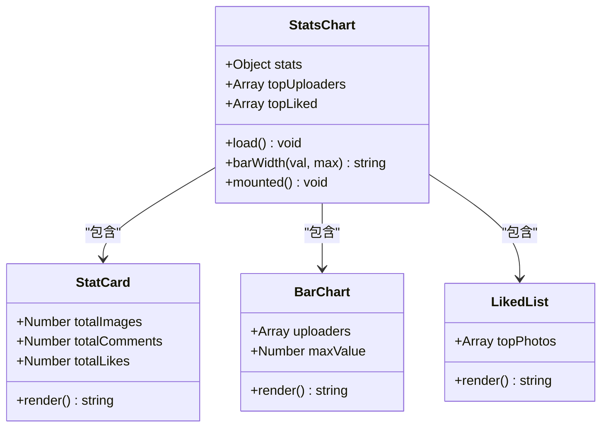
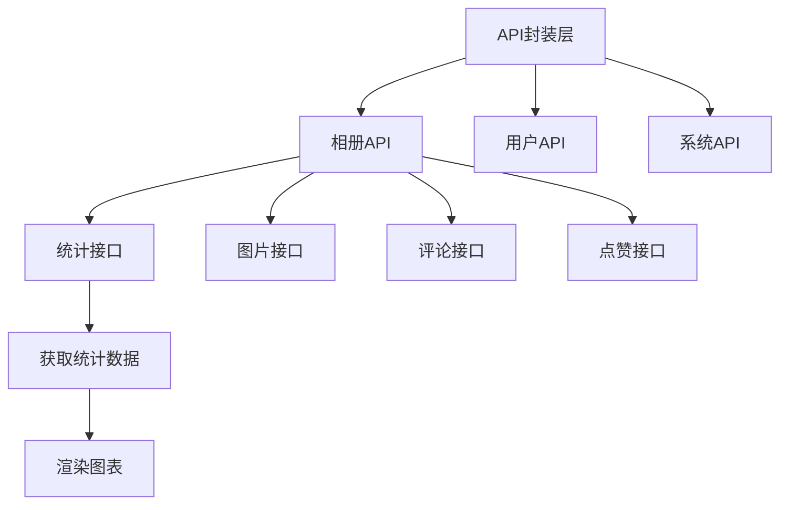
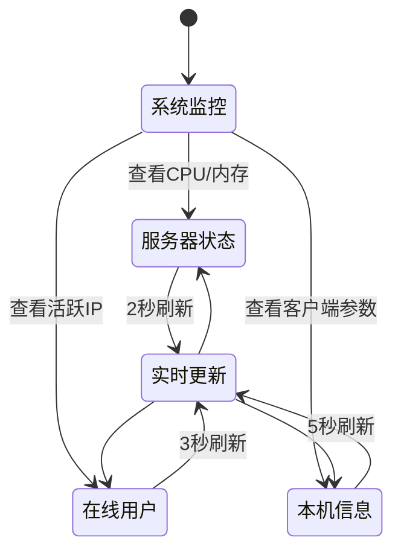
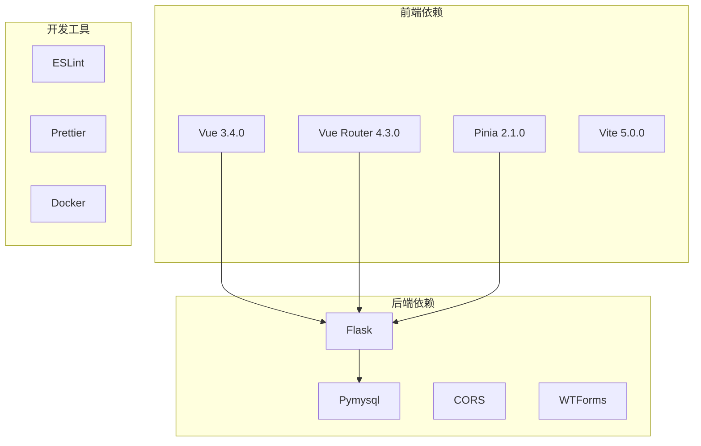

# 统计分析功能

<cite>
**本文档引用的文件**
- [StatsChart.vue](file://frontend/src/components/StatsChart.vue)
- [api.js](file://frontend/src/api.js)
- [app.py](file://app.py)
- [admin_dashboard.html](file://templates/admin_dashboard.html)
- [system_monitor.html](file://templates/system_monitor.html)
- [package.json](file://frontend/package.json)
- [main.js](file://frontend/src/main.js)
</cite>

## 目录
1. [简介](#简介)
2. [项目结构](#项目结构)
3. [核心组件](#核心组件)
4. [架构概览](#架构概览)
5. [详细组件分析](#详细组件分析)
6. [依赖分析](#依赖分析)
7. [性能考虑](#性能考虑)
8. [故障排除指南](#故障排除指南)
9. [结论](#结论)

## 简介
本项目实现了完整的统计分析功能，涵盖相册统计数据收集与计算、图表可视化展示、用户活跃度评估、系统性能监控等多个维度。系统采用前后端分离架构，后端基于Flask提供RESTful API，前端使用Vue 3构建交互式统计界面。

## 项目结构
项目采用模块化组织方式，主要分为前端Vue应用和后端Flask服务两大部分：



**图表来源**
- [StatsChart.vue:1-77](file://frontend/src/components/StatsChart.vue#L1-L77)
- [api.js:1-45](file://frontend/src/api.js#L1-L45)
- [app.py:119-131](file://app.py#L119-L131)

**章节来源**
- [StatsChart.vue:1-77](file://frontend/src/components/StatsChart.vue#L1-L77)
- [api.js:1-45](file://frontend/src/api.js#L1-L45)
- [app.py:119-131](file://app.py#L119-L131)

## 核心组件
系统的核心统计功能由以下关键组件构成：

### 相册统计API
后端提供完整的相册统计接口，包括基础统计、排行榜和用户活跃度数据：

- **基础统计**：照片总数、评论总数、点赞总数
- **排行榜统计**：上传达人排行、最受欢迎照片排行
- **用户活跃度**：基于活动日志的积分系统

### 前端统计展示
Vue组件负责数据可视化和用户交互：

- **StatsChart组件**：网格布局显示基础统计
- **交互式图表**：柱状图展示上传排行
- **响应式设计**：适配不同屏幕尺寸

**章节来源**
- [app.py:3081-3117](file://app.py#L3081-L3117)
- [StatsChart.vue:1-77](file://frontend/src/components/StatsChart.vue#L1-L77)

## 架构概览
系统采用经典的三层架构模式，实现了清晰的职责分离：



**图表来源**
- [StatsChart.vue:47-54](file://frontend/src/components/StatsChart.vue#L47-L54)
- [api.js:44-45](file://frontend/src/api.js#L44-L45)
- [app.py:3081-3117](file://app.py#L3081-L3117)

## 详细组件分析

### StatsChart 统计图表组件
该组件实现了相册统计数据的可视化展示，采用响应式网格布局设计：



**图表来源**
- [StatsChart.vue:43-55](file://frontend/src/components/StatsChart.vue#L43-L55)

组件特性：
- **响应式布局**：使用CSS Grid实现自适应网格
- **渐变色彩**：现代化的视觉设计
- **动画效果**：柱状图宽度过渡动画
- **条件渲染**：根据数据存在性动态显示内容

**章节来源**
- [StatsChart.vue:1-77](file://frontend/src/components/StatsChart.vue#L1-L77)

### API 封装层
前端通过统一的API封装层管理所有后端通信：



**图表来源**
- [api.js:1-45](file://frontend/src/api.js#L1-L45)

**章节来源**
- [api.js:1-45](file://frontend/src/api.js#L1-L45)

### 后端统计服务
Flask后端提供完整的统计服务，包含多种数据聚合查询：

```mermaid
graph LR
subgraph "统计查询"
A[基础统计查询] --> B[照片总数]
A --> C[评论总数]
A --> D[点赞总数]
E[排行查询] --> F[上传达人排行]
E --> G[评论达人排行]
E --> H[热门照片排行]
end
subgraph "数据库操作"
B --> I[COUNT(*) FROM album_images]
C --> J[COUNT(*) FROM album_image_comments]
D --> K[COUNT(*) FROM album_likes]
F --> L[GROUP BY uploader ORDER BY COUNT DESC]
H --> M[LEFT JOIN album_likes GROUP BY ai.id ORDER BY likes DESC]
end
```

**图表来源**
- [app.py:3088-3114](file://app.py#L3088-L3114)

**章节来源**
- [app.py:3081-3117](file://app.py#L3081-L3117)

### 管理面板集成
系统监控和管理面板提供了更全面的统计视图：



**图表来源**
- [admin_dashboard.html:451-782](file://templates/admin_dashboard.html#L451-L782)
- [system_monitor.html:259-269](file://templates/system_monitor.html#L259-L269)

**章节来源**
- [admin_dashboard.html:1-800](file://templates/admin_dashboard.html#L1-L800)
- [system_monitor.html:1-271](file://templates/system_monitor.html#L1-L271)

## 依赖分析
系统依赖关系清晰，前后端分离程度高：



**图表来源**
- [package.json:11-19](file://frontend/package.json#L11-L19)

**章节来源**
- [package.json:1-21](file://frontend/package.json#L1-L21)

## 性能考虑
系统在多个层面考虑了性能优化：

### 前端性能优化
- **懒加载**：按需加载统计组件
- **虚拟滚动**：大数据集时使用虚拟滚动
- **缓存策略**：合理利用浏览器缓存
- **资源压缩**：Vite构建时自动优化

### 后端性能优化
- **数据库索引**：为常用查询字段建立索引
- **查询优化**：使用LIMIT限制结果集大小
- **连接池**：复用数据库连接
- **缓存机制**：热点数据缓存

### 监控指标
系统内置多种性能监控指标：

| 指标类别 | 监控内容 | 更新频率 |
|---------|---------|---------|
| 系统资源 | CPU使用率、内存占用 | 2秒 |
| 网络统计 | 发送/接收字节数、包数 | 2秒 |
| 用户活动 | 在线IP数、请求次数 | 3秒 |
| 应用状态 | 页面可见性、停留时间 | 5秒 |

**章节来源**
- [system_monitor.html:676-727](file://templates/system_monitor.html#L676-L727)

## 故障排除指南
常见问题及解决方案：

### API调用失败
**症状**：统计数据显示为空或报错
**排查步骤**：
1. 检查网络连接状态
2. 验证API端点可用性
3. 确认用户登录状态
4. 查看浏览器开发者工具

### 数据显示异常
**症状**：图表数据不正确或显示错误
**排查步骤**：
1. 检查数据库连接
2. 验证SQL查询结果
3. 确认数据格式转换
4. 查看后端日志

### 性能问题
**症状**：页面加载缓慢或图表渲染卡顿
**排查步骤**：
1. 检查前端资源加载
2. 分析网络请求耗时
3. 监控服务器响应时间
4. 优化数据库查询

**章节来源**
- [StatsChart.vue:47-54](file://frontend/src/components/StatsChart.vue#L47-L54)
- [app.py:3081-3117](file://app.py#L3081-L3117)

## 结论
本统计分析功能实现了完整的数据收集、处理、展示和监控体系。系统具有以下优势：

1. **模块化设计**：前后端职责清晰，易于维护和扩展
2. **实时监控**：多维度性能指标实时更新
3. **可视化丰富**：支持多种图表类型和交互效果
4. **性能优化**：从多层面考虑系统性能
5. **安全可靠**：完善的权限控制和数据保护

未来可以考虑的功能增强：
- 更丰富的图表类型支持
- 自定义统计报表生成
- 数据导出功能扩展
- 高级分析算法集成
- 移动端适配优化