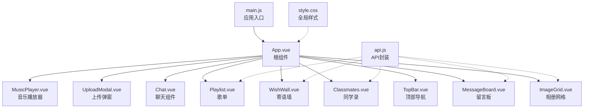
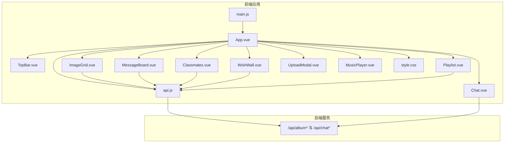
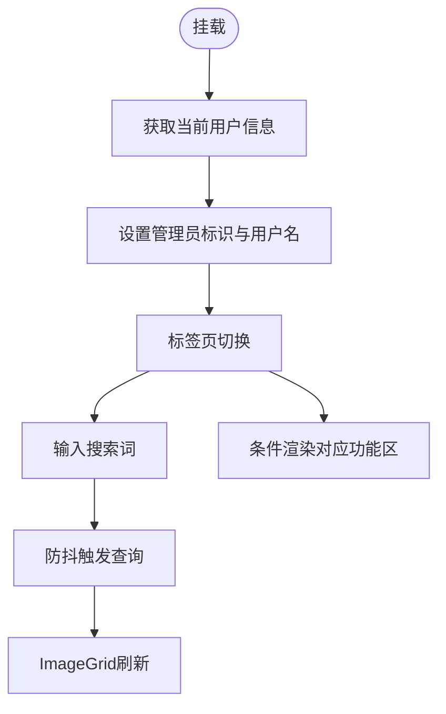
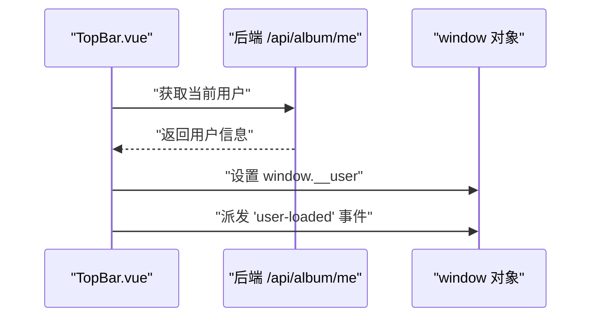
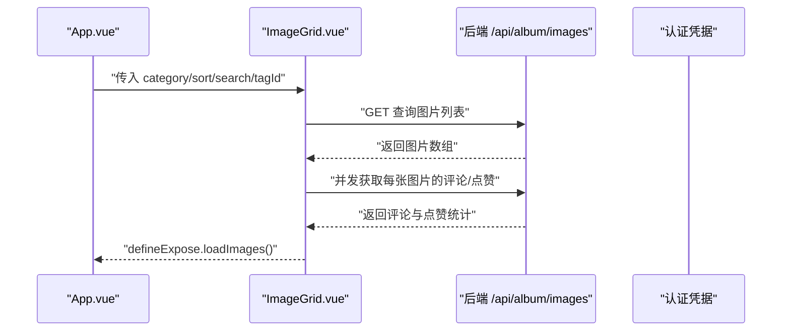
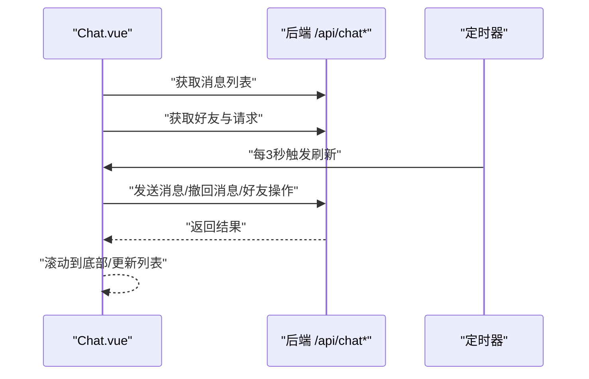
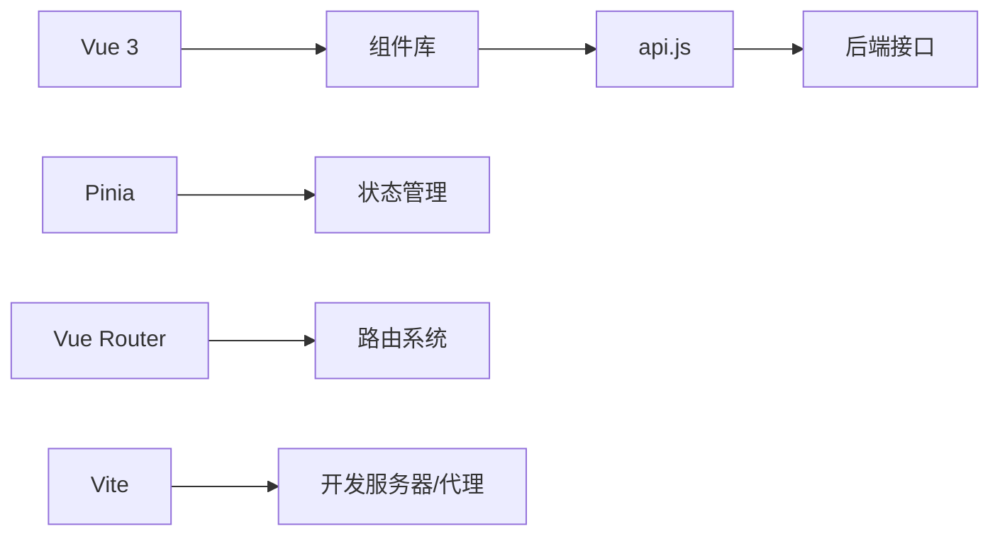

# 前端架构设计

<cite>
**本文引用的文件**
- [frontend/src/main.js](file://frontend/src/main.js)
- [frontend/src/App.vue](file://frontend/src/App.vue)
- [frontend/src/api.js](file://frontend/src/api.js)
- [frontend/package.json](file://frontend/package.json)
- [frontend/vite.config.js](file://frontend/vite.config.js)
- [frontend/src/style.css](file://frontend/src/style.css)
- [frontend/src/components/TopBar.vue](file://frontend/src/components/TopBar.vue)
- [frontend/src/components/ImageGrid.vue](file://frontend/src/components/ImageGrid.vue)
- [frontend/src/components/Chat.vue](file://frontend/src/components/Chat.vue)
- [frontend/src/components/MessageBoard.vue](file://frontend/src/components/MessageBoard.vue)
- [frontend/src/components/Classmates.vue](file://frontend/src/components/Classmates.vue)
- [frontend/src/components/WishWall.vue](file://frontend/src/components/WishWall.vue)
- [frontend/src/components/Playlist.vue](file://frontend/src/components/Playlist.vue)
</cite>

## 目录
1. [引言](#引言)
2. [项目结构](#项目结构)
3. [核心组件](#核心组件)
4. [架构总览](#架构总览)
5. [详细组件分析](#详细组件分析)
6. [依赖关系分析](#依赖关系分析)
7. [性能考虑](#性能考虑)
8. [故障排查指南](#故障排查指南)
9. [结论](#结论)
10. [附录](#附录)

## 引言
本文件面向School_Web前端，系统性梳理基于Vue.js 3的应用架构设计，覆盖应用入口初始化、根组件结构、组件化模式、状态管理现状、路由系统、API客户端设计、组件通信与生命周期管理、性能优化策略以及响应式与移动端适配方案。文档以“可读性优先”为原则，尽量通过图示与路径指引帮助读者快速定位实现细节。

## 项目结构
前端位于frontend目录，采用Vite作为构建工具与开发服务器，使用Vue 3 Composition API风格（<script setup>）。项目采用“按功能模块组织”的组件化布局，根组件负责页面主框架与多标签页切换，各功能区域由独立组件实现。

图表来源
- [frontend/src/main.js:1-6](file://frontend/src/main.js#L1-L6)
- [frontend/src/App.vue:1-99](file://frontend/src/App.vue#L1-L99)
- [frontend/src/api.js:1-45](file://frontend/src/api.js#L1-L45)
- [frontend/src/style.css:1-59](file://frontend/src/style.css#L1-L59)

章节来源
- [frontend/src/main.js:1-6](file://frontend/src/main.js#L1-L6)
- [frontend/src/App.vue:1-99](file://frontend/src/App.vue#L1-L99)
- [frontend/package.json:1-21](file://frontend/package.json#L1-L21)
- [frontend/vite.config.js:1-21](file://frontend/vite.config.js#L1-L21)

## 核心组件
- 应用入口与挂载
  - 使用createApp创建应用实例，挂载至#app元素，引入全局样式。
  - 入口文件极简，职责清晰，便于扩展。
  - 参考路径：[frontend/src/main.js:1-6](file://frontend/src/main.js#L1-L6)

- 根组件App.vue
  - 提供顶部导航TopBar与多标签页切换逻辑，维护当前tab、搜索词、排序、标签过滤等状态。
  - 条件渲染不同功能区：相册网格、留言板、时间线、同学录、寄语墙、歌单、统计等。
  - 通过ref与事件在子组件间传递状态，例如上传完成后的tab切换、标签过滤联动。
  - 参考路径：[frontend/src/App.vue:1-99](file://frontend/src/App.vue#L1-L99)

- API客户端
  - 统一封装fetch请求，统一携带凭据，集中导出常用接口（相册、评论、点赞、下载、分享、上传、留言板、统计等）。
  - 便于在组件中以函数式调用的方式进行前后端交互。
  - 参考路径：[frontend/src/api.js:1-45](file://frontend/src/api.js#L1-L45)

- 全局样式
  - 定义通用按钮、输入框、模态框、动画等基础样式，确保组件风格一致。
  - 参考路径：[frontend/src/style.css:1-59](file://frontend/src/style.css#L1-L59)

章节来源
- [frontend/src/main.js:1-6](file://frontend/src/main.js#L1-L6)
- [frontend/src/App.vue:1-99](file://frontend/src/App.vue#L1-L99)
- [frontend/src/api.js:1-45](file://frontend/src/api.js#L1-L45)
- [frontend/src/style.css:1-59](file://frontend/src/style.css#L1-L59)

## 架构总览
下图展示从前端入口到组件与API的交互关系，体现“根组件编排、组件自治、API封装”的架构特征。

图表来源
- [frontend/src/main.js:1-6](file://frontend/src/main.js#L1-L6)
- [frontend/src/App.vue:1-99](file://frontend/src/App.vue#L1-L99)
- [frontend/src/api.js:1-45](file://frontend/src/api.js#L1-L45)
- [frontend/src/style.css:1-59](file://frontend/src/style.css#L1-L59)
- [frontend/src/components/TopBar.vue:1-42](file://frontend/src/components/TopBar.vue#L1-L42)
- [frontend/src/components/ImageGrid.vue:1-129](file://frontend/src/components/ImageGrid.vue#L1-L129)
- [frontend/src/components/MessageBoard.vue:1-80](file://frontend/src/components/MessageBoard.vue#L1-L80)
- [frontend/src/components/Classmates.vue:1-113](file://frontend/src/components/Classmates.vue#L1-L113)
- [frontend/src/components/WishWall.vue:1-61](file://frontend/src/components/WishWall.vue#L1-L61)
- [frontend/src/components/Playlist.vue:1-71](file://frontend/src/components/Playlist.vue#L1-L71)
- [frontend/src/components/Chat.vue:1-214](file://frontend/src/components/Chat.vue#L1-L214)

## 详细组件分析

### 根组件App.vue
- 设计要点
  - 使用Composition API与<script setup>，集中声明响应式状态与方法。
  - 顶部标签页切换，配合搜索、排序、标签过滤，驱动ImageGrid刷新。
  - 条件渲染不同功能区，避免不必要的DOM开销。
  - 通过ref与事件回调实现父子通信，如上传完成后的tab跳转。
- 关键流程
  - 初始化时拉取当前用户身份，设置管理员权限与用户名。
  - 搜索防抖与过滤联动，提升交互流畅度。
- 参考路径
  - [frontend/src/App.vue:47-84](file://frontend/src/App.vue#L47-L84)

图表来源
- [frontend/src/App.vue:62-84](file://frontend/src/App.vue#L62-L84)

章节来源
- [frontend/src/App.vue:1-99](file://frontend/src/App.vue#L1-L99)

### 顶部导航TopBar.vue
- 设计要点
  - 在挂载时异步获取用户信息，成功后暴露到全局window对象，并派发自定义事件，供其他组件感知。
  - 未登录时提供跳转登录的入口。
- 生命周期与通信
  - onMounted中发起请求；成功后通过window.__user与window事件实现跨组件广播。
- 参考路径
  - [frontend/src/components/TopBar.vue:15-31](file://frontend/src/components/TopBar.vue#L15-L31)

图表来源
- [frontend/src/components/TopBar.vue:20-31](file://frontend/src/components/TopBar.vue#L20-L31)

章节来源
- [frontend/src/components/TopBar.vue:1-42](file://frontend/src/components/TopBar.vue#L1-L42)

### 相册网格ImageGrid.vue
- 设计要点
  - 接收category、sort、search、tagId四个属性，组合成查询参数。
  - 首次加载时并行获取每张图片的评论数与点赞数，提升信息密度。
  - 支持教师角色的重命名与删除操作，普通用户仅查看。
  - 通过defineExpose暴露loadImages方法，供父组件触发刷新。
- 数据流
  - watch监听props变化，自动刷新列表。
  - onMounted时根据全局用户信息判断是否具备教师权限。
- 参考路径
  - [frontend/src/components/ImageGrid.vue:43-106](file://frontend/src/components/ImageGrid.vue#L43-L106)

图表来源
- [frontend/src/components/ImageGrid.vue:55-106](file://frontend/src/components/ImageGrid.vue#L55-L106)

章节来源
- [frontend/src/components/ImageGrid.vue:1-129](file://frontend/src/components/ImageGrid.vue#L1-L129)

### 留言板MessageBoard.vue
- 设计要点
  - 使用api.js提供的接口进行消息的增删查。
  - 删除权限：管理员或消息作者可删除。
  - 加载状态与空态提示，提升可用性。
- 参考路径
  - [frontend/src/components/MessageBoard.vue:23-65](file://frontend/src/components/MessageBoard.vue#L23-L65)

章节来源
- [frontend/src/components/MessageBoard.vue:1-80](file://frontend/src/components/MessageBoard.vue#L1-L80)

### 同学录Classmates.vue
- 设计要点
  - 支持添加、编辑、删除同学信息，支持按“届数·班级”筛选。
  - 表单字段覆盖基本信息与未来规划，便于展示与检索。
  - 管理员与创建者拥有编辑/删除权限。
- 参考路径
  - [frontend/src/components/Classmates.vue:46-94](file://frontend/src/components/Classmates.vue#L46-L94)

章节来源
- [frontend/src/components/Classmates.vue:1-113](file://frontend/src/components/Classmates.vue#L1-L113)

### 寄语墙WishWall.vue
- 设计要点
  - 支持匿名发送，展示作者头像色块与时间戳。
  - 管理员与作者可删除。
- 参考路径
  - [frontend/src/components/WishWall.vue:28-45](file://frontend/src/components/WishWall.vue#L28-L45)

章节来源
- [frontend/src/components/WishWall.vue:1-61](file://frontend/src/components/WishWall.vue#L1-L61)

### 歌单Playlist.vue
- 设计要点
  - 支持添加歌曲、投票、删除（管理员），可选打开外链播放。
- 参考路径
  - [frontend/src/components/Playlist.vue:27-55](file://frontend/src/components/Playlist.vue#L27-L55)

章节来源
- [frontend/src/components/Playlist.vue:1-71](file://frontend/src/components/Playlist.vue#L1-L71)

### 聊天组件Chat.vue
- 设计要点
  - 世界频道与私信双通道，支持好友搜索、请求、接受、删除。
  - 右键菜单支持撤回本人消息，定时轮询刷新消息与好友列表。
  - 移动端侧边栏折叠与自适应布局。
- 参考路径
  - [frontend/src/components/Chat.vue:61-164](file://frontend/src/components/Chat.vue#L61-L164)

图表来源
- [frontend/src/components/Chat.vue:80-164](file://frontend/src/components/Chat.vue#L80-L164)

章节来源
- [frontend/src/components/Chat.vue:1-214](file://frontend/src/components/Chat.vue#L1-L214)

## 依赖关系分析
- 技术栈
  - Vue 3、Pinia、Vue Router（在package.json中声明）
  - Vite构建与代理配置
- 依赖关系
  - 组件之间通过props与事件进行松耦合通信。
  - API封装集中于api.js，降低重复代码与提高一致性。
  - 样式集中在style.css，组件内使用scoped样式隔离。
- 开发与运行
  - dev脚本启动Vite，server.proxy将/api与/static/albums转发至本地后端服务。
- 参考路径
  - [frontend/package.json:11-20](file://frontend/package.json#L11-L20)
  - [frontend/vite.config.js:4-20](file://frontend/vite.config.js#L4-L20)

图表来源
- [frontend/package.json:11-20](file://frontend/package.json#L11-L20)
- [frontend/vite.config.js:4-20](file://frontend/vite.config.js#L4-L20)

章节来源
- [frontend/package.json:1-21](file://frontend/package.json#L1-L21)
- [frontend/vite.config.js:1-21](file://frontend/vite.config.js#L1-L21)

## 性能考虑
- 列表渲染与懒加载
  - 图片列表使用懒加载属性，减少首屏压力。
  - 参考路径：[frontend/src/components/ImageGrid.vue:11](file://frontend/src/components/ImageGrid.vue#L11)
- 并行请求
  - 列表项详情统计采用Promise.all并行获取，缩短等待时间。
  - 参考路径：[frontend/src/components/ImageGrid.vue:67-74](file://frontend/src/components/ImageGrid.vue#L67-L74)
- 防抖与节流
  - 搜索输入使用setTimeout防抖，降低频繁请求。
  - 参考路径：[frontend/src/App.vue:73](file://frontend/src/App.vue#L73)
- 轮询优化
  - 聊天组件定时轮询，建议在后台标签页或离开页面时停止轮询，避免资源浪费。
  - 参考路径：[frontend/src/components/Chat.vue:158-164](file://frontend/src/components/Chat.vue#L158-L164)
- 缓存与复用
  - 组件内部缓存用户身份信息，避免重复请求。
  - 参考路径：[frontend/src/components/TopBar.vue:25-31](file://frontend/src/components/TopBar.vue#L25-L31)

## 故障排查指南
- 登录与权限
  - 若用户信息未显示，请检查后端会话是否正确携带凭据，确认代理配置指向正确的后端地址。
  - 参考路径：[frontend/vite.config.js:9-18](file://frontend/vite.config.js#L9-L18)
- 请求失败与错误提示
  - 组件内多数请求未显式抛错，而是通过alert提示后端返回的error字段。若无提示，请检查网络面板与后端返回格式。
  - 参考路径：[frontend/src/components/MessageBoard.vue:40-52](file://frontend/src/components/MessageBoard.vue#L40-L52)
- 聊天消息不刷新
  - 确认定时器正常运行且未被卸载；检查后端消息接口是否返回最新数据。
  - 参考路径：[frontend/src/components/Chat.vue:158-164](file://frontend/src/components/Chat.vue#L158-L164)
- 相册图片为空
  - 检查category、sort、search、tagId参数是否正确传递；确认静态资源路径/static/albums代理有效。
  - 参考路径：[frontend/src/components/ImageGrid.vue:55-61](file://frontend/src/components/ImageGrid.vue#L55-L61)

章节来源
- [frontend/vite.config.js:9-18](file://frontend/vite.config.js#L9-L18)
- [frontend/src/components/MessageBoard.vue:40-52](file://frontend/src/components/MessageBoard.vue#L40-L52)
- [frontend/src/components/Chat.vue:158-164](file://frontend/src/components/Chat.vue#L158-L164)
- [frontend/src/components/ImageGrid.vue:55-61](file://frontend/src/components/ImageGrid.vue#L55-L61)

## 结论
该前端采用“根组件编排+组件自治+API封装”的清晰架构，结合防抖、并行请求、轮询与懒加载等策略，在保证交互体验的同时兼顾性能。后续可在以下方面进一步完善：
- 引入Pinia进行跨组件共享状态管理，统一管理用户、全局配置、聊天状态等。
- 完善路由系统，结合Vue Router实现页面级导航与参数传递。
- 增强错误边界与统一错误处理，提升稳定性与可观测性。
- 丰富单元测试与E2E测试，保障变更质量。

## 附录
- 响应式与移动端适配
  - 全局样式提供基础断点与布局适配思路，组件内亦包含针对聊天侧边栏的移动端折叠样式。
  - 参考路径：[frontend/src/style.css:54-59](file://frontend/src/style.css#L54-L59)，[frontend/src/components/Chat.vue:203-209](file://frontend/src/components/Chat.vue#L203-L209)