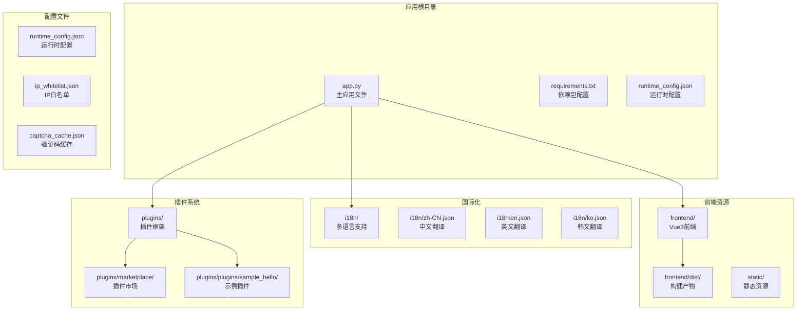
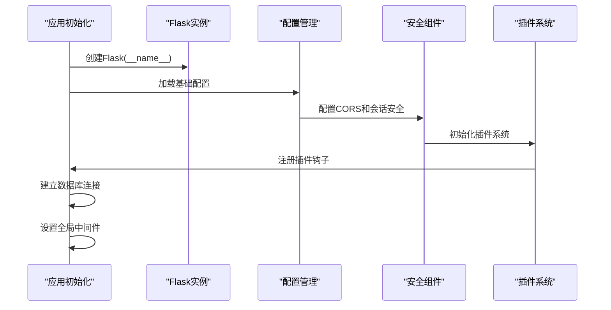
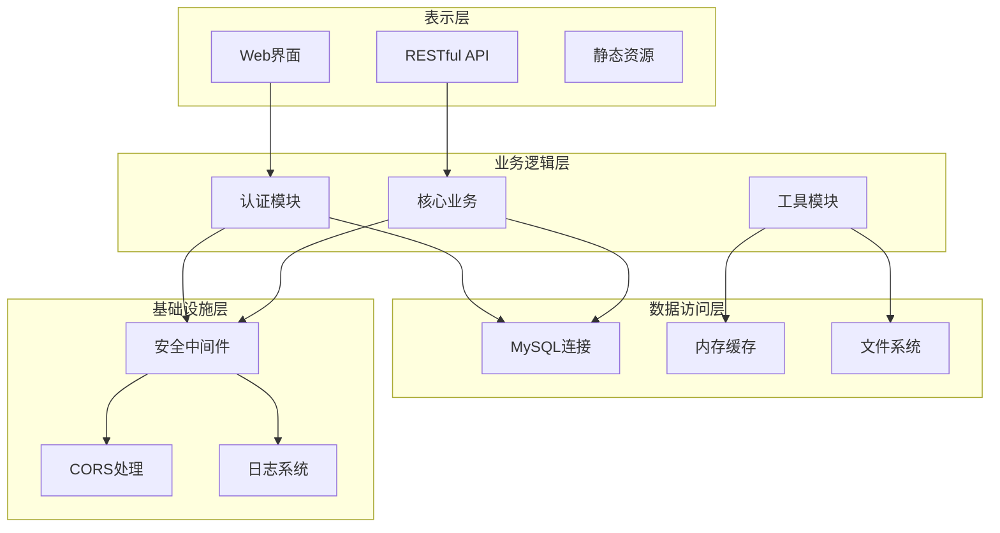
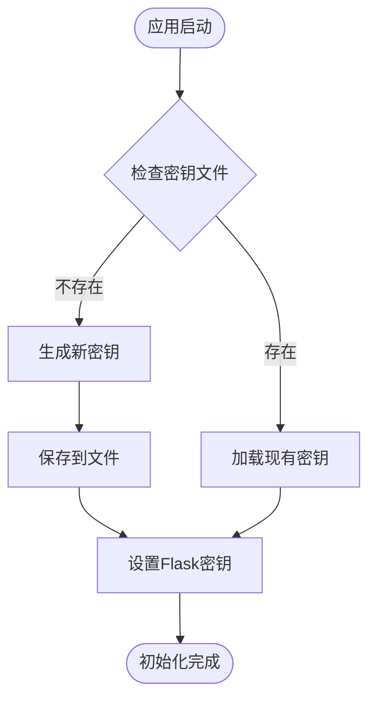
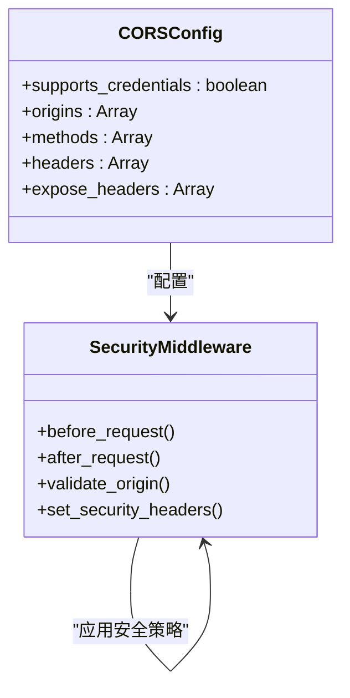
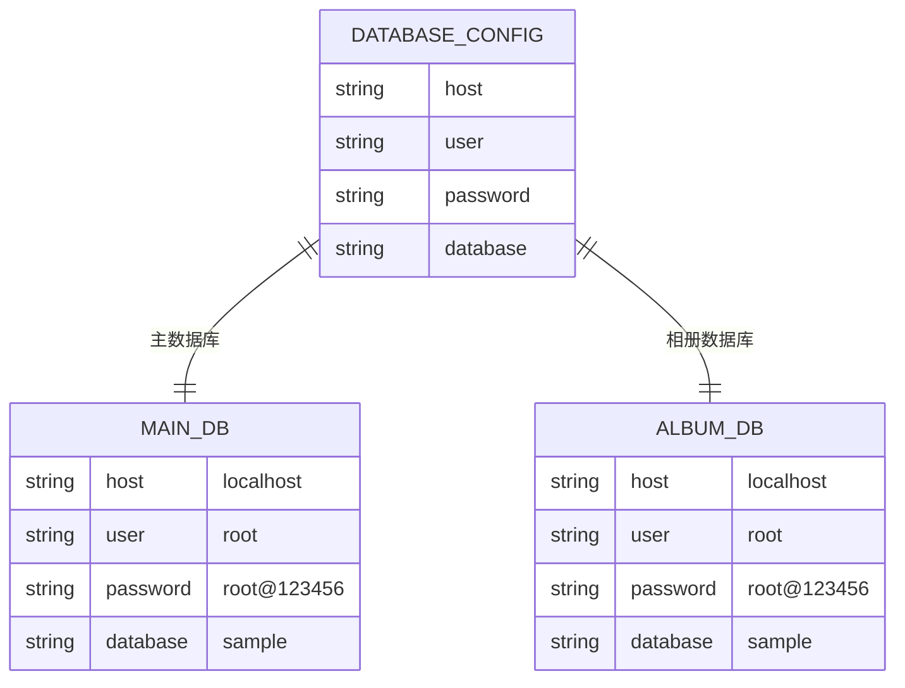
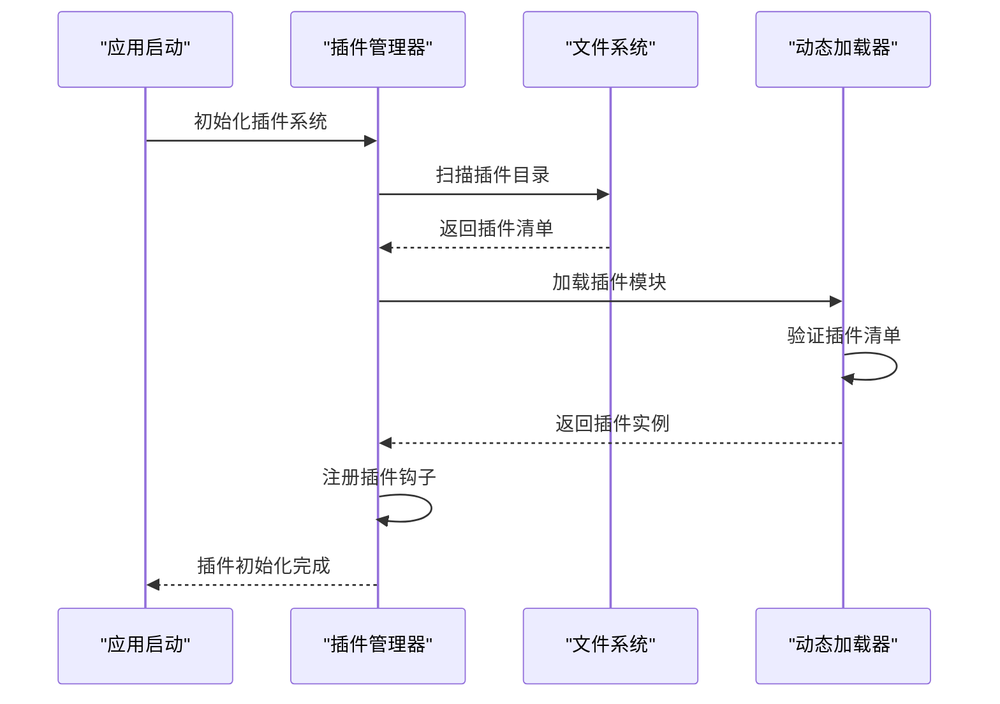
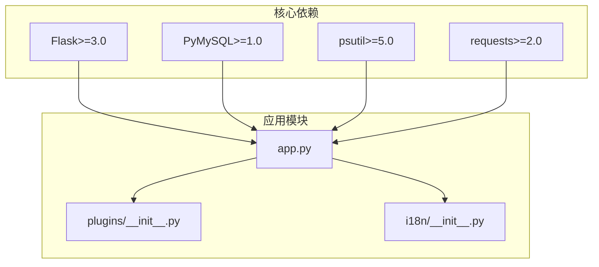

# Flask应用初始化

<cite>
**本文档引用的文件**
- [app.py](file://app.py)
- [plugins/__init__.py](file://plugins/__init__.py)
- [i18n/__init__.py](file://i18n/__init__.py)
- [requirements.txt](file://requirements.txt)
- [rate_config.json](file://rate_config.json)
- [ip_whitelist.json](file://ip_whitelist.json)
</cite>

## 目录
1. [简介](#简介)
2. [项目结构](#项目结构)
3. [核心组件](#核心组件)
4. [架构概览](#架构概览)
5. [详细组件分析](#详细组件分析)
6. [依赖分析](#依赖分析)
7. [性能考虑](#性能考虑)
8. [故障排除指南](#故障排除指南)
9. [结论](#结论)

## 简介

School_Web是一个基于Flask框架开发的校园综合管理系统。本文档详细解释了Flask应用实例的初始化过程，包括应用配置、密钥管理、CORS设置、数据库连接配置、会话安全设置、全局配置参数、依赖注入机制以及配置文件加载顺序和优先级。

## 项目结构

该项目采用典型的Flask项目结构，主要包含以下关键目录和文件：

**图表来源**
- [app.py](file://app.py)
- [plugins/__init__.py](file://plugins/__init__.py)
- [i18n/__init__.py](file://i18n/__init__.py)

**章节来源**
- [app.py](file://app.py)
- [requirements.txt](file://requirements.txt)

## 核心组件

### Flask应用实例创建

应用实例的创建过程遵循标准的Flask初始化模式，但包含了多项安全增强和自定义配置：

**图表来源**
- [app.py](file://app.py)

### 应用配置管理

应用配置采用多层次设计，确保灵活性和安全性：

| 配置类别 | 配置项 | 默认值 | 作用域 |
|---------|--------|--------|--------|
| 数据库配置 | DB_CONFIG | localhost/root/root@123456/sample | 主数据库 |
| 数据库配置 | ALBUM_DB_CONFIG | localhost/root/root@123456/sample | 相册数据库 |
| 安全配置 | ADMIN_SECRET | 环境变量/默认值 | 管理员权限 |
| 日志配置 | LOG_FILE | app.log | 应用日志 |

**章节来源**
- [app.py](file://app.py)

## 架构概览

应用采用模块化架构设计，主要分为以下几个层次：

**图表来源**
- [app.py](file://app.py)
- [plugins/__init__.py](file://plugins/__init__.py)

## 详细组件分析

### 密钥管理系统

应用实现了自动化的密钥生成和持久化机制：

**图表来源**
- [app.py](file://app.py)

密钥管理特性：
- 自动检测和生成64字节十六进制密钥
- 密钥文件位于应用根目录下的隐藏文件
- 支持密钥轮换和备份恢复

**章节来源**
- [app.py](file://app.py)

### CORS跨域配置

应用采用严格的CORS策略，确保前后端分离的安全通信：

**图表来源**
- [app.py](file://app.py)

CORS配置特点：
- 支持凭据传输（credentials）
- 限定特定源（localhost:3000）
- 自动HTTPS检测和Secure标志设置

**章节来源**
- [app.py](file://app.py)

### 会话安全设置

应用实现了多层次的会话安全保护：

| 安全特性 | 配置 | 作用 |
|---------|------|------|
| HttpOnly | True | 防止XSS攻击 |
| SameSite | Lax | 防止CSRF攻击 |
| Secure | 环境检测 | HTTPS环境自动启用 |
| 生命周期 | 2小时 | 会话超时控制 |

**章节来源**
- [app.py](file://app.py)

### 数据库连接配置

应用支持双数据库架构，提供灵活的数据分离：

**图表来源**
- [app.py](file://app.py)

数据库连接特性：
- 独立的主数据库和相册数据库配置
- 自动表结构初始化和维护
- 连接池管理和错误处理

**章节来源**
- [app.py](file://app.py)

### 插件系统初始化

插件系统采用动态加载机制，支持热插拔和版本管理：

**图表来源**
- [plugins/__init__.py](file://plugins/__init__.py)

插件系统特性：
- 动态发现和加载
- 插件清单验证
- 钩子注册和管理
- 支持无代码插件

**章节来源**
- [plugins/__init__.py](file://plugins/__init__.py)

### 国际化配置

应用支持多语言切换，采用预加载机制优化性能：

**图表来源**
- [i18n/__init__.py](file://i18n/__init__.py)

国际化特性：
- 支持中文、英文、韩文、日文
- 自动语言检测和偏好保持
- 模板上下文自动注入

**章节来源**
- [i18n/__init__.py](file://i18n/__init__.py)

## 依赖分析

应用的依赖关系相对简单，主要依赖于Flask生态系统：

**图表来源**
- [requirements.txt](file://requirements.txt)
- [app.py](file://app.py)

**章节来源**
- [requirements.txt](file://requirements.txt)

## 性能考虑

应用在性能方面采用了多项优化策略：

1. **连接池管理**：使用PyMySQL的连接池减少数据库连接开销
2. **缓存策略**：内存缓存常用数据，减少数据库查询
3. **异步处理**：关键操作使用线程池避免阻塞
4. **静态资源优化**：前端资源分离部署，CDN加速
5. **压缩传输**：Gzip压缩减少网络传输量

## 故障排除指南

### 常见问题及解决方案

| 问题类型 | 症状 | 解决方案 |
|---------|------|----------|
| 数据库连接失败 | 应用启动时报错 | 检查DB_CONFIG配置和数据库服务状态 |
| 密钥文件权限问题 | Flask密钥相关错误 | 确认.secret_key文件权限和所有权 |
| CORS跨域失败 | 前端请求被阻止 | 验证CORS配置和前端源地址 |
| 插件加载失败 | 插件功能不可用 | 检查插件目录权限和插件清单 |
| 会话超时问题 | 用户频繁需要重新登录 | 调整PERMANENT_SESSION_LIFETIME配置 |

### 调试建议

1. **启用调试模式**：设置FLASK_ENV=development
2. **查看日志文件**：检查app.log中的错误信息
3. **数据库连接测试**：使用独立脚本测试数据库连通性
4. **网络诊断**：使用curl测试API端点
5. **浏览器开发者工具**：检查CORS和会话Cookie

**章节来源**
- [app.py](file://app.py)

## 结论

School_Web的Flask应用初始化展现了现代Web应用的最佳实践。通过模块化设计、多层次安全配置、动态插件系统和国际化支持，应用提供了完整的校园管理解决方案。其架构既保证了安全性，又保持了良好的可扩展性和维护性。

关键优势包括：
- 完善的安全机制和会话管理
- 灵活的插件系统和配置管理
- 双数据库架构支持复杂业务需求
- 多语言支持和国际化设计
- 详细的日志记录和错误处理