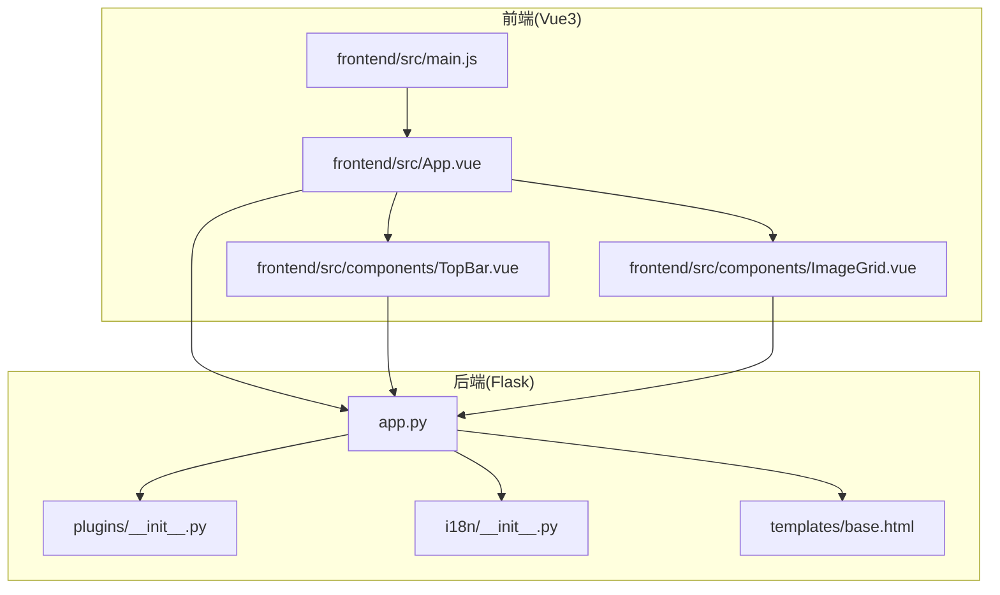
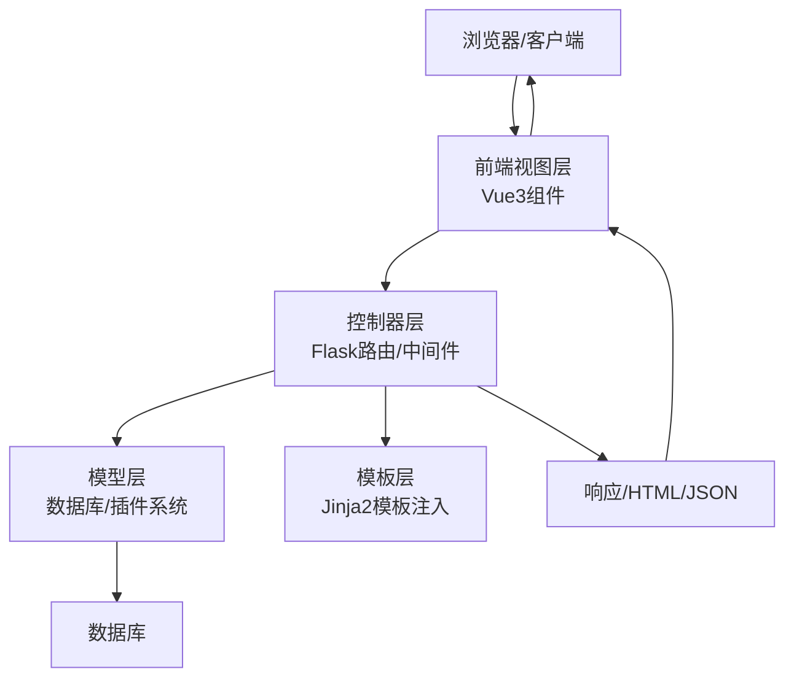
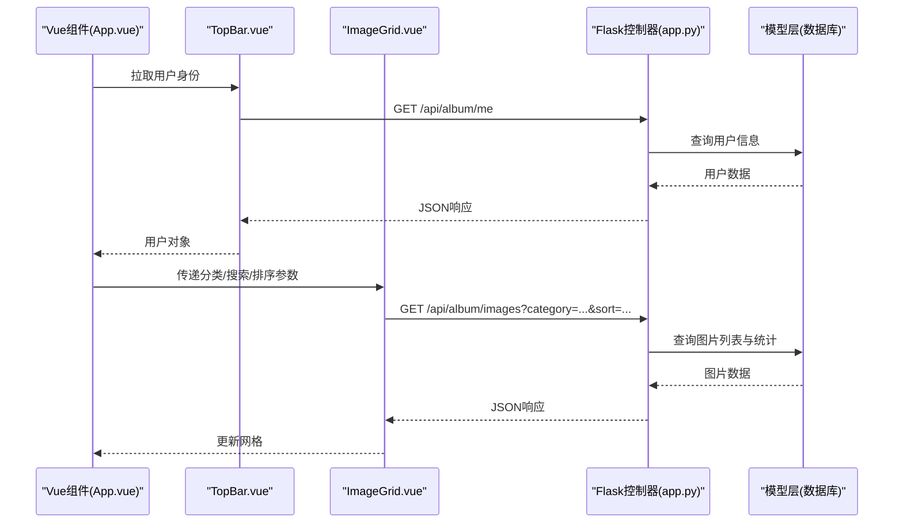
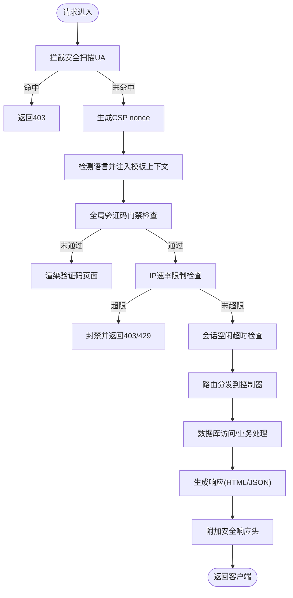
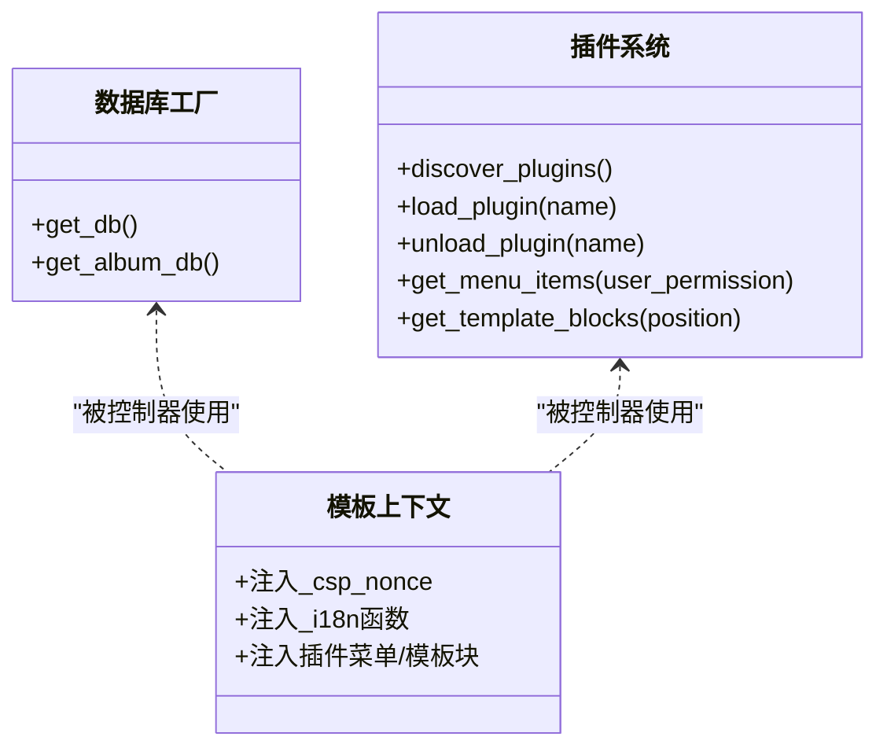
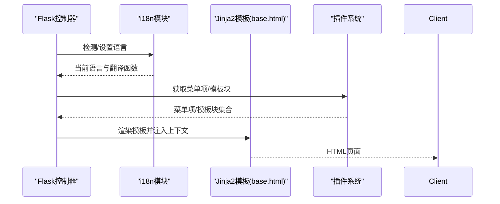
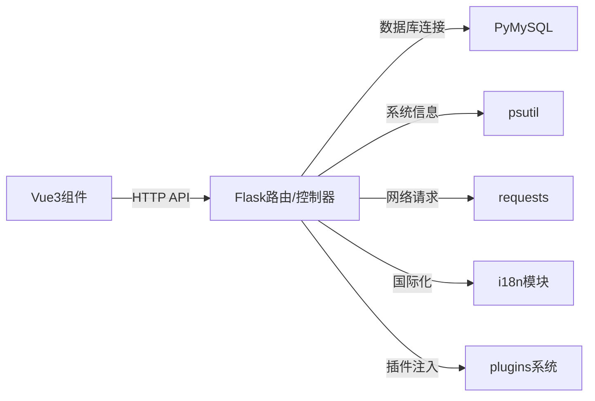

# MVC交互模式

<cite>
**本文引用的文件**
- [app.py](file://app.py)
- [plugins/__init__.py](file://plugins/__init__.py)
- [i18n/__init__.py](file://i18n/__init__.py)
- [templates/base.html](file://templates/base.html)
- [frontend/src/main.js](file://frontend/src/main.js)
- [frontend/src/App.vue](file://frontend/src/App.vue)
- [frontend/src/components/TopBar.vue](file://frontend/src/components/TopBar.vue)
- [frontend/src/components/ImageGrid.vue](file://frontend/src/components/ImageGrid.vue)
- [requirements.txt](file://requirements.txt)
</cite>

## 目录
1. [引言](#引言)
2. [项目结构](#项目结构)
3. [核心组件](#核心组件)
4. [架构总览](#架构总览)
5. [详细组件分析](#详细组件分析)
6. [依赖分析](#依赖分析)
7. [性能考量](#性能考量)
8. [故障排查指南](#故障排查指南)
9. [结论](#结论)
10. [附录](#附录)

## 引言
本文件围绕School_Web的MVC交互模式进行系统化梳理，重点阐释请求在“视图-控制器-模型”之间的流转路径与控制流程，明确各层职责边界，解析服务层抽象与接口设计、错误传播与异常处理策略、以及扩展性设计（插件系统与功能模块化）。文档同时给出可视化图示与分层说明，帮助读者快速把握整体架构与实现细节。

## 项目结构
- 后端采用Flask框架，集中于app.py中定义路由、中间件、安全策略与数据访问层封装。
- 前端基于Vue3，入口位于frontend/src/main.js，根组件为frontend/src/App.vue，配合多个功能组件（如ImageGrid、TopBar等）构成视图层。
- 国际化与插件系统分别位于i18n与plugins目录，作为横切关注点注入到模板与渲染上下文中。
- 模板系统以Jinja2为主，基础模板templates/base.html统一注入安全与国际化上下文。

图表来源
- [frontend/src/main.js:1-6](file://frontend/src/main.js#L1-L6)
- [frontend/src/App.vue:1-99](file://frontend/src/App.vue#L1-L99)
- [frontend/src/components/TopBar.vue:1-42](file://frontend/src/components/TopBar.vue#L1-L42)
- [frontend/src/components/ImageGrid.vue:1-129](file://frontend/src/components/ImageGrid.vue#L1-L129)
- [app.py:119-139](file://app.py#L119-L139)
- [plugins/__init__.py:1-249](file://plugins/__init__.py#L1-L249)
- [i18n/__init__.py:1-113](file://i18n/__init__.py#L1-L113)
- [templates/base.html:1-337](file://templates/base.html#L1-L337)

章节来源
- [frontend/src/main.js:1-6](file://frontend/src/main.js#L1-L6)
- [frontend/src/App.vue:1-99](file://frontend/src/App.vue#L1-L99)
- [app.py:119-139](file://app.py#L119-L139)

## 核心组件
- 视图层（View）
  - Vue3组件负责UI渲染与用户交互，通过fetch调用后端API获取数据或提交变更。
  - 模板层（Jinja2）由Flask注入上下文，提供安全头、CSP nonce、国际化函数与插件注入点。
- 控制器层（Controller）
  - Flask路由函数承担控制器职责，处理请求参数、调用业务/数据访问方法、组织响应数据或模板渲染。
  - 中间件与before_request/after_request钩子负责安全、速率限制、语言检测、CSP注入等横切逻辑。
- 模型层（Model）
  - 数据访问通过get_db/get_album_db等工厂函数获取连接，封装数据库初始化与表结构管理。
  - 插件系统提供菜单项、模板块、静态路由与API路由的动态扩展能力。

章节来源
- [app.py:149-194](file://app.py#L149-L194)
- [app.py:680-692](file://app.py#L680-L692)
- [plugins/__init__.py:1-249](file://plugins/__init__.py#L1-L249)
- [i18n/__init__.py:1-113](file://i18n/__init__.py#L1-L113)
- [templates/base.html:1-337](file://templates/base.html#L1-L337)

## 架构总览
School_Web采用经典的MVC模式：
- 视图层：Vue3组件与Jinja2模板共同完成界面展示与交互。
- 控制器层：Flask路由函数与中间件处理请求、校验、鉴权与响应生成。
- 模型层：数据库连接与表结构初始化，配合插件系统实现功能扩展。

图表来源
- [app.py:119-139](file://app.py#L119-L139)
- [app.py:149-194](file://app.py#L149-L194)
- [app.py:680-692](file://app.py#L680-L692)
- [templates/base.html:1-337](file://templates/base.html#L1-L337)

## 详细组件分析

### 视图层（Vue3组件）
- 组件职责
  - App.vue：主容器，负责标签页切换、搜索与排序参数传递给ImageGrid等子组件。
  - TopBar.vue：顶部导航，拉取当前用户身份并暴露至window，供其他组件使用。
  - ImageGrid.vue：图片网格展示，异步加载图片列表与统计信息，支持重命名与删除等教师操作。
- 数据流
  - 组件通过fetch调用后端API（如/api/album/images、/api/album/me等）获取数据。
  - 使用watch与onMounted生命周期触发数据刷新，保持视图与数据同步。

图表来源
- [frontend/src/App.vue:78-84](file://frontend/src/App.vue#L78-L84)
- [frontend/src/components/TopBar.vue:20-31](file://frontend/src/components/TopBar.vue#L20-L31)
- [frontend/src/components/ImageGrid.vue:55-106](file://frontend/src/components/ImageGrid.vue#L55-L106)
- [app.py:1709-1750](file://app.py#L1709-L1750)
- [app.py:680-692](file://app.py#L680-L692)

章节来源
- [frontend/src/App.vue:1-99](file://frontend/src/App.vue#L1-L99)
- [frontend/src/components/TopBar.vue:1-42](file://frontend/src/components/TopBar.vue#L1-L42)
- [frontend/src/components/ImageGrid.vue:1-129](file://frontend/src/components/ImageGrid.vue#L1-L129)

### 控制器层（Flask路由与中间件）
- 路由与控制器
  - 登录/注册/登出等核心路由在app.py中定义，控制器负责参数校验、速率限制、验证码校验、数据库查询与响应生成。
  - 仪表盘、个人资料、系统监控等页面路由均带有鉴权装饰器，确保访问安全。
- 中间件与横切逻辑
  - before_request：安全UA拦截、CSP nonce生成、语言检测与注入、全局验证码门禁、速率限制与会话空闲超时检查。
  - after_request：统一添加安全响应头（CSP、XSS防护、HSTS等），隐藏服务器版本信息，敏感页面禁用缓存。
- 错误处理
  - 对数据库连接失败、SQL异常、参数类型错误等情况返回结构化JSON或Flash消息，保证用户体验与可诊断性。

图表来源
- [app.py:149-156](file://app.py#L149-L156)
- [app.py:158-162](file://app.py#L158-L162)
- [app.py:165-173](file://app.py#L165-L173)
- [app.py:600-622](file://app.py#L600-L622)
- [app.py:513-562](file://app.py#L513-L562)
- [app.py:564-593](file://app.py#L564-L593)
- [app.py:642-676](file://app.py#L642-L676)

章节来源
- [app.py:1020-1219](file://app.py#L1020-L1219)
- [app.py:1709-1908](file://app.py#L1709-L1908)
- [app.py:642-676](file://app.py#L642-L676)

### 模型层（数据库与插件系统）
- 数据访问
  - get_db/get_album_db提供数据库连接工厂，封装表初始化（如用户资料、活动日志、相册扩展表等）。
  - 通过游标执行SQL，处理插入、更新、查询与索引优化，确保数据一致性与性能。
- 插件系统
  - 支持动态发现、加载、卸载插件，注册菜单项、模板注入块、静态路由与API路由。
  - 通过上下文处理器将菜单与模板块注入到所有模板，实现功能模块化与扩展性。

图表来源
- [app.py:680-692](file://app.py#L680-L692)
- [plugins/__init__.py:25-136](file://plugins/__init__.py#L25-L136)
- [i18n/__init__.py:50-67](file://i18n/__init__.py#L50-L67)
- [templates/base.html:175-194](file://templates/base.html#L175-L194)

章节来源
- [app.py:231-345](file://app.py#L231-L345)
- [plugins/__init__.py:1-249](file://plugins/__init__.py#L1-L249)
- [i18n/__init__.py:1-113](file://i18n/__init__.py#L1-L113)

### 国际化与模板注入
- 国际化
  - i18n模块提供翻译函数与语言检测逻辑，支持多语言资源文件按需加载。
- 模板注入
  - 上下文处理器将翻译函数、语言信息与插件菜单/模板块注入模板，base.html统一渲染导航、通知与主题切换等通用UI。

图表来源
- [app.py:165-173](file://app.py#L165-L173)
- [app.py:181-194](file://app.py#L181-L194)
- [i18n/__init__.py:70-108](file://i18n/__init__.py#L70-L108)
- [templates/base.html:158-230](file://templates/base.html#L158-L230)
- [plugins/__init__.py:154-184](file://plugins/__init__.py#L154-L184)

章节来源
- [app.py:165-194](file://app.py#L165-L194)
- [i18n/__init__.py:1-113](file://i18n/__init__.py#L1-L113)
- [templates/base.html:1-337](file://templates/base.html#L1-L337)
- [plugins/__init__.py:1-249](file://plugins/__init__.py#L1-L249)

## 依赖分析
- 技术栈
  - 后端：Flask、PyMySQL、psutil、requests等。
  - 前端：Vue3、Bootstrap、本地样式与组件化开发。
- 组件耦合
  - 前端组件通过REST风格API与后端解耦，控制器仅暴露清晰的接口契约。
  - 插件系统通过钩子机制与上下文处理器实现横切扩展，避免硬编码耦合。

图表来源
- [requirements.txt:1-5](file://requirements.txt#L1-L5)
- [app.py:1-25](file://app.py#L1-L25)
- [frontend/src/App.vue:1-99](file://frontend/src/App.vue#L1-L99)
- [plugins/__init__.py:1-249](file://plugins/__init__.py#L1-L249)
- [i18n/__init__.py:1-113](file://i18n/__init__.py#L1-L113)

章节来源
- [requirements.txt:1-5](file://requirements.txt#L1-L5)
- [app.py:1-25](file://app.py#L1-L25)

## 性能考量
- 前端
  - 组件懒加载与虚拟滚动（如图片网格）减少DOM压力；搜索输入节流降低请求频率。
- 后端
  - 速率限制与封禁策略防止滥用；数据库查询建立索引（如用户活动日志、日历事件）提升检索效率。
  - 安全响应头与CSP减少XSS风险，避免额外的页面渲染开销。
- 可扩展性
  - 插件系统支持功能模块化与动态装配，便于按需扩展而不影响核心路由。

## 故障排查指南
- 登录/注册失败
  - 检查验证码、速率限制与数据库连接状态；查看Flash消息与后端日志。
- API返回403/429
  - 确认全局验证码门禁、IP封禁与速率限制配置；核对请求频率与路径是否在豁免列表。
- 模板未注入插件内容
  - 检查插件加载状态与上下文处理器注入逻辑；确认菜单权限与位置配置。
- 国际化无效
  - 核对语言检测顺序与Cookie/Session优先级；确认翻译键是否存在。

章节来源
- [app.py:513-562](file://app.py#L513-L562)
- [app.py:600-622](file://app.py#L600-L622)
- [app.py:181-194](file://app.py#L181-L194)
- [plugins/__init__.py:154-184](file://plugins/__init__.py#L154-L184)
- [i18n/__init__.py:70-108](file://i18n/__init__.py#L70-L108)

## 结论
School_Web在MVC模式下实现了清晰的职责分离：视图层专注UI与交互，控制器负责请求处理与安全策略，模型层聚焦数据访问与扩展机制。通过插件系统与国际化注入，系统具备良好的模块化与可扩展性；结合速率限制、CSP与安全响应头，兼顾性能与安全性。建议后续进一步完善API契约文档与错误码标准化，持续优化数据库索引与前端缓存策略。

## 附录
- 关键实现路径参考
  - 登录控制器：[app.py:1020-1116](file://app.py#L1020-L1116)
  - 仪表盘控制器：[app.py:1709-1750](file://app.py#L1709-L1750)
  - 系统监控API：[app.py:1827-1888](file://app.py#L1827-L1888)
  - 数据库工厂与初始化：[app.py:680-345](file://app.py#L680-L345)
  - 插件系统钩子与注入：[plugins/__init__.py:154-184](file://plugins/__init__.py#L154-L184)
  - 国际化上下文注入：[app.py:181-194](file://app.py#L181-L194)
  - 前端入口与根组件：[frontend/src/main.js:1-6](file://frontend/src/main.js#L1-L6)、[frontend/src/App.vue:1-99](file://frontend/src/App.vue#L1-L99)