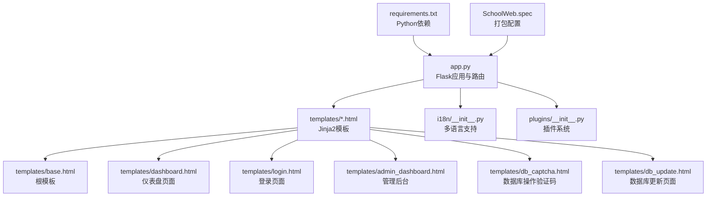
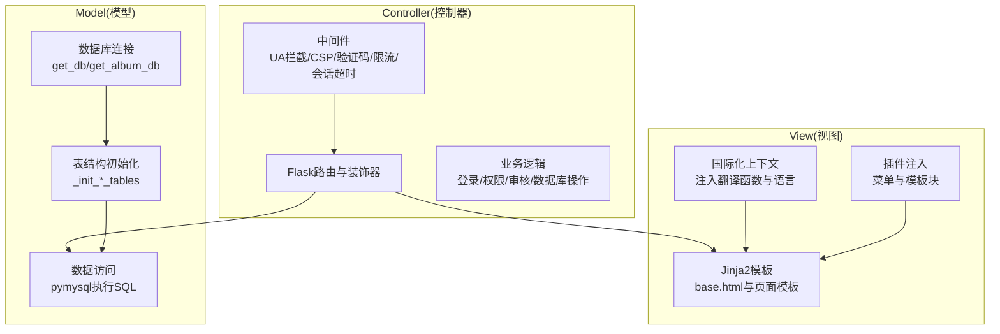
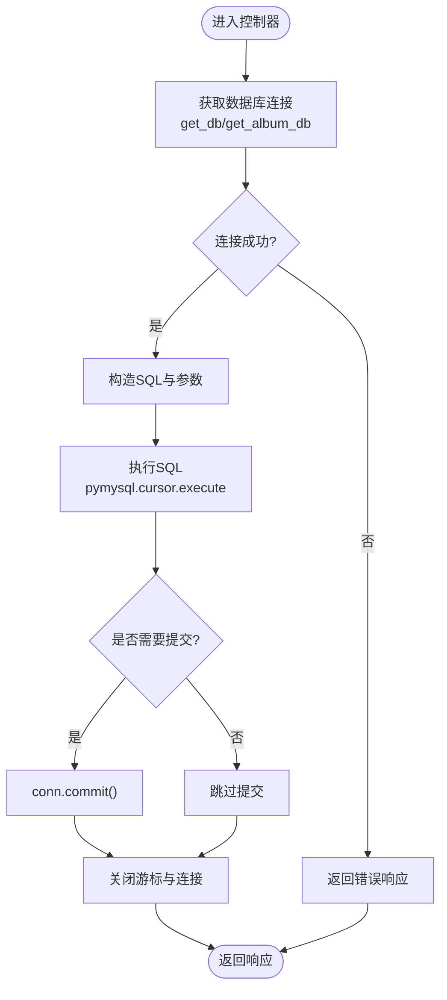
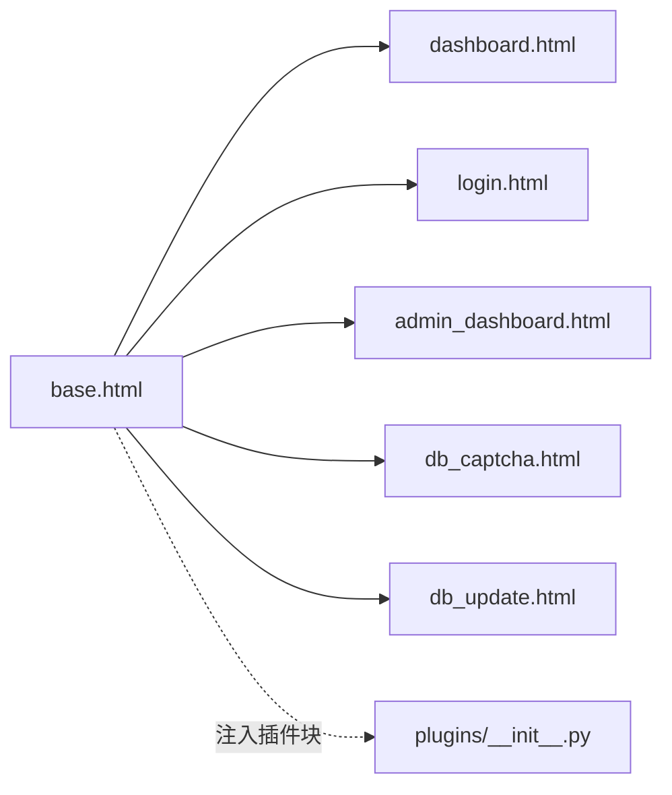
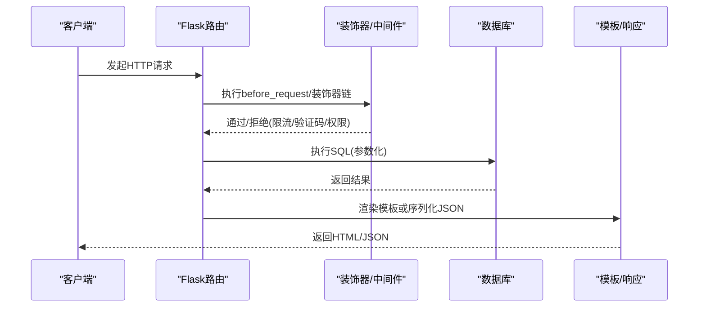
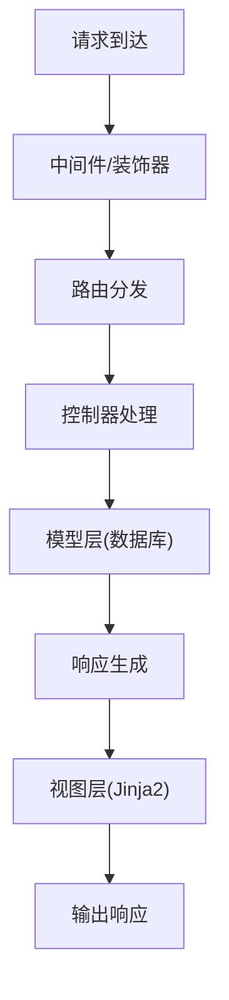
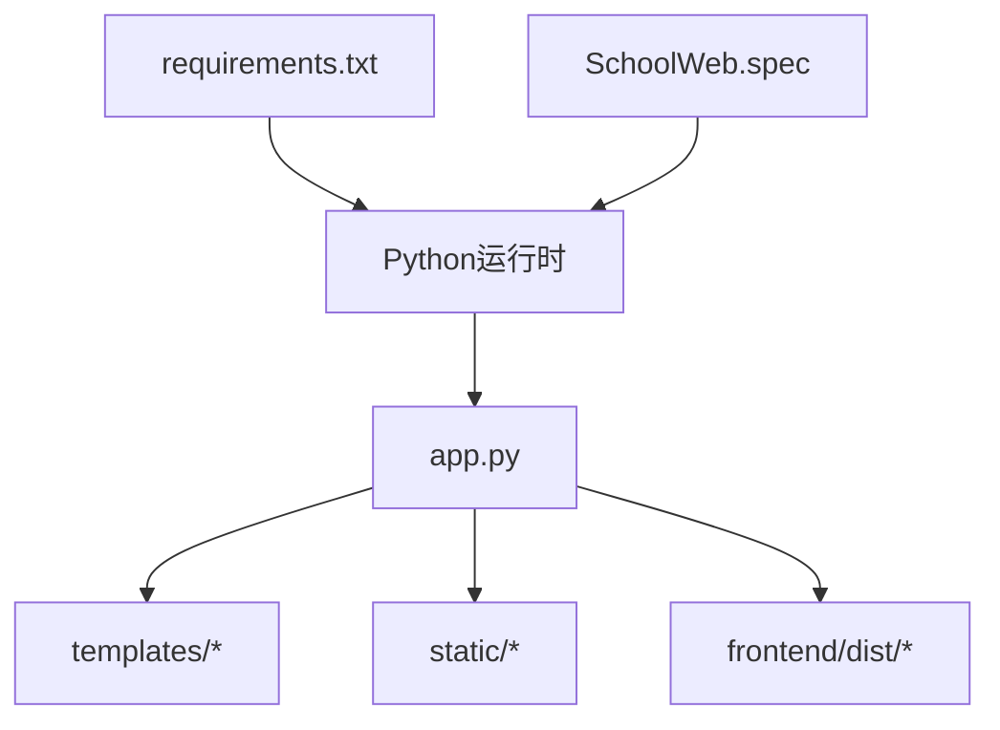

# MVC架构模式

<cite>
**本文引用的文件**
- [app.py](file://app.py)
- [templates/base.html](file://templates/base.html)
- [templates/dashboard.html](file://templates/dashboard.html)
- [templates/login.html](file://templates/login.html)
- [templates/admin_dashboard.html](file://templates/admin_dashboard.html)
- [templates/db_captcha.html](file://templates/db_captcha.html)
- [templates/db_update.html](file://templates/db_update.html)
- [i18n/__init__.py](file://i18n/__init__.py)
- [plugins/__init__.py](file://plugins/__init__.py)
- [requirements.txt](file://requirements.txt)
- [SchoolWeb.spec](file://SchoolWeb.spec)
</cite>

## 目录
1. [简介](#简介)
2. [项目结构](#项目结构)
3. [核心组件](#核心组件)
4. [架构总览](#架构总览)
5. [详细组件分析](#详细组件分析)
6. [依赖分析](#依赖分析)
7. [性能考虑](#性能考虑)
8. [故障排查指南](#故障排查指南)
9. [结论](#结论)
10. [附录](#附录)

## 简介
本文件面向School_Web项目的MVC架构模式实现，系统性梳理模型(Model)层的数据库连接与表结构、视图(View)层的Jinja2模板体系与插件注入、控制器(Controller)层的路由与业务逻辑处理。文档同时给出MVC各层交互流程、最佳实践与运维建议，帮助开发者与维护者高效理解与演进系统。

## 项目结构
- 应用入口与控制器：app.py集中定义Flask应用、路由、中间件、安全策略与业务逻辑。
- 视图层：templates目录存放Jinja2模板，base.html为根模板，其他页面模板继承并使用块机制。
- 国际化：i18n模块提供多语言支持与上下文注入。
- 插件系统：plugins模块提供菜单与模板块注入能力，增强视图层扩展性。
- 前端资源：frontend目录包含Vue前端构建产物，静态资源位于static目录。
- 依赖与打包：requirements.txt声明Python依赖，SchoolWeb.spec描述打包配置。

图表来源
- [app.py](file://app.py)
- [templates/base.html](file://templates/base.html)
- [templates/dashboard.html](file://templates/dashboard.html)
- [templates/login.html](file://templates/login.html)
- [templates/admin_dashboard.html](file://templates/admin_dashboard.html)
- [templates/db_captcha.html](file://templates/db_captcha.html)
- [templates/db_update.html](file://templates/db_update.html)
- [i18n/__init__.py](file://i18n/__init__.py)
- [plugins/__init__.py](file://plugins/__init__.py)
- [requirements.txt](file://requirements.txt)
- [SchoolWeb.spec](file://SchoolWeb.spec)

章节来源
- [app.py](file://app.py)
- [templates/base.html](file://templates/base.html)
- [i18n/__init__.py](file://i18n/__init__.py)
- [plugins/__init__.py](file://plugins/__init__.py)
- [requirements.txt](file://requirements.txt)
- [SchoolWeb.spec](file://SchoolWeb.spec)

## 核心组件
- 模型层
  - 数据库连接：统一通过get_db/get_album_db建立连接，异常捕获返回None，避免崩溃。
  - 表结构初始化：在应用启动阶段创建用户、活动日志、管理员申请、日历事件、相册扩展等表。
  - 数据访问：控制器中直接使用pymysql执行SQL，进行增删改查与事务提交。
- 视图层
  - Jinja2模板：base.html提供通用布局、导航、通知与脚本；各页面模板继承并填充块。
  - 国际化注入：上下文处理器将翻译函数与语言信息注入模板。
  - 插件注入：上下文处理器注入插件菜单与模板块，实现视图扩展。
- 控制器层
  - 路由与中间件：before_request钩子实现UA拦截、CSP nonce生成、语言检测、全局验证码门禁、速率限制、会话空闲超时等。
  - 业务逻辑：登录、权限校验、管理员申请、VIP审核、数据库可视化操作、通知轮询等。
  - 输入验证与响应：参数类型校验、CSRF保护、API统一返回格式、模板渲染与静态资源服务。

章节来源
- [app.py](file://app.py)
- [templates/base.html](file://templates/base.html)
- [i18n/__init__.py](file://i18n/__init__.py)
- [plugins/__init__.py](file://plugins/__init__.py)

## 架构总览
MVC在本项目中的体现：
- Model：数据库连接与表结构、数据访问（pymysql）。
- View：Jinja2模板与插件注入，国际化上下文。
- Controller：Flask路由、装饰器、中间件与业务处理。

图表来源
- [app.py](file://app.py)
- [templates/base.html](file://templates/base.html)
- [i18n/__init__.py](file://i18n/__init__.py)
- [plugins/__init__.py](file://plugins/__init__.py)

## 详细组件分析

### 模型(Model)层设计
- 数据库连接管理
  - 统一连接工厂：get_db/get_album_db分别针对主库与相册扩展库，异常捕获返回None，保证健壮性。
  - 表结构初始化：在应用启动时创建用户资料、活动日志、管理员申请、日历事件、相册扩展表等，兼容旧版本列变更。
- 数据访问对象(DAO)模式
  - 本项目未显式定义独立DAO类，而是将数据访问逻辑直接嵌入控制器方法中，遵循“轻DAO”风格：每个路由对应一次数据库操作，参数校验与SQL执行在同一函数内完成。
- ORM映射
  - 未使用ORM框架，直接使用pymysql执行SQL，通过字典/元组封装查询结果，便于快速迭代与灵活定制。

图表来源
- [app.py](file://app.py)

章节来源
- [app.py](file://app.py)

### 视图(View)层实现
- Jinja2模板引擎
  - 根模板base.html：定义通用头部、导航、通知、样式与脚本，注入CSP nonce与国际化上下文。
  - 页面模板：dashboard.html、login.html等继承base.html，使用块机制填充标题与内容区域。
- 模板继承与块机制
  - base.html定义title与content块；页面模板通过block指令覆盖相应块，实现布局复用与局部替换。
- 插件注入
  - 上下文处理器注入插件菜单与模板块，页面footer/head位置可插入插件HTML片段，实现视图扩展。

图表来源
- [templates/base.html](file://templates/base.html)
- [templates/dashboard.html](file://templates/dashboard.html)
- [templates/login.html](file://templates/login.html)
- [templates/admin_dashboard.html](file://templates/admin_dashboard.html)
- [templates/db_captcha.html](file://templates/db_captcha.html)
- [templates/db_update.html](file://templates/db_update.html)
- [plugins/__init__.py](file://plugins/__init__.py)

章节来源
- [templates/base.html](file://templates/base.html)
- [templates/dashboard.html](file://templates/dashboard.html)
- [templates/login.html](file://templates/login.html)
- [templates/admin_dashboard.html](file://templates/admin_dashboard.html)
- [templates/db_captcha.html](file://templates/db_captcha.html)
- [templates/db_update.html](file://templates/db_update.html)
- [plugins/__init__.py](file://plugins/__init__.py)

### 控制器(Controller)层职责
- 业务逻辑处理
  - 登录与权限：login_required装饰器、管理员权限校验、VIP审核、排行榜查询等。
  - 数据库操作：可视化查询/更新、数据库操作验证码门禁、日志记录。
  - 通知与会话：通知轮询、会话空闲超时、全局验证码门禁。
- 输入验证
  - 参数类型校验：如语言切换API对lang字段进行字符串类型校验。
  - CSRF保护：隐藏字段与fetch请求携带CSRF令牌。
  - SQL安全：使用参数化查询与白名单/反引号包裹表名，降低注入风险。
- 响应生成
  - HTML渲染：render_template返回Jinja2模板渲染结果。
  - API响应：统一返回JSON，包含错误码与消息，便于前端处理。

图表来源
- [app.py](file://app.py)

章节来源
- [app.py](file://app.py)

### MVC各层交互模式
- 数据流向
  - 控制器接收请求，调用模型层执行数据库操作，再将结果交给视图层渲染或序列化为JSON。
- 控制流程
  - 中间件负责全局安全与会话管理；路由装饰器负责权限与验证码门禁；业务逻辑集中在控制器方法中。
- 视图扩展
  - 插件系统通过上下文处理器向模板注入菜单与块，实现视图层的动态扩展。

图表来源
- [app.py](file://app.py)
- [templates/base.html](file://templates/base.html)

章节来源
- [app.py](file://app.py)
- [templates/base.html](file://templates/base.html)

## 依赖分析
- Python依赖
  - Flask、PyMySQL、psutil、requests等，满足Web框架、数据库驱动与系统监控需求。
- 打包配置
  - SchoolWeb.spec定义了打包时的数据文件与隐藏导入，确保模板、静态资源与第三方库正确打包。

图表来源
- [requirements.txt](file://requirements.txt)
- [SchoolWeb.spec](file://SchoolWeb.spec)
- [app.py](file://app.py)

章节来源
- [requirements.txt](file://requirements.txt)
- [SchoolWeb.spec](file://SchoolWeb.spec)
- [app.py](file://app.py)

## 性能考虑
- 数据库连接
  - 每次请求按需建立连接，避免长连接带来的资源占用；在控制器中及时关闭游标与连接，减少资源泄漏。
- 限流与验证码
  - 内存级速率限制与持久化配置，结合全局验证码门禁，有效缓解暴力破解与滥用。
- 模板渲染
  - 使用上下文处理器注入必要数据，避免重复计算；插件注入尽量在必要位置使用，减少不必要的DOM拼接。
- 前端与静态资源
  - 前端构建产物放置于frontend/dist，通过Flask静态路由提供，注意缓存策略与CDN配合。

## 故障排查指南
- 数据库连接失败
  - 检查get_db/get_album_db返回值，确认异常捕获与错误提示是否正确。
  - 关注表结构初始化过程，确认CREATE TABLE与ALTER COLUMN执行顺序与权限。
- 403/429错误
  - 速率限制触发：检查ip_requests/ip_blocked状态与配置文件；验证码门禁：确认验证码输入与会话状态。
  - 全局验证码：未登录用户访问受保护路由可能被拦截。
- 权限相关
  - 管理员申请/审核：确认用户权限与排行榜条件；VIP审核：检查用户是否存在与状态是否为pending。
- 国际化与插件
  - 语言切换：确认上下文处理器注入与cookie设置；插件菜单/块：检查插件加载与hook注册。

章节来源
- [app.py](file://app.py)
- [i18n/__init__.py](file://i18n/__init__.py)
- [plugins/__init__.py](file://plugins/__init__.py)

## 结论
School_Web采用轻量MVC架构：控制器集中处理业务与路由，模型层通过pymysql直接访问数据库，视图层基于Jinja2模板与插件系统实现扩展。该模式具备开发效率高、耦合度低、易于演进的特点。建议后续在保持现有优势的同时，逐步引入更清晰的DAO抽象与ORM映射，以提升复杂业务场景下的可维护性与一致性。

## 附录
- 最佳实践
  - 代码组织：将公共业务逻辑抽取为独立函数，减少路由函数臃肿。
  - 职责分离：控制器只做路由与编排，模型层专注数据访问，视图层专注展示。
  - 测试策略：为关键路由与业务函数编写单元测试，覆盖正常与异常分支；对SQL执行路径进行参数化与白名单校验测试。
  - 安全加固：持续完善中间件与装饰器，强化输入校验与权限控制；定期审查模板注入与插件安全性。