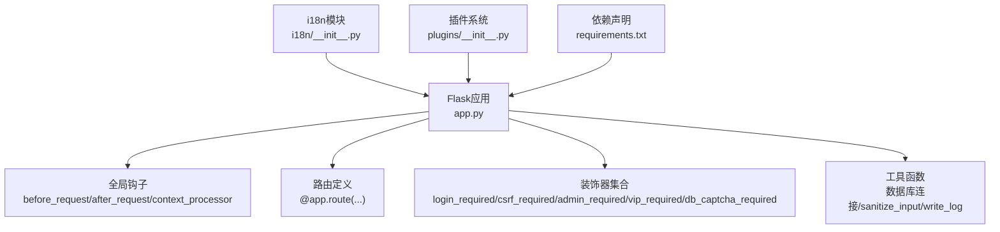
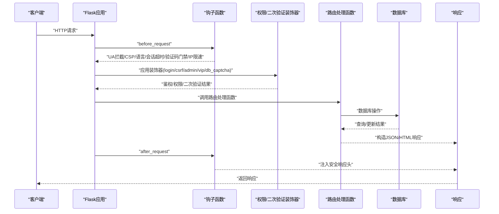
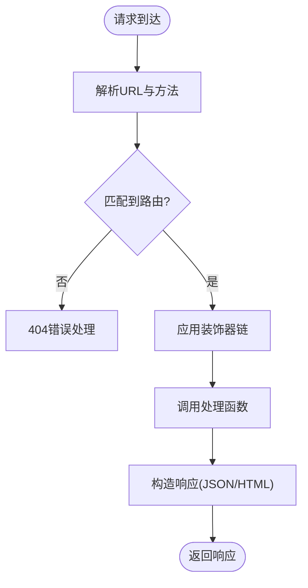
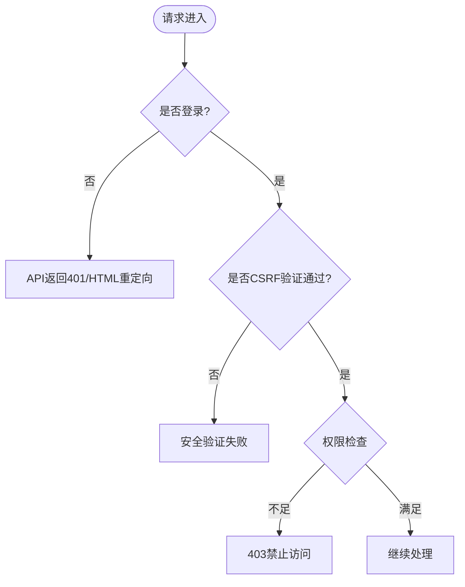
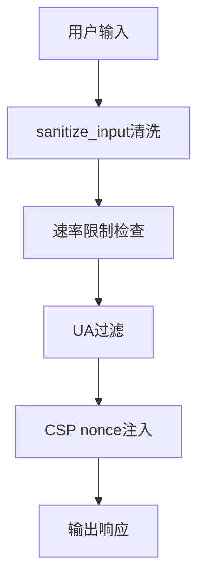
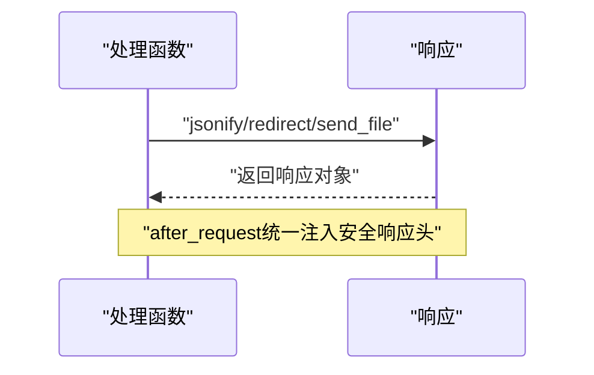
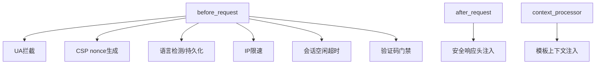
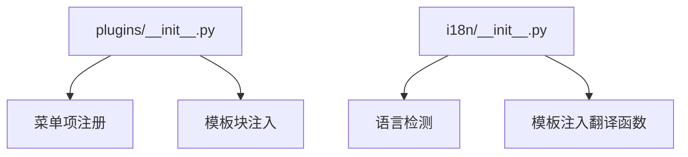
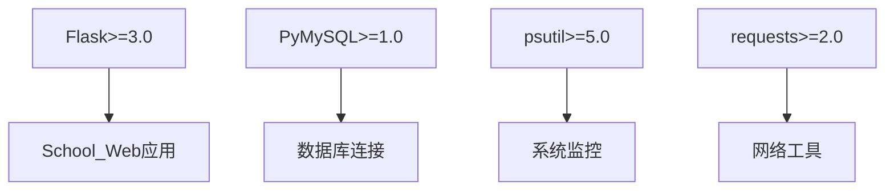

# 控制器层逻辑

<cite>
**本文档引用的文件**
- [app.py](file://app.py)
- [i18n/__init__.py](file://i18n/__init__.py)
- [plugins/__init__.py](file://plugins/__init__.py)
- [requirements.txt](file://requirements.txt)
</cite>

## 目录
1. [简介](#简介)
2. [项目结构](#项目结构)
3. [核心组件](#核心组件)
4. [架构总览](#架构总览)
5. [详细组件分析](#详细组件分析)
6. [依赖分析](#依赖分析)
7. [性能考虑](#性能考虑)
8. [故障排查指南](#故障排查指南)
9. [结论](#结论)

## 简介
本文件面向School_Web项目的控制器层（Flask路由与视图函数），系统性梳理其路由系统实现、鉴权与权限控制、输入验证与安全防护、响应生成与错误处理、中间件与钩子函数，以及最佳实践建议。文档旨在帮助开发者快速理解并高效维护控制器层逻辑。

## 项目结构
- 应用入口与核心控制器集中在 app.py，负责：
  - Flask应用实例初始化与配置（CORS、Session安全、安全响应头等）
  - 全局钩子（before_request、after_request、context_processor）
  - 路由定义与业务处理
  - 自定义装饰器（登录、CSRF、权限、二次验证等）
  - 数据库连接与工具函数
- 多语言支持模块 i18n/__init__.py 提供国际化能力
- 插件系统 plugins/__init__.py 支持动态加载与菜单/模板注入
- 依赖声明位于 requirements.txt

图表来源
- [app.py:119-139](file://app.py#L119-L139)
- [app.py:149-178](file://app.py#L149-L178)
- [app.py:907-988](file://app.py#L907-L988)
- [i18n/__init__.py:1-113](file://i18n/__init__.py#L1-L113)
- [plugins/__init__.py:1-249](file://plugins/__init__.py#L1-L249)
- [requirements.txt:1-5](file://requirements.txt#L1-L5)

章节来源
- [app.py:119-139](file://app.py#L119-L139)
- [app.py:149-178](file://app.py#L149-L178)
- [app.py:907-988](file://app.py#L907-L988)
- [i18n/__init__.py:1-113](file://i18n/__init__.py#L1-L113)
- [plugins/__init__.py:1-249](file://plugins/__init__.py#L1-L249)
- [requirements.txt:1-5](file://requirements.txt#L1-L5)

## 核心组件
- 路由系统与URL模式匹配
  - 使用 @app.route 装饰器定义路由，支持方法参数（如 methods=["GET","POST"]）
  - 支持URL参数与查询参数解析（如 /api/table/<table>/data）
- 鉴权与权限控制
  - 登录态检查：login_required
  - CSRF防护：csrf_required（基于session中的token）
  - 权限分级：admin_required、vip_required、non_guest_required
  - 二次验证：db_captcha_required（数据库操作）、fm_password_required（文件管理器）
- 输入验证与安全防护
  - sanitize_input：清洗HTML/JS标签并限制长度
  - 速率限制：内存+文件持久化的RateLimiter与全局IP限速
  - 安全响应头：X-Content-Type-Options、X-Frame-Options、X-XSS-Protection、CSP、HSTS等
  - 用户代理过滤：拦截常见扫描工具UA
- 响应生成与错误处理
  - JSON响应：统一返回 {"ok": true/false, ...}
  - 重定向：登录/注册/登出等场景
  - 全局错误处理器：404/500/403，避免泄露内部信息
- 中间件与钩子函数
  - before_request：UA拦截、CSP nonce生成、语言检测、会话空闲超时、全局验证码门禁、IP限速
  - after_request：统一安全响应头注入
  - context_processor：向模板注入csp_nonce、翻译函数与插件菜单/模板块
- 插件与国际化
  - 插件系统：动态加载、菜单项与模板块注入
  - 多语言：语言检测、会话持久化、模板注入翻译函数

章节来源
- [app.py:1021-1116](file://app.py#L1021-L1116)
- [app.py:907-988](file://app.py#L907-L988)
- [app.py:873-880](file://app.py#L873-L880)
- [app.py:31-114](file://app.py#L31-L114)
- [app.py:642-676](file://app.py#L642-L676)
- [app.py:149-178](file://app.py#L149-L178)
- [i18n/__init__.py:50-113](file://i18n/__init__.py#L50-L113)
- [plugins/__init__.py:143-194](file://plugins/__init__.py#L143-L194)

## 架构总览
控制器层围绕Flask应用实例构建，通过装饰器与钩子函数形成清晰的控制流：请求进入 before_request 钩子进行预处理（UA拦截、CSP、语言、会话超时、验证码门禁、IP限速），随后进入对应路由处理函数，处理完成后经 after_request 注入安全响应头，最终返回JSON或HTML响应。全局错误处理器统一处理异常。

图表来源
- [app.py:149-178](file://app.py#L149-L178)
- [app.py:907-988](file://app.py#L907-L988)
- [app.py:642-676](file://app.py#L642-L676)

章节来源
- [app.py:149-178](file://app.py#L149-L178)
- [app.py:907-988](file://app.py#L907-L988)
- [app.py:642-676](file://app.py#L642-L676)

## 详细组件分析

### 路由系统与URL模式匹配
- 路由装饰器使用
  - @app.route("/login", methods=["GET","POST"]) 定义登录路由
  - @app.route("/api/table/<table>/data") 支持URL参数table
  - @app.route("/api/album/images/<int:img_id>/like") 显式类型转换
- URL参数与查询参数
  - request.args 获取查询参数（如 limit、channel、before）
  - request.view_args 获取URL参数（如 table、img_id）

图表来源
- [app.py:1021-1116](file://app.py#L1021-L1116)
- [app.py:2371-2405](file://app.py#L2371-L2405)

章节来源
- [app.py:1021-1116](file://app.py#L1021-L1116)
- [app.py:2371-2405](file://app.py#L2371-L2405)

### 鉴权与权限控制
- 登录态检查：未登录访问受保护路由时，API返回{"ok": false, "error": "..."}，HTML页面重定向至登录
- CSRF防护：非GET请求需携带表单字段或请求头中的CSRF token，使用hmac.compare_digest进行常量时间比较
- 权限分级：
  - admin_required：仅管理员可访问
  - vip_required：VIP或管理员可访问
  - non_guest_required：访客不可访问
- 二次验证：
  - db_captcha_required：数据库敏感操作前二次验证
  - fm_password_required：文件管理器访问密码验证

图表来源
- [app.py:907-988](file://app.py#L907-L988)

章节来源
- [app.py:907-988](file://app.py#L907-L988)

### 输入验证与安全防护
- 输入清洗：sanitize_input去除HTML/JS标签并限制长度
- 速率限制：
  - 内存+文件持久化RateLimiter：支持按(IP,route)维度限流
  - 全局IP限速：基于滑动窗口与队列，超限封禁并记录
- 安全响应头：X-Content-Type-Options、X-Frame-Options、X-XSS-Protection、CSP、HSTS、Permissions-Policy
- 用户代理过滤：拦截常见扫描工具UA
- 文件上传安全：魔数校验、大小限制、白名单扩展名、路径穿越防护

图表来源
- [app.py:873-880](file://app.py#L873-L880)
- [app.py:31-114](file://app.py#L31-L114)
- [app.py:642-676](file://app.py#L642-L676)
- [app.py:149-156](file://app.py#L149-L156)

章节来源
- [app.py:873-880](file://app.py#L873-L880)
- [app.py:31-114](file://app.py#L31-L114)
- [app.py:642-676](file://app.py#L642-L676)
- [app.py:149-156](file://app.py#L149-L156)

### 响应生成与错误处理策略
- JSON响应：统一结构 {"ok": true/false, ...}，API错误码与状态码配合
- 重定向：登录/注册/登出等场景
- 全局错误处理：404/500/403，避免泄露内部信息

图表来源
- [app.py:4315-4333](file://app.py#L4315-L4333)
- [app.py:642-676](file://app.py#L642-L676)

章节来源
- [app.py:4315-4333](file://app.py#L4315-L4333)
- [app.py:642-676](file://app.py#L642-L676)

### 中间件与钩子函数
- before_request
  - block_security_scanners：拦截扫描UA
  - set_csp_nonce：为每个请求生成CSP nonce
  - set_language：检测并设置语言，持久化用户偏好
  - check_rate_limit：全局IP限速
  - check_session_idle_timeout：会话空闲超时（自动登出）
  - check_global_captcha：全站验证码门禁
- after_request：统一注入安全响应头
- context_processor：注入csp_nonce、翻译函数、插件菜单与模板块

图表来源
- [app.py:149-178](file://app.py#L149-L178)
- [app.py:642-676](file://app.py#L642-L676)
- [app.py:175-194](file://app.py#L175-L194)

章节来源
- [app.py:149-178](file://app.py#L149-L178)
- [app.py:642-676](file://app.py#L642-L676)
- [app.py:175-194](file://app.py#L175-L194)

### 插件系统与国际化
- 插件系统：动态发现、加载、注册菜单项与模板块，支持权限过滤
- 国际化：语言检测、会话持久化、模板注入翻译函数

图表来源
- [plugins/__init__.py:143-194](file://plugins/__init__.py#L143-L194)
- [i18n/__init__.py:50-113](file://i18n/__init__.py#L50-L113)

章节来源
- [plugins/__init__.py:143-194](file://plugins/__init__.py#L143-L194)
- [i18n/__init__.py:50-113](file://i18n/__init__.py#L50-L113)

## 依赖分析
- Flask版本要求：>=3.0
- 数据库驱动：PyMySQL
- 系统监控：psutil
- HTTP请求：requests
- 会话与CORS：Flask内置与flask_cors

图表来源
- [requirements.txt:1-5](file://requirements.txt#L1-L5)

章节来源
- [requirements.txt:1-5](file://requirements.txt#L1-L5)

## 性能考虑
- 速率限制：内存+文件持久化结合，避免频繁I/O；封禁期间试探次数阈值与追加封禁策略减少滥用
- 缓存：日志清空后写入单行清空记录，避免大文件读写
- 数据库：统一连接池与异常捕获，避免阻塞；批量操作（如备份）采用tar压缩
- 响应头：敏感页面禁用缓存，降低浏览器缓存带来的安全风险
- 线程安全：速率限制、会话活跃时间、白名单等使用锁保护共享状态

## 故障排查指南
- 登录失败/被锁定
  - 检查登录防爆破机制与失败次数记录
  - 核对数据库连接与用户凭据
- CSRF校验失败
  - 确认表单包含_csrf_token或请求头携带X-CSRF-Token
  - 检查session中的csrf_token是否正确
- 权限不足/403
  - 确认用户权限等级（guest/user/vip/administrator）
  - 检查路由装饰器（admin_required/vip_required等）
- 速率限制/封禁
  - 检查IP是否在白名单或手动封禁列表
  - 查看最近封禁记录与封禁时长
- 全局验证码门禁
  - 确认验证码验证通过后设置global_captcha_verified
  - API请求需返回{"error":"需要安全验证"}

章节来源
- [app.py:1021-1116](file://app.py#L1021-L1116)
- [app.py:907-988](file://app.py#L907-L988)
- [app.py:514-562](file://app.py#L514-L562)
- [app.py:600-622](file://app.py#L600-L622)

## 结论
School_Web控制器层通过Flask装饰器与钩子函数实现了清晰的鉴权、权限与安全控制，结合速率限制、CSP与安全响应头，提供了较为完整的安全基线。建议在后续迭代中进一步完善：
- 将装饰器与钩子函数抽象为可配置策略
- 对高频API引入缓存与限流策略
- 增强日志与审计追踪
- 逐步替换内联事件处理，减少对unsafe-inline的依赖