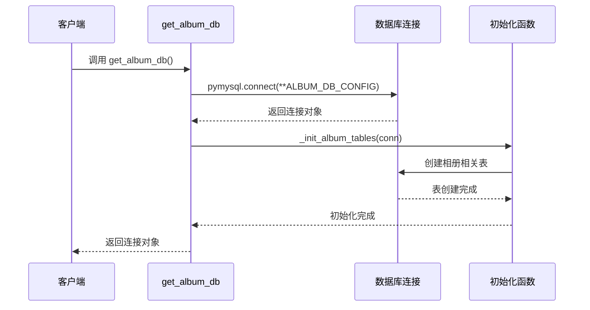

# 模型层设计

<cite>
**本文档引用的文件**
- [app.py](file://app.py)
- [README.md](file://README.md)
</cite>

## 目录
1. [项目概述](#项目概述)
2. [数据库连接管理](#数据库连接管理)
3. [数据访问层设计](#数据访问层设计)
4. [核心数据表结构](#核心数据表结构)
5. [模型层最佳实践](#模型层最佳实践)
6. [性能优化策略](#性能优化策略)
7. [安全防护机制](#安全防护机制)
8. [总结](#总结)

## 项目概述

School_Web是一个基于Flask + Vue 3构建的多功能工具箱Web应用，专为校园场景设计。项目采用前后端分离架构，后端使用Flask框架，前端使用Vue 3框架，集成了用户认证、系统监控、数据库管理、文件操作、网络工具、毕业相册等多种功能。

## 数据库连接管理

### 连接管理机制

项目实现了两套数据库连接管理机制：

#### 主数据库连接(get_db)

```mermaid
flowchart TD
A[调用 get_db()] --> B{连接池检查}
B --> |有连接| C[返回现有连接]
B --> |无连接| D[创建新连接]
D --> E[pymysql.connect(**DB_CONFIG)]
E --> F{连接成功?}
F --> |是| G[返回连接对象]
F --> |否| H[返回 None]
C --> I[使用连接]
G --> I
H --> J[错误处理]
```

**图表来源**
- [app.py:680-685](file://app.py#L680-L685)

#### 相册数据库连接(get_album_db)



**图表来源**
- [app.py:686-693](file://app.py#L686-L693)
- [app.py:695-831](file://app.py#L695-L831)

### 连接配置

项目使用两个独立的数据库配置：

| 配置项 | 默认值 | 说明 |
|--------|--------|------|
| host | localhost | MySQL服务器地址 |
| user | root | 数据库用户名 |
| password | root@123456 | 数据库密码 |
| database | sample | 数据库名称 |

**章节来源**
- [app.py:624-636](file://app.py#L624-L636)
- [app.py:680-693](file://app.py#L680-L693)

## 数据访问层设计

### 数据访问模式

项目采用直接SQL查询的数据访问模式，主要特点包括：

#### 1. 参数化查询
所有数据库操作都使用参数化查询防止SQL注入：

```python
cursor.execute(
    "SELECT User_Password, Access_Permission FROM users WHERE User_Name = %s",
    (username,)
)
```

#### 2. 连接生命周期管理
每个数据库操作都遵循严格的连接生命周期：

```mermaid
flowchart TD
A[开始数据库操作] --> B[获取连接 get_db()/get_album_db()]
B --> C{连接成功?}
C --> |否| D[返回错误]
C --> |是| E[创建游标 cursor]
E --> F[执行SQL查询]
F --> G[处理查询结果]
G --> H[关闭游标 close()]
H --> I[关闭连接 close()]
I --> J[结束操作]
D --> K[异常处理]
```

**图表来源**
- [app.py:1056-1069](file://app.py#L1056-L1069)

#### 3. 错误处理策略

```python
try:
    cursor = conn.cursor()
    cursor.execute(sql, params)
    conn.commit()
    cursor.close()
    conn.close()
except pymysql.MySQLError as e:
    # 数据库错误处理
    flash(f"数据库错误: {str(e)}", "danger")
except Exception as e:
    # 其他异常处理
    flash(f"操作失败: {str(e)}", "danger")
```

**章节来源**
- [app.py:1056-1116](file://app.py#L1056-L1116)
- [app.py:2370-2406](file://app.py#L2370-L2406)

## 核心数据表结构

### 用户认证表

| 表名 | 字段 | 类型 | 约束 | 说明 |
|------|------|------|------|------|
| users | id | INT | PRIMARY KEY, AUTO_INCREMENT | 用户ID |
| users | User_Name | VARCHAR(50) | NOT NULL, UNIQUE | 用户名 |
| users | User_Password | VARCHAR(255) | NOT NULL | 密码哈希 |
| users | Access_Permission | VARCHAR(20) | DEFAULT 'guest' | 权限级别 |
| users | created_at | TIMESTAMP | DEFAULT CURRENT_TIMESTAMP | 创建时间 |

### 用户资料表

| 表名 | 字段 | 类型 | 约束 | 说明 |
|------|------|------|------|------|
| user_profiles | username | VARCHAR(50) | PRIMARY KEY | 用户名 |
| user_profiles | nickname | VARCHAR(50) |  | 昵称 |
| user_profiles | bio | TEXT |  | 个人简介 |
| user_profiles | phone | VARCHAR(20) |  | 电话号码 |
| user_profiles | email | VARCHAR(100) |  | 邮箱地址 |
| user_profiles | birthday | DATE |  | 生日 |
| user_profiles | lang | VARCHAR(10) | DEFAULT 'zh-CN' | 语言偏好 |
| user_profiles | updated_at | TIMESTAMP | DEFAULT CURRENT_TIMESTAMP ON UPDATE CURRENT_TIMESTAMP | 更新时间 |

### 活动日志表

| 表名 | 字段 | 类型 | 约束 | 说明 |
|------|------|------|------|------|
| activity_log | id | INT | PRIMARY KEY, AUTO_INCREMENT | 日志ID |
| activity_log | username | VARCHAR(50) | NOT NULL | 用户名 |
| activity_log | action | VARCHAR(50) | NOT NULL | 操作类型 |
| activity_log | points | INT | DEFAULT 0 | 积分 |
| activity_log | created_at | TIMESTAMP | DEFAULT CURRENT_TIMESTAMP | 创建时间 |
| activity_log | idx_activity_user | INDEX |  | 用户索引 |
| activity_log | idx_activity_time | INDEX |  | 时间索引 |

### 相册相关表

#### 图片信息表(album_images)

| 字段 | 类型 | 约束 | 说明 |
|------|------|------|------|
| id | INT | PRIMARY KEY, AUTO_INCREMENT | 图片ID |
| category | VARCHAR(50) | NOT NULL | 分类 |
| name | VARCHAR(255) | NOT NULL | 名称 |
| filename | VARCHAR(255) | NOT NULL | 文件名 |
| uploader | VARCHAR(50) | NOT NULL | 上传者 |
| uploader_name | VARCHAR(50) | NOT NULL | 上传者显示名 |
| upload_time | TIMESTAMP | DEFAULT CURRENT_TIMESTAMP | 上传时间 |
| status | VARCHAR(20) | DEFAULT 'approved' | 审核状态 |

#### 聊天消息表(chat_messages)

| 字段 | 类型 | 约束 | 说明 |
|------|------|------|------|
| id | INT | PRIMARY KEY, AUTO_INCREMENT | 消息ID |
| channel | VARCHAR(10) | NOT NULL DEFAULT 'world' | 频道 |
| sender | VARCHAR(50) | NOT NULL | 发送者 |
| recipient | VARCHAR(50) |  | 接收者 |
| content | TEXT | NOT NULL | 消息内容 |
| created_at | TIMESTAMP | DEFAULT CURRENT_TIMESTAMP | 创建时间 |
| idx_channel | INDEX |  | 频道索引 |
| idx_sender | INDEX |  | 发送者索引 |
| idx_recipient | INDEX |  | 接收者索引 |
| idx_created | INDEX |  | 时间索引 |

**章节来源**
- [README.md:352-360](file://README.md#L352-L360)
- [app.py:247-296](file://app.py#L247-L296)
- [app.py:799-829](file://app.py#L799-L829)

## 模型层最佳实践

### 1. 连接池管理

虽然项目目前使用的是简单的连接创建模式，但建议实现连接池管理：

```python
# 建议的连接池实现
import pymysql.pooling

db_pool = pymysql.pooling.ConnectionPool(
    host=DB_CONFIG['host'],
    user=DB_CONFIG['user'],
    password=DB_CONFIG['password'],
    database=DB_CONFIG['database'],
    maxconnections=10,
    blocking=True
)

def get_db_with_pool():
    try:
        return db_pool.connection()
    except Exception:
        return None
```

### 2. 事务管理

对于需要保证数据一致性的操作，应该使用事务：

```python
def transaction_operation():
    conn = get_db()
    if not conn:
        return False
    
    try:
        conn.begin()
        # 执行多个相关操作
        cursor = conn.cursor()
        cursor.execute(sql1, params1)
        cursor.execute(sql2, params2)
        conn.commit()
        return True
    except Exception:
        conn.rollback()
        return False
    finally:
        cursor.close()
        conn.close()
```

### 3. 数据验证

在数据库操作前进行数据验证：

```python
def validate_user_data(username, password):
    if not username or len(username) > 50:
        raise ValueError("用户名格式不正确")
    if not password or len(password) < 8:
        raise ValueError("密码长度不足")
    return True
```

### 4. 错误处理

实现统一的错误处理机制：

```python
def safe_database_operation(operation_func):
    try:
        return operation_func()
    except pymysql.IntegrityError as e:
        return {"success": False, "error": "数据冲突"}
    except pymysql.OperationalError as e:
        return {"success": False, "error": "数据库连接错误"}
    except Exception as e:
        return {"success": False, "error": "操作失败"}
```

**章节来源**
- [app.py:680-693](file://app.py#L680-L693)
- [app.py:1056-1116](file://app.py#L1056-L1116)

## 性能优化策略

### 1. 索引优化

项目已经在关键字段上建立了索引：

```sql
-- 活动日志表索引
INDEX idx_activity_user (username)
INDEX idx_activity_time (created_at)

-- 聊天消息表索引
INDEX idx_channel (channel)
INDEX idx_sender (sender)
INDEX idx_recipient (recipient)
INDEX idx_created (created_at)
```

### 2. 查询优化

使用LIMIT限制查询结果：

```python
# 限制返回结果数量
cursor.execute(sql + " LIMIT %s", (limit,))
```

### 3. 连接复用

避免频繁创建和销毁连接，建议实现连接复用机制。

### 4. 缓存策略

对于频繁访问但不经常变化的数据，可以考虑使用缓存：

```python
import redis

redis_client = redis.Redis()

def get_cached_data(key):
    data = redis_client.get(key)
    if data:
        return json.loads(data)
    return None
```

**章节来源**
- [app.py:276-278](file://app.py#L276-L278)
- [app.py:811-815](file://app.py#L811-L815)

## 安全防护机制

### 1. SQL注入防护

项目严格使用参数化查询：

```python
# 正确的做法
cursor.execute("SELECT * FROM users WHERE id = %s", (user_id,))

# 错误的做法（避免）
cursor.execute(f"SELECT * FROM users WHERE id = {user_id}")
```

### 2. 输入验证

所有用户输入都经过验证和清理：

```python
def sanitize_input(text, max_length=1000):
    """清洗用户输入：去除 HTML/JS 标签，限制长度"""
    if not text:
        return ""
    text = str(text).strip()
    text = _SCRIPT_TAG.sub("", text)
    text = _HTML_TAG.sub("", text)
    return text[:max_length]
```

### 3. 权限控制

基于角色的访问控制：

```python
def admin_required(f):
    @wraps(f)
    def decorated(*args, **kwargs):
        if session.get("permission") != "administrator":
            return redirect(url_for("dashboard"))
        return f(*args, **kwargs)
    return decorated
```

### 4. 会话安全

```python
app.config.update(
    SESSION_COOKIE_HTTPONLY=True,
    SESSION_COOKIE_SAMESITE='Lax',
    SESSION_COOKIE_SECURE=bool(os.environ.get("HTTPS")),
    PERMANENT_SESSION_LIFETIME=datetime.timedelta(hours=2),
)
```

**章节来源**
- [app.py:873-880](file://app.py#L873-L880)
- [app.py:934-963](file://app.py#L934-L963)
- [app.py:133-139](file://app.py#L133-L139)

## 总结

School_Web的模型层设计体现了以下特点：

1. **简洁高效**：采用直接SQL查询的方式，代码简洁易懂
2. **安全可靠**：严格使用参数化查询，防止SQL注入
3. **扩展性强**：支持多数据库配置，便于扩展新的功能模块
4. **性能优化**：在关键表上建立索引，提高查询效率
5. **权限控制**：基于角色的访问控制机制

建议的改进方向：
- 实现连接池管理
- 添加ORM层以提高代码可维护性
- 增加数据验证和业务规则层
- 实现更完善的错误处理和日志记录机制