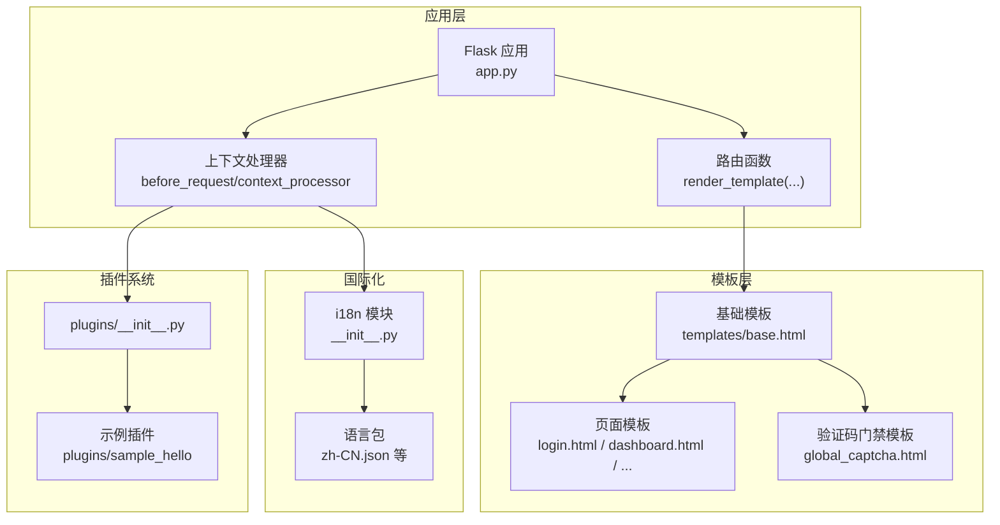
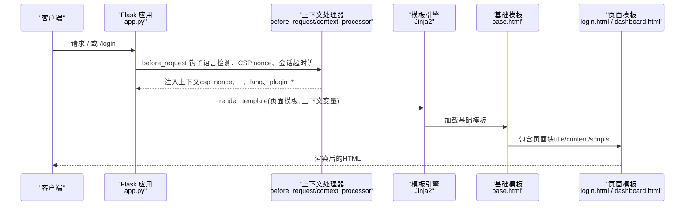
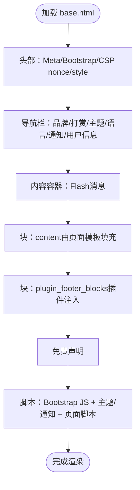
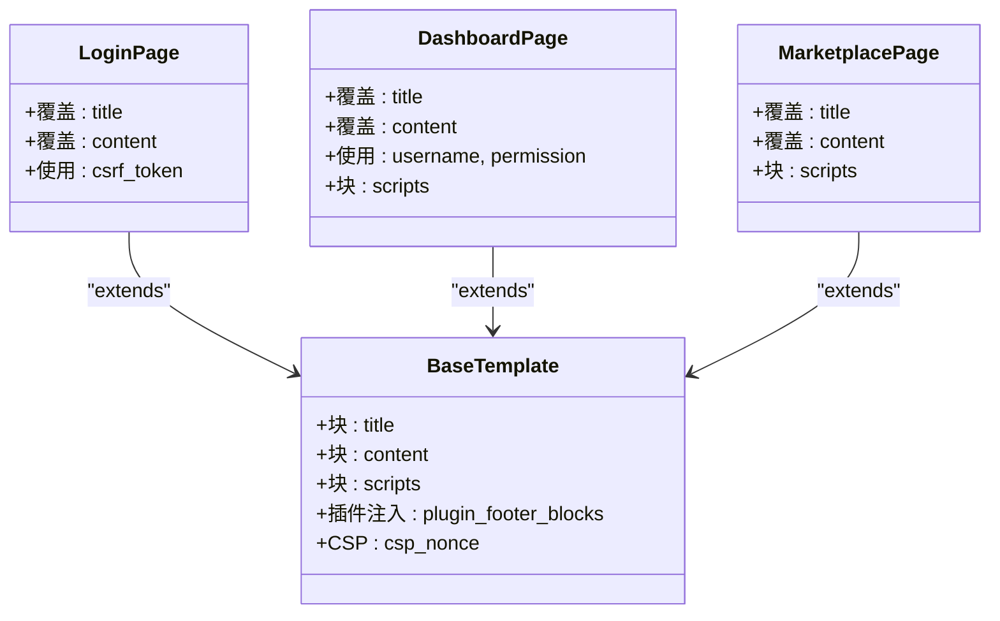
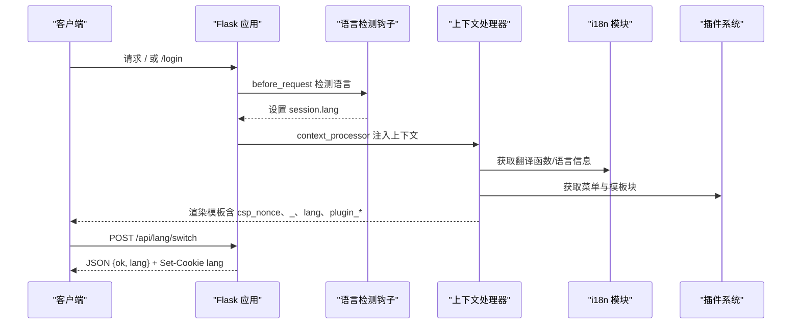
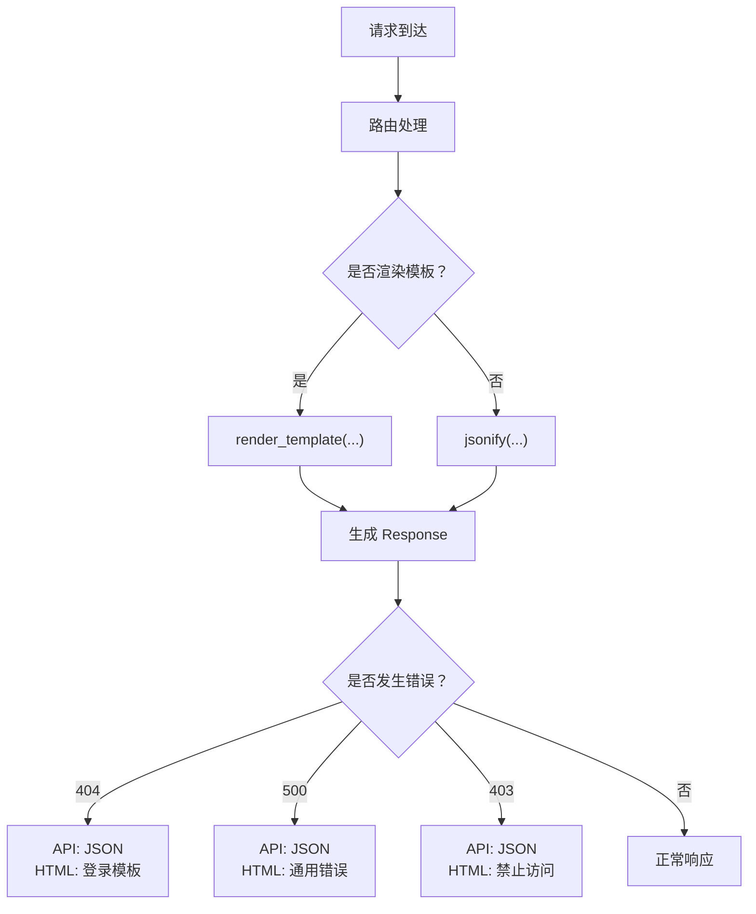
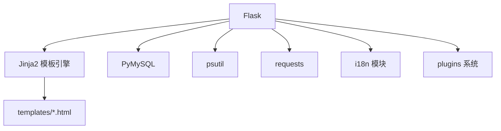

# 视图层实现

<cite>
**本文档引用的文件**
- [app.py](file://app.py)
- [base.html](file://templates/base.html)
- [login.html](file://templates/login.html)
- [dashboard.html](file://templates/dashboard.html)
- [global_captcha.html](file://templates/global_captcha.html)
- [marketplace.html](file://templates/marketplace.html)
- [register.html](file://templates/register.html)
- [__init__.py](file://i18n/__init__.py)
- [zh-CN.json](file://i18n/zh-CN.json)
- [__init__.py](file://plugins/__init__.py)
- [plugin.json](file://plugins/plugins/sample_hello/plugin.json)
- [__init__.py](file://plugins/plugins/sample_hello/__init__.py)
- [requirements.txt](file://requirements.txt)
</cite>

## 目录
1. [引言](#引言)
2. [项目结构](#项目结构)
3. [核心组件](#核心组件)
4. [架构总览](#架构总览)
5. [详细组件分析](#详细组件分析)
6. [依赖分析](#依赖分析)
7. [性能考虑](#性能考虑)
8. [故障排查指南](#故障排查指南)
9. [结论](#结论)
10. [附录](#附录)

## 引言
本文件面向School_Web项目的视图层实现，聚焦于Jinja2模板引擎的使用与扩展，涵盖模板继承、块(block)定义与变量传递；模板布局系统（基础模板、头部导航、侧边栏与内容区组织）；模板上下文处理器（语言切换、插件菜单注入、安全令牌传递）；模板渲染流程与响应生成机制（HTTP状态码处理与错误页面显示）；以及视图层开发最佳实践（模板复用、样式组织与响应式设计）。文档旨在帮助开发者快速理解并高效维护视图层。

## 项目结构
School_Web采用Flask + Jinja2的后端模板方案，模板集中于templates目录，国际化资源位于i18n目录，插件系统位于plugins目录。应用通过before_request、context_processor等钩子向模板注入全局上下文，并通过路由函数渲染模板或返回JSON。

**图表来源**
- [app.py](file://app.py)
- [base.html](file://templates/base.html)
- [login.html](file://templates/login.html)
- [dashboard.html](file://templates/dashboard.html)
- [global_captcha.html](file://templates/global_captcha.html)
- [__init__.py](file://i18n/__init__.py)
- [zh-CN.json](file://i18n/zh-CN.json)
- [__init__.py](file://plugins/__init__.py)
- [plugin.json](file://plugins/plugins/sample_hello/plugin.json)
- [__init__.py](file://plugins/plugins/sample_hello/__init__.py)

**章节来源**
- [app.py](file://app.py)
- [requirements.txt](file://requirements.txt)

## 核心组件
- 基础模板与布局系统：通过base.html统一头部导航、主题切换、语言切换、通知铃铛、内容区占位与页脚插件注入，形成一致的视觉与交互体验。
- 模板继承与块机制：各页面模板通过extends继承基础模板，使用block定义标题、内容与脚本块，实现高复用与低耦合。
- 上下文处理器：注入CSP nonce、翻译函数与语言信息、插件菜单与模板注入块，使模板可直接使用这些变量。
- 国际化：通过i18n模块与语言包实现键值翻译与语言检测，支持查询参数、会话、Cookie与Accept-Language。
- 插件系统：动态发现、加载与注册菜单项与模板注入块，实现视图层的可扩展性。
- 错误处理：针对API与HTML页面分别返回JSON或渲染登录模板，避免信息泄露。

**章节来源**
- [base.html](file://templates/base.html)
- [login.html](file://templates/login.html)
- [dashboard.html](file://templates/dashboard.html)
- [global_captcha.html](file://templates/global_captcha.html)
- [__init__.py](file://i18n/__init__.py)
- [__init__.py](file://plugins/__init__.py)
- [app.py](file://app.py)

## 架构总览
视图层围绕“基础模板 + 页面模板 + 上下文处理器”的模式构建，路由函数负责业务逻辑与数据准备，模板负责呈现与交互。国际化与插件系统通过上下文处理器无缝注入到模板。

**图表来源**
- [app.py](file://app.py)
- [base.html](file://templates/base.html)
- [login.html](file://templates/login.html)
- [dashboard.html](file://templates/dashboard.html)

## 详细组件分析

### 基础模板与布局系统（base.html）
- 结构组成
  - 头部导航：品牌名、打赏按钮、主题切换、语言切换、通知铃铛、用户信息与退出表单。
  - 内容容器：Flash消息、页面内容块（content）、插件页脚注入块、免责声明。
  - 脚本区：Bootstrap JS、主题切换与通知轮询脚本、页面级脚本块（scripts）。
- 块定义
  - title：页面标题，默认值来自基础模板。
  - content：页面主要内容区，由具体页面模板填充。
  - scripts：页面级脚本，如仪表盘的管理员申请与VIP申请交互。
- 样式组织
  - 使用CSS自定义属性实现明暗主题切换，支持data-bs-theme。
  - 通过nonce注入CSP，确保内联样式与脚本的安全执行。
- 插件注入
  - 通过plugin_footer_blocks循环输出插件提供的HTML片段，实现非侵入式扩展。

**图表来源**
- [base.html](file://templates/base.html)

**章节来源**
- [base.html](file://templates/base.html)

### 模板继承与块机制（login.html、dashboard.html、marketplace.html）
- 继承与复用
  - login.html、dashboard.html、marketplace.html均通过extends继承base.html，共享头部、样式与脚本。
- 块覆盖
  - login.html覆盖title与content，实现登录表单布局。
  - dashboard.html覆盖title与content，实现仪表盘卡片网格与交互脚本。
  - marketplace.html覆盖title与content，实现插件市场网格布局与脚本。
- 变量传递
  - 路由函数将username、permission、csrf_token等传入模板，模板中直接使用。

**图表来源**
- [base.html](file://templates/base.html)
- [login.html](file://templates/login.html)
- [dashboard.html](file://templates/dashboard.html)
- [marketplace.html](file://templates/marketplace.html)

**章节来源**
- [login.html](file://templates/login.html)
- [dashboard.html](file://templates/dashboard.html)
- [marketplace.html](file://templates/marketplace.html)

### 模板上下文处理器（语言切换、插件菜单注入、安全令牌）
- 语言切换
  - before_request阶段根据查询参数、会话、Cookie与Accept-Language检测语言，写入session。
  - context_processor注入翻译函数_、当前语言lang、支持语言列表supported_langs、语言名称lang_name。
  - 通过API /api/lang/switch实现AJAX切换语言，返回JSON并设置Cookie。
- 插件菜单注入
  - context_processor注入plugin_menu_items与plugin_footer_blocks、plugin_head_blocks，供模板直接渲染。
  - 插件系统通过register_menu_item与register_template_block注册菜单与模板块。
- 安全令牌传递
  - before_request生成CSP nonce并注入g，context_processor将其注入模板上下文。
  - 表单隐藏字段_csrf_token由模板使用，配合后端CSRF保护。

**图表来源**
- [app.py](file://app.py)
- [__init__.py](file://i18n/__init__.py)
- [__init__.py](file://plugins/__init__.py)

**章节来源**
- [app.py](file://app.py)
- [__init__.py](file://i18n/__init__.py)
- [__init__.py](file://plugins/__init__.py)

### 模板渲染流程与响应生成机制
- 路由渲染
  - 路由函数调用render_template传入上下文变量，Jinja2渲染后返回Response对象。
- 错误页面显示
  - 404：API返回JSON错误；HTML页面渲染登录模板（携带csrf_token）。
  - 500：API返回JSON错误；HTML页面返回通用错误提示。
  - 403：API返回JSON错误；HTML页面返回禁止访问提示。
- HTTP状态码处理
  - 全局错误处理器按请求类型区分返回格式，避免敏感信息泄露。

**图表来源**
- [app.py](file://app.py)

**章节来源**
- [app.py](file://app.py)

### 视图层开发最佳实践
- 模板复用
  - 优先继承base.html，仅在子模板中覆盖必要块，减少重复代码。
  - 将公共UI片段（如通知、语言切换）放入基础模板或插件注入块。
- 样式组织
  - 使用CSS自定义属性实现主题切换，避免重复定义颜色与阴影。
  - 通过nonce注入CSP，确保内联样式与脚本安全。
- 响应式设计
  - 使用Bootstrap栅格系统与flex布局，适配不同屏幕尺寸。
  - 在页面模板中使用块scripts添加页面级交互，避免与基础模板冲突。
- 国际化与插件
  - 使用_函数与语言包键值，避免硬编码文本。
  - 通过插件系统扩展菜单与模板块，保持核心模板简洁。

**章节来源**
- [base.html](file://templates/base.html)
- [login.html](file://templates/login.html)
- [dashboard.html](file://templates/dashboard.html)
- [marketplace.html](file://templates/marketplace.html)
- [__init__.py](file://i18n/__init__.py)
- [__init__.py](file://plugins/__init__.py)

## 依赖分析
- 框架与库
  - Flask：Web框架与模板渲染。
  - PyMySQL：数据库连接。
  - psutil、requests：系统监控与网络工具。
- 模板与国际化
  - Jinja2：模板引擎（由Flask提供）。
  - i18n模块：翻译函数与语言检测。
- 插件系统
  - 动态导入与注册菜单项、模板块。

**图表来源**
- [requirements.txt](file://requirements.txt)
- [app.py](file://app.py)

**章节来源**
- [requirements.txt](file://requirements.txt)
- [app.py](file://app.py)

## 性能考虑
- 模板渲染
  - 使用块与继承减少重复计算，避免在模板中进行复杂逻辑。
  - 将静态资源（CSS/JS）置于CDN，降低带宽与延迟。
- 国际化
  - 预加载语言包，减少运行时IO开销。
- 插件注入
  - 控制注入块数量与大小，避免影响首屏渲染。
- 安全与缓存
  - 对HTML响应设置Cache-Control: no-store，避免浏览器缓存敏感页面。

[本节为通用指导，无需特定文件引用]

## 故障排查指南
- 语言切换无效
  - 检查before_request中的语言检测逻辑与session写入。
  - 确认context_processor注入的lang与supported_langs正确。
  - 使用API /api/lang/switch验证返回与Cookie设置。
- 插件菜单/模板块未显示
  - 检查插件目录与plugin.json是否存在。
  - 确认插件__init__.py中register_menu_item与register_template_block调用。
  - 查看context_processor中plugin_menu_items与plugin_footer_blocks是否注入。
- CSP导致内联脚本失效
  - 确认模板中使用nonce注入与context_processor注入csp_nonce。
  - 检查安全响应头中Content-Security-Policy是否包含对应的nonce指令。
- 错误页面显示异常
  - 检查全局错误处理器对API与HTML的不同返回策略。
  - 确认404/500/403场景下的响应格式与状态码。

**章节来源**
- [app.py](file://app.py)
- [__init__.py](file://i18n/__init__.py)
- [__init__.py](file://plugins/__init__.py)
- [base.html](file://templates/base.html)

## 结论
School_Web的视图层通过清晰的模板继承与块机制、完善的上下文处理器、可扩展的插件系统与严谨的国际化支持，实现了高复用、易维护与安全可控的前端呈现层。遵循本文档的最佳实践，可进一步提升开发效率与用户体验。

[本节为总结，无需特定文件引用]

## 附录
- 示例插件
  - 插件目录：plugins/plugins/sample_hello
  - 功能：注册菜单项与底部模板注入块。
  - 便于理解插件如何向模板注入内容。

**章节来源**
- [plugin.json](file://plugins/plugins/sample_hello/plugin.json)
- [__init__.py](file://plugins/plugins/sample_hello/__init__.py)