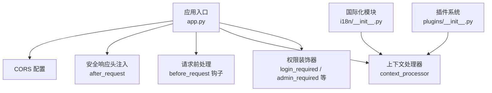
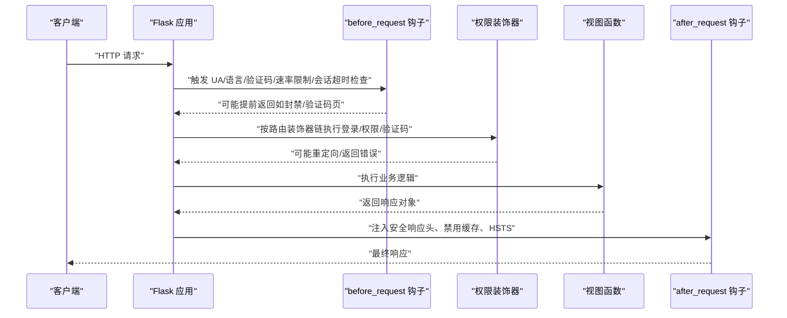
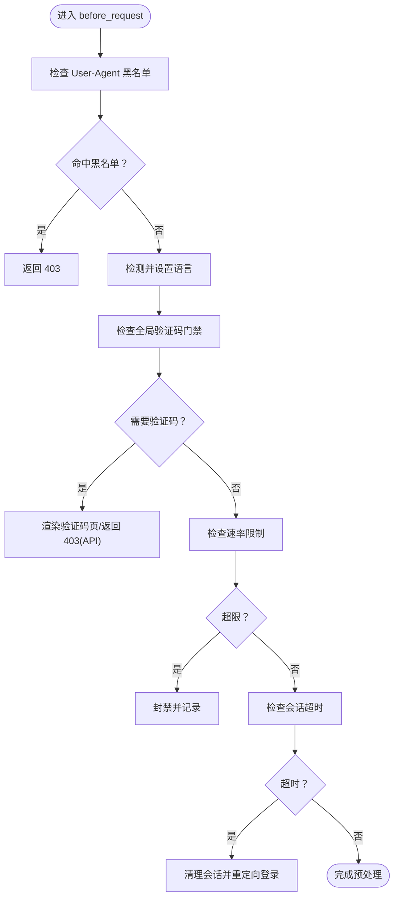
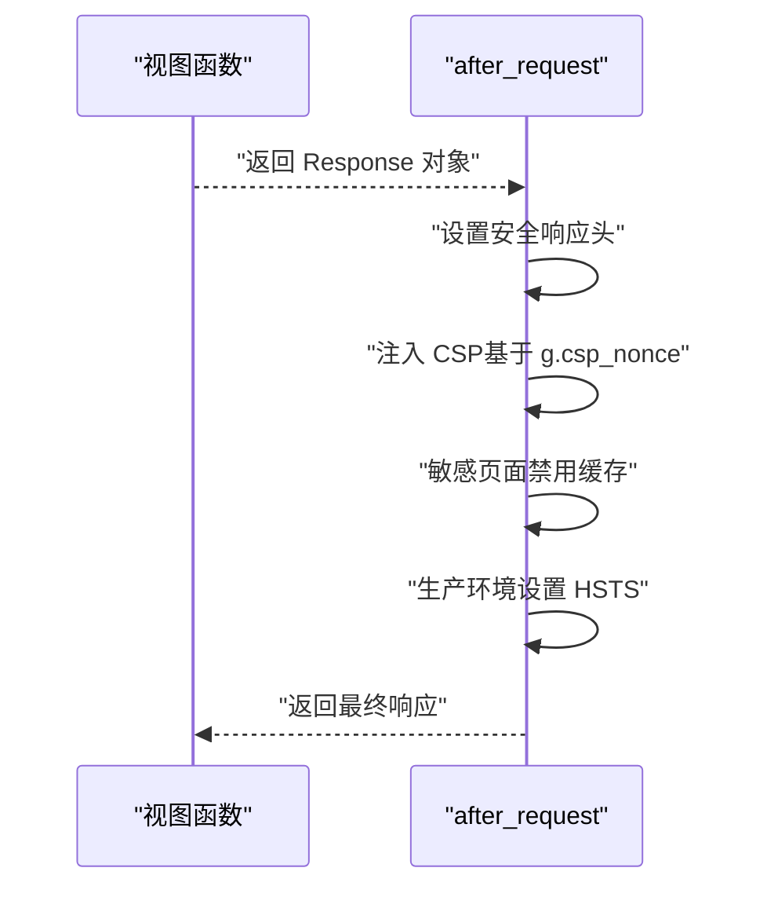
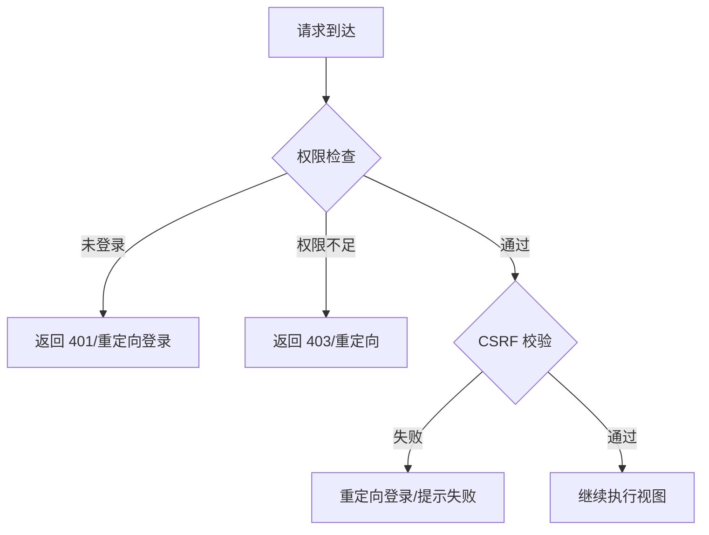
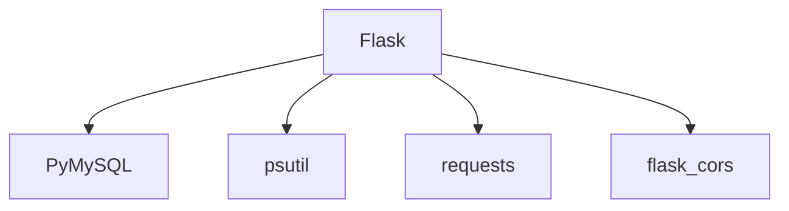

# 中间件机制

<cite>
**本文档引用的文件**
- [app.py](file://app.py)
- [i18n/__init__.py](file://i18n/__init__.py)
- [plugins/__init__.py](file://plugins/__init__.py)
- [requirements.txt](file://requirements.txt)
</cite>

## 目录
1. [简介](#简介)
2. [项目结构](#项目结构)
3. [核心组件](#核心组件)
4. [架构总览](#架构总览)
5. [详细组件分析](#详细组件分析)
6. [依赖分析](#依赖分析)
7. [性能考虑](#性能考虑)
8. [故障排查指南](#故障排查指南)
9. [结论](#结论)

## 简介
本文件系统性梳理 School_Web 的中间件机制，围绕 Flask 生命周期钩子（before_request、after_request 等）展开，结合项目实际实现，说明请求预处理、响应后处理与异常处理策略；同时覆盖安全中间件（CSRF/XSS/SQL 注入防护）、会话与权限控制（认证、权限验证、ACL 管理）以及性能优化与调试技巧。文档面向不同技术背景读者，既提供高层概览也给出代码级映射与图示。

## 项目结构
- 应用主体位于 app.py，集中定义 Flask 实例、CORS、安全响应头、国际化注入、多类中间件钩子与装饰器式权限控制。
- 国际化模块 i18n 提供语言检测与翻译注入。
- 插件系统 plugins 支持菜单与模板块注入，体现“中间件式”的视图层扩展能力。
- 依赖通过 requirements.txt 明确 Flask、PyMySQL、psutil、requests 等版本约束。

图表来源
- [app.py:119-139](file://app.py#L119-L139)
- [app.py:642-676](file://app.py#L642-L676)
- [app.py:149-178](file://app.py#L149-L178)
- [app.py:175-194](file://app.py#L175-L194)
- [app.py:907-963](file://app.py#L907-L963)
- [i18n/__init__.py:1-113](file://i18n/__init__.py#L1-L113)
- [plugins/__init__.py:1-249](file://plugins/__init__.py#L1-L249)

章节来源
- [app.py:119-139](file://app.py#L119-L139)
- [app.py:642-676](file://app.py#L642-L676)
- [app.py:149-178](file://app.py#L149-L178)
- [app.py:175-194](file://app.py#L175-L194)
- [i18n/__init__.py:1-113](file://i18n/__init__.py#L1-L113)
- [plugins/__init__.py:1-249](file://plugins/__init__.py#L1-L249)

## 核心组件
- Flask 应用与基础配置：密钥持久化、CORS、Session 安全参数。
- 生命周期钩子：
  - before_request：UA 黑名单拦截、CSP nonce 生成、语言设置、全局验证码门禁、速率限制、会话超时检测。
  - after_request：统一安全响应头、敏感页面禁用缓存、HSTS 控制。
  - context_processor：向模板注入 CSP nonce、翻译函数与语言信息、插件菜单与模板块。
- 权限控制装饰器：基于会话的登录、管理员、VIP、非访客、数据库验证码、文件管理器密码等多重保护。
- 安全工具：User-Agent 黑名单、CSP nonce、XSS/点击劫持防护、X-Content-Type-Options、X-Frame-Options、X-XSS-Protection、Referrer-Policy、Permissions-Policy、HSTS。
- 输入清洗：通用输入清洗函数，移除脚本与 HTML 标签，限制长度。
- 速率限制：内存队列 + 文件持久化的轻量速率限制器，支持白名单与封禁策略。
- 日志与审计：统一写日志函数，便于审计与问题定位。

章节来源
- [app.py:119-139](file://app.py#L119-L139)
- [app.py:149-178](file://app.py#L149-L178)
- [app.py:642-676](file://app.py#L642-L676)
- [app.py:175-194](file://app.py#L175-L194)
- [app.py:907-963](file://app.py#L907-L963)
- [app.py:869-881](file://app.py#L869-L881)
- [app.py:31-114](file://app.py#L31-L114)

## 架构总览
下图展示请求在 Flask 中的典型流转路径，突出中间件钩子与装饰器的作用点。

图表来源
- [app.py:149-178](file://app.py#L149-L178)
- [app.py:642-676](file://app.py#L642-L676)
- [app.py:907-963](file://app.py#L907-L963)

## 详细组件分析

### 生命周期钩子与请求预处理
- UA 黑名单拦截：在 before_request 中读取 User-Agent 并与黑名单匹配，命中即返回 403。
- CSP nonce 生成：为每个请求生成随机 nonce，注入 g.csp_nonce，模板中通过 context_processor 注入。
- 语言设置：根据查询参数、会话、Cookie、Accept-Language 自动检测语言并持久化已登录用户的语言偏好。
- 全局验证码门禁：对已登录用户在特定路由上强制二次验证码校验，API 路由返回 403。
- 速率限制：对静态资源/分享链接等豁免，对 IP 维护滑动窗口队列，超限封禁并记录试探次数。
- 会话超时检测：对已登录用户按 IP 记录最后活跃时间，超时则清理会话并重定向登录。

图表来源
- [app.py:149-156](file://app.py#L149-L156)
- [app.py:158-161](file://app.py#L158-L161)
- [app.py:165-173](file://app.py#L165-L173)
- [app.py:600-622](file://app.py#L600-L622)
- [app.py:513-562](file://app.py#L513-L562)
- [app.py:564-593](file://app.py#L564-L593)

章节来源
- [app.py:149-178](file://app.py#L149-L178)
- [app.py:600-622](file://app.py#L600-L622)
- [app.py:513-562](file://app.py#L513-L562)
- [app.py:564-593](file://app.py#L564-L593)

### 响应后处理与安全响应头
- after_request 注入统一安全响应头：X-Content-Type-Options、X-Frame-Options、X-XSS-Protection、Referrer-Policy、Permissions-Policy。
- Content-Security-Policy：基于 g.csp_nonce 限制脚本与样式来源，避免内联脚本与样式，必要时保留 unsafe-inline 以兼容历史代码，逐步迁移。
- 敏感页面禁用缓存：对 text/html 设置 no-store、Pragma、Expires。
- HSTS：生产环境启用，提升 HTTPS 安全性。
- 隐藏 Server 版本信息。

图表来源
- [app.py:642-676](file://app.py#L642-L676)

章节来源
- [app.py:642-676](file://app.py#L642-L676)

### 上下文处理器与模板注入
- 注入 CSP nonce：使模板中 script/style 可使用 nonce。
- 注入翻译函数与语言信息：支持多语言渲染。
- 注入插件菜单与模板块：实现视图层扩展。

章节来源
- [app.py:175-194](file://app.py#L175-L194)
- [i18n/__init__.py:50-108](file://i18n/__init__.py#L50-L108)
- [plugins/__init__.py:154-193](file://plugins/__init__.py#L154-L193)

### 权限控制与装饰器
- 登录保护：login_required，未登录时对 API 返回 401，对页面重定向登录。
- 管理员保护：admin_required，非管理员返回 403 或重定向。
- VIP 保护：vip_required，非 VIP 或管理员返回 403 或重定向。
- 非访客保护：non_guest_required，访客返回 403 或重定向。
- CSRF 保护：csrf_required，对非 GET 请求校验 session 中的 CSRF token。
- 数据库验证码保护：db_captcha_required，对数据库相关操作进行二次验证码校验。
- 文件管理器密码保护：fm_password_required，对敏感文件操作进行密码校验。

图表来源
- [app.py:907-963](file://app.py#L907-L963)

章节来源
- [app.py:907-963](file://app.py#L907-L963)

### 安全中间件实现要点
- CSRF 防护：在登录页生成随机 CSRF token 并存入 session，csrf_required 对非 GET 请求校验 token，使用恒时比较函数避免时序攻击。
- XSS 防护：CSP nonce 严格限制脚本与样式来源；X-XSS-Protection 与 nosniff 提升浏览器防护；模板中尽量避免内联事件与样式。
- SQL 注入防护：数据库访问统一使用参数化查询，表名白名单 + 反引号包裹；对管理员开放的数据库操作要求二次验证码。
- 速率限制与封禁：内存队列 + 文件持久化，支持白名单、手动封禁、试探封禁延长；对静态资源与分享链接豁免。
- 会话安全：HttpOnly、SameSite、Secure（HTTPS 环境）、固定生命周期；会话超时自动登出。
- 输入清洗：sanitize_input 移除脚本与 HTML 标签，限制长度，降低 XSS 与注入风险。

章节来源
- [app.py:919-932](file://app.py#L919-L932)
- [app.py:642-676](file://app.py#L642-L676)
- [app.py:869-881](file://app.py#L869-L881)
- [app.py:513-562](file://app.py#L513-L562)
- [app.py:133-139](file://app.py#L133-L139)
- [app.py:564-593](file://app.py#L564-L593)

### 会话管理与权限控制（含 ACL）
- 会话字段：username、permission、csrf_token、lang、global_captcha_verified、db_captcha_verified、fm_verified 等。
- 权限等级：guest < user < vip < administrator（通过数值映射实现比较）。
- ACL 管理：插件系统通过 register_menu_item/register_template_block 注册菜单与模板块，get_menu_items 按权限过滤，形成轻量 ACL。
- 会话超时：按 IP 记录最后活跃时间，超时自动清理会话并提示。

章节来源
- [plugins/__init__.py:143-193](file://plugins/__init__.py#L143-L193)
- [app.py:564-593](file://app.py#L564-L593)

### 自定义中间件实现方式
- 请求预处理：通过 @app.before_request 注册多个钩子，分别负责 UA 拦截、语言设置、验证码门禁、速率限制、会话超时。
- 响应后处理：通过 @app.after_request 注入统一安全响应头与 CSP。
- 异常捕获：通过 @app.errorhandler 注册 404/500/403，API 路由返回 JSON 错误，页面路由返回友好提示。
- 视图层扩展：通过 context_processor 注入全局变量，配合插件系统实现菜单与模板块的动态注入。

章节来源
- [app.py:642-676](file://app.py#L642-L676)
- [app.py:4315-4332](file://app.py#L4315-L4332)
- [app.py:175-194](file://app.py#L175-L194)
- [plugins/__init__.py:143-193](file://plugins/__init__.py#L143-L193)

## 依赖分析
- Flask：提供 WSGI、路由、请求/响应对象、钩子与错误处理。
- PyMySQL：数据库连接与参数化查询。
- psutil/requests：系统监控与网络工具依赖。
- CORS：跨域支持。

图表来源
- [requirements.txt:1-5](file://requirements.txt#L1-L5)

章节来源
- [requirements.txt:1-5](file://requirements.txt#L1-L5)

## 性能考虑
- 速率限制：
  - 内存队列 + 文件持久化，避免重启丢失；对高频调用使用去抖保存（Timer）减少磁盘 IO。
  - 白名单与手动封禁优先级高于普通封禁，减少误伤。
- 会话超时：
  - 仅对已登录用户按 IP 维护活跃时间，避免对匿名用户造成额外锁竞争。
- 响应头注入：
  - after_request 仅做头部设置与敏感页面禁用缓存，开销极低。
- 输入清洗：
  - 对用户输入进行基本清洗与长度限制，降低后续处理成本。
- 建议：
  - 将高并发场景下的数据库查询改为连接池（如使用连接池封装）。
  - 对热点路由增加本地缓存（如语言偏好、插件菜单）。
  - 将 CSP nonce 生成与注入过程放入更靠近模板渲染处，减少重复计算。

[本节为通用指导，不直接分析具体文件]

## 故障排查指南
- 403/401/403 页面：
  - API 路由：检查权限装饰器与 CSRF token；确认 session 中 csrf_token 是否存在且有效。
  - 页面路由：检查登录状态与权限等级，确认模板中是否正确注入 csrf_token。
- 429 速率限制：
  - 检查 ip_requests 与 ip_blocked 状态，确认是否被封禁；核对白名单与手动封禁配置。
  - 关注封禁延长逻辑（试探次数超限追加封禁）。
- 404/500：
  - API 路由：统一返回 JSON 错误；页面路由：返回友好提示。
  - 检查数据库连接与表结构，确认参数化查询与白名单校验。
- CSP/XSS：
  - 确认模板中 script/style 是否使用 nonce；逐步移除 unsafe-inline。
  - 检查 after_request 中 CSP 注入是否被路由自定义 CSP 覆盖。
- 会话超时：
  - 检查 ip_last_active 与 SESSION_IDLE_TIMEOUT；确认超时后是否正确清理会话并重定向登录。
- 日志审计：
  - 使用统一写日志函数记录关键操作，便于定位问题。

章节来源
- [app.py:4315-4332](file://app.py#L4315-L4332)
- [app.py:513-562](file://app.py#L513-L562)
- [app.py:564-593](file://app.py#L564-L593)
- [app.py:642-676](file://app.py#L642-L676)

## 结论
School_Web 的中间件机制以 Flask 钩子与装饰器为核心，实现了请求预处理、响应后处理与异常处理的闭环；通过 UA 黑名单、CSP nonce、CSRF 校验、速率限制与会话超时等手段构建了较为完整的安全体系；权限控制与插件系统进一步增强了可扩展性与可维护性。建议在高并发场景下引入连接池与本地缓存，并持续推进 CSP 与输入清洗策略的完善，以获得更优的安全性与性能表现。