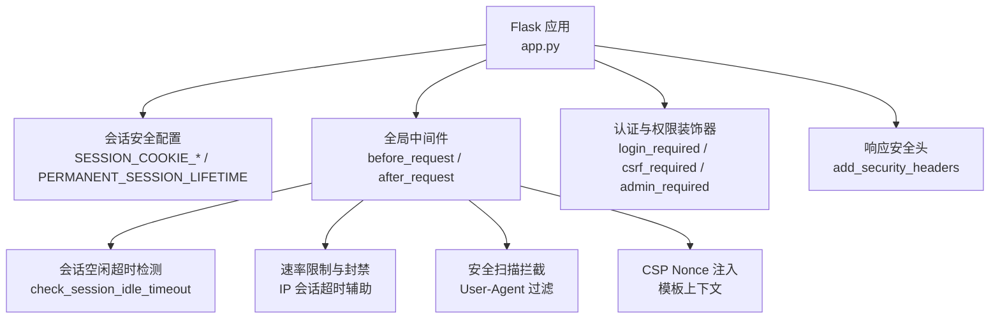
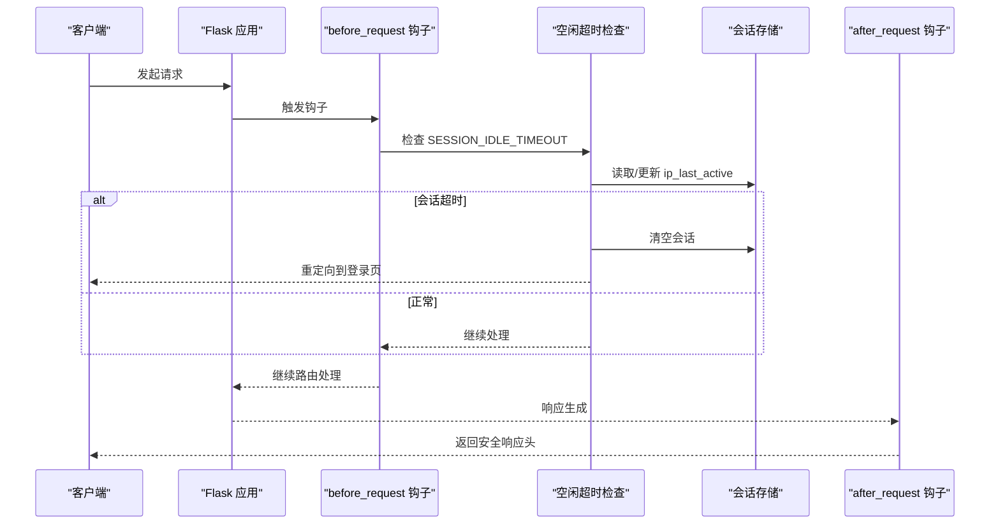
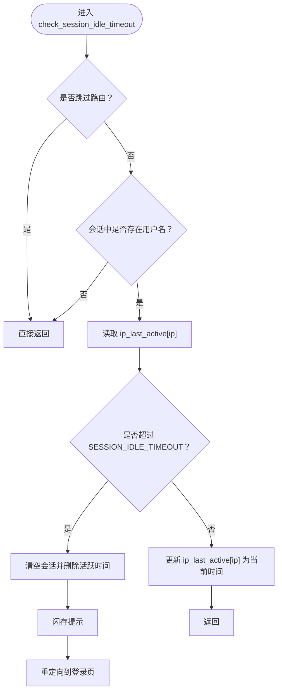
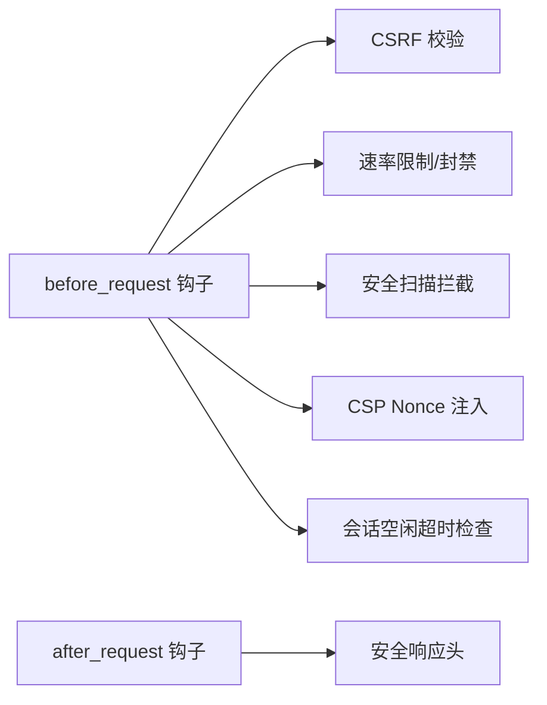
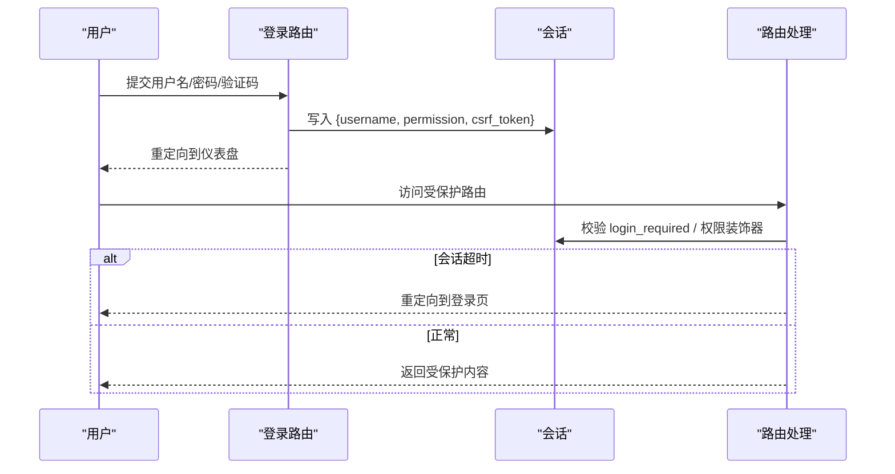
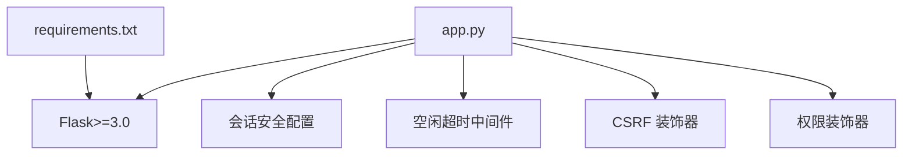

# 会话管理中间件

<cite>
**本文引用的文件**
- [app.py](file://app.py)
- [requirements.txt](file://requirements.txt)
</cite>

## 目录
1. [简介](#简介)
2. [项目结构](#项目结构)
3. [核心组件](#核心组件)
4. [架构总览](#架构总览)
5. [详细组件分析](#详细组件分析)
6. [依赖分析](#依赖分析)
7. [性能考量](#性能考量)
8. [故障排除指南](#故障排除指南)
9. [结论](#结论)

## 简介
本文件针对 School_Web 的会话管理中间件进行系统化技术文档编写，重点覆盖以下方面：
- Flask 会话安全配置：SESSION_COOKIE_HTTPONLY、SESSION_COOKIE_SAMESITE、SESSION_COOKIE_SECURE、PERMANENT_SESSION_LIFETIME 的作用与影响
- check_session_idle_timeout 函数的实现细节：IP 活跃时间检测、会话超时机制与自动登出流程
- 会话持久化策略：会话数据存储位置、生命周期与安全保护
- 会话管理与其他中间件的协作关系：与 CSRF、速率限制、安全扫描拦截、CSP 等的关系
- 在用户认证流程中的关键作用：登录、登出、权限控制与会话更新
- 性能优化建议与常见问题排查

## 项目结构
本项目采用单应用入口模式，会话管理相关逻辑集中在应用主文件中，通过多个 before_request/after_request 钩子实现中间件式的行为控制。

图表来源
- [app.py:133-139](file://app.py#L133-L139)
- [app.py:564-593](file://app.py#L564-L593)
- [app.py:513-562](file://app.py#L513-L562)
- [app.py:149-156](file://app.py#L149-L156)
- [app.py:158-161](file://app.py#L158-L161)
- [app.py:907-916](file://app.py#L907-L916)
- [app.py:642-676](file://app.py#L642-L676)

章节来源
- [app.py:119-139](file://app.py#L119-L139)
- [app.py:513-593](file://app.py#L513-L593)
- [app.py:907-963](file://app.py#L907-L963)
- [app.py:642-676](file://app.py#L642-L676)

## 核心组件
- 会话安全配置
  - SESSION_COOKIE_HTTPONLY：防止客户端脚本读取 Cookie，降低 XSS 攻击面
  - SESSION_COOKIE_SAMESITE：限制跨站携带 Cookie，缓解 CSRF
  - SESSION_COOKIE_SECURE：仅在 HTTPS 下传输 Cookie，防止中间人窃听
  - PERMANENT_SESSION_LIFETIME：会话永久有效时长（此处为 2 小时）
- 会话空闲超时中间件
  - 通过 ip_last_active 记录每个 IP 的最后活跃时间
  - 在每次请求前检查是否超过 SESSION_IDLE_TIMEOUT（默认 150 秒）
  - 超时则清空会话并重定向至登录页
- 会话持久化与密钥
  - secret_key 通过文件持久化，避免进程重启导致会话失效
  - CORS 配置支持凭证传递与特定来源
- 安全响应头与 CSP
  - after_request 设置多种安全头，隐藏服务器版本，启用 HSTS（非调试环境）
  - 为模板注入 CSP nonce，配合 CSP 策略使用

章节来源
- [app.py:133-139](file://app.py#L133-L139)
- [app.py:508-593](file://app.py#L508-L593)
- [app.py:121-129](file://app.py#L121-L129)
- [app.py:131](file://app.py#L131)
- [app.py:642-676](file://app.py#L642-L676)

## 架构总览
下图展示了会话管理在请求生命周期中的位置与交互：

图表来源
- [app.py:564-593](file://app.py#L564-L593)
- [app.py:642-676](file://app.py#L642-L676)

## 详细组件分析

### 会话安全配置详解
- SESSION_COOKIE_HTTPONLY
  - 作用：禁止 JavaScript 读取会话 Cookie，显著降低 XSS 成功概率
  - 影响：前端无法通过 document.cookie 获取会话标识，但不影响服务端读取
- SESSION_COOKIE_SAMESITE
  - 作用：限制跨站请求携带 Cookie，缓解 CSRF 攻击
  - 影响：与跨域资源访问策略协同，需结合业务域名与来源策略评估
- SESSION_COOKIE_SECURE
  - 作用：仅在 HTTPS 传输，防止中间人攻击
  - 影响：开发环境若未启用 HTTPS，需显式关闭以避免浏览器拒绝接收
- PERMANENT_SESSION_LIFETIME
  - 作用：定义“永久会话”的有效期（2 小时）
  - 影响：结合空闲超时策略，既保证用户体验又限制最长会话时长

章节来源
- [app.py:133-139](file://app.py#L133-L139)

### check_session_idle_timeout 实现分析
- 功能目标
  - 对已登录用户按 IP 维度检测空闲超时
  - 超时后自动清理会话并提示用户重新登录
- 关键变量
  - SESSION_IDLE_TIMEOUT：空闲超时阈值（秒）
  - ip_last_active：记录每个 IP 的最后活跃时间
  - session_lock：并发安全锁
- 执行流程
  - 跳过静态资源、分享链接、登录/注册/登出等路由
  - 若会话中存在用户名，则读取该 IP 的上次活跃时间
  - 若超过阈值，清空会话、删除活跃时间记录、闪存提示并重定向到登录页
  - 否则更新该 IP 的活跃时间为当前时间
- 与速率限制的协作
  - 速率限制模块同样基于 IP 维度维护活跃队列与封禁状态
  - 两者共同构成“IP 级别的行为治理”

图表来源
- [app.py:564-593](file://app.py#L564-L593)

章节来源
- [app.py:508-593](file://app.py#L508-L593)

### 会话持久化策略
- 密钥持久化
  - secret_key 通过文件持久化，避免进程重启导致会话签名失效
- 会话数据存储
  - 使用 Flask 默认内存会话存储（基于服务器内存）
  - 结合 PERMANENT_SESSION_LIFETIME 控制会话有效期
- 安全保护
  - 通过 SESSION_COOKIE_* 与安全响应头强化传输与存储安全
  - 登录成功后更新 CSRF Token，降低会话劫持风险

章节来源
- [app.py:121-129](file://app.py#L121-L129)
- [app.py:133-139](file://app.py#L133-L139)
- [app.py:1076](file://app.py#L1076)

### 会话管理与其他中间件的协作
- CSRF 防护
  - 登录/注册等敏感路由生成并校验 CSRF Token
- 速率限制与封禁
  - 基于 IP 的请求频率控制，封禁期间会话仍受空闲超时约束
- 安全扫描拦截
  - 对已知扫描工具 User-Agent 直接拒绝，减少异常会话压力
- CSP 注入
  - 为模板注入 nonce，结合 CSP 策略提升 XSS 防护

图表来源
- [app.py:918-932](file://app.py#L918-L932)
- [app.py:513-562](file://app.py#L513-L562)
- [app.py:149-156](file://app.py#L149-L156)
- [app.py:158-161](file://app.py#L158-L161)
- [app.py:564-593](file://app.py#L564-L593)
- [app.py:642-676](file://app.py#L642-L676)

章节来源
- [app.py:918-932](file://app.py#L918-L932)
- [app.py:513-562](file://app.py#L513-L562)
- [app.py:149-156](file://app.py#L149-L156)
- [app.py:158-161](file://app.py#L158-L161)
- [app.py:564-593](file://app.py#L564-L593)
- [app.py:642-676](file://app.py#L642-L676)

### 在用户认证流程中的关键作用
- 登录
  - 生成 CSRF Token 并校验验证码
  - 成功后写入会话（用户名、权限、CSRF Token），记录活动日志
- 登出
  - 清空会话并删除对应 IP 的活跃时间记录
- 权限装饰器
  - login_required：未登录重定向
  - admin_required/vip_required：基于会话权限判断
  - csrf_required：对非 GET 请求校验 CSRF Token

图表来源
- [app.py:1021-1116](file://app.py#L1021-L1116)
- [app.py:1191-1203](file://app.py#L1191-L1203)
- [app.py:907-963](file://app.py#L907-L963)

章节来源
- [app.py:1021-1116](file://app.py#L1021-L1116)
- [app.py:1191-1203](file://app.py#L1191-L1203)
- [app.py:907-963](file://app.py#L907-L963)

## 依赖分析
- Flask 版本要求
  - 要求 Flask>=3.0，确保会话与中间件 API 的稳定性
- 会话中间件依赖
  - 会话安全配置依赖 Flask 会话机制
  - 空闲超时依赖 time 模块与线程锁
  - CSRF 与权限装饰器依赖会话数据

图表来源
- [requirements.txt:1](file://requirements.txt#L1)
- [app.py:133-139](file://app.py#L133-L139)
- [app.py:564-593](file://app.py#L564-L593)
- [app.py:918-932](file://app.py#L918-L932)
- [app.py:933-963](file://app.py#L933-L963)

章节来源
- [requirements.txt:1](file://requirements.txt#L1)
- [app.py:133-139](file://app.py#L133-L139)
- [app.py:564-593](file://app.py#L564-L593)
- [app.py:918-932](file://app.py#L918-L932)
- [app.py:933-963](file://app.py#L933-L963)

## 性能考量
- 会话存储
  - 当前使用内存存储，适合单实例部署；多实例需考虑分布式会话或 Redis
- 空闲超时检查
  - 使用轻量级字典与锁，开销较低；注意高并发下的锁竞争
- 响应头与 CSP
  - 每次请求生成 nonce 并设置安全头，成本可控；可结合缓存策略优化静态资源
- 速率限制与封禁
  - 与空闲超时共用 IP 维度的状态，避免重复计算

## 故障排除指南
- 会话在重启后丢失
  - 检查 secret_key 文件是否存在且可读写
  - 确认文件权限与路径正确
- HTTPS 环境下会话 Cookie 无法接收
  - 检查 SESSION_COOKIE_SECURE 配置与环境变量 HTTPS 的值
- 自动登出过于频繁
  - 调整 SESSION_IDLE_TIMEOUT 与 PERMANENT_SESSION_LIFETIME
  - 检查是否存在大量静态资源请求被误判为空闲
- CSRF 校验失败
  - 确认表单中包含 CSRF Token，且未被模板渲染错误覆盖
- 安全扫描被拦截
  - 若误伤正常用户，可调整阻断 UA 列表或临时放行

章节来源
- [app.py:121-129](file://app.py#L121-L129)
- [app.py:133-139](file://app.py#L133-L139)
- [app.py:508-593](file://app.py#L508-L593)
- [app.py:918-932](file://app.py#L918-L932)
- [app.py:149-156](file://app.py#L149-L156)

## 结论
本会话管理中间件通过合理的安全配置与中间件协作，在保障安全性的同时兼顾了可用性。空闲超时机制有效降低了长期挂起会话的风险；与 CSRF、速率限制、安全扫描与 CSP 的组合进一步提升了整体防护能力。建议在多实例部署场景引入分布式会话存储，并根据业务流量调优空闲超时与速率限制参数。