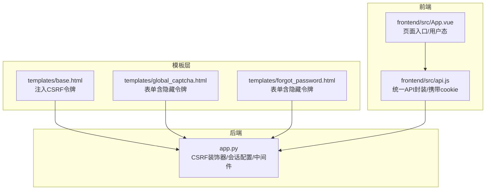
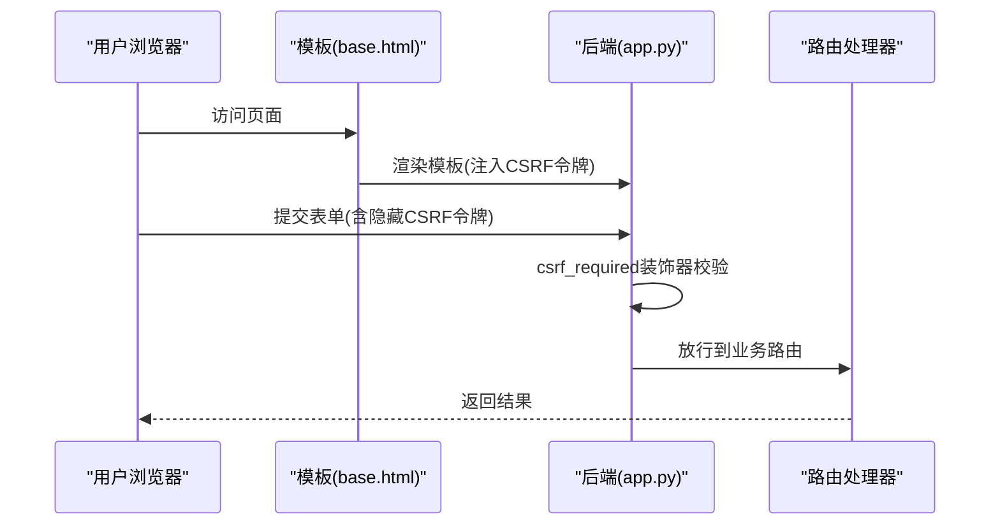
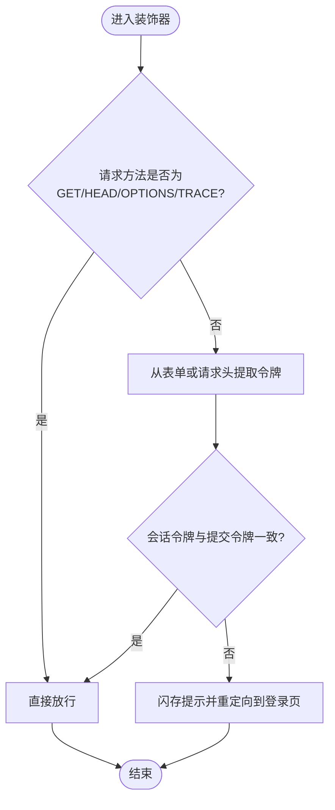
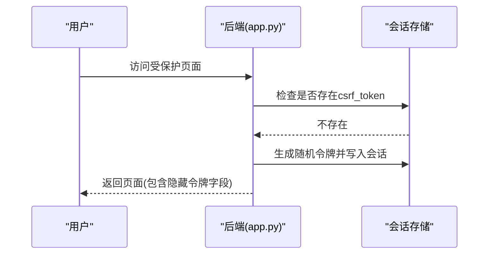
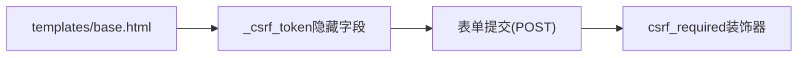
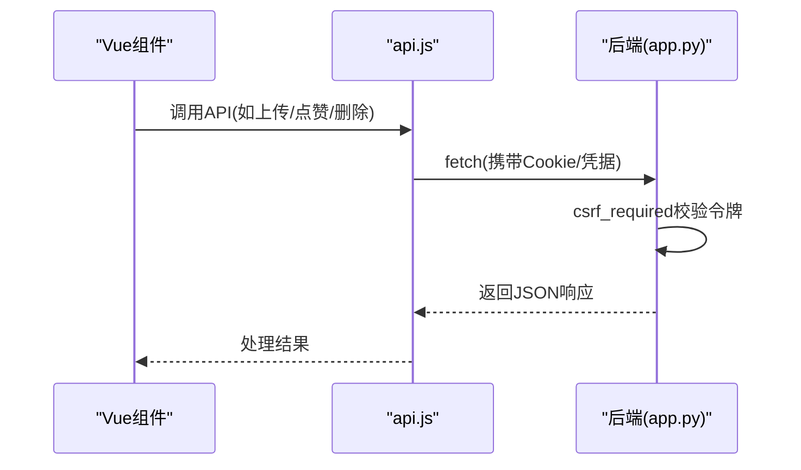
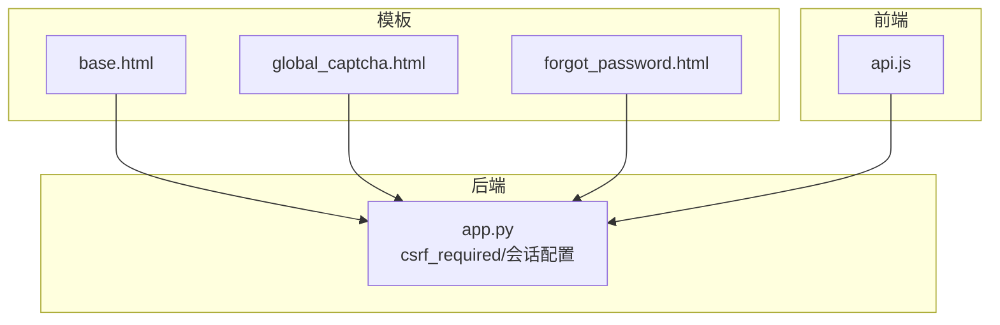

# CSRF跨站请求伪造防护

<cite>
**本文档引用的文件**
- [app.py](file://app.py)
- [templates/base.html](file://templates/base.html)
- [templates/global_captcha.html](file://templates/global_captcha.html)
- [templates/forgot_password.html](file://templates/forgot_password.html)
- [frontend/src/api.js](file://frontend/src/api.js)
- [frontend/src/App.vue](file://frontend/src/App.vue)
</cite>

## 目录
1. [简介](#简介)
2. [项目结构](#项目结构)
3. [核心组件](#核心组件)
4. [架构概览](#架构概览)
5. [详细组件分析](#详细组件分析)
6. [依赖分析](#依赖分析)
7. [性能考虑](#性能考虑)
8. [故障排除指南](#故障排除指南)
9. [结论](#结论)

## 简介
本文件系统性梳理School_Web项目的CSRF（跨站请求伪造）防护机制，涵盖攻击原理、项目实现细节、令牌生成与验证流程、前后端协作方式、最佳实践与常见陷阱等。通过逐层解析后端装饰器、模板注入、前端API调用等关键环节，帮助读者全面理解并正确实施CSRF防护。

## 项目结构
围绕CSRF防护的关键文件分布如下：
- 后端核心：app.py中定义CSRF装饰器、会话安全配置、全局中间件等
- 模板注入：base.html等模板中注入CSRF令牌，确保表单提交携带令牌
- 前端交互：前端通过fetch API提交请求，配合会话凭据完成认证与CSRF校验

**图表来源**
- [app.py](file://app.py)
- [templates/base.html](file://templates/base.html)
- [templates/global_captcha.html](file://templates/global_captcha.html)
- [templates/forgot_password.html](file://templates/forgot_password.html)
- [frontend/src/api.js](file://frontend/src/api.js)
- [frontend/src/App.vue](file://frontend/src/App.vue)

**章节来源**
- [app.py](file://app.py)
- [templates/base.html](file://templates/base.html)
- [templates/global_captcha.html](file://templates/global_captcha.html)
- [templates/forgot_password.html](file://templates/forgot_password.html)
- [frontend/src/api.js](file://frontend/src/api.js)
- [frontend/src/App.vue](file://frontend/src/App.vue)

## 核心组件
- CSRF装饰器：对非GET请求进行CSRF令牌校验，使用恒等比较防止时序攻击
- 会话安全配置：HttpOnly、SameSite、Secure等配置降低令牌泄露风险
- 模板注入：在HTML表单中注入隐藏的CSRF令牌字段
- 前端API：统一使用同源/同凭据策略，确保令牌随请求自动携带

**章节来源**
- [app.py](file://app.py)
- [templates/base.html](file://templates/base.html)
- [frontend/src/api.js](file://frontend/src/api.js)

## 架构概览
CSRF防护的整体流程如下：
- 用户访问受保护页面时，后端在会话中生成CSRF令牌并注入模板
- 表单提交时，隐藏字段携带CSRF令牌
- 非GET请求到达后端，装饰器从表单或请求头提取令牌并与会话令牌比对
- 比对通过后放行业务逻辑，否则重定向至登录页

**图表来源**
- [app.py](file://app.py)
- [templates/base.html](file://templates/base.html)

## 详细组件分析

### CSRF装饰器与令牌验证
- 适用范围：对非GET/HEAD/OPTIONS/TRACE请求进行校验
- 校验来源：优先从表单字段获取，其次从请求头获取
- 校验方法：使用恒等比较避免时序攻击
- 失败处理：闪存提示并重定向至登录页

**图表来源**
- [app.py](file://app.py)

**章节来源**
- [app.py](file://app.py)

### 会话与令牌存储
- 令牌生成：首次访问时在会话中生成随机令牌
- 存储位置：Flask会话对象，结合HttpOnly Cookie保障传输安全
- 生命周期：随会话周期变化，登录成功后会更新令牌

**图表来源**
- [app.py](file://app.py)

**章节来源**
- [app.py](file://app.py)

### 模板注入与表单提交
- 模板注入：在基础模板中注入隐藏的CSRF令牌字段
- 表单提交：所有POST表单均包含该隐藏字段
- 登出表单：同样注入CSRF令牌字段，确保登出操作受保护

**图表来源**
- [templates/base.html](file://templates/base.html)

**章节来源**
- [templates/base.html](file://templates/base.html)
- [templates/global_captcha.html](file://templates/global_captcha.html)
- [templates/forgot_password.html](file://templates/forgot_password.html)

### 前端API与CSRF协作
- 统一API封装：通过fetch封装统一处理请求
- 凭据携带：开启credentials以自动携带Cookie，确保会话与CSRF令牌随请求发送
- 适用场景：相册、留言板、统计等API交互

**图表来源**
- [frontend/src/api.js](file://frontend/src/api.js)
- [app.py](file://app.py)

**章节来源**
- [frontend/src/api.js](file://frontend/src/api.js)
- [frontend/src/App.vue](file://frontend/src/App.vue)

## 依赖分析
- 模板对后端的依赖：模板依赖后端注入的CSRF令牌与CSP nonce
- 路由对装饰器的依赖：受保护路由均需通过csrf_required装饰器
- 前端对后端的依赖：API调用依赖会话Cookie与CSRF令牌

**图表来源**
- [app.py](file://app.py)
- [templates/base.html](file://templates/base.html)
- [templates/global_captcha.html](file://templates/global_captcha.html)
- [templates/forgot_password.html](file://templates/forgot_password.html)
- [frontend/src/api.js](file://frontend/src/api.js)

**章节来源**
- [app.py](file://app.py)
- [templates/base.html](file://templates/base.html)
- [frontend/src/api.js](file://frontend/src/api.js)

## 性能考虑
- 令牌生成成本极低：一次性随机令牌，开销可忽略
- 校验成本极低：恒等比较，常数时间复杂度
- 模板注入成本极低：仅在渲染阶段注入隐藏字段
- 建议：避免在高频路径重复生成令牌，保持令牌与会话生命周期一致

## 故障排除指南
- 现象：提交表单后被重定向到登录页
  - 可能原因：缺少CSRF令牌、令牌不匹配、会话失效
  - 排查步骤：确认模板是否注入隐藏令牌字段；检查表单是否包含令牌；确认会话Cookie是否正常
- 现象：前端API调用失败
  - 可能原因：未携带Cookie/凭据；跨域配置不当
  - 排查步骤：确认fetch是否开启凭据；检查CORS配置；确认SameSite/Lax策略与前端域名一致
- 现象：令牌频繁失效
  - 可能原因：会话超时；页面长时间未操作
  - 排查步骤：检查会话空闲超时配置；在页面加载时重新渲染模板以更新令牌

**章节来源**
- [app.py](file://app.py)
- [templates/base.html](file://templates/base.html)
- [frontend/src/api.js](file://frontend/src/api.js)

## 结论
School_Web采用“会话令牌+装饰器校验”的CSRF防护方案，结合模板注入与前端统一API封装，实现了对主要业务请求的可靠保护。建议在生产环境中进一步完善令牌刷新策略（如登录成功后更新令牌）、强化HTTPS与安全响应头配置，并对关键路由进行更细粒度的令牌校验，以提升整体安全性。