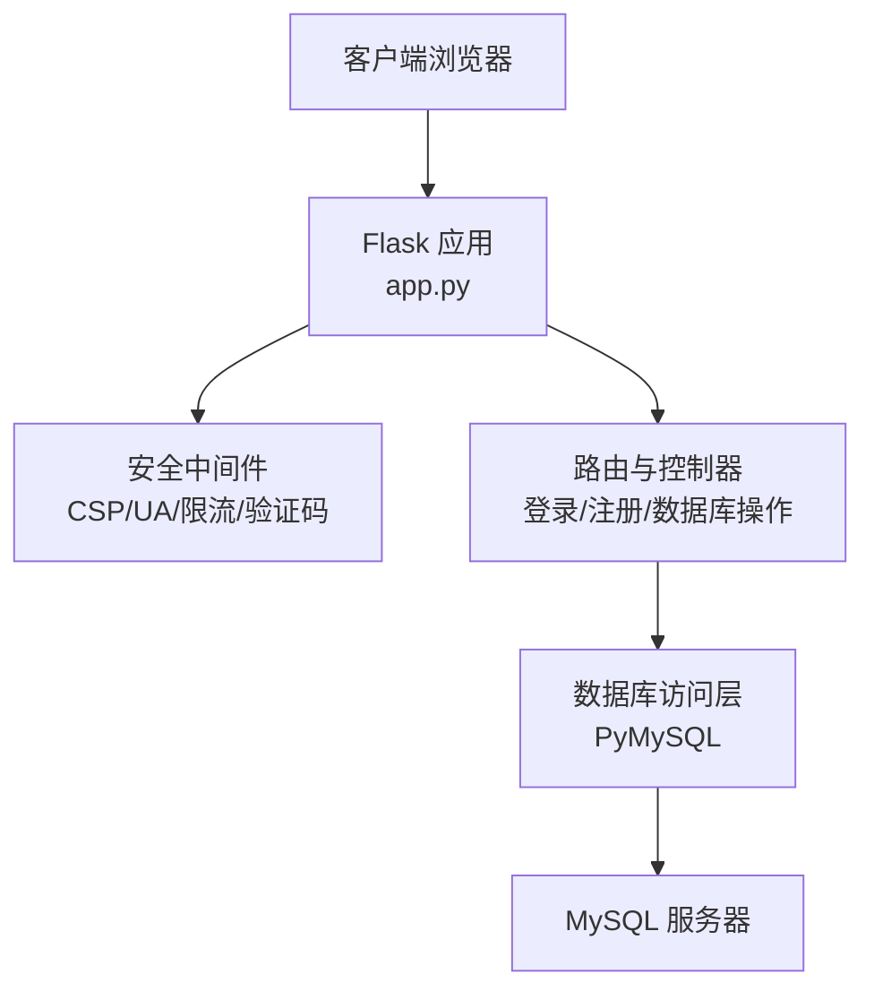
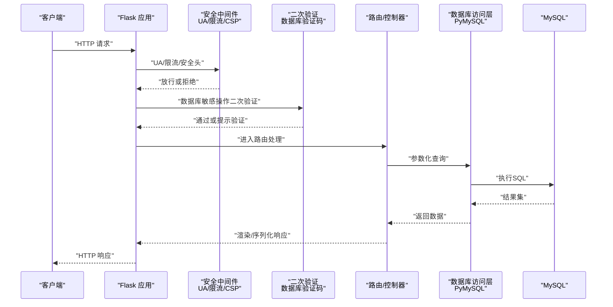
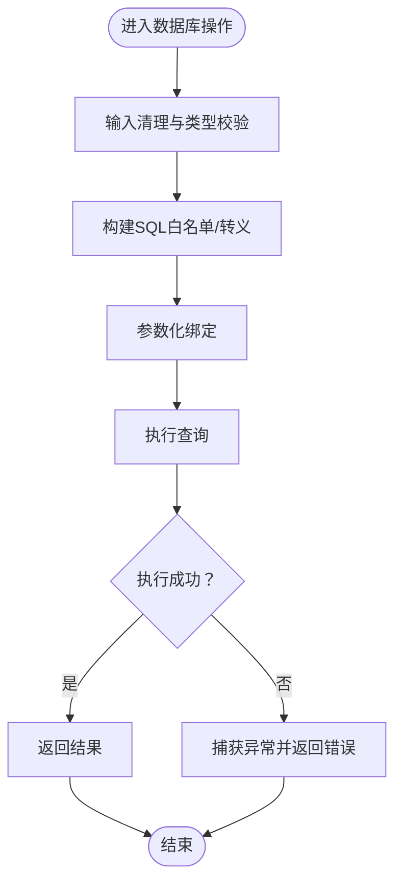
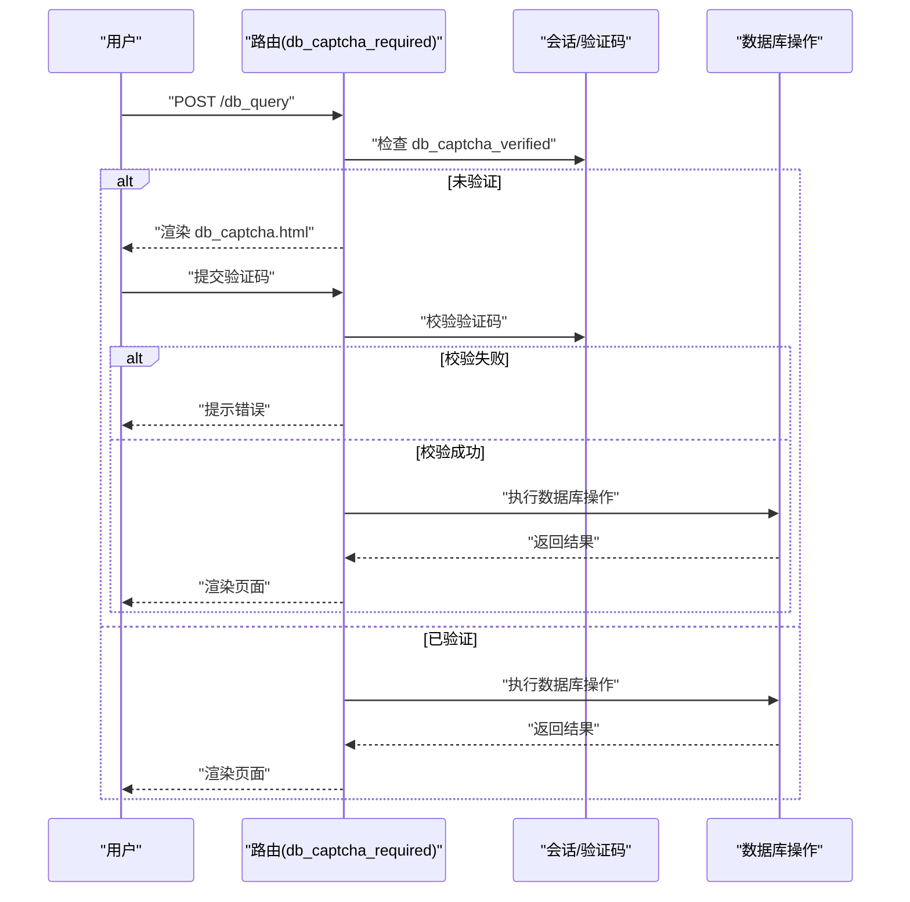
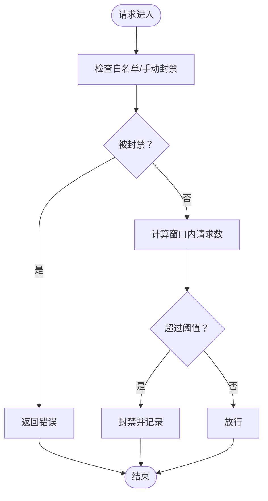
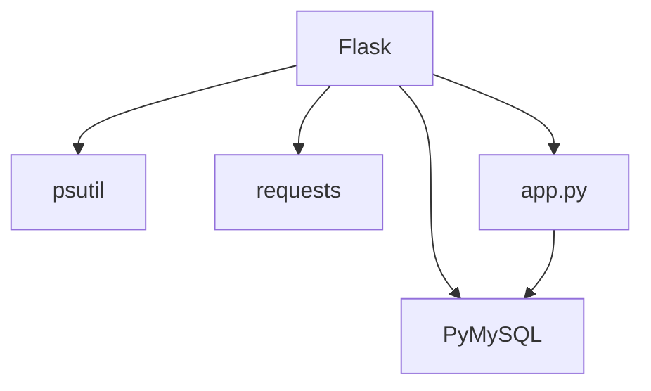

# SQL注入防护

<cite>
**本文引用的文件**
- [app.py](file://app.py)
- [requirements.txt](file://requirements.txt)
- [安全措施清单.md](file://安全措施清单.md)
</cite>

## 目录
1. [简介](#简介)
2. [项目结构](#项目结构)
3. [核心组件](#核心组件)
4. [架构总览](#架构总览)
5. [详细组件分析](#详细组件分析)
6. [依赖分析](#依赖分析)
7. [性能考虑](#性能考虑)
8. [故障排查指南](#故障排查指南)
9. [结论](#结论)
10. [附录](#附录)

## 简介
本文件聚焦于School_Web项目的SQL注入防护机制，系统性梳理项目中已实现的防护策略与潜在风险点，包括参数化查询的使用、输入验证与清理、数据库访问控制、以及数据库连接与权限管理建议。同时提供SQL注入攻击原理与常见向量的概述，帮助读者全面理解项目在安全方面的设计取舍与改进建议。

## 项目结构
- 后端基于Flask应用，数据库访问通过PyMySQL实现，主要业务逻辑集中在单一入口文件中。
- 安全相关能力分布于多处：全局安全响应头、CSP nonce轮换、速率限制、UA过滤、验证码门禁、数据库二次验证装饰器、输入清理函数等。
- 数据库连接配置集中定义，便于统一管理与后续加固。

图示来源
- [app.py:131-660](file://app.py#L131-L660)
- [app.py:680-693](file://app.py#L680-L693)

章节来源
- [app.py:131-660](file://app.py#L131-L660)
- [app.py:680-693](file://app.py#L680-L693)

## 核心组件
- 参数化查询与ORM思想
  - 项目广泛采用参数化查询，将用户输入作为参数传入，避免拼接SQL字符串，显著降低注入风险。
  - 关键路径包括登录、注册、个人资料、重置令牌、活动日志、管理员请求、相册扩展等多处数据库交互。
- 输入验证与清理
  - 提供通用输入清理函数，限制长度并进行基本清洗，配合类型校验与白名单策略共同使用。
- 数据库二次验证
  - 对数据库敏感操作（如查询、增删改）引入二次验证码门禁，结合会话状态与CSRF令牌，提升防护强度。
- 速率限制与访问控制
  - 针对登录、注册、验证码等高频接口实施独立限流，阻断暴力破解与自动化探测。
- 安全响应头与CSP
  - 设置严格的响应头与CSP nonce，降低XSS与点击劫持风险，间接减少SQL注入利用面。

章节来源
- [app.py:872-878](file://app.py#L872-L878)
- [app.py:966-988](file://app.py#L966-L988)
- [app.py:1028-1116](file://app.py#L1028-L1116)
- [app.py:1119-1188](file://app.py#L1119-L1188)
- [app.py:2319-2367](file://app.py#L2319-L2367)
- [app.py:2370-2485](file://app.py#L2370-L2485)

## 架构总览
下图展示了SQL相关请求在系统中的流转与防护节点：

图示来源
- [app.py:149-156](file://app.py#L149-L156)
- [app.py:513-562](file://app.py#L513-L562)
- [app.py:966-988](file://app.py#L966-L988)
- [app.py:2319-2367](file://app.py#L2319-L2367)
- [app.py:2370-2485](file://app.py#L2370-L2485)

## 详细组件分析

### 组件A：参数化查询与输入清理
- 实现模式
  - 登录与注册：使用参数化查询绑定用户名与密码，避免字符串拼接。
  - 个人资料与活动日志：通过参数化查询写入用户输入，防止注入。
  - 数据库可视化操作：对表名采用白名单+反引号包裹策略，列名使用占位符，数据值通过参数化传入。
- 数据结构与复杂度
  - 查询执行为O(n)扫描与O(1)参数绑定，参数化查询由驱动层处理，避免SQL解析与注入风险。
- 依赖链
  - 路由层依赖数据库访问函数，数据库访问函数依赖PyMySQL连接。
- 风险与优化
  - 表名与列名动态拼接需严格白名单与转义，建议进一步封装SQL构造器，统一参数化策略。
  - 对于复杂条件，建议引入SQL Builder或ORM映射层，减少手写SQL。

图示来源
- [app.py:872-878](file://app.py#L872-L878)
- [app.py:1028-1116](file://app.py#L1028-L1116)
- [app.py:1119-1188](file://app.py#L1119-L1188)
- [app.py:1753-1789](file://app.py#L1753-L1789)
- [app.py:2319-2367](file://app.py#L2319-L2367)
- [app.py:2370-2485](file://app.py#L2370-L2485)

章节来源
- [app.py:872-878](file://app.py#L872-L878)
- [app.py:1028-1116](file://app.py#L1028-L1116)
- [app.py:1119-1188](file://app.py#L1119-L1188)
- [app.py:1753-1789](file://app.py#L1753-L1789)
- [app.py:2319-2367](file://app.py#L2319-L2367)
- [app.py:2370-2485](file://app.py#L2370-L2485)

### 组件B：数据库二次验证与验证码门禁
- 实现模式
  - 通过装饰器对数据库敏感路由进行二次验证码校验，未通过则拒绝访问或引导至验证页面。
  - 结合会话状态与CSRF令牌，确保请求来源可信。
- 数据流程
  - 用户提交数据库操作请求 → 检查二次验证状态 → 若未验证则要求输入验证码 → 验证通过后重定向回原路径 → 执行数据库操作。

图示来源
- [app.py:966-988](file://app.py#L966-L988)
- [app.py:2319-2367](file://app.py#L2319-L2367)
- [app.py:2370-2485](file://app.py#L2370-L2485)

章节来源
- [app.py:966-988](file://app.py#L966-L988)
- [app.py:2319-2367](file://app.py#L2319-L2367)
- [app.py:2370-2485](file://app.py#L2370-L2485)

### 组件C：速率限制与访问控制
- 实现模式
  - 针对登录、注册、验证码等接口设置独立限流桶，超过阈值进行封禁并记录。
  - 支持白名单与手动封禁，便于运维干预。
- 数据流程
  - 每次请求进入before_request → 检查白名单/手动封禁 → 清理过期记录 → 计算窗口内请求数 → 超限则封禁并返回403/429。

图示来源
- [app.py:513-562](file://app.py#L513-L562)
- [app.py:348-413](file://app.py#L348-L413)

章节来源
- [app.py:513-562](file://app.py#L513-L562)
- [app.py:348-413](file://app.py#L348-L413)

### 组件D：安全响应头与CSP
- 实现模式
  - 统一设置X-Content-Type-Options、X-Frame-Options、X-XSS-Protection、Referrer-Policy、Permissions-Policy等。
  - 为每个请求生成唯一CSP nonce，脚本与样式资源通过nonce授权，降低XSS风险。
- 影响
  - 降低XSS导致的二次注入风险，减少攻击面。

章节来源
- [app.py:641-676](file://app.py#L641-L676)
- [app.py:158-161](file://app.py#L158-L161)

### 组件E：数据库连接与权限管理
- 当前实现
  - 数据库连接配置集中定义，使用PyMySQL建立连接。
- 建议
  - 引入连接池管理（如pymysqlpool或SQLAlchemy连接池），限制最大连接数与空闲超时。
  - 为不同业务场景拆分数据库账号，遵循“最小权限”原则，避免使用高权限账号执行只读查询。
  - 对外暴露的数据库端口与网络访问进行防火墙限制，仅允许受信网段访问。

章节来源
- [app.py:625-636](file://app.py#L625-L636)
- [requirements.txt:1-5](file://requirements.txt#L1-L5)

## 依赖分析
- 外部依赖
  - Flask：Web框架，提供路由、请求/响应对象与中间件机制。
  - PyMySQL：MySQL驱动，负责连接与查询执行。
  - psutil、requests：系统监控与网络请求辅助库。
- 内部耦合
  - 路由层高度依赖数据库访问函数与安全中间件，建议将数据库访问抽象为服务层，增强可测试性与可维护性。

图示来源
- [requirements.txt:1-5](file://requirements.txt#L1-L5)
- [app.py:15-25](file://app.py#L15-L25)

章节来源
- [requirements.txt:1-5](file://requirements.txt#L1-L5)
- [app.py:15-25](file://app.py#L15-L25)

## 性能考虑
- 参数化查询的使用提升了安全性，对性能影响可忽略；建议在高频接口上启用连接池，减少连接建立开销。
- 限流与二次验证会增加少量CPU与I/O消耗，但能有效阻止暴力破解与自动化攻击，建议根据实际流量调整阈值。
- 对于大规模数据导出或复杂查询，建议引入分页与索引优化，避免一次性传输大量数据。

## 故障排查指南
- 常见问题
  - 数据库连接失败：检查连接配置与网络连通性，确认数据库服务状态。
  - 二次验证失败：确认会话状态与验证码一致性，检查CSRF令牌有效性。
  - 429/403错误：检查是否触发限流或封禁，查看最近封禁记录。
- 排查步骤
  - 查看应用日志与错误响应，定位具体路由与异常类型。
  - 对照安全中间件与装饰器，确认请求是否通过所有安全检查。
  - 验证输入清理与类型校验逻辑，确保未绕过参数化查询。

章节来源
- [app.py:680-693](file://app.py#L680-L693)
- [app.py:966-988](file://app.py#L966-L988)
- [app.py:513-562](file://app.py#L513-L562)

## 结论
School_Web在SQL注入防护方面采取了多项有效措施：广泛使用参数化查询、输入清理、二次验证码、速率限制与UA过滤等。这些措施显著降低了注入风险。为进一步提升安全性与可维护性，建议引入连接池、最小权限账号、ORM映射层与统一SQL构造器，并持续完善日志与告警体系。

## 附录
- SQL注入攻击原理与常见向量
  - 原理：攻击者通过在输入中注入恶意SQL片段，改变程序原本的SQL执行逻辑，从而绕过认证、读取或篡改数据。
  - 常见向量：未过滤的用户输入、字符串拼接、错误回显、弱口令、越权访问、不安全的文件上传等。
- 最佳实践
  - 始终使用参数化查询或ORM映射层。
  - 对输入进行长度与类型校验，必要时进行白名单过滤。
  - 采用最小权限原则与连接池管理。
  - 引入WAF与入侵检测系统，配合日志审计与定期渗透测试。