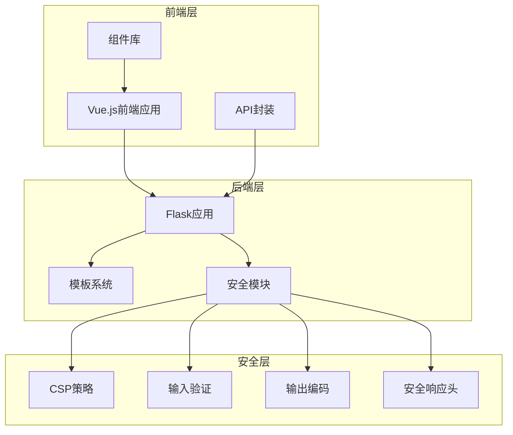
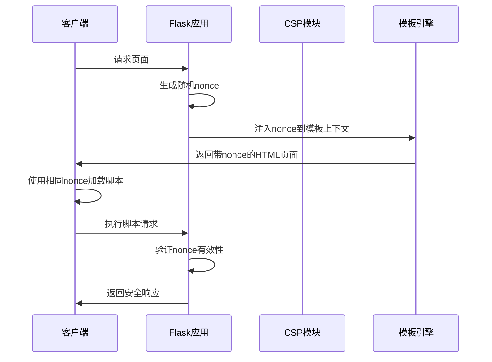
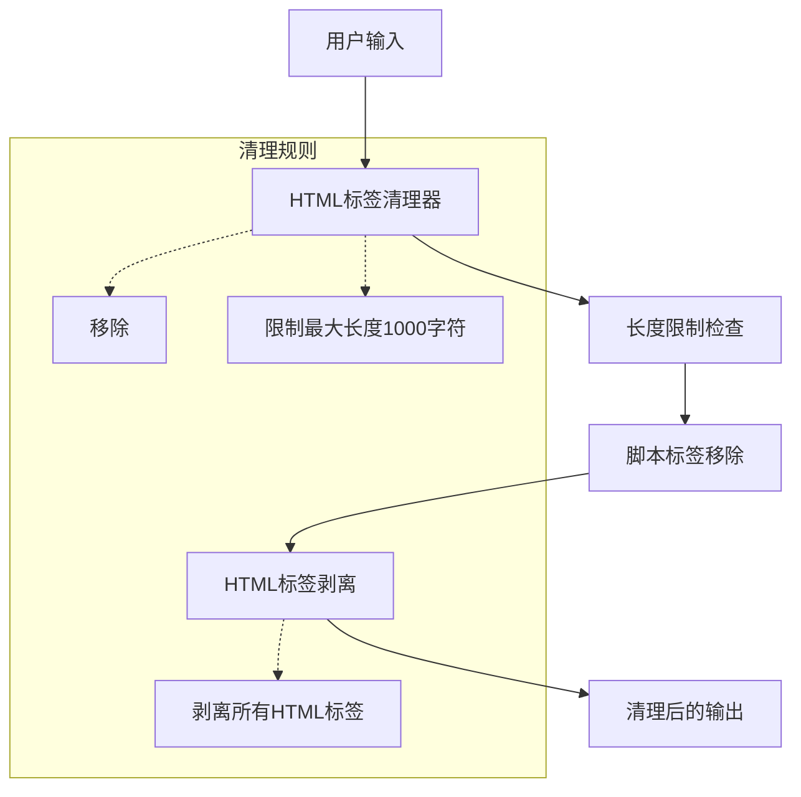
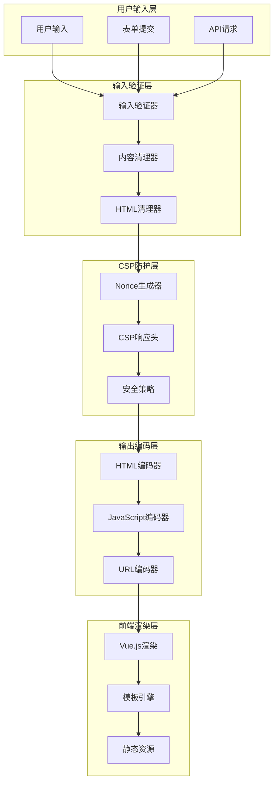
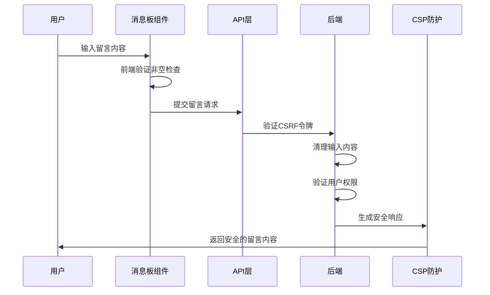
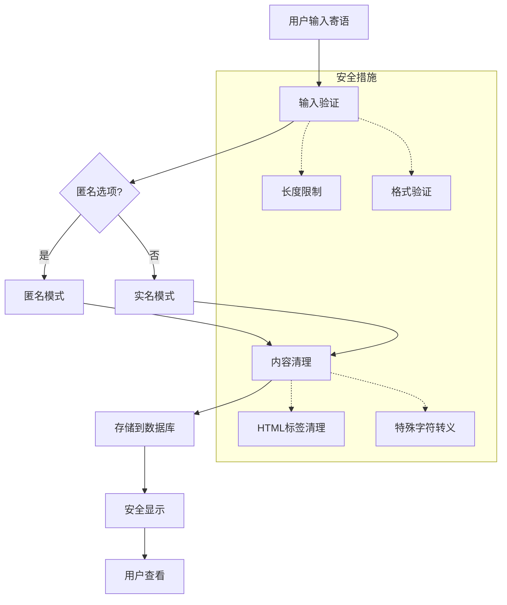
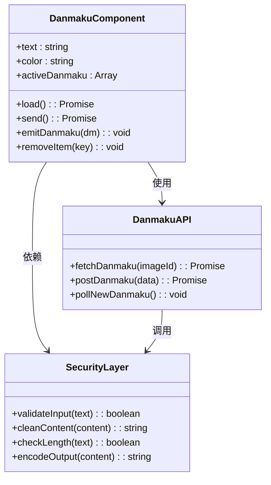
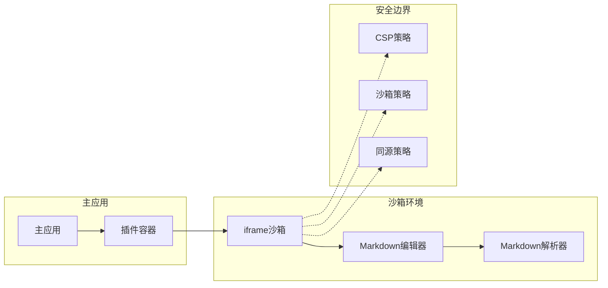
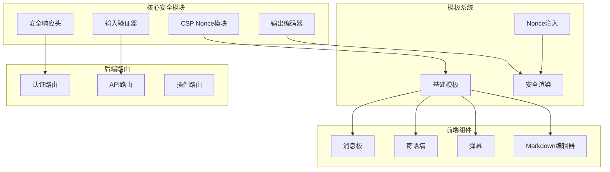

# XSS跨站脚本攻击防护

<cite>
**本文档引用的文件**
- [app.py](file://app.py)
- [templates/base.html](file://templates/base.html)
- [frontend/src/components/MessageBoard.vue](file://frontend/src/components/MessageBoard.vue)
- [frontend/src/components/WishWall.vue](file://frontend/src/components/WishWall.vue)
- [frontend/src/components/Danmaku.vue](file://frontend/src/components/Danmaku.vue)
- [plugins/marketplace/markdown-editor/index.html](file://plugins/marketplace/markdown-editor/index.html)
- [安全措施清单.md](file://安全措施清单.md)
</cite>

## 目录
1. [简介](#简介)
2. [项目结构](#项目结构)
3. [核心组件](#核心组件)
4. [架构概览](#架构概览)
5. [详细组件分析](#详细组件分析)
6. [依赖分析](#依赖分析)
7. [性能考虑](#性能考虑)
8. [故障排除指南](#故障排除指南)
9. [结论](#结论)

## 简介

XSS（跨站脚本攻击）是Web应用中最常见的安全漏洞之一，攻击者通过在网页中注入恶意脚本代码来窃取用户信息、劫持用户会话或进行其他恶意操作。本项目针对School_Web应用构建了全面的XSS防护体系，采用多层次、多维度的安全策略。

本项目实现了以下XSS防护机制：
- **CSP nonce机制**：为每个请求生成唯一的nonce值，确保脚本执行的安全性
- **输入验证与清理**：对用户输入进行全面的验证和清理
- **输出编码**：对动态内容进行适当的HTML转义
- **内容安全策略**：严格的CSP策略限制脚本执行来源
- **多层防护体系**：结合多种安全措施形成纵深防御

## 项目结构

School_Web项目采用前后端分离的架构设计，主要分为以下几个层次：

**图表来源**
- [app.py:119-139](file://app.py#L119-L139)
- [templates/base.html:1-337](file://templates/base.html#L1-337)

**章节来源**
- [app.py:119-139](file://app.py#L119-L139)
- [templates/base.html:1-337](file://templates/base.html#L1-337)

## 核心组件

### CSP Nonce生成与管理

项目实现了动态nonce机制，为每个HTTP请求生成唯一的nonce值：

**图表来源**
- [app.py:158-178](file://app.py#L158-L178)
- [templates/base.html:8](file://templates/base.html#L8)
- [templates/base.html:233](file://templates/base.html#L233)

### 输入验证与清理机制

项目实现了多层次的输入验证和清理：

**图表来源**
- [app.py:869-881](file://app.py#L869-L881)

### 安全响应头配置

项目配置了全面的安全响应头：

| 响应头 | 值 | 作用 |
|--------|-----|------|
| X-Content-Type-Options | nosniff | 防止MIME类型嗅探 |
| X-Frame-Options | SAMEORIGIN | 防止点击劫持 |
| X-XSS-Protection | 1; mode=block | XSS过滤器（兼容性） |
| Referrer-Policy | strict-origin-when-cross-origin | 控制引用信息 |
| Content-Security-Policy | 严格策略 | CSP防护 |
| Permissions-Policy | camera=(), microphone=(), geolocation=() | 权限控制 |

**章节来源**
- [app.py:642-676](file://app.py#L642-L676)

## 架构概览

### XSS防护架构图

**图表来源**
- [app.py:869-881](file://app.py#L869-L881)
- [app.py:158-178](file://app.py#L158-L178)
- [app.py:642-676](file://app.py#L642-L676)

## 详细组件分析

### 消息板组件XSS防护

消息板组件展示了典型的XSS防护实践：

**图表来源**
- [frontend/src/components/MessageBoard.vue:39-45](file://frontend/src/components/MessageBoard.vue#L39-L45)
- [frontend/src/components/MessageBoard.vue:54-56](file://frontend/src/components/MessageBoard.vue#L54-L56)

#### 关键防护措施

1. **前端验证**：检查输入内容是否为空
2. **后端验证**：CSRF令牌验证和用户权限检查
3. **内容清理**：后端对输入内容进行清理
4. **权限控制**：删除操作的权限验证

**章节来源**
- [frontend/src/components/MessageBoard.vue:1-80](file://frontend/src/components/MessageBoard.vue#L1-L80)

### 寄语墙组件XSS防护

寄语墙组件提供了匿名留言功能，采用了严格的XSS防护：

**图表来源**
- [frontend/src/components/WishWall.vue:39-44](file://frontend/src/components/WishWall.vue#L39-L44)

#### 匿名功能的XSS防护

寄语墙的匿名功能通过以下方式确保安全：

1. **服务器端控制**：匿名状态由服务器端控制，客户端无法伪造
2. **内容清理**：所有寄语内容都会经过服务器端清理
3. **权限验证**：删除操作需要服务器端权限验证

**章节来源**
- [frontend/src/components/WishWall.vue:1-61](file://frontend/src/components/WishWall.vue#L1-L61)

### 弹幕组件XSS防护

弹幕组件展示了实时交互场景下的XSS防护：

**图表来源**
- [frontend/src/components/Danmaku.vue:18-74](file://frontend/src/components/Danmaku.vue#L18-L74)

#### 实时弹幕的XSS防护

弹幕系统的XSS防护特点：

1. **输入长度限制**：最大200字符限制
2. **颜色选择限制**：仅允许预定义的颜色值
3. **内容验证**：发送前进行基本验证
4. **实时更新**：使用轮询机制获取新弹幕

**章节来源**
- [frontend/src/components/Danmaku.vue:1-89](file://frontend/src/components/Danmaku.vue#L1-L89)

### Markdown编辑器沙箱防护

插件市场中的Markdown编辑器采用了沙箱隔离机制：

**图表来源**
- [plugins/marketplace/markdown-editor/index.html:1-486](file://plugins/marketplace/markdown-editor/index.html#L1-L486)

#### 沙箱隔离机制

Markdown编辑器的沙箱防护措施：

1. **iframe隔离**：在独立的iframe中运行
2. **CSP限制**：严格的CSP策略限制
3. **同源策略**：防止跨域访问
4. **内容转义**：对用户输入进行HTML转义

**章节来源**
- [plugins/marketplace/markdown-editor/index.html:208-324](file://plugins/marketplace/markdown-editor/index.html#L208-L324)

## 依赖分析

### XSS防护依赖关系

**图表来源**
- [app.py:158-178](file://app.py#L158-L178)
- [templates/base.html:8](file://templates/base.html#L8)

### 安全配置依赖

项目的安全配置形成了相互依赖的关系：

| 组件 | 依赖组件 | 作用 |
|------|----------|------|
| CSP Nonce生成 | Flask应用上下文 | 为每个请求生成唯一nonce |
| 模板Nonce注入 | Jinja2模板引擎 | 将nonce注入到HTML模板 |
| 安全响应头 | HTTP响应处理 | 设置CSP和其他安全头 |
| 输入验证器 | 所有API路由 | 验证和清理用户输入 |
| 输出编码器 | 所有渲染组件 | 对输出内容进行编码 |

**章节来源**
- [app.py:158-178](file://app.py#L158-L178)
- [app.py:642-676](file://app.py#L642-L676)

## 性能考虑

### CSP Nonce性能影响

CSP nonce机制对性能的影响相对较小：

1. **内存开销**：每个请求仅存储一个nonce值
2. **CPU开销**：随机数生成和字符串处理
3. **网络开销**：nonce值长度较短，影响可忽略
4. **缓存友好**：nonce随请求变化，不影响静态资源缓存

### 输入验证性能优化

项目采用了高效的输入验证策略：

1. **正则表达式优化**：使用编译后的正则表达式
2. **早期失败**：在验证失败时立即返回错误
3. **批量处理**：对多个验证规则进行组合检查
4. **缓存策略**：对重复验证结果进行缓存

## 故障排除指南

### 常见XSS防护问题

| 问题类型 | 症状 | 解决方案 |
|----------|------|----------|
| CSP拒绝执行 | 脚本被阻止执行 | 检查nonce是否正确传递 |
| 输入验证失败 | 表单提交被拒绝 | 检查输入格式和长度限制 |
| 输出编码问题 | 特殊字符显示异常 | 确认输出编码是否正确应用 |
| 模板渲染错误 | 页面显示不完整 | 检查模板变量是否正确注入 |

### 调试技巧

1. **浏览器开发者工具**：检查CSP报告和网络请求
2. **服务器日志**：查看安全相关的日志信息
3. **单元测试**：编写XSS防护测试用例
4. **安全扫描**：定期进行自动化安全扫描

**章节来源**
- [安全措施清单.md:1-161](file://安全措施清单.md#L1-L161)

## 结论

School_Web项目构建了一个全面而有效的XSS防护体系，主要体现在以下几个方面：

### 核心防护成果

1. **CSP Nonce机制**：实现了每请求唯一的nonce值，有效防止了反射型XSS攻击
2. **多层次输入验证**：从前端到后端的全方位输入验证和清理
3. **严格的CSP策略**：限制了脚本执行来源，增强了整体安全性
4. **组件级安全设计**：各个前端组件都内置了相应的XSS防护措施

### 安全优势

- **纵深防御**：多层防护机制相互配合，形成完整的安全体系
- **实时防护**：CSP nonce机制能够实时阻止恶意脚本执行
- **易于维护**：统一的安全框架便于后续的安全维护和更新
- **性能友好**：安全措施对系统性能影响最小化

### 改进建议

1. **Cookie Secure标记**：在生产环境中添加Secure标志
2. **CDN脚本SRI**：为外部CDN资源添加子资源完整性校验
3. **GET请求限流**：为GET请求添加适当的频率限制
4. **CSP策略优化**：进一步收紧CSP策略，减少潜在攻击面

通过这些综合性的安全措施，School_Web项目有效地防范了各种类型的XSS攻击，为用户提供了安全可靠的使用环境。