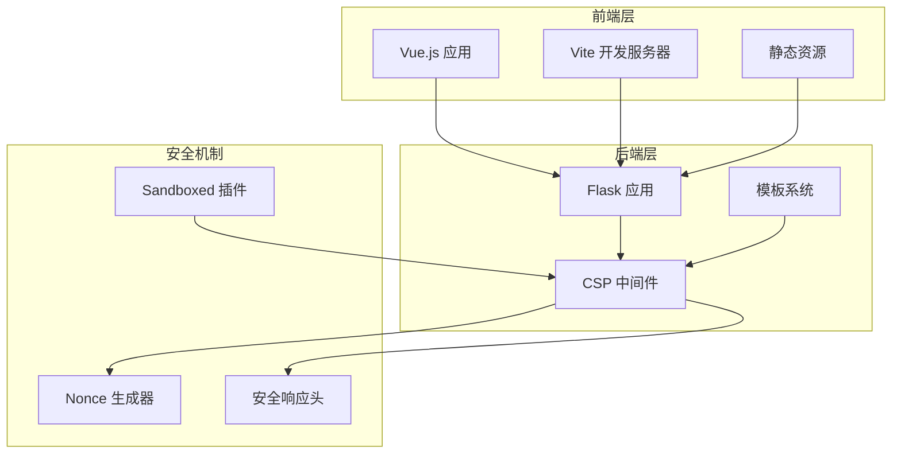
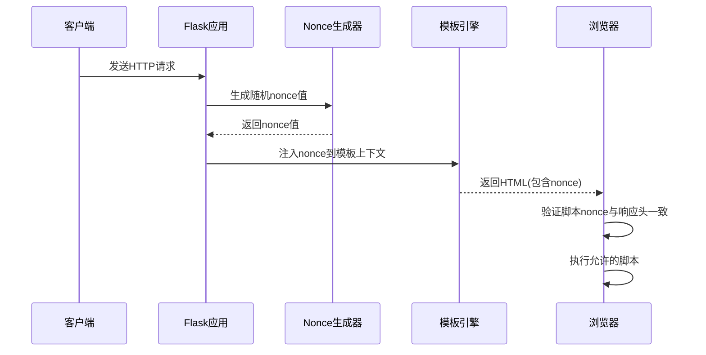
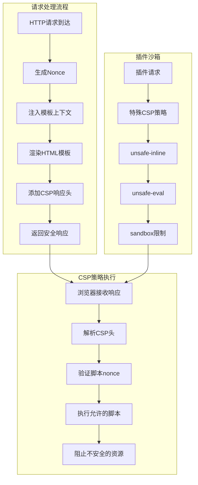
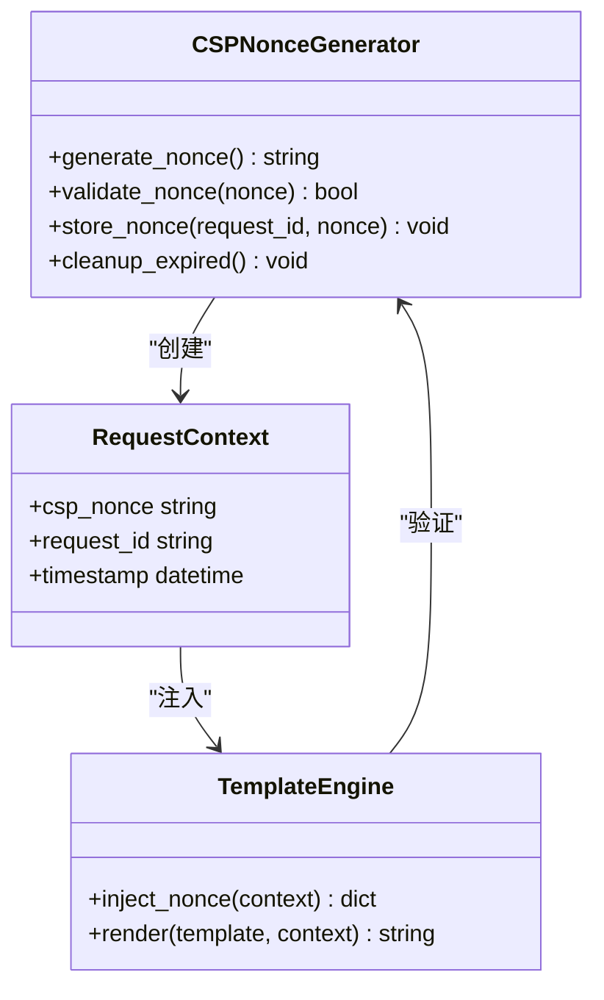
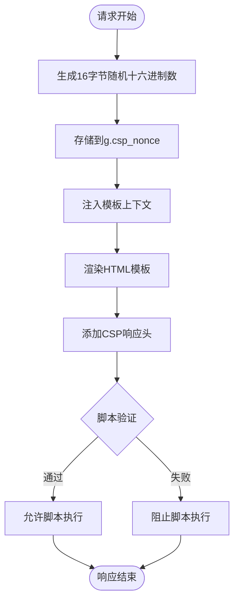
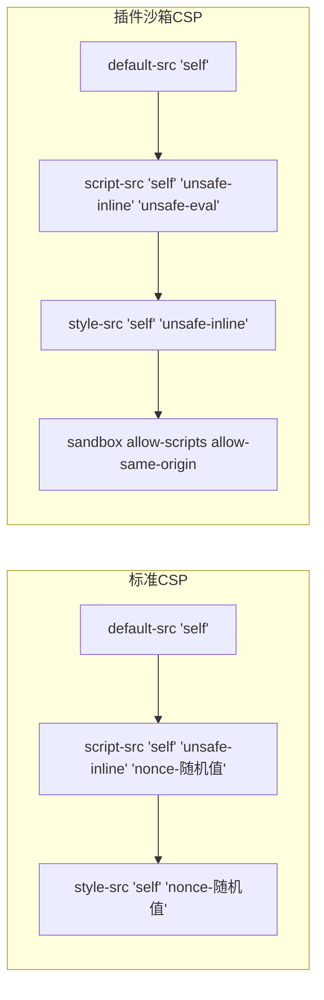
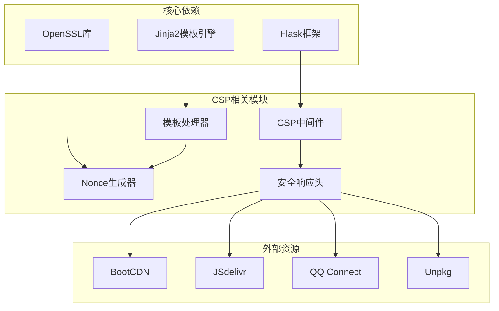

# 内容安全策略(CSP)

<cite>
**本文档引用的文件**
- [app.py](file://app.py)
- [base.html](file://templates/base.html)
- [admin_dashboard.html](file://templates/admin_dashboard.html)
- [album_vue3.html](file://templates/album_vue3.html)
- [dashboard.html](file://templates/dashboard.html)
- [安全措施清单.md](file://安全措施清单.md)
- [vite.config.js](file://frontend/vite.config.js)
</cite>

## 目录
1. [简介](#简介)
2. [项目结构](#项目结构)
3. [核心组件](#核心组件)
4. [架构概览](#架构概览)
5. [详细组件分析](#详细组件分析)
6. [依赖分析](#依赖分析)
7. [性能考虑](#性能考虑)
8. [故障排除指南](#故障排除指南)
9. [结论](#结论)

## 简介

内容安全策略(Content Security Policy, CSP)是现代Web应用的重要安全机制，通过定义允许资源加载的来源列表来防止跨站脚本攻击(XSS)、点击劫持等安全威胁。School_Web项目实现了完整的CSP安全框架，采用nonce机制确保动态脚本的安全执行。

CSP的核心价值在于：
- **XSS防护**：阻止恶意脚本注入执行
- **点击劫持防护**：限制页面被嵌入到其他网站
- **资源来源控制**：精确控制脚本、样式、图片等资源的加载来源
- **安全审计**：通过报告机制监控潜在的安全问题

## 项目结构

School_Web项目的CSP实现采用前后端协同的方式：



**图表来源**
- [app.py:158-178](file://app.py#L158-L178)
- [app.py:641-676](file://app.py#L641-L676)

**章节来源**
- [app.py:119-139](file://app.py#L119-L139)
- [vite.config.js:1-21](file://frontend/vite.config.js#L1-21)

## 核心组件

### CSP策略配置

项目实现了全面的CSP策略配置，包含以下核心指令：

| 指令 | 值 | 用途 |
|------|-----|------|
| `default-src` | `'self'` | 默认所有资源来源限制为同源 |
| `script-src` | `'self' 'unsafe-inline' 'nonce-{随机值}' https://connect.qq.com https://cdn.bootcdn.net https://unpkg.com` | 允许同源脚本、内联脚本、动态nonce脚本和指定CDN |
| `style-src` | `'self' 'nonce-{随机值}' https://cdn.bootcdn.net https://cdn.jsdelivr.net` | 允许同源样式、动态nonce样式和指定CDN |
| `font-src` | `'self' https://cdn.bootcdn.net` | 允许同源字体和指定CDN字体 |
| `img-src` | `'self' data: blob:` | 允许同源图片、data URI和blob对象 |
| `connect-src` | `'self' https://api.dictionaryapi.dev https://cdn.bootcdn.net https://cdn.jsdelivr.net` | 允许同源和指定API的网络请求 |
| `frame-ancestors` | `'self'` | 防止页面被嵌入到其他网站 |
| `form-action` | `'self'` | 限制表单提交目标 |

### Nonce生成机制

Nonce是CSP安全机制的核心组件，通过为每个HTTP响应生成唯一的随机值来实现动态脚本的安全执行：



**图表来源**
- [app.py:158-178](file://app.py#L158-L178)
- [app.py:641-676](file://app.py#L641-L676)

**章节来源**
- [app.py:158-178](file://app.py#L158-L178)
- [app.py:641-676](file://app.py#L641-L676)

## 架构概览

School_Web的CSP架构采用多层次防护设计：



**图表来源**
- [app.py:158-178](file://app.py#L158-L178)
- [app.py:641-676](file://app.py#L641-L676)
- [app.py:5606-5623](file://app.py#L5606-L5623)

## 详细组件分析

### Nonce生成器组件

Nonce生成器是CSP安全机制的核心，负责为每个请求生成唯一的安全令牌：



**图表来源**
- [app.py:158-178](file://app.py#L158-L178)
- [app.py:175-178](file://app.py#L175-L178)

#### Nonce生成流程



**图表来源**
- [app.py:158-178](file://app.py#L158-L178)
- [app.py:648-650](file://app.py#L648-L650)

**章节来源**
- [app.py:158-178](file://app.py#L158-L178)
- [app.py:648-650](file://app.py#L648-L650)

### 模板集成机制

模板系统通过上下文处理器自动注入nonce值，确保所有动态脚本都使用有效的安全令牌：

| 模板文件 | 使用位置 | Nonce注入方式 |
|----------|----------|---------------|
| base.html | 全局样式和脚本 | `<style nonce="{{ csp_nonce }}">` |
| admin_dashboard.html | 管理界面 | 多处`<style nonce="{{ csp_nonce }}">`和`<script nonce="{{ csp_nonce }}">` |
| album_vue3.html | 相册应用 | `<style nonce="{{ csp_nonce }}">`和CDN脚本 |
| dashboard.html | 仪表板 | 动态脚本区域 |

**章节来源**
- [base.html:8](file://templates/base.html#L8)
- [base.html:232](file://templates/base.html#L232)
- [admin_dashboard.html:5](file://templates/admin_dashboard.html#L5)
- [album_vue3.html:7](file://templates/album_vue3.html#L7)

### 插件沙箱安全策略

对于插件系统，项目采用了特殊的CSP策略来平衡功能性和安全性：



**图表来源**
- [app.py:652-664](file://app.py#L652-L664)
- [app.py:5612-5620](file://app.py#L5612-L5620)

**章节来源**
- [app.py:5612-5620](file://app.py#L5612-L5620)
- [app.py:5696-5703](file://app.py#L5696-L5703)

## 依赖分析

CSP实现涉及多个组件的协同工作：



**图表来源**
- [app.py:119-139](file://app.py#L119-L139)
- [app.py:652-664](file://app.py#L652-L664)

**章节来源**
- [app.py:119-139](file://app.py#L119-L139)
- [app.py:652-664](file://app.py#L652-L664)

## 性能考虑

CSP实现对性能的影响最小化：

### 优化策略
- **Nonce缓存**：每个请求生成一次nonce，避免重复计算
- **条件注入**：仅在需要时添加CSP响应头
- **模板优化**：通过上下文处理器统一管理nonce注入
- **CDN利用**：使用可靠的CDN减少加载延迟

### 性能影响评估
- **CPU开销**：每次请求产生约16字节随机数，开销极小
- **内存占用**：nonce存储在请求上下文中，生命周期短
- **网络延迟**：CSP头大小约200字节，影响可忽略
- **缓存友好**：静态资源通过CDN缓存，提升加载速度

## 故障排除指南

### 常见问题及解决方案

#### 1. 脚本执行失败
**症状**：动态脚本无法执行
**原因**：nonce不匹配或过期
**解决**：
- 确认模板中正确使用`nonce="{{ csp_nonce }}"`属性
- 检查响应头中的Content-Security-Policy是否包含正确的nonce
- 验证脚本标签是否在模板渲染后添加

#### 2. 样式显示异常
**症状**：内联样式被阻止
**原因**：缺少nonce属性
**解决**：
- 确保所有内联样式标签包含nonce属性
- 检查CSP策略中的style-src指令配置

#### 3. 第三方资源加载失败
**症状**：CDN资源无法加载
**原因**：CSP策略限制
**解决**：
- 验证第三方域名是否在相应指令的允许列表中
- 检查CDN服务的可用性和DNS解析

#### 4. 插件功能异常
**症状**：插件无法正常运行
**原因**：沙箱策略过于严格
**解决**：
- 检查插件沙箱CSP配置
- 验证插件是否使用了必需的unsafe-eval功能

### 调试工具推荐

#### 1. 浏览器开发者工具
- **Network面板**：查看CSP报告和资源加载状态
- **Console面板**：查看CSP违规报告
- **Security面板**：检查安全响应头

#### 2. 在线CSP测试工具
- **Google CSP Evaluator**：验证CSP策略有效性
- **CSP Validator**：检查策略语法和最佳实践

#### 3. 本地调试技巧
```javascript
// 检查CSP报告
fetch('/api/debug/csp-report')
  .then(response => response.json())
  .then(data => console.log('CSP Violations:', data));

// 验证nonce生成
fetch('/api/debug/nonce')
  .then(response => response.text())
  .then(nonce => console.log('Generated Nonce:', nonce));
```

**章节来源**
- [安全措施清单.md:72-124](file://安全措施清单.md#L72-L124)

## 结论

School_Web项目的CSP实现展现了现代Web应用安全的最佳实践。通过nonce机制、严格的资源来源控制和多层次的安全防护，有效提升了应用的整体安全性。

### 主要成就
- **完整的CSP策略**：覆盖所有主要资源类型的来源控制
- **动态nonce机制**：确保动态脚本的安全执行
- **插件沙箱隔离**：在保证功能性的前提下实现安全隔离
- **性能优化**：最小化CSP对应用性能的影响

### 改进建议
- **SRI完整性校验**：为CDN资源添加Subresource Integrity校验
- **CSP报告机制**：启用CSP报告功能以便监控潜在安全问题
- **定期策略审查**：定期评估和更新CSP策略以适应新的安全威胁

通过持续的安全改进和监控，School_Web的CSP实现将继续为用户提供安全可靠的使用体验。