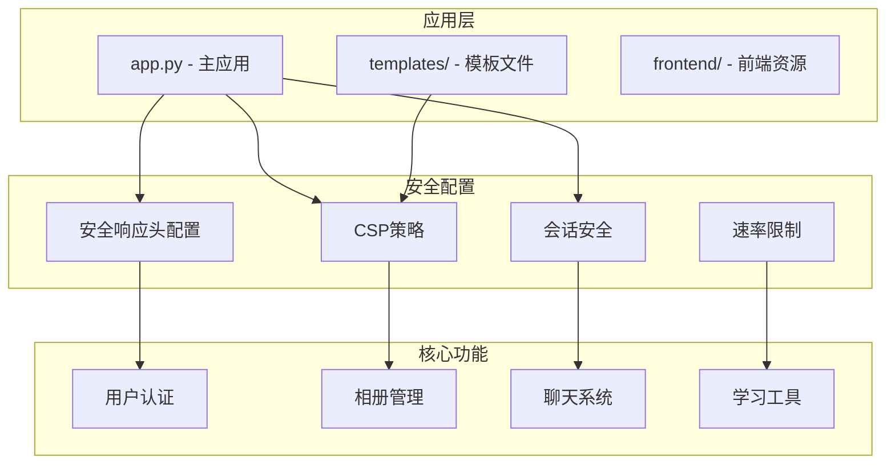
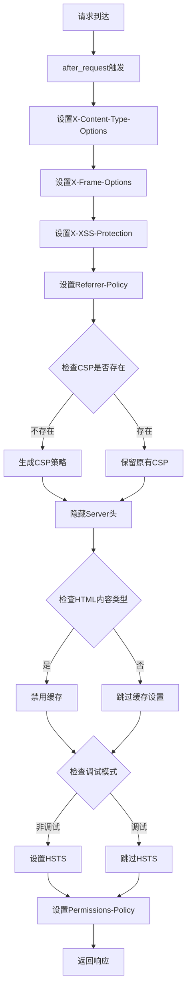
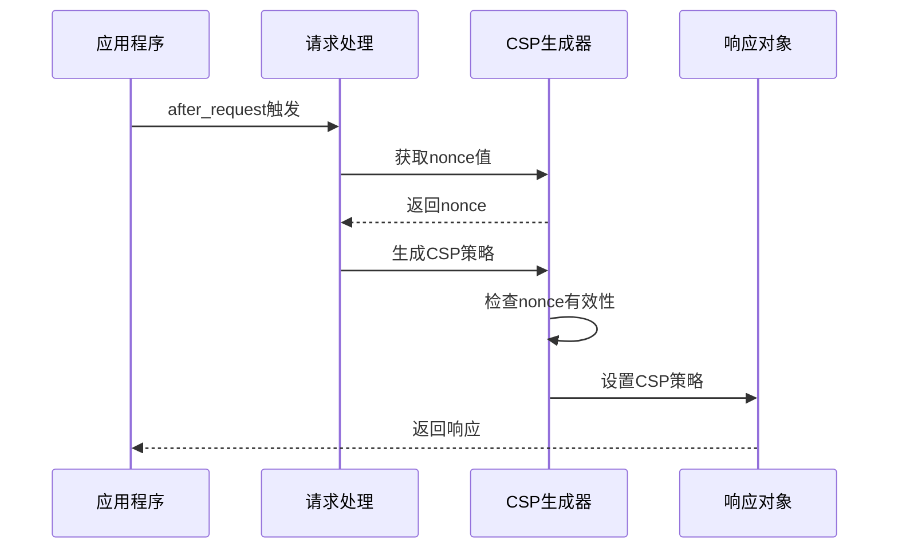
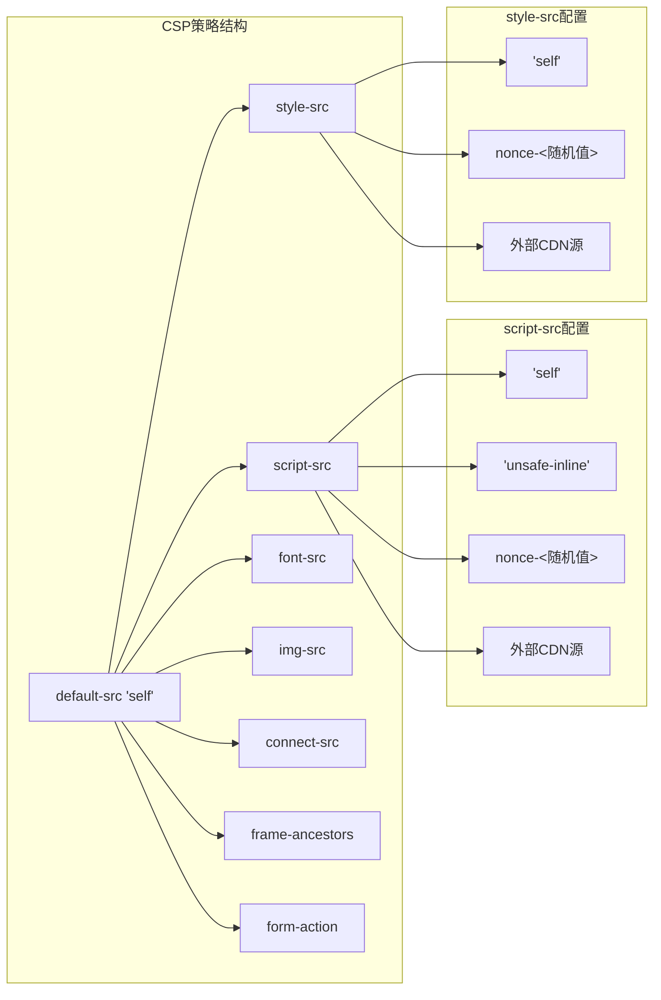
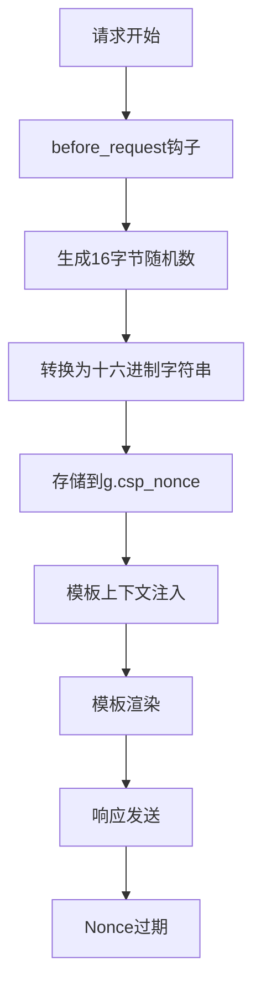
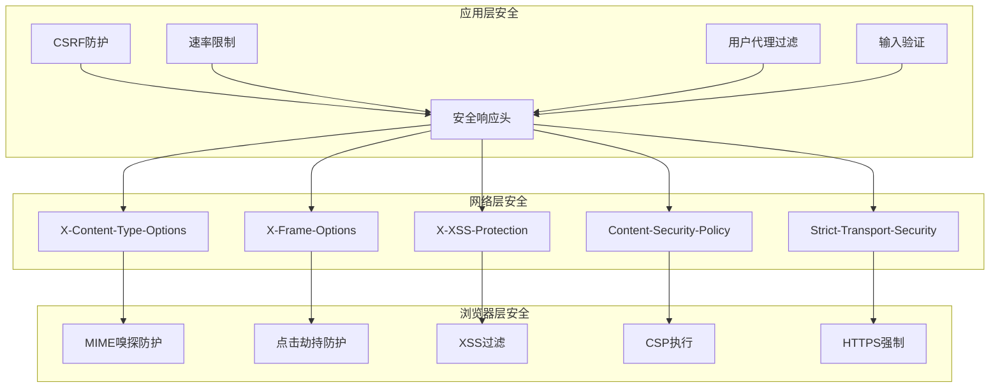
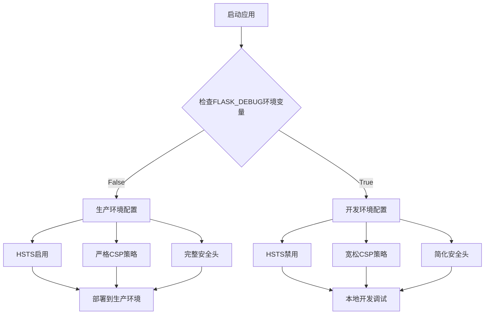

# 安全响应头配置

<cite>
**本文档引用的文件**
- [app.py](file://app.py)
- [安全措施清单.md](file://安全措施清单.md)
- [base.html](file://templates/base.html)
- [admin_dashboard.html](file://templates/admin_dashboard.html)
- [dashboard.html](file://templates/dashboard.html)
</cite>

## 目录
1. [简介](#简介)
2. [项目结构概览](#项目结构概览)
3. [核心安全响应头详解](#核心安全响应头详解)
4. [add_security_headers函数实现分析](#add-security-headers函数实现分析)
5. [CSP策略配置深度解析](#csp策略配置深度解析)
6. [安全响应头协同工作机制](#安全响应头协同工作机制)
7. [最佳实践与配置建议](#最佳实践与配置建议)
8. [性能考虑](#性能考虑)
9. [故障排除指南](#故障排除指南)
10. [总结](#总结)

## 简介

School_Web是一个综合性的Web应用程序，集成了多种功能模块，包括用户认证、相册管理、聊天系统、学习工具等。该项目在安全性方面采用了多层次的防护策略，其中安全响应头配置是其安全架构的重要组成部分。

本文档深入分析School_Web中的安全响应头配置，重点解释X-Content-Type-Options、X-Frame-Options、X-XSS-Protection、Content-Security-Policy、Strict-Transport-Security等关键安全响应头的作用和安全价值，并详细说明`add_security_headers`函数的实现机制。

## 项目结构概览

School_Web采用Flask框架构建，整体项目结构如下：

**图表来源**
- [app.py:641-676](file://app.py#L641-L676)
- [app.py:133-139](file://app.py#L133-L139)

**章节来源**
- [app.py:1-120](file://app.py#L1-L120)

## 核心安全响应头详解

### X-Content-Type-Options: nosniff

**作用机制**：
- 禁止浏览器进行MIME类型嗅探
- 强制按照Content-Type头部指定的类型处理响应内容
- 防止攻击者通过上传恶意文件伪装成合法类型来绕过安全检查

**安全价值**：
- 防止混合内容攻击
- 确保静态资源按预期方式加载
- 减少因类型猜测导致的安全漏洞

### X-Frame-Options: SAMEORIGIN

**作用机制**：
- 限制页面只能在同源框架中嵌入
- 防止点击劫持攻击
- 保护用户免受UI欺骗攻击

**安全价值**：
- 防止网站被其他站点iframe嵌套
- 保护用户交互不被恶意篡改
- 维护网站的完整性

### X-XSS-Protection: 1; mode=block

**作用机制**：
- 启用浏览器内置的XSS过滤器
- 当检测到XSS攻击时，阻止页面渲染
- 提供第二道防线

**注意**：
- 现代浏览器已基本弃用此头
- 但仍可作为兼容性保护

### Content-Security-Policy (CSP)

**作用机制**：
- 定义允许加载资源的来源
- 控制内联脚本和样式执行
- 防止跨站脚本攻击

**安全价值**：
- 防止XSS攻击
- 限制攻击面
- 提供细粒度的资源控制

### Strict-Transport-Security (HSTS)

**作用机制**：
- 强制使用HTTPS连接
- 防止协议降级攻击
- 自动重定向HTTP到HTTPS

**安全价值**：
- 保护用户免受中间人攻击
- 确保数据传输加密
- 防止会话劫持

**章节来源**
- [安全措施清单.md:47-51](file://安全措施清单.md#L47-L51)
- [app.py:644-646](file://app.py#L644-L646)

## add_security_headers函数实现分析

### 函数架构

`add_security_headers`函数是School_Web安全响应头配置的核心实现，位于应用的`after_request`钩子中：

**图表来源**
- [app.py:642-676](file://app.py#L642-L676)

### 关键实现细节

#### 1. 响应头设置流程

函数严格按照以下顺序设置安全响应头：

1. **MIME嗅探防护** (`X-Content-Type-Options: nosniff`)
2. **点击劫持防护** (`X-Frame-Options: SAMEORIGIN`)
3. **XSS过滤器** (`X-XSS-Protection: 1; mode=block`)
4. **引用策略** (`Referrer-Policy: strict-origin-when-cross-origin`)
5. **CSP策略** (条件性设置)
6. **服务器信息隐藏** (移除Server头)
7. **敏感页面缓存控制** (针对HTML内容)
8. **HSTS设置** (仅生产环境)
9. **权限策略** (`Permissions-Policy: camera=(), microphone=(), geolocation=()`)

#### 2. CSP策略生成逻辑

CSP策略的生成遵循以下规则：

**图表来源**
- [app.py:648-664](file://app.py#L648-L664)

#### 3. 环境特定配置

函数实现了智能的环境检测机制：

- **生产环境**：启用HSTS和严格的安全策略
- **开发环境**：禁用HSTS，便于本地开发调试
- **动态配置**：通过环境变量`FLASK_DEBUG`控制行为

**章节来源**
- [app.py:642-676](file://app.py#L642-L676)

## CSP策略配置深度解析

### CSP策略构成

School_Web的CSP策略采用"每请求生成nonce"的动态策略，确保每次请求都有唯一的执行上下文：

**图表来源**
- [app.py:653-664](file://app.py#L653-L664)

### Nonce机制实现

Nonce（一次性令牌）是CSP策略的核心安全特性：

#### 1. Nonce生成流程

**图表来源**
- [app.py:158-161](file://app.py#L158-L161)
- [app.py:175-178](file://app.py#L175-L178)

#### 2. Nonce在模板中的使用

所有内联JavaScript和CSS都必须包含对应的nonce属性：

- **内联样式**：`<style nonce="{{ csp_nonce }}">`
- **内联脚本**：`<script nonce="{{ csp_nonce }}">`
- **动态生成的内容**：通过模板上下文传递nonce值

#### 3. 外部资源源控制

CSP策略严格限制外部资源来源：

- **脚本源**：`'self' 'unsafe-inline'` + `nonce-<随机值>` + 特定CDN
- **样式源**：`'self'` + `nonce-<随机值>` + 特定CDN
- **字体源**：`'self'` + 特定CDN
- **图片源**：`'self' data: blob:`
- **连接源**：`'self'` + 特定API域名

**章节来源**
- [app.py:653-664](file://app.py#L653-L664)
- [base.html:8](file://templates/base.html#L8)
- [base.html:233](file://templates/base.html#L233)

## 安全响应头协同工作机制

### 多层次安全防护体系

School_Web的安全响应头并非孤立存在，而是与应用的其他安全措施形成协同效应：

### 安全响应头之间的依赖关系

1. **基础防护层**：X-Content-Type-Options、X-Frame-Options提供基础防护
2. **高级防护层**：Content-Security-Policy提供细粒度控制
3. **传输安全层**：Strict-Transport-Security确保加密传输
4. **策略协调层**：各响应头相互配合，形成完整的安全策略

### 动态配置与环境适配

系统根据运行环境动态调整安全策略：

**图表来源**
- [app.py:673-674](file://app.py#L673-L674)

**章节来源**
- [app.py:642-676](file://app.py#L642-L676)

## 最佳实践与配置建议

### 安全响应头配置最佳实践

#### 1. CSP策略优化建议

**当前实现优势**：
- 使用每请求生成的nonce，提供强隔离性
- 保留`'unsafe-inline'`以兼容现有代码，但计划逐步迁移
- 严格的外部资源来源控制

**改进建议**：
- **逐步移除`'unsafe-inline'`**：为所有内联脚本和样式添加nonce
- **添加SRI完整性校验**：为CDN资源添加Subresource Integrity
- **细化资源来源**：根据实际需求进一步收紧CSP规则

#### 2. HSTS配置优化

**当前实现**：
- 使用标准的HSTS配置：`max-age=31536000; includeSubDomains`
- 仅在生产环境启用

**建议改进**：
- **添加preload支持**：考虑添加`preload`参数
- **设置HSTS预加载列表**：对于生产环境可考虑提交到HSTS预加载列表

#### 3. 缓存控制策略

**当前实现**：
- 对HTML内容禁用缓存
- 对静态资源设置合理的缓存策略

**建议优化**：
- **区分缓存策略**：静态资源使用长期缓存，动态内容禁用缓存
- **ETag支持**：为静态资源添加ETag支持

### 配置建议清单

#### 短期改进（1-2周）

1. **CSP策略完善**
   - 为所有内联脚本添加nonce属性
   - 为所有内联样式添加nonce属性
   - 移除`'unsafe-inline'`依赖

2. **CDN资源安全**
   - 为外部CDN资源添加SRI完整性校验
   - 建立CDN资源监控机制

#### 中期改进（1-3个月）

1. **Cookie安全强化**
   - 为会话Cookie添加`Secure`标记
   - 实现HTTPS强制重定向

2. **权限策略细化**
   - 根据功能需求细化Permissions-Policy
   - 添加更多隐私相关策略

#### 长期改进（3-6个月）

1. **安全审计自动化**
   - 建立安全响应头检查机制
   - 实现定期安全扫描

2. **零信任架构**
   - 实现更严格的访问控制
   - 添加多因素认证支持

**章节来源**
- [安全措施清单.md:76-91](file://安全措施清单.md#L76-L91)
- [安全措施清单.md:158-161](file://安全措施清单.md#L158-L161)

## 性能考虑

### 安全响应头对性能的影响

#### 1. Nonce生成开销

每请求生成nonce的操作开销极小：
- 16字节随机数生成
- 十六进制字符串转换
- 内存存储和模板注入

#### 2. CSP策略计算

CSP策略的生成和设置对性能影响可以忽略不计：
- 字符串拼接操作
- 环境变量检查
- 条件性响应头设置

#### 3. 缓存策略优化

当前的缓存控制策略经过精心设计：
- HTML内容禁用缓存，确保用户看到最新内容
- 静态资源使用浏览器缓存，减少带宽消耗
- 敏感页面的缓存控制防止信息泄露

### 性能监控建议

#### 1. 关键指标监控

- **响应头设置成功率**
- **CSP策略生成时间**
- **Nonce生成性能**
- **缓存命中率**

#### 2. 性能优化方向

- **批量Nonce生成**：在高并发场景下考虑Nonce池
- **CSP策略缓存**：对静态CSP策略进行缓存
- **条件性响应头**：根据内容类型动态选择响应头

## 故障排除指南

### 常见问题诊断

#### 1. CSP策略导致的功能异常

**症状**：
- 页面某些功能无法正常工作
- JavaScript执行失败
- 样式显示异常

**排查步骤**：
1. 检查浏览器开发者工具的Console和Network面板
2. 查看CSP违规报告
3. 验证nonce值是否正确传递
4. 确认外部资源URL是否在允许列表中

**解决方案**：
- 为内联脚本和样式添加正确的nonce属性
- 将必要的外部资源添加到CSP允许列表
- 逐步移除`'unsafe-inline'`依赖

#### 2. HSTS相关问题

**症状**：
- 开发环境中HTTPS连接失败
- 浏览器提示HSTS相关错误

**排查步骤**：
1. 检查`FLASK_DEBUG`环境变量设置
2. 验证HSTS响应头是否正确设置
3. 确认开发环境的HTTPS配置

**解决方案**：
- 在开发环境中禁用HSTS
- 确保生产环境正确配置HTTPS

#### 3. 缓存控制问题

**症状**：
- 页面内容更新不及时
- 静态资源版本更新失败

**排查步骤**：
1. 检查Cache-Control响应头设置
2. 验证Pragama和Expires头
3. 确认内容类型判断逻辑

**解决方案**：
- 确保HTML内容禁用缓存
- 为静态资源设置合适的缓存策略
- 实现资源版本化机制

### 调试工具推荐

#### 1. 浏览器开发者工具

- **Network面板**：查看响应头和CSP报告
- **Console面板**：查看CSP违规警告
- **Security面板**：检查HTTPS状态

#### 2. 在线检测工具

- **Security Headers**：检测响应头配置
- **CSP Evaluator**：评估CSP策略有效性
- **SSL Labs**：检查HTTPS配置

**章节来源**
- [安全措施清单.md:97-101](file://安全措施清单.md#L97-L101)

## 总结

School_Web的安全响应头配置展现了现代Web应用安全防护的先进理念。通过`add_security_headers`函数的精心设计，项目实现了多层次、动态化的安全防护体系。

### 核心成就

1. **完整的安全响应头覆盖**：实现了X-Content-Type-Options、X-Frame-Options、X-XSS-Protection、Content-Security-Policy、Strict-Transport-Security等关键安全头的配置

2. **智能化的环境适配**：根据运行环境动态调整安全策略，既保证了生产环境的安全性，又不影响开发调试体验

3. **创新的CSP实现**：采用每请求生成nonce的策略，提供了强大的XSS防护能力

4. **全面的安全措施集成**：安全响应头与其他安全措施形成协同效应，构建了完整的安全防护体系

### 未来发展方向

1. **逐步移除兼容性依赖**：完全移除`'unsafe-inline'`，实现真正的CSP合规

2. **增强CDN资源安全**：为外部资源添加SRI完整性校验

3. **完善安全监控**：建立自动化安全审计和监控机制

4. **持续优化性能**：在保证安全的前提下进一步优化性能表现

通过持续的安全改进和优化，School_Web的安全响应头配置将继续为用户提供可靠、安全的Web应用体验。