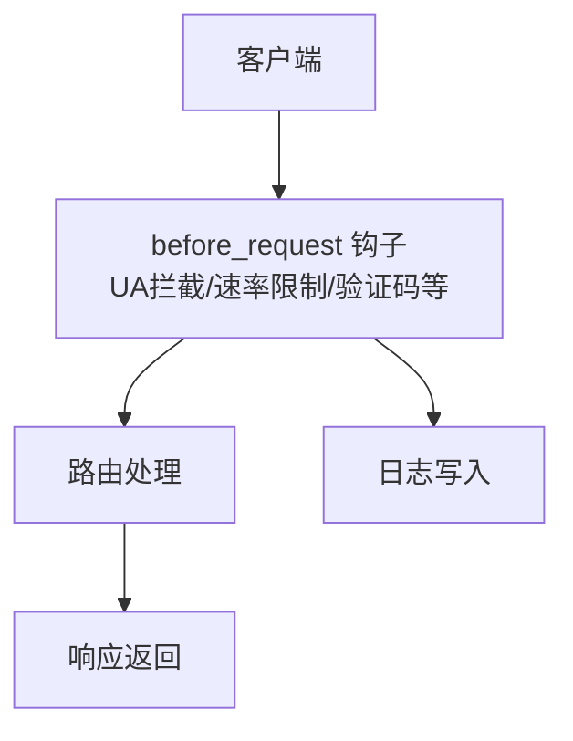
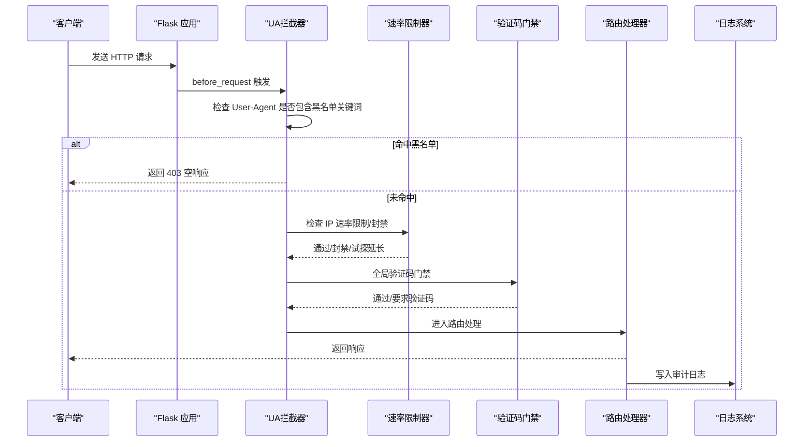
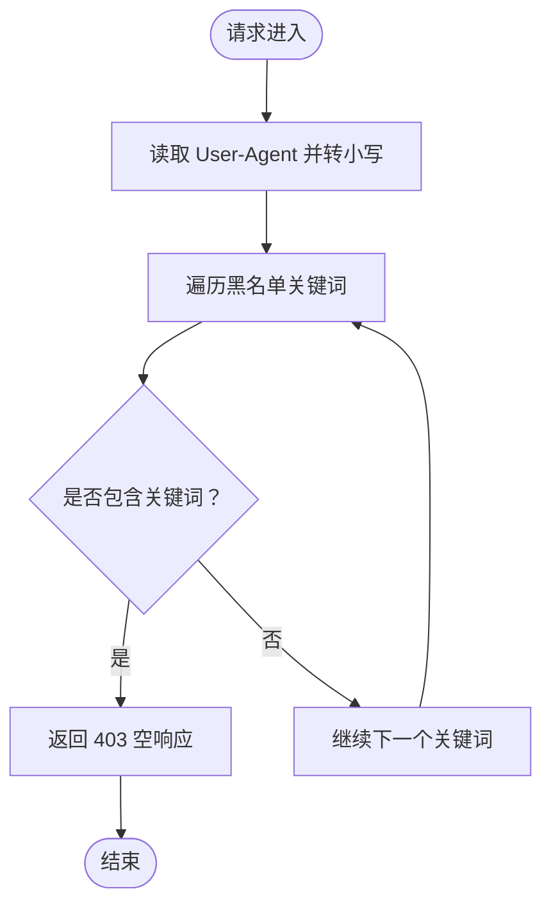
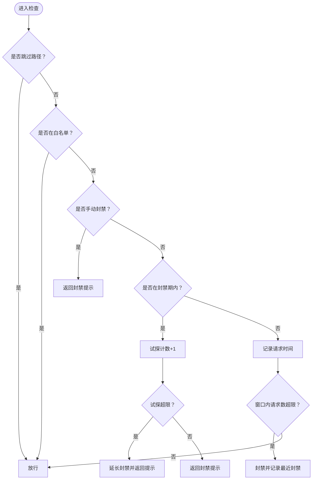
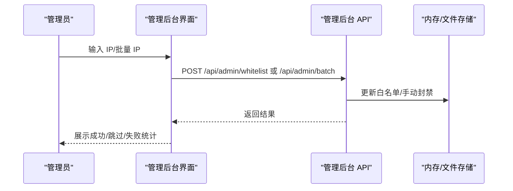
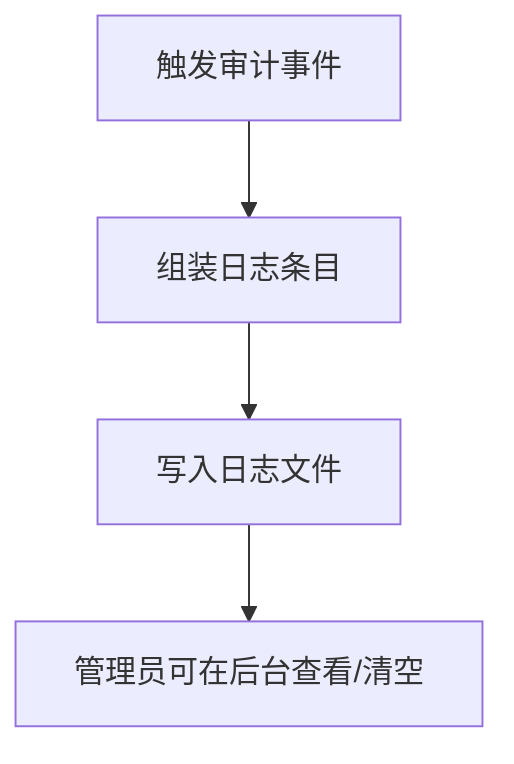
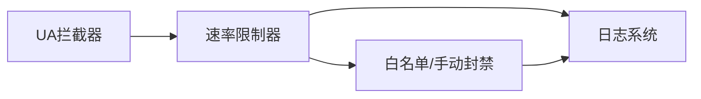

# 安全扫描器拦截

<cite>
**本文引用的文件**
- [app.py](file://app.py)
- [安全措施清单.md](file://安全措施清单.md)
- [admin_dashboard.html](file://templates/admin_dashboard.html)
- [logs.html](file://templates/logs.html)
</cite>

## 目录
1. [简介](#简介)
2. [项目结构与入口](#项目结构与入口)
3. [核心组件](#核心组件)
4. [架构总览](#架构总览)
5. [详细组件分析](#详细组件分析)
6. [依赖关系分析](#依赖关系分析)
7. [性能与可扩展性](#性能与可扩展性)
8. [故障排查指南](#故障排查指南)
9. [结论](#结论)

## 简介
本文档围绕 School_Web 的“安全扫描器拦截”机制进行系统化说明，重点涵盖：
- 常见 Web 安全扫描工具的特征与检测原理
- block_security_scanners 函数的实现细节（User-Agent 匹配、拦截策略、响应处理）
- 黑名单维护策略（静态黑名单、白名单、手动封禁、动态配置）
- 日志记录与告警机制
- 误拦截处理方案与运维建议

## 项目结构与入口
- 后端基于 Flask，核心逻辑集中在 app.py
- 安全拦截在请求进入路由处理前执行，属于全局中间层
- 管理后台提供白名单、手动封禁、速率限制配置等运维能力
- 日志通过统一写入函数输出至应用根目录日志文件

图表来源
- [app.py:149-156](file://app.py#L149-L156)
- [app.py:513-562](file://app.py#L513-L562)
- [app.py:886-896](file://app.py#L886-L896)

章节来源
- [app.py:149-156](file://app.py#L149-L156)
- [app.py:513-562](file://app.py#L513-L562)
- [app.py:886-896](file://app.py#L886-L896)

## 核心组件
- 安全扫描器拦截（UA 匹配）
  - 静态黑名单：包含常见扫描工具关键词
  - 拦截策略：命中即返回 403
- 速率限制与封禁
  - 基于内存的滑动窗口计数，支持白名单、手动封禁、试探延长
- 白名单与手动封禁
  - 管理后台提供白名单与手动封禁的增删改查
- 日志与审计
  - 统一写日志函数，支持清空与查看

章节来源
- [app.py:142-146](file://app.py#L142-L146)
- [app.py:149-156](file://app.py#L149-L156)
- [app.py:352-388](file://app.py#L352-L388)
- [app.py:513-562](file://app.py#L513-L562)
- [app.py:4154-4187](file://app.py#L4154-L4187)
- [app.py:4200-4255](file://app.py#L4200-L4255)
- [app.py:886-896](file://app.py#L886-L896)

## 架构总览
下图展示“安全扫描器拦截”在请求生命周期中的位置与交互。

图表来源
- [app.py:149-156](file://app.py#L149-L156)
- [app.py:513-562](file://app.py#L513-L562)
- [app.py:600-622](file://app.py#L600-L622)
- [app.py:886-896](file://app.py#L886-L896)

## 详细组件分析

### 安全扫描器拦截（UA 匹配）
- 黑名单定义
  - 静态列表包含常见扫描工具关键词，如 sqlmap、nikto、nessus、nmap、acunetix、burpsuite、dirbuster、openvas、hydra、amass、gobuster、wpscan、zgrab、masscan、whatweb、httprint、jaeles
- 匹配规则
  - 读取请求头中的 User-Agent 并转换为小写，逐项检查是否被包含
- 拦截策略
  - 一旦命中，立即返回 403 空响应，不进入后续处理
- 响应处理
  - 403 空响应，避免泄露具体原因

图表来源
- [app.py:142-146](file://app.py#L142-L146)
- [app.py:149-156](file://app.py#L149-L156)

章节来源
- [app.py:142-146](file://app.py#L142-L146)
- [app.py:149-156](file://app.py#L149-L156)

### 速率限制与封禁
- 配置项
  - RATE_LIMIT：窗口内最大请求数
  - RATE_WINDOW：时间窗口（秒）
  - BLOCK_DURATION：首次封禁时长（秒）
  - BLOCK_PROBE_LIMIT：封禁期间试探阈值
  - BLOCK_EXTEND：试探超限时追加封禁（秒）
- 状态存储
  - ip_requests：每个 IP 的请求时间队列
  - ip_blocked：封禁截止时间映射
  - ip_blocked_probes：封禁期间试探计数
  - ip_whitelist：白名单集合
  - ip_manual_blocked：手动封禁映射
- 逻辑流程
  - 跳过静态资源与分享链接
  - 白名单直接放行
  - 手动封禁立即拒绝
  - 检查封禁期：未到期则累计试探，超限追加封禁
  - 记录请求并统计窗口内数量，超限封禁
  - 写入最近封禁记录，供前端展示

图表来源
- [app.py:513-562](file://app.py#L513-L562)
- [app.py:352-388](file://app.py#L352-L388)

章节来源
- [app.py:352-388](file://app.py#L352-L388)
- [app.py:513-562](file://app.py#L513-L562)

### 白名单与手动封禁
- 白名单
  - 支持单个/批量添加与删除
  - 添加白名单会清除该 IP 的封禁状态与请求记录
  - 白名单持久化到文件
- 手动封禁
  - 支持指定时长（10 分钟到 24 小时）
  - 批量封禁，自动跳过白名单
  - 写入审计日志
- 管理后台
  - 提供可视化界面，支持刷新、批量操作、查看封禁统计

图表来源
- [app.py:4154-4187](file://app.py#L4154-L4187)
- [app.py:4200-4255](file://app.py#L4200-L4255)
- [admin_dashboard.html:106-679](file://templates/admin_dashboard.html#L106-L679)

章节来源
- [app.py:4154-4187](file://app.py#L4154-L4187)
- [app.py:4200-4255](file://app.py#L4200-L4255)
- [admin_dashboard.html:106-679](file://templates/admin_dashboard.html#L106-L679)

### 日志记录与审计
- 写日志函数
  - 统一格式：时间戳 + 动作 + 详情
  - 输出到应用根目录日志文件
- 日志查看与清空
  - 管理后台提供日志页与清空功能
- 审计范围
  - 登录/注册/封禁/白名单变更/速率配置修改等

图表来源
- [app.py:886-896](file://app.py#L886-L896)
- [app.py:4287-4312](file://app.py#L4287-L4312)
- [logs.html:1-19](file://templates/logs.html#L1-L19)

章节来源
- [app.py:886-896](file://app.py#L886-L896)
- [app.py:4287-4312](file://app.py#L4287-L4312)
- [logs.html:1-19](file://templates/logs.html#L1-L19)

### 误拦截处理方案
- 识别误拦截
  - 通过管理后台查看 IP 统计与封禁状态
  - 结合日志确认拦截原因
- 处理方式
  - 将误判的来源 IP 加入白名单
  - 对临时误判场景，采用短期手动封禁而非永久封禁
  - 动态调整速率限制配置，降低误封概率
- 预防措施
  - 定期审查黑名单，剔除误伤关键词
  - 优化 UA 匹配策略（如更精确的模式匹配）

章节来源
- [app.py:4154-4187](file://app.py#L4154-L4187)
- [app.py:4200-4255](file://app.py#L4200-L4255)
- [app.py:513-562](file://app.py#L513-L562)

## 依赖关系分析
- 组件耦合
  - UA 拦截器与速率限制器均位于 before_request 钩子，彼此独立但共享 IP 信息
  - 白名单/手动封禁与速率限制共享 IP 状态，互斥操作需注意顺序
- 外部依赖
  - 日志文件写入
  - IP 地理位置查询（用于可视化）
- 循环依赖
  - 未发现循环导入

图表来源
- [app.py:149-156](file://app.py#L149-L156)
- [app.py:513-562](file://app.py#L513-L562)
- [app.py:4154-4187](file://app.py#L4154-L4187)
- [app.py:4200-4255](file://app.py#L4200-L4255)
- [app.py:886-896](file://app.py#L886-L896)

章节来源
- [app.py:149-156](file://app.py#L149-L156)
- [app.py:513-562](file://app.py#L513-L562)
- [app.py:4154-4187](file://app.py#L4154-L4187)
- [app.py:4200-4255](file://app.py#L4200-L4255)
- [app.py:886-896](file://app.py#L886-L896)

## 性能与可扩展性
- 性能特性
  - UA 匹配为 O(n)（n 为黑名单长度），常数很小
  - 速率限制基于滑动窗口队列，均摊 O(1)，内存占用与并发请求数相关
- 可扩展性
  - 黑名单可按需扩展
  - 速率限制配置可通过管理后台动态调整
  - 日志文件可接入外部日志系统（需扩展写日志函数）

章节来源
- [app.py:142-146](file://app.py#L142-L146)
- [app.py:352-388](file://app.py#L352-L388)

## 故障排查指南
- 常见问题
  - 误拦截：将来源 IP 加入白名单或调整速率限制
  - 误封禁：检查手动封禁时长，必要时解除封禁
  - 日志缺失：确认日志文件路径与权限
- 排查步骤
  - 查看管理后台 IP 统计与封禁状态
  - 在日志页查看审计记录
  - 检查 UA 是否包含黑名单关键词
  - 调整速率限制配置以减少误封

章节来源
- [app.py:4154-4187](file://app.py#L4154-L4187)
- [app.py:4200-4255](file://app.py#L4200-L4255)
- [app.py:4287-4312](file://app.py#L4287-L4312)
- [admin_dashboard.html:106-679](file://templates/admin_dashboard.html#L106-L679)

## 结论
- School_Web 的安全扫描器拦截通过简单高效的 UA 关键词匹配实现，具备快速部署与低开销的特点
- 与速率限制、白名单/手动封禁、日志审计形成完整的安全闭环
- 建议持续维护黑名单、优化 UA 匹配策略、动态调整速率限制配置，以平衡安全性与可用性