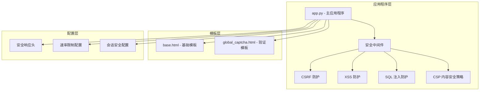
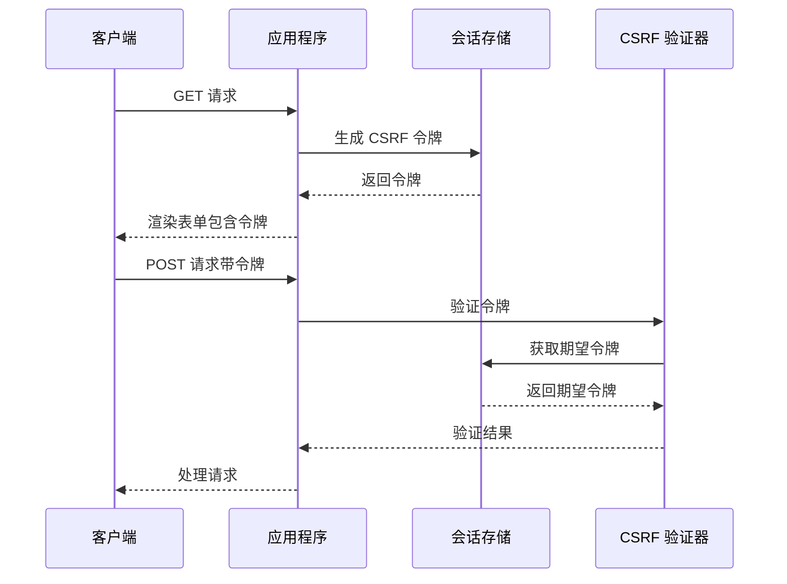
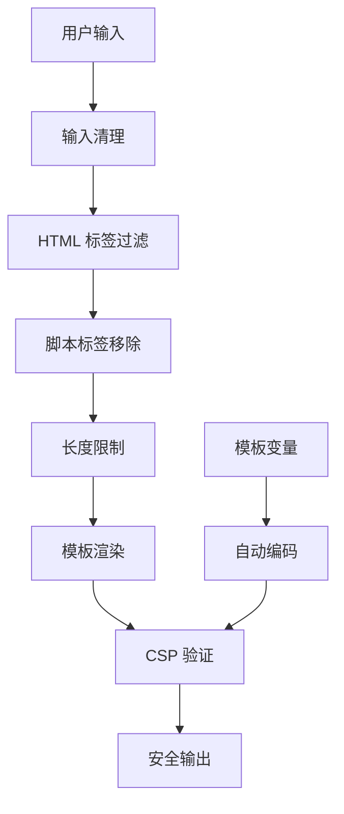
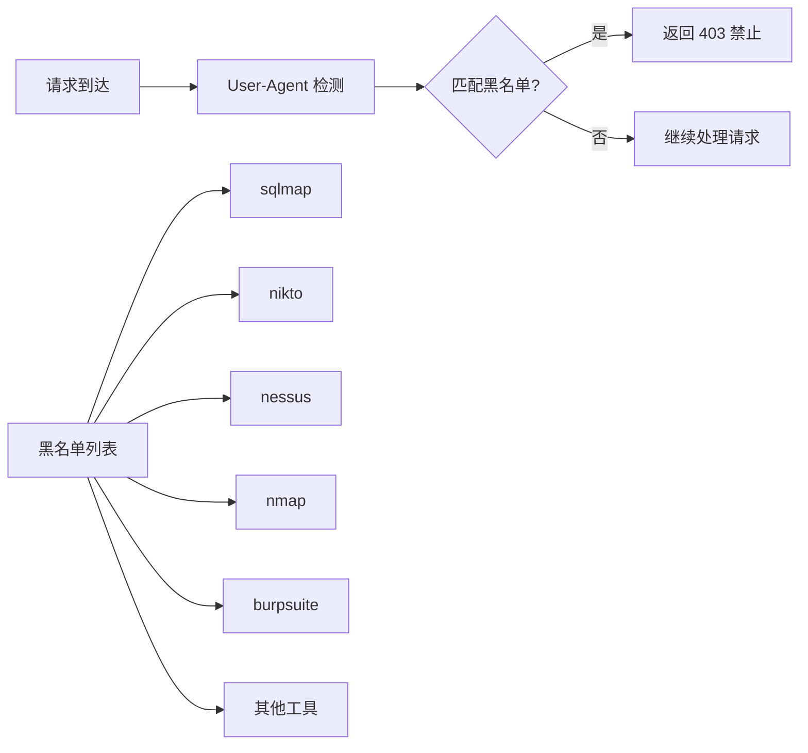
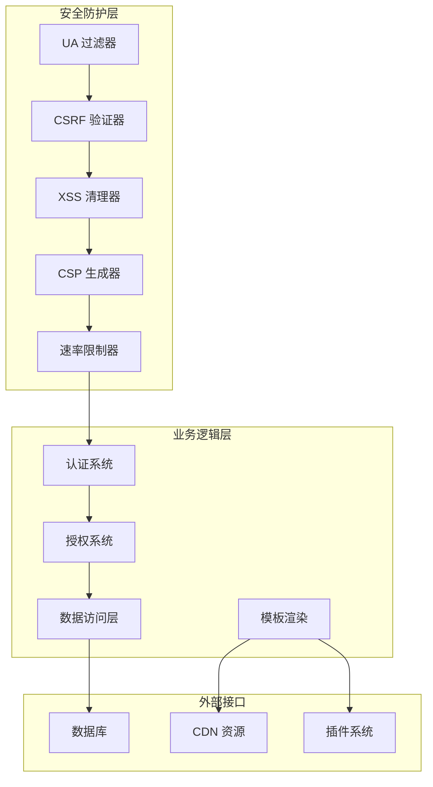
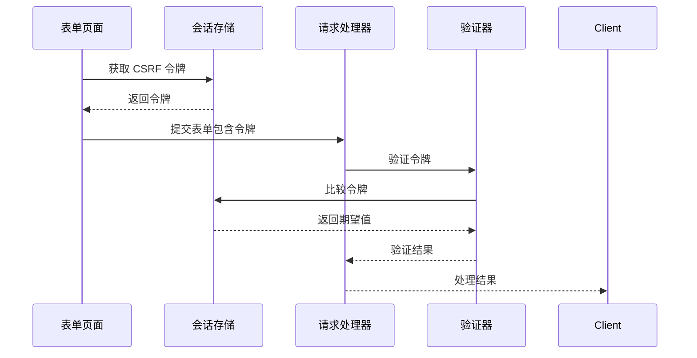
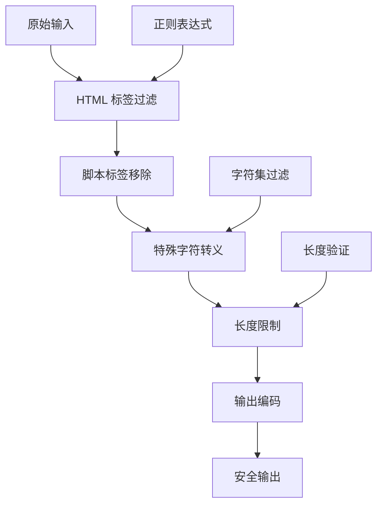
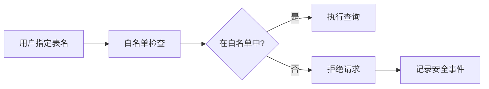
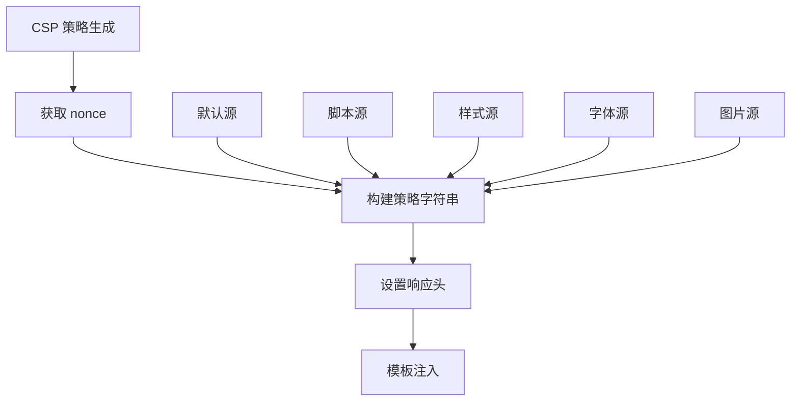
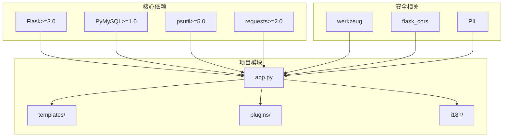

# 安全防护中间件

<cite>
**本文档引用的文件**
- [app.py](file://app.py)
- [安全措施清单.md](file://安全措施清单.md)
- [templates/base.html](file://templates/base.html)
- [templates/global_captcha.html](file://templates/global_captcha.html)
- [requirements.txt](file://requirements.txt)
</cite>

## 目录
1. [简介](#简介)
2. [项目结构](#项目结构)
3. [核心组件](#核心组件)
4. [架构概览](#架构概览)
5. [详细组件分析](#详细组件分析)
6. [依赖关系分析](#依赖关系分析)
7. [性能考虑](#性能考虑)
8. [故障排除指南](#故障排除指南)
9. [结论](#结论)

## 简介

School_Web 项目实现了全面的安全防护中间件，采用多层次的安全策略来保护应用程序免受各种网络攻击。本文档深入分析了项目中的安全机制，包括 CSRF 防护、XSS 防护、SQL 注入防护、安全扫描工具拦截、CSP 内容安全策略以及各种安全响应头的配置。

该项目采用了现代化的安全实践，结合了传统的安全防护技术和最新的安全标准，为 Web 应用程序提供了坚实的安全基础。

## 项目结构

School_Web 项目采用模块化的架构设计，安全防护功能主要集中在主应用程序文件中，通过 Flask 的中间件机制实现：

**图表来源**
- [app.py:149-162](file://app.py#L149-L162)
- [app.py:641-676](file://app.py#L641-L676)
- [templates/base.html:1-337](file://templates/base.html#L1-L337)

**章节来源**
- [app.py:119-139](file://app.py#L119-L139)
- [requirements.txt:1-5](file://requirements.txt#L1-5)

## 核心组件

### CSRF 防护机制

项目实现了完整的 CSRF（跨站请求伪造）防护机制，通过以下方式确保请求的安全性：

1. **会话令牌生成**：每个用户会话都会生成唯一的 CSRF 令牌
2. **令牌验证**：所有非 GET 请求都要求验证 CSRF 令牌
3. **双重验证**：支持表单字段和 HTTP 头两种验证方式

**图表来源**
- [app.py:1024-1026](file://app.py#L1024-L1026)
- [app.py:919-932](file://app.py#L919-L932)

### XSS 防护系统

项目采用了多层次的 XSS（跨站脚本攻击）防护策略：

1. **CSP 内容安全策略**：通过 nonce 机制严格控制脚本执行
2. **输入清理**：对用户输入进行 HTML 标签和脚本标签的清理
3. **输出编码**：在模板渲染时自动进行适当的输出编码

**图表来源**
- [app.py:870-880](file://app.py#L870-L880)
- [app.py:649-650](file://app.py#L649-L650)

### SQL 注入防护

项目实现了严格的 SQL 注入防护机制：

1. **参数化查询**：所有数据库操作都使用参数化查询
2. **表名白名单验证**：动态表名通过白名单验证
3. **输入验证**：对所有用户输入进行严格的类型和格式验证

**章节来源**
- [app.py:2347-2348](file://app.py#L2347-L2348)
- [app.py:2381-2386](file://app.py#L2381-L2386)
- [app.py:2421-2424](file://app.py#L2421-L2424)

### 安全扫描工具拦截

项目实现了智能的安全扫描工具拦截机制：

**图表来源**
- [app.py:142-146](file://app.py#L142-L146)
- [app.py:150-155](file://app.py#L150-L155)

**章节来源**
- [app.py:141-156](file://app.py#L141-L156)

### CSP 内容安全策略

项目实现了强大的 CSP（内容安全策略）机制：

1. **nonce 生成**：每个请求生成唯一的随机数
2. **动态策略**：根据 nonce 动态生成 CSP 策略
3. **模板集成**：在模板中自动注入 CSP 配置

**章节来源**
- [app.py:158-161](file://app.py#L158-L161)
- [app.py:648-664](file://app.py#L648-L664)
- [templates/base.html:8](file://templates/base.html#L8)
- [templates/base.html:233](file://templates/base.html#L233)

## 架构概览

**图表来源**
- [app.py:149-156](file://app.py#L149-L156)
- [app.py:919-932](file://app.py#L919-L932)
- [app.py:641-676](file://app.py#L641-L676)

## 详细组件分析

### CSRF 防护组件

CSRF 防护是项目安全体系的核心组件之一，通过以下机制确保请求的真实性：

#### 令牌生成机制
- 使用加密安全的随机数生成器生成 CSRF 令牌
- 令牌与用户会话绑定，确保唯一性和时效性
- 支持会话刷新，防止令牌泄露导致的长期风险

#### 令牌验证流程

**图表来源**
- [app.py:919-932](file://app.py#L919-L932)
- [app.py:1024-1026](file://app.py#L1024-L1026)

#### 支持的验证方式
- **表单字段验证**：通过隐藏字段 `_csrf_token` 进行验证
- **HTTP 头验证**：通过 `X-CSRF-Token` 头进行验证
- **会话验证**：基于用户会话的令牌存储和比较

**章节来源**
- [app.py:925-931](file://app.py#L925-L931)

### XSS 防护组件

XSS 防护采用了多层次的防护策略：

#### 输入清理机制

**图表来源**
- [app.py:870-880](file://app.py#L870-L880)

#### 输出安全机制
- **模板自动编码**：所有模板变量自动进行 HTML 编码
- **CSP 严格控制**：通过 nonce 机制确保只有预期的脚本可以执行
- **动态策略生成**：根据请求上下文动态生成 CSP 策略

**章节来源**
- [app.py:870-880](file://app.py#L870-L880)
- [templates/base.html:8](file://templates/base.html#L8)
- [templates/base.html:233](file://templates/base.html#L233)

### SQL 注入防护组件

SQL 注入防护是数据库层安全的关键保障：

#### 参数化查询实现
- **预编译语句**：所有数据库操作使用预编译语句
- **参数绑定**：用户输入通过参数绑定传递，避免 SQL 拼接
- **类型安全**：严格的类型检查和转换

#### 表名白名单验证

**图表来源**
- [app.py:2347-2348](file://app.py#L2347-L2348)
- [app.py:2381-2386](file://app.py#L2381-L2386)

**章节来源**
- [app.py:2347-2348](file://app.py#L2347-L2348)
- [app.py:2421-2424](file://app.py#L2421-L2424)

### 安全扫描工具拦截组件

安全扫描工具拦截机制通过智能 UA 匹配实现：

#### 黑名单管理
- **动态更新**：支持运行时更新黑名单列表
- **精确匹配**：使用包含匹配而非正则表达式，提高性能
- **大小写不敏感**：统一转换为小写进行匹配

#### 拦截策略
- **即时阻断**：发现匹配立即返回 403 状态码
- **静默处理**：不暴露具体的拦截原因
- **日志记录**：记录拦截事件用于审计

**章节来源**
- [app.py:142-146](file://app.py#L142-L146)
- [app.py:150-155](file://app.py#L150-L155)

### CSP 内容安全策略组件

CSP 实现了严格的脚本执行控制：

#### Nonce 生成机制
- **加密安全**：使用 `os.urandom()` 生成加密安全的随机数
- **请求级唯一**：每个请求生成不同的 nonce
- **自动注入**：通过上下文处理器自动注入到模板

#### 策略配置

**图表来源**
- [app.py:158-161](file://app.py#L158-L161)
- [app.py:648-664](file://app.py#L648-L664)

**章节来源**
- [app.py:648-664](file://app.py#L648-L664)
- [templates/base.html:8](file://templates/base.html#L8)
- [templates/base.html:233](file://templates/base.html#L233)

### 安全响应头组件

安全响应头提供了额外的浏览器安全保护：

#### 头部配置
- **X-Content-Type-Options**: 防止 MIME 类型嗅探
- **X-Frame-Options**: 防止点击劫持
- **X-XSS-Protection**: XSS 过滤器（向后兼容）
- **Referrer-Policy**: 控制引用策略
- **Permissions-Policy**: 管理浏览器权限

#### 动态配置
- **条件设置**：根据环境变量动态设置某些头部
- **模板集成**：与 CSP nonce 机制协同工作
- **版本隐藏**：隐藏服务器版本信息

**章节来源**
- [app.py:644-676](file://app.py#L644-L676)

## 依赖关系分析

**图表来源**
- [requirements.txt:1-5](file://requirements.txt#L1-L5)

**章节来源**
- [requirements.txt:1-5](file://requirements.txt#L1-L5)

## 性能考虑

### 安全开销评估

项目在安全性与性能之间取得了良好的平衡：

1. **内存缓存**：CSRF 令牌和会话数据存储在内存中
2. **快速匹配**：UA 过滤使用简单的字符串包含检查
3. **按需验证**：仅对非 GET 请求进行 CSRF 验证
4. **批量处理**：多个安全检查可以在单个中间件中完成

### 优化建议

1. **缓存策略**：考虑将 CSRF 令牌缓存到 Redis
2. **异步处理**：将安全日志记录异步化
3. **CDN 集成**：利用 CDN 缓存静态资源减少服务器负载
4. **监控指标**：添加安全相关的性能监控指标

## 故障排除指南

### 常见问题诊断

#### CSRF 验证失败
- **症状**：表单提交返回安全验证失败
- **原因**：CSRF 令牌缺失或过期
- **解决方案**：重新加载页面获取新的 CSRF 令牌

#### CSP 防护阻止脚本
- **症状**：页面脚本无法执行
- **原因**：脚本不在 CSP 允许列表中
- **解决方案**：检查 CSP 策略配置或使用模板中的 nonce

#### UA 被错误拦截
- **症状**：正常用户被 403 禁止
- **原因**：User-Agent 被误判为扫描工具
- **解决方案**：检查 UA 过滤规则或临时移除拦截

### 安全事件响应

#### 日志记录
- **访问日志**：记录所有安全相关事件
- **错误日志**：记录安全验证失败的原因
- **审计日志**：记录重要的安全操作

#### 监控告警
- **异常流量**：监控异常的请求模式
- **失败率**：监控安全验证的失败率
- **响应时间**：监控安全检查对性能的影响

**章节来源**
- [app.py:886-896](file://app.py#L886-L896)

## 结论

School_Web 项目的安全防护中间件展现了现代 Web 应用安全的最佳实践。通过多层次的安全策略，包括 CSRF 防护、XSS 防护、SQL 注入防护、安全扫描工具拦截和 CSP 内容安全策略，项目为用户提供了全面的安全保障。

### 主要优势

1. **综合性防护**：涵盖了常见的 Web 安全威胁
2. **现代化实现**：采用了最新的安全标准和实践
3. **性能优化**：在保证安全的前提下优化了性能
4. **易于维护**：模块化的架构便于维护和扩展

### 改进建议

1. **Cookie 安全**：添加 Secure 标记到会话 Cookie
2. **CDN 安全**：为外部 CDN 资源添加 SRI 完整性校验
3. **监控增强**：添加更详细的安全事件监控
4. **定期审计**：建立定期的安全审计和测试流程

该项目为其他 Web 应用程序的安全开发提供了优秀的参考模板，展示了如何在实际项目中实施全面的安全防护措施。