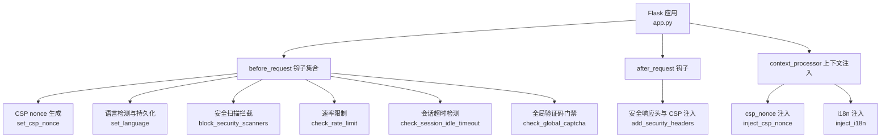
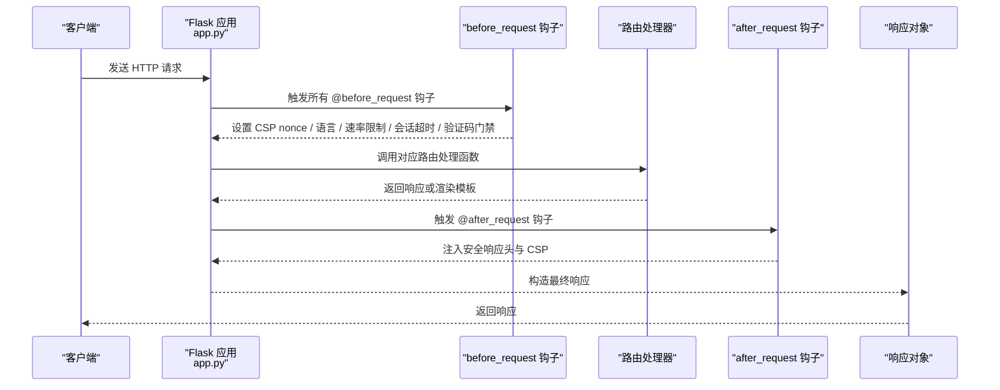
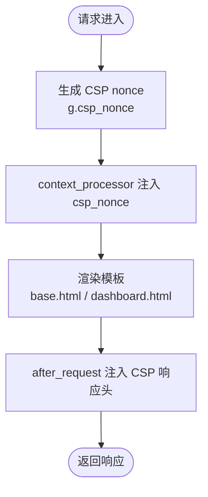
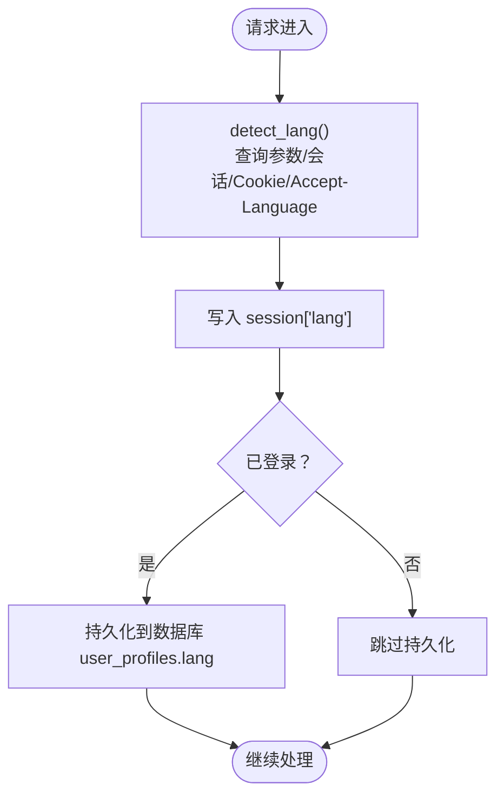
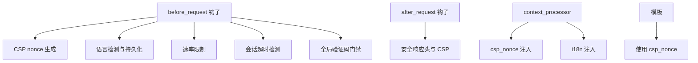

# 请求生命周期钩子

<cite>
**本文引用的文件**
- [app.py](file://app.py)
- [i18n/__init__.py](file://i18n/__init__.py)
- [templates/base.html](file://templates/base.html)
- [templates/dashboard.html](file://templates/dashboard.html)
- [plugins/__init__.py](file://plugins/__init__.py)
- [安全措施清单.md](file://安全措施清单.md)
</cite>

## 目录
1. [引言](#引言)
2. [项目结构](#项目结构)
3. [核心组件](#核心组件)
4. [架构总览](#架构总览)
5. [详细组件分析](#详细组件分析)
6. [依赖分析](#依赖分析)
7. [性能考虑](#性能考虑)
8. [故障排查指南](#故障排查指南)
9. [结论](#结论)
10. [附录](#附录)

## 引言
本文聚焦 School_Web 的请求生命周期钩子，系统梳理 Flask 的 before_request、after_request、teardown_request 等钩子在项目中的实现与应用，重点解释 set_csp_nonce、set_language 等钩子的执行顺序、作用范围与参数传递机制，并说明这些钩子如何影响请求处理流程、在中间件机制中的关键作用。同时提供调试技巧与性能优化建议。

## 项目结构
- 应用入口与钩子集中于 app.py，包含多个 @app.before_request、@app.after_request 钩子，以及上下文处理器注入 CSP nonce 与国际化信息。
- 国际化检测逻辑位于 i18n/__init__.py，提供 detect_lang 与语言资源加载。
- 模板 templates/base.html 与 templates/dashboard.html 使用注入的 csp_nonce，确保内联样式与脚本的安全执行。
- 插件系统 plugins/__init__.py 支持菜单与模板块注入，与钩子共同参与请求上下文构建。
- 安全措施清单.md 记录了 CSP 与安全响应头的演进与建议。

图表来源
- [app.py:149-178](file://app.py#L149-L178)
- [app.py:642-676](file://app.py#L642-L676)

章节来源
- [app.py:149-178](file://app.py#L149-L178)
- [app.py:642-676](file://app.py#L642-L676)

## 核心组件
- 请求前处理（before_request）
  - 安全扫描拦截：阻断常见安全扫描工具的 User-Agent。
  - CSP nonce 生成：为每个请求生成一次性随机值，用于 CSP nonce。
  - 语言检测与持久化：根据查询参数、会话、Cookie、Accept-Language 检测语言，并写入会话与数据库。
  - 速率限制：对非静态/分享路径进行 IP 级请求频率控制。
  - 会话超时检测：对已登录用户按 IP 记录最后活跃时间，超时则强制登出。
  - 全局验证码门禁：对未登录且未通过验证码验证的敏感路径进行二次验证。
- 响应后处理（after_request）
  - 安全响应头：统一设置 X-Content-Type-Options、X-Frame-Options、Referrer-Policy、Content-Security-Policy 等。
- 上下文处理器（context_processor）
  - 注入 CSP nonce 到模板上下文。
  - 注入翻译函数、语言信息、插件菜单与模板块等。

章节来源
- [app.py:149-178](file://app.py#L149-L178)
- [app.py:642-676](file://app.py#L642-L676)
- [i18n/__init__.py:70-108](file://i18n/__init__.py#L70-L108)

## 架构总览
下面的序列图展示了请求从进入 Flask 到返回客户端的关键步骤，以及钩子与上下文处理器的介入时机。

图表来源
- [app.py:149-178](file://app.py#L149-L178)
- [app.py:642-676](file://app.py#L642-L676)

## 详细组件分析

### 生命周期钩子执行顺序与作用范围
- 执行顺序
  - Flask 按注册顺序依次执行所有 @before_request 钩子，遇到返回值（如 403/重定向）即短路后续钩子与路由处理。
  - after_request 钩子在路由处理完成后、响应返回前执行，接收响应对象并可修改响应头与内容。
  - teardown_request 钩子在请求结束时执行，无论异常与否，常用于清理资源。
- 作用范围
  - before_request：影响后续路由处理与模板渲染，如 set_csp_nonce 为模板注入 nonce，set_language 影响翻译与界面语言。
  - after_request：统一注入安全响应头，避免个别路由遗漏。
  - context_processor：向所有模板注入通用上下文，如 csp_nonce 与 i18n。

章节来源
- [app.py:149-178](file://app.py#L149-L178)
- [app.py:642-676](file://app.py#L642-L676)

### set_csp_nonce 实现原理与模板注入
- 实现原理
  - 在每个请求进入时生成一次性随机值，存储于 g.csp_nonce，供模板与响应头使用。
  - 模板通过 {{ csp_nonce }} 注入到 <style nonce=...> 与 <script nonce=...>，确保内联资源仅在匹配 nonce 时可执行。
- 参数传递机制
  - 通过 Flask 的 g 对象在请求上下文中传递，after_request 读取 g.csp_nonce 并拼接至 Content-Security-Policy。
- 影响与安全收益
  - 防止 XSS：即使攻击者注入内联脚本，若无法预测 nonce 则无法执行。
  - 与模板协作：base.html 与 dashboard.html 等均使用 {{ csp_nonce }}，保证内联样式与脚本生效。

图表来源
- [app.py:158-161](file://app.py#L158-L161)
- [app.py:175-178](file://app.py#L175-L178)
- [app.py:642-676](file://app.py#L642-L676)
- [templates/base.html:8](file://templates/base.html#L8)
- [templates/base.html:233](file://templates/base.html#L233)
- [templates/base.html:269](file://templates/base.html#L269)
- [templates/dashboard.html:302](file://templates/dashboard.html#L302)

章节来源
- [app.py:158-161](file://app.py#L158-L161)
- [app.py:175-178](file://app.py#L175-L178)
- [app.py:642-676](file://app.py#L642-L676)
- [templates/base.html:8](file://templates/base.html#L8)
- [templates/base.html:233](file://templates/base.html#L233)
- [templates/base.html:269](file://templates/base.html#L269)
- [templates/dashboard.html:302](file://templates/dashboard.html#L302)

### set_language 实现原理与多语言检测机制
- 实现原理
  - detect_lang 依据以下优先级检测语言：查询参数 ?lang=、会话、Cookie、Accept-Language。
  - 将检测结果写入 session["lang"]，并在用户已登录时持久化到数据库字段 user_profiles.lang。
- 参数传递机制
  - 通过 session 与数据库实现跨请求的状态保持；after_request 注入 i18n 上下文，模板可直接使用 _() 与 lang_name() 等。
- 影响与用户体验
  - 保证界面语言与用户偏好一致；API 与模板均可正确翻译。

图表来源
- [i18n/__init__.py:70-108](file://i18n/__init__.py#L70-L108)
- [app.py:165-173](file://app.py#L165-L173)
- [app.py:197-211](file://app.py#L197-L211)

章节来源
- [i18n/__init__.py:70-108](file://i18n/__init__.py#L70-L108)
- [app.py:165-173](file://app.py#L165-L173)
- [app.py:197-211](file://app.py#L197-L211)

### 安全扫描拦截与响应头注入
- 安全扫描拦截
  - block_security_scanners 通过 User-Agent 列表过滤，命中即返回 403，阻止自动化扫描。
- 响应头注入
  - add_security_headers 统一设置多种安全响应头，包括 CSP（使用 g.csp_nonce），并按需设置 HSTS、缓存策略等。
- 与模板的协同
  - 模板通过 {{ csp_nonce }} 使用 nonce，确保内联资源合法执行。

章节来源
- [app.py:149-156](file://app.py#L149-L156)
- [app.py:642-676](file://app.py#L642-L676)
- [templates/base.html:8](file://templates/base.html#L8)
- [templates/base.html:233](file://templates/base.html#L233)
- [templates/base.html:269](file://templates/base.html#L269)
- [templates/dashboard.html:302](file://templates/dashboard.html#L302)

### 速率限制、会话超时与全局验证码门禁
- 速率限制
  - 对非静态/分享路径进行 IP 级请求频率控制，支持白名单、手动封禁、试探封禁延长等策略。
- 会话超时检测
  - 对已登录用户按 IP 记录最后活跃时间，超时则清除会话并重定向登录。
- 全局验证码门禁
  - 未登录用户访问敏感路径时，要求通过验证码验证，API 路径返回 403，页面渲染验证码模板。

章节来源
- [app.py:513-592](file://app.py#L513-L592)
- [app.py:599-622](file://app.py#L599-L622)

### 插件系统与钩子的协作
- 插件通过上下文处理器注入菜单与模板块，与钩子共同参与请求上下文构建。
- 模板中使用插件注入的块，形成可扩展的 UI 结构。

章节来源
- [plugins/__init__.py:143-184](file://plugins/__init__.py#L143-L184)
- [app.py:181-194](file://app.py#L181-L194)

## 依赖分析
- 钩子之间的耦合
  - set_csp_nonce 与 after_request 的 CSP 注入强相关，需保证 nonce 生成在响应头注入之前。
  - set_language 与数据库持久化存在条件写入，避免未登录用户产生无效写入。
- 模板依赖
  - base.html 与 dashboard.html 依赖 csp_nonce 注入，否则内联样式/脚本将被 CSP 拦截。
- 外部依赖
  - i18n 模块提供语言检测与翻译函数，影响模板渲染与 API 响应。

图表来源
- [app.py:149-178](file://app.py#L149-L178)
- [app.py:642-676](file://app.py#L642-L676)
- [i18n/__init__.py:70-108](file://i18n/__init__.py#L70-L108)
- [templates/base.html:8](file://templates/base.html#L8)
- [templates/dashboard.html:302](file://templates/dashboard.html#L302)

## 性能考虑
- CSP nonce 生成
  - 使用一次性随机值，开销极小；建议避免在高频静态资源上重复生成。
- 语言检测
  - 优先级判断为 O(1)，数据库写入仅在登录用户场景触发，影响有限。
- 速率限制
  - 内存队列与去抖保存策略降低 I/O 压力；建议结合 Redis 实现分布式共享。
- 响应头注入
  - after_request 仅修改响应头，成本低；注意避免重复设置 CSP 导致冲突。
- 模板渲染
  - 通过 context_processor 注入通用上下文，减少模板重复逻辑。

## 故障排查指南
- CSP 相关问题
  - 症状：内联样式/脚本被拦截。
  - 排查：确认模板中是否正确使用 {{ csp_nonce }}，after_request 是否注入 CSP，g.csp_nonce 是否存在。
- 语言切换无效
  - 症状：切换语言后界面未更新。
  - 排查：确认 /api/lang/switch 是否正确设置 Cookie 与 session，set_language 是否读取到 session["lang"]。
- 403 被拦截
  - 症状：请求被 403。
  - 排查：检查 block_security_scanners 的 User-Agent 列表，确认是否误伤。
- 速率限制误判
  - 症状：正常请求被封禁。
  - 排查：检查 ip_whitelist、manual_block、rate_config 配置，确认窗口与阈值设置。
- 会话超时频繁
  - 症状：频繁被强制登出。
  - 排查：确认 SESSION_IDLE_TIMEOUT 设置，检查 ip_last_active 更新逻辑。

章节来源
- [app.py:149-156](file://app.py#L149-L156)
- [app.py:513-592](file://app.py#L513-L592)
- [app.py:599-622](file://app.py#L599-L622)
- [app.py:642-676](file://app.py#L642-L676)
- [templates/base.html:8](file://templates/base.html#L8)
- [templates/dashboard.html:302](file://templates/dashboard.html#L302)

## 结论
School_Web 的请求生命周期钩子通过 before_request、after_request 与 context_processor 构建了统一的安全与国际化基础层。set_csp_nonce 与 set_language 是其中的关键环节，前者保障内联资源的执行安全，后者确保界面语言一致性。配合速率限制、会话超时与验证码门禁，形成了多层次的防护体系。建议在生产环境中进一步完善 CSP 的完整性校验与分布式速率限制，以提升安全性与稳定性。

## 附录
- 安全响应头与 CSP 的演进与建议参见安全措施清单。
- 模板中对 csp_nonce 的使用示例可参考 base.html 与 dashboard.html。

章节来源
- [安全措施清单.md:72-124](file://安全措施清单.md#L72-L124)
- [templates/base.html:8](file://templates/base.html#L8)
- [templates/base.html:233](file://templates/base.html#L233)
- [templates/base.html:269](file://templates/base.html#L269)
- [templates/dashboard.html:302](file://templates/dashboard.html#L302)