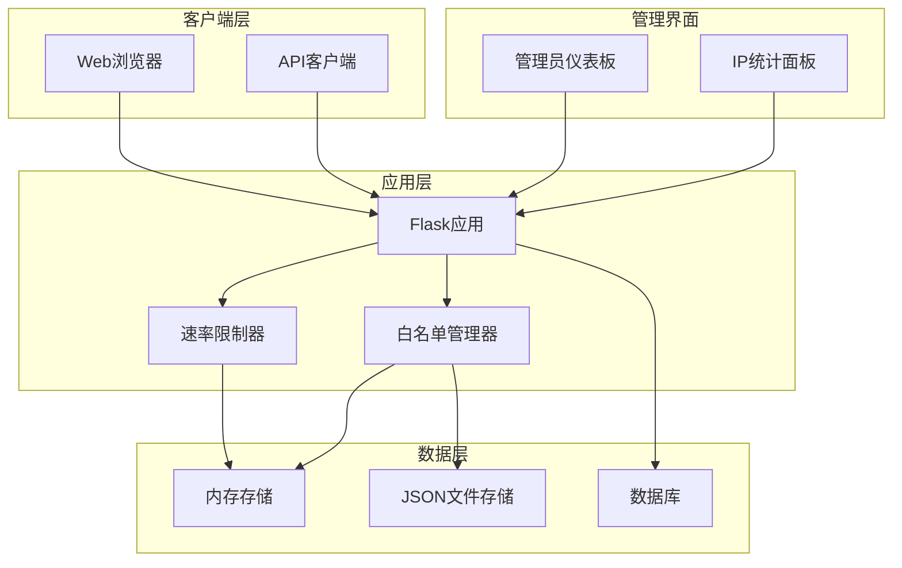
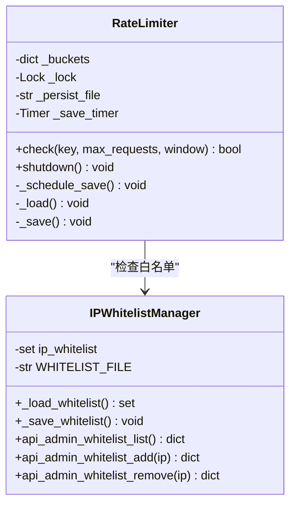
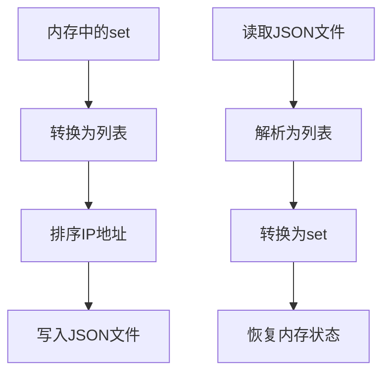
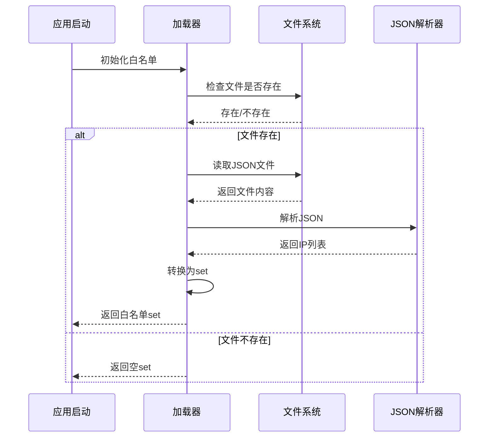
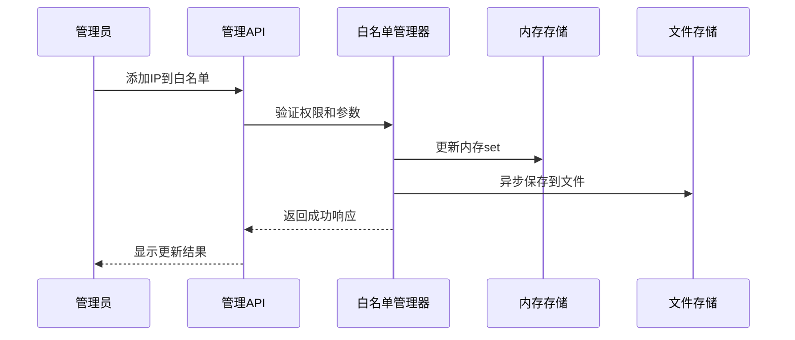
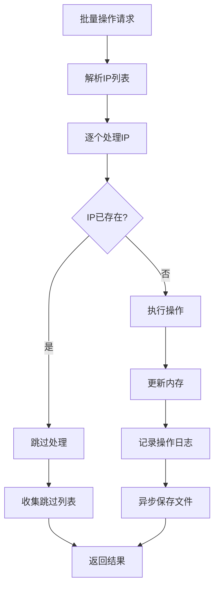
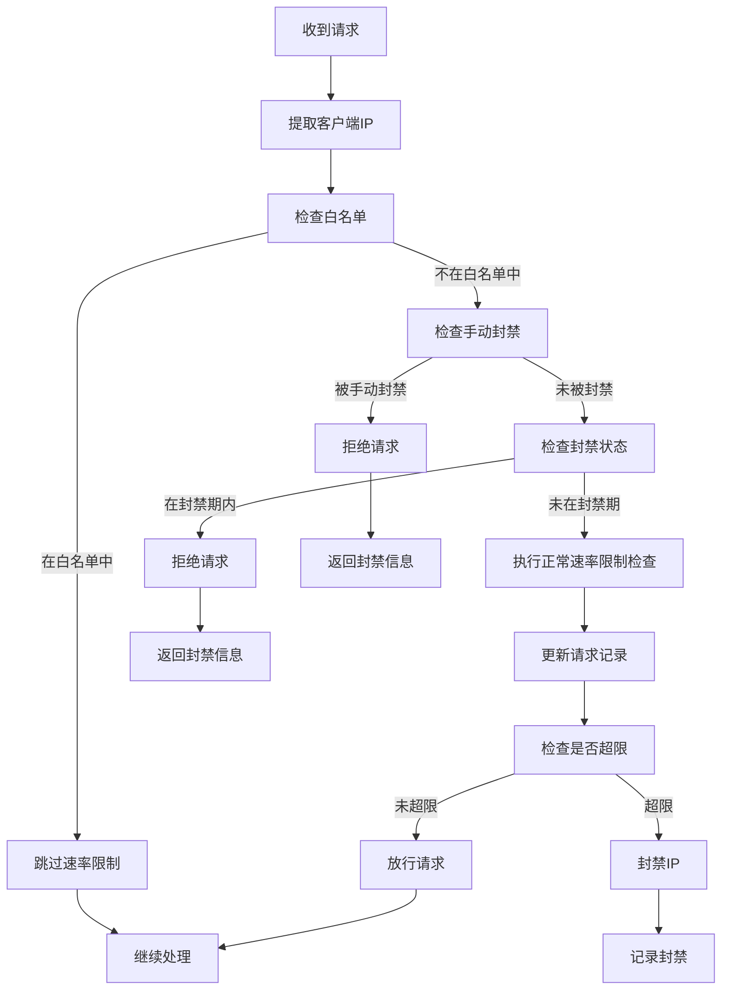
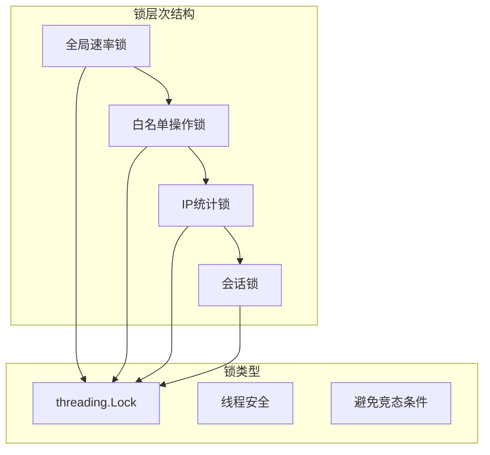

# IP白名单管理系统

<cite>
**本文档引用的文件**
- [app.py](file://app.py)
- [README.md](file://README.md)
- [admin_dashboard.html](file://templates/admin_dashboard.html)
- [rate_limiter.json](file://rate_limiter.json)
</cite>

## 目录
1. [项目概述](#项目概述)
2. [系统架构](#系统架构)
3. [核心组件](#核心组件)
4. [白名单数据结构](#白名单数据结构)
5. [持久化存储机制](#持久化存储机制)
6. [动态更新策略](#动态更新策略)
7. [速率限制检查流程](#速率限制检查流程)
8. [并发安全保护](#并发安全保护)
9. [最佳实践与安全考虑](#最佳实践与安全考虑)
10. [故障排查指南](#故障排查指南)
11. [总结](#总结)

## 项目概述

School_Web是一个基于Flask的多功能Web应用平台，集成了用户管理、系统监控、数据库操作、文件管理、网络工具、毕业相册等多种功能。本文档专注于其IP白名单管理系统，这是一个关键的安全防护组件，用于管理不受速率限制约束的IP地址列表。

## 系统架构



**图表来源**
- [app.py:348-412](file://app.py#L348-L412)
- [app.py:4145-4187](file://app.py#L4145-L4187)

## 核心组件

### 速率限制器（RateLimiter）

速率限制器是系统的核心安全组件，负责监控和控制请求频率：



**图表来源**
- [app.py:31-116](file://app.py#L31-L116)
- [app.py:394-412](file://app.py#L394-L412)

**章节来源**
- [app.py:31-116](file://app.py#L31-L116)
- [app.py:348-412](file://app.py#L348-L412)

## 白名单数据结构

### 内存数据结构

白名单在内存中使用Python的set数据结构存储，提供高效的查找性能：

```mermaid
graph LR
A[内存存储] --> B[set ip_whitelist]
B --> C[IP地址1]
B --> D[IP地址2]
B --> E[IP地址3]
B --> F[...]
subgraph "查找复杂度"
G[平均O(1)]
H[最坏O(n)]
end
```

**图表来源**
- [app.py:386](file://app.py#L386)

### 文件存储格式

白名单数据以JSON格式持久化存储，文件名为`ip_whitelist.json`：



**图表来源**
- [app.py:394-412](file://app.py#L394-L412)

**章节来源**
- [app.py:386](file://app.py#L386)
- [app.py:394-412](file://app.py#L394-L412)

## 持久化存储机制

### 文件位置与命名

白名单文件位于应用根目录，使用固定的文件名：
- 文件名：`ip_whitelist.json`
- 完整路径：`{应用根目录}/ip_whitelist.json`

### JSON文件格式

文件采用简单的数组格式存储IP地址列表：

```json
[
  "192.168.1.100",
  "10.0.0.1",
  "172.16.0.1"
]
```

### 加载流程



**图表来源**
- [app.py:394-402](file://app.py#L394-L402)

**章节来源**
- [app.py:394-402](file://app.py#L394-L402)

## 动态更新策略

### 实时更新机制

白名单支持实时动态更新，所有变更都会立即生效：



**图表来源**
- [app.py:4154-4172](file://app.py#L4154-L4172)

### 批量操作支持

系统支持批量添加和移除IP地址，提高管理效率：



**图表来源**
- [app.py:4210-4255](file://app.py#L4210-L4255)

**章节来源**
- [app.py:4154-4172](file://app.py#L4154-L4172)
- [app.py:4210-4255](file://app.py#L4210-L4255)

## 速率限制检查流程

### 检查优先级

白名单检查在整个速率限制流程中具有最高优先级：



**图表来源**
- [app.py:513-561](file://app.py#L513-L561)

### 速率限制参数

系统支持动态调整的速率限制参数：

| 参数名称 | 默认值 | 说明 |
|---------|--------|------|
| RATE_LIMIT | 40 | 时间窗口内的最大请求数 |
| RATE_WINDOW | 15 | 速率限制的时间窗口（秒） |
| BLOCK_DURATION | 240 | IP封禁时长（秒） |
| BLOCK_PROBE_LIMIT | 200 | 封禁期间试探阈值 |
| BLOCK_EXTEND | 300 | 试探超限时追加封禁时长（秒） |

**章节来源**
- [app.py:513-561](file://app.py#L513-L561)
- [app.py:352-358](file://app.py#L352-L358)

## 并发安全保护

### 锁机制设计

系统使用多层锁机制确保数据一致性：



**图表来源**
- [app.py:506](file://app.py#L506)
- [app.py:511](file://app.py#L511)

### 线程安全保证

1. **全局速率锁**：保护所有速率限制相关操作
2. **白名单操作锁**：确保白名单变更的一致性
3. **IP统计锁**：维护IP统计信息的准确性
4. **会话锁**：保护会话状态的完整性

**章节来源**
- [app.py:506](file://app.py#L506)
- [app.py:511](file://app.py#L511)

## 最佳实践与安全考虑

### 白名单管理最佳实践

1. **最小权限原则**：只授予必要的IP地址白名单权限
2. **定期审查**：定期审查和清理不再需要的白名单条目
3. **分层管理**：根据业务需求设置不同级别的白名单
4. **审计日志**：所有白名单变更都应记录详细的审计信息

### 安全考虑

1. **IP地址验证**：在添加IP到白名单前进行格式验证
2. **权限控制**：只有管理员才能进行白名单管理操作
3. **操作审计**：记录所有白名单相关的操作
4. **异常处理**：完善的异常处理机制防止系统崩溃

### 性能优化建议

1. **内存使用**：合理控制白名单规模，避免过多的IP地址
2. **文件I/O**：使用异步方式保存白名单文件，减少阻塞
3. **缓存策略**：利用内存缓存提高查询性能
4. **监控告警**：建立白名单使用情况的监控机制

**章节来源**
- [app.py:4154-4187](file://app.py#L4154-L4187)
- [README.md:729-772](file://README.md#L729-L772)

## 故障排查指南

### 常见问题诊断

#### 白名单文件损坏

**症状**：系统启动时报错，无法加载白名单

**解决方案**：
1. 检查`ip_whitelist.json`文件格式是否正确
2. 验证JSON语法的有效性
3. 如文件损坏，可以删除文件让系统重新创建

#### 权限问题

**症状**：管理员无法添加或移除白名单IP

**解决方案**：
1. 确认管理员账户权限
2. 检查文件系统的读写权限
3. 验证应用程序的运行权限

#### 性能问题

**症状**：白名单操作响应缓慢

**解决方案**：
1. 检查白名单规模是否过大
2. 优化文件I/O操作
3. 考虑使用更高效的存储方案

### 调试技巧

1. **启用调试模式**：设置`FLASK_DEBUG=1`获取更多调试信息
2. **查看日志**：检查应用日志了解具体错误信息
3. **单元测试**：编写测试用例验证白名单功能
4. **性能监控**：监控白名单操作的性能指标

**章节来源**
- [README.md:603-664](file://README.md#L603-L664)

## 总结

School_Web的IP白名单管理系统是一个设计精良的安全防护组件，具有以下特点：

1. **高效性**：使用set数据结构提供O(1)的查找性能
2. **持久化**：支持JSON文件的持久化存储
3. **实时性**：所有变更立即生效，无需重启服务
4. **安全性**：多层锁机制确保数据一致性
5. **可管理性**：提供完整的管理API和前端界面

该系统为School_Web提供了灵活而强大的IP地址管理能力，既满足了日常运营的需求，又确保了系统的安全性和稳定性。通过合理的配置和管理，可以有效提升系统的安全防护水平和用户体验。