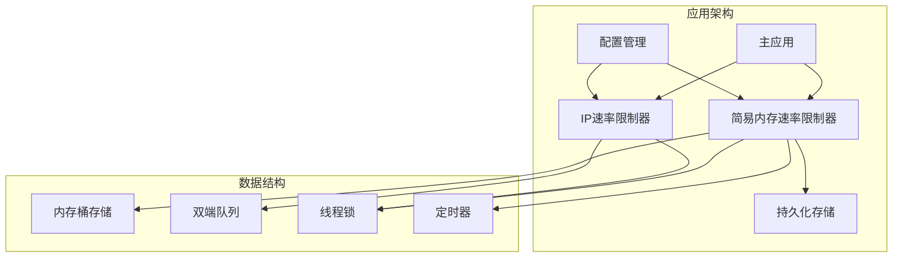
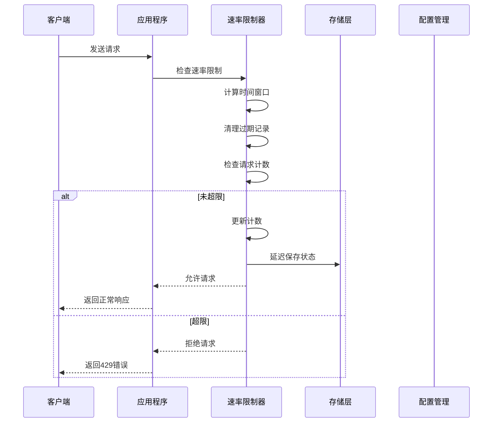
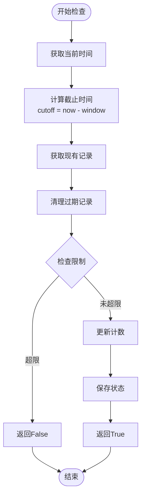
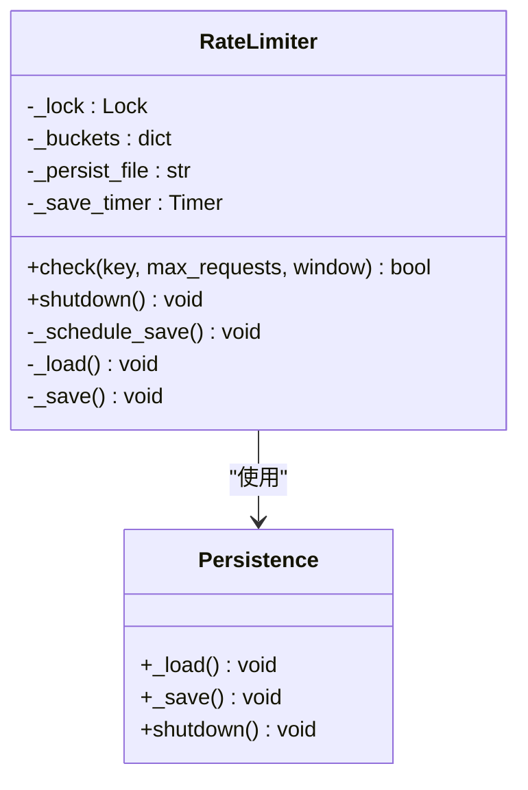
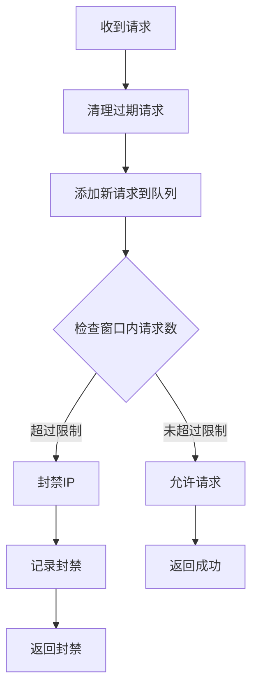
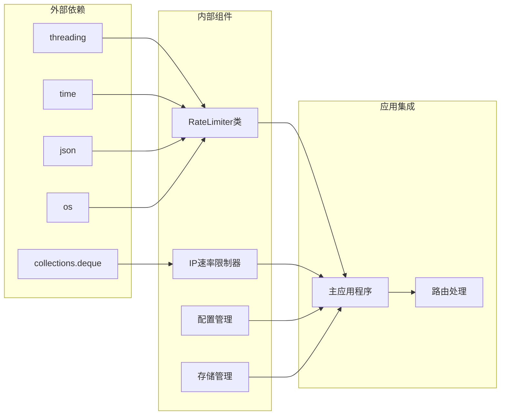

# 内存速率限制机制

<cite>
**本文档引用的文件**
- [app.py](file://app.py)
- [rate_limiter.json](file://rate_limiter.json)
</cite>

## 目录
1. [简介](#简介)
2. [项目结构](#项目结构)
3. [核心组件](#核心组件)
4. [架构概览](#架构概览)
5. [详细组件分析](#详细组件分析)
6. [依赖关系分析](#依赖关系分析)
7. [性能考虑](#性能考虑)
8. [故障排除指南](#故障排除指南)
9. [结论](#结论)

## 简介

School_Web项目实现了双重内存速率限制机制，旨在保护系统免受恶意请求和滥用攻击。该机制采用两种不同的实现方式：

1. **简易内存速率限制器**：基于内存存储的轻量级实现
2. **IP地址速率限制器**：基于滑动窗口算法的完整实现

这两种机制协同工作，为系统的不同场景提供灵活的流量控制能力。

## 项目结构

项目采用模块化设计，将速率限制功能集成在主应用文件中：



**图表来源**
- [app.py:31-116](file://app.py#L31-L116)
- [app.py:348-562](file://app.py#L348-L562)

**章节来源**
- [app.py:1-800](file://app.py#L1-L800)

## 核心组件

### RateLimiter类（简易内存速率限制器）

RateLimiter是一个轻量级的内存速率限制实现，具有以下特点：

- **内存存储结构**：使用字典存储请求计数
- **文件持久化**：支持将状态保存到JSON文件
- **线程安全**：使用锁机制保护并发访问
- **智能清理**：自动清理过期记录

### IP速率限制器（完整实现）

IP速率限制器提供了更复杂的滑动窗口算法：

- **滑动窗口算法**：基于时间窗口的精确计数
- **双端队列**：高效的请求时间戳管理
- **动态封禁**：超限自动封禁IP地址
- **白名单支持**：可配置的IP白名单机制

**章节来源**
- [app.py:31-116](file://app.py#L31-L116)
- [app.py:348-562](file://app.py#L348-L562)

## 架构概览



**图表来源**
- [app.py:43-57](file://app.py#L43-L57)
- [app.py:59-107](file://app.py#L59-L107)

## 详细组件分析

### RateLimiter类实现详解

#### 内存存储结构设计

RateLimiter使用字典作为主要存储结构：

```python
self._buckets = {}  # {(ip, route): [ts, ...]}
```

每个键值对代表一个特定IP和路由的请求历史记录，值为时间戳列表。

#### 时间窗口计算算法



**图表来源**
- [app.py:43-57](file://app.py#L43-L57)

#### 线程锁保护机制

```python
with self._lock:
    # 临界区代码
    pass
```

使用`threading.Lock()`确保多线程环境下的数据一致性。

#### 文件持久化策略



**图表来源**
- [app.py:31-116](file://app.py#L31-L116)

**章节来源**
- [app.py:31-116](file://app.py#L31-L116)

### IP速率限制器实现

#### 滑动窗口算法机制

IP速率限制器采用更精确的滑动窗口算法：



**图表来源**
- [app.py:514-562](file://app.py#L514-L562)

#### 双端队列的使用

```python
if ip not in ip_requests:
    ip_requests[ip] = deque()
q = ip_requests[ip]
```

使用`collections.deque`提供高效的两端操作能力。

#### 动态封禁机制

```python
if len(q) > rate_config["RATE_LIMIT"]:
    ip_blocked[ip] = now + rate_config["BLOCK_DURATION"]
    # 记录封禁信息
```

**章节来源**
- [app.py:348-562](file://app.py#L348-L562)

### 配置参数详解

#### 速率限制配置

| 参数名称 | 默认值 | 作用 | 调优建议 |
|---------|--------|------|----------|
| RATE_LIMIT | 40 | 时间窗口内的最大请求数 | 根据业务需求调整，建议10-100之间 |
| RATE_WINDOW | 10 | 时间窗口（秒） | 建议10-60秒，平衡响应速度和保护效果 |
| BLOCK_DURATION | 240 | 封禁时长（秒） | 建议120-600秒，避免误封 |
| BLOCK_PROBE_LIMIT | 50 | 封禁期间试探次数阈值 | 建议30-100次，防止暴力试探 |
| BLOCK_EXTEND | 240 | 试探超限后追加封禁（秒） | 建议120-300秒 |

#### 配置文件管理

```python
DEFAULT_RATE_CONFIG = {
    "RATE_LIMIT": 40,
    "RATE_WINDOW": 10,
    "BLOCK_DURATION": 240,
    "BLOCK_PROBE_LIMIT": 50,
    "BLOCK_EXTEND": 240,
}
```

**章节来源**
- [app.py:352-382](file://app.py#L352-L382)

## 依赖关系分析



**图表来源**
- [app.py:16-25](file://app.py#L16-L25)
- [app.py:31-116](file://app.py#L31-L116)

**章节来源**
- [app.py:1-800](file://app.py#L1-L800)

## 性能考虑

### 时间复杂度分析

1. **RateLimiter.check()**: O(n) - 其中n为窗口内的请求数
2. **IP速率限制器**: O(n) - 清理过期请求的时间复杂度
3. **内存使用**: O(k) - k为活跃IP的数量

### 优化策略

1. **延迟保存机制**：使用定时器合并多次保存操作
2. **智能清理**：定期清理过期记录，避免内存泄漏
3. **线程安全**：使用细粒度锁减少竞争条件

### 内存管理

```python
# 自动清理过期记录
hits = [t for t in hits if t > cutoff]
```

**章节来源**
- [app.py:49-50](file://app.py#L49-L50)

## 故障排除指南

### 常见问题诊断

1. **请求被意外拒绝**
   - 检查配置参数设置
   - 验证IP地址识别准确性
   - 查看日志文件了解拒绝原因

2. **内存使用异常增长**
   - 检查是否有大量活跃IP
   - 验证过期记录清理机制
   - 监控存储文件大小

3. **持久化功能失效**
   - 检查文件权限
   - 验证JSON格式正确性
   - 确认磁盘空间充足

### 调试技巧

```python
# 启用调试输出
print(f"  速率限制: 从文件加载了 {loaded} 条记录")
```

**章节来源**
- [app.py:89-90](file://app.py#L89-L90)

## 结论

School_Web项目的内存速率限制机制提供了多层次的流量控制能力：

1. **灵活性**：支持多种配置参数，适应不同场景需求
2. **可靠性**：具备文件持久化和自动清理机制
3. **性能**：采用高效的双端队列和延迟保存策略
4. **安全性**：提供IP封禁和白名单等高级功能

该机制为School_Web系统提供了坚实的流量保护基础，能够有效防止恶意请求和滥用行为，同时保持系统的响应性和可用性。