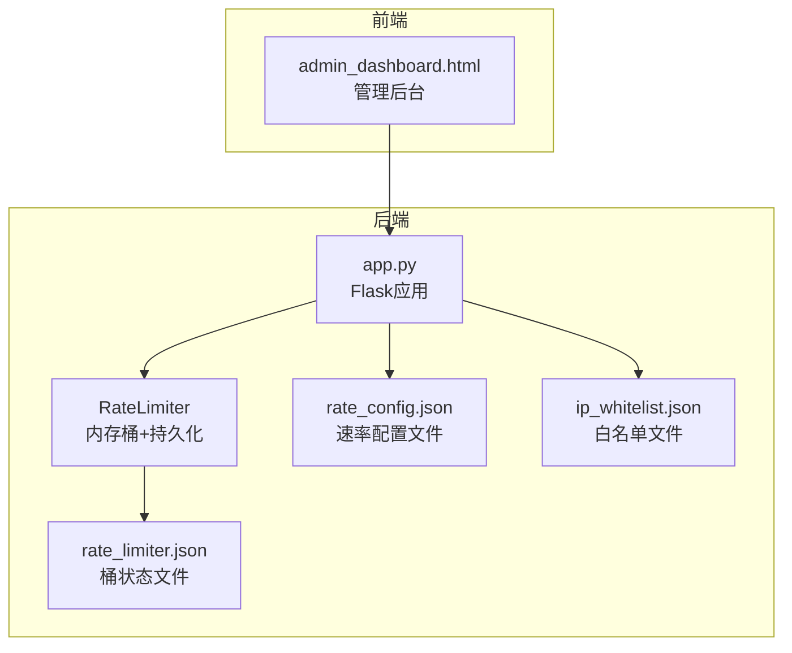
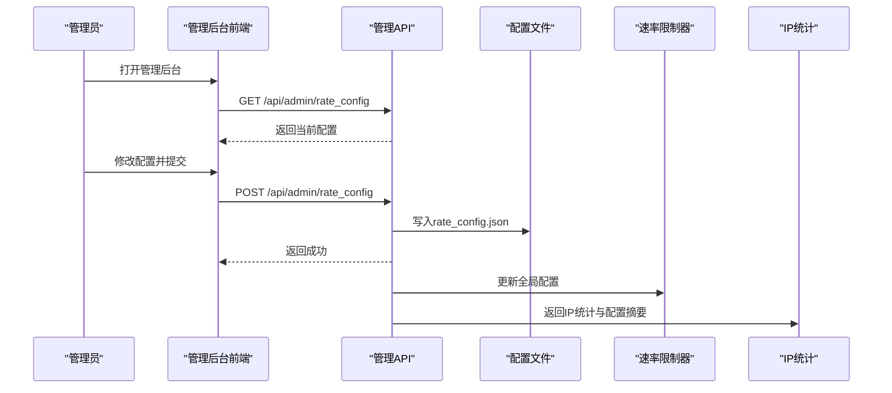
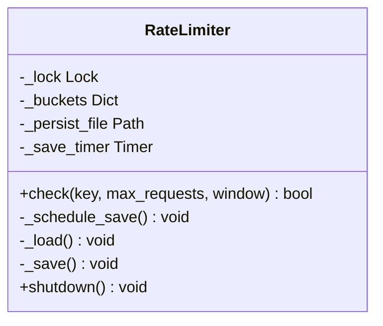
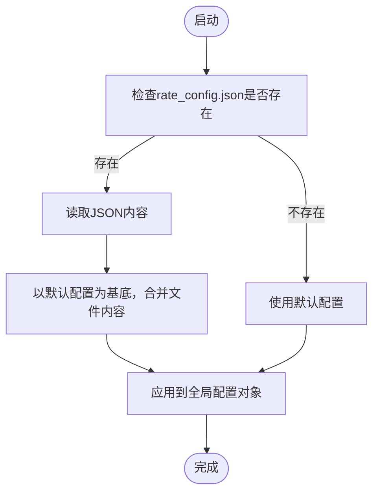
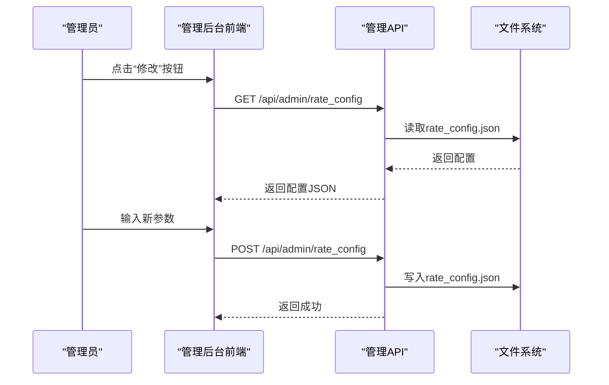
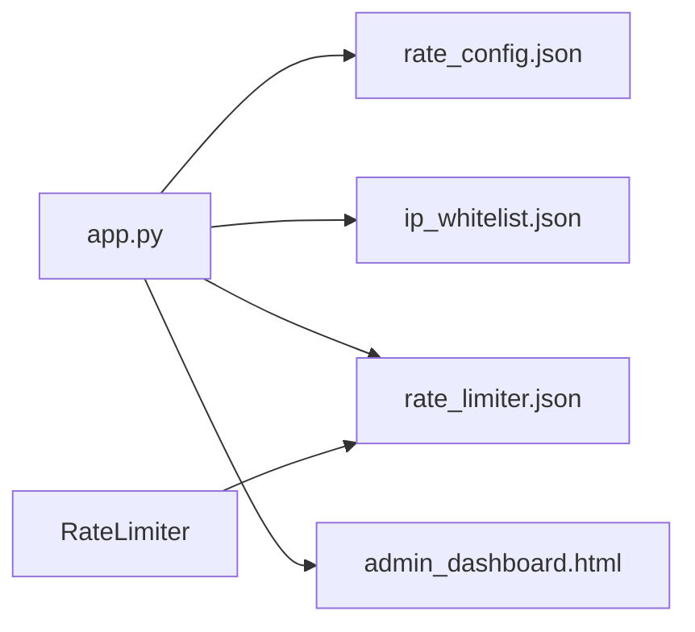

# 动态配置管理系统

<cite>
**本文档引用的文件**
- [app.py](file://app.py)
- [rate_limiter.json](file://rate_limiter.json)
- [admin_dashboard.html](file://templates/admin_dashboard.html)
</cite>

## 目录
1. [简介](#简介)
2. [项目结构](#项目结构)
3. [核心组件](#核心组件)
4. [架构概览](#架构概览)
5. [详细组件分析](#详细组件分析)
6. [依赖关系分析](#依赖关系分析)
7. [性能考虑](#性能考虑)
8. [故障排查指南](#故障排查指南)
9. [结论](#结论)
10. [附录](#附录)

## 简介
本文件面向School_Web项目的动态配置管理系统，重点解析速率限制配置的动态管理机制。系统通过文件持久化实现配置的运行时修改与同步，支持管理员在管理后台实时调整速率限制策略，并具备白名单、手动封禁、试探封禁延长等配套功能。本文将深入解释_DEFAULT_RATE_CONFIG各参数含义、配置文件存储格式、配置合并逻辑与默认值回退机制，并提供调优指南与监控指标收集方法。

## 项目结构
动态配置管理涉及以下关键文件：
- 后端主程序：app.py，包含速率限制器类、配置加载/保存逻辑、管理API
- 速率限制持久化文件：rate_limiter.json，用于内存桶状态的持久化
- 管理后台前端：templates/admin_dashboard.html，提供速率限制配置界面与IP统计

图表来源
- [app.py:349-382](file://app.py#L349-L382)
- [app.py:116](file://app.py#L116)
- [rate_limiter.json:1-1](file://rate_limiter.json#L1-L1)

章节来源
- [app.py:349-382](file://app.py#L349-L382)
- [app.py:116](file://app.py#L116)
- [rate_limiter.json:1-1](file://rate_limiter.json#L1-L1)

## 核心组件
- 速率限制器（RateLimiter）：基于内存的滑动窗口计数器，支持按(key, route)维度统计请求，具备去抖保存机制，将桶状态持久化到文件
- 速率限制全局配置：DEFAULT_RATE_CONFIG定义默认参数，运行时从rate_config.json加载并合并
- 管理API：提供速率配置的获取与设置、IP统计、白名单管理、手动封禁等接口
- 前端管理界面：提供可视化配置表单与实时统计展示

章节来源
- [app.py:31-116](file://app.py#L31-L116)
- [app.py:352-382](file://app.py#L352-L382)
- [app.py:4258-4284](file://app.py#L4258-L4284)

## 架构概览
系统采用“内存计数 + 文件持久化”的双层架构：
- 内存层：实时统计请求、执行封禁决策
- 文件层：持久化桶状态与配置，实现进程重启后的状态恢复与配置持久化

图表来源
- [app.py:4258-4284](file://app.py#L4258-L4284)
- [app.py:4092-4102](file://app.py#L4092-L4102)

## 详细组件分析

### 速率限制器（RateLimiter）
- 存储结构：键为元组(key, route)，值为时间戳队列，按窗口清理过期记录
- 去抖保存：连续写入合并为一次保存，避免高频写入
- 持久化加载：启动时从rate_limiter.json加载最近65秒内的记录，过滤过期项

图表来源
- [app.py:31-116](file://app.py#L31-L116)

章节来源
- [app.py:31-116](file://app.py#L31-L116)
- [rate_limiter.json:1-1](file://rate_limiter.json#L1-L1)

### 速率限制全局配置与合并逻辑
- 默认配置：DEFAULT_RATE_CONFIG定义五项参数
- 文件加载：从rate_config.json读取，若文件不存在或解析失败则回退默认值
- 合并策略：以默认值为基础，用文件中的键值覆盖，未提供的键保持默认

图表来源
- [app.py:360-382](file://app.py#L360-L382)

章节来源
- [app.py:352-382](file://app.py#L352-L382)

### 管理API与前端交互
- 获取配置：GET /api/admin/rate_config
- 设置配置：POST /api/admin/rate_config，支持更新五项参数，均需为正整数
- IP统计：GET /api/admin/ip_stats，返回IP请求统计与配置摘要
- 白名单管理：GET/POST/DELETE /api/admin/whitelist
- 手动封禁：POST /api/admin/manual_block，支持批量操作

图表来源
- [app.py:4258-4284](file://app.py#L4258-L4284)
- [app.py:4092-4102](file://app.py#L4092-L4102)

章节来源
- [app.py:4258-4284](file://app.py#L4258-L4284)
- [app.py:4092-4102](file://app.py#L4092-L4102)

### 前端管理界面
- 配置表单：包含窗口(秒)、上限(次)、封禁(秒)、试探阈值、追加封禁(秒)
- 实时统计：显示跟踪IP数、封禁IP数、白名单数、速率限制、在线会话、手动封禁数
- 自动刷新：服务器状态Tab每2秒刷新一次

章节来源
- [admin_dashboard.html:197-233](file://templates/admin_dashboard.html#L197-L233)
- [admin_dashboard.html:55-92](file://templates/admin_dashboard.html#L55-L92)

## 依赖关系分析
- app.py依赖：
  - rate_config.json：运行时配置文件
  - ip_whitelist.json：白名单持久化文件
  - rate_limiter.json：内存桶状态持久化文件
  - templates/admin_dashboard.html：管理界面
- 组件耦合：
  - 速率限制器与全局配置通过全局变量共享
  - 管理API直接读写配置文件，保证配置变更的持久性
  - 前端通过REST API与后端交互，实现配置的可视化管理

图表来源
- [app.py:349-382](file://app.py#L349-L382)
- [app.py:116](file://app.py#L116)

章节来源
- [app.py:349-382](file://app.py#L349-L382)
- [app.py:116](file://app.py#L116)

## 性能考虑
- 内存计数器：使用deque进行滑动窗口清理，时间复杂度O(n)清理过期项，n为窗口内请求数
- 去抖保存：RateLimiter的保存定时器将高频写入合并为低频写入，减少磁盘I/O
- 并发控制：全局锁保护配置与状态的读写一致性
- 配置加载：仅在启动时加载配置文件，运行时通过API更新，避免频繁I/O

## 故障排查指南
- 配置文件损坏：
  - 现象：配置加载失败，回退到默认值
  - 处理：检查rate_config.json格式，确保为合法JSON；必要时删除文件以恢复默认
- 速率限制误封：
  - 现象：正常用户被封禁
  - 处理：检查白名单与手动封禁列表；确认试探阈值与追加封禁策略；必要时清空IP统计
- 状态不一致：
  - 现象：重启后桶状态异常
  - 处理：检查rate_limiter.json是否被意外修改；确认加载逻辑仅保留65秒内记录

章节来源
- [app.py:360-382](file://app.py#L360-L382)
- [app.py:68-92](file://app.py#L68-L92)
- [app.py:4105-4125](file://app.py#L4105-L4125)

## 结论
School_Web的动态配置管理系统通过文件持久化实现了速率限制配置的运行时修改与同步，结合内存计数器与白名单、手动封禁等机制，提供了灵活且可控的安全策略。DEFAULT_RATE_CONFIG的五个参数共同定义了系统的防护强度与体验平衡，建议根据业务场景与流量特征进行调优，并配合管理后台的监控指标进行持续优化。

## 附录

### DEFAULT_RATE_CONFIG 参数详解
- RATE_LIMIT：时间窗口内的最大请求数。超过该阈值触发封禁
- RATE_WINDOW：滑动窗口大小（秒）。决定统计的时间范围
- BLOCK_DURATION：首次封禁时长（秒）。封禁到期后自动解除
- BLOCK_PROBE_LIMIT：封禁期间试探次数阈值。超过阈值触发追加封禁
- BLOCK_EXTEND：试探超限时追加的封禁时长（秒）

章节来源
- [app.py:352-358](file://app.py#L352-L358)

### 配置文件存储格式与合并逻辑
- rate_config.json：存储当前生效的配置键值对
- 合并策略：以DEFAULT_RATE_CONFIG为基底，用文件中的键值覆盖
- 默认值回退：文件缺失或解析失败时，使用DEFAULT_RATE_CONFIG

章节来源
- [app.py:360-382](file://app.py#L360-L382)

### 配置调优指南
- 低流量场景：适当提高RATE_WINDOW与RATE_LIMIT，降低BLOCK_DURATION
- 高并发场景：缩短BLOCK_DURATION并提高BLOCK_PROBE_LIMIT，防止误封
- 防探测：合理设置BLOCK_PROBE_LIMIT与BLOCK_EXTEND，避免探测式攻击绕过
- 白名单策略：将可信IP加入白名单，避免误封影响用户体验

### 监控指标收集方法
- IP统计接口：GET /api/admin/ip_stats，返回跟踪IP数、封禁IP数、白名单数、速率限制、在线会话、手动封禁数
- 前端仪表板：管理后台提供实时刷新的服务器状态与网络统计
- 日志审计：管理操作（如修改配置、封禁/解封IP）均有日志记录，便于追踪

章节来源
- [app.py:4092-4102](file://app.py#L4092-L4102)
- [admin_dashboard.html:55-92](file://templates/admin_dashboard.html#L55-L92)