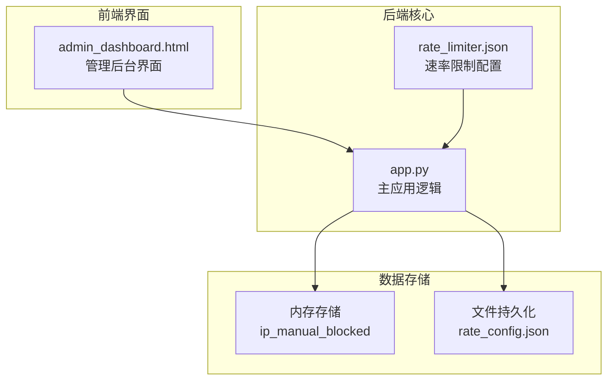
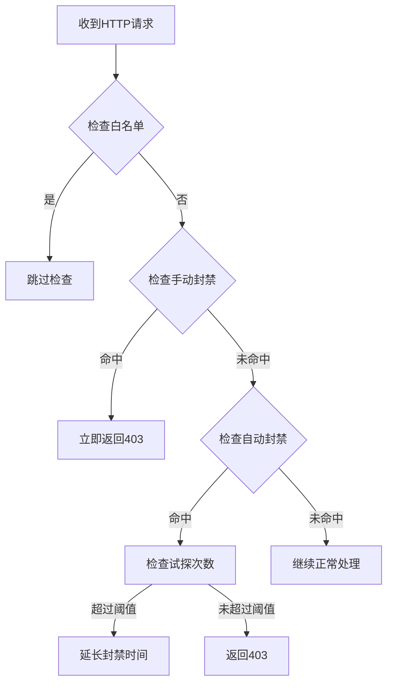
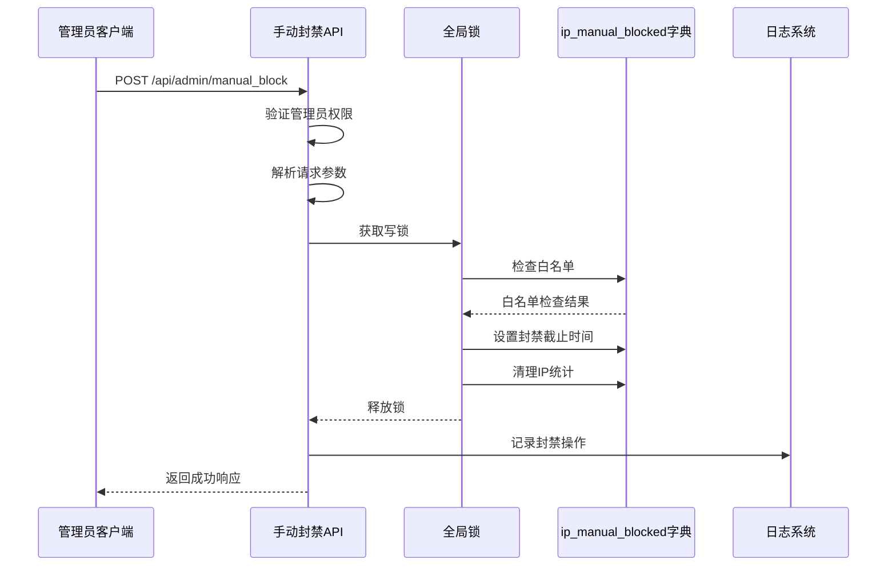
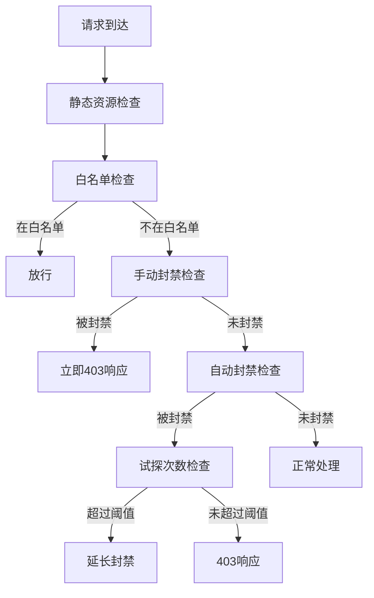
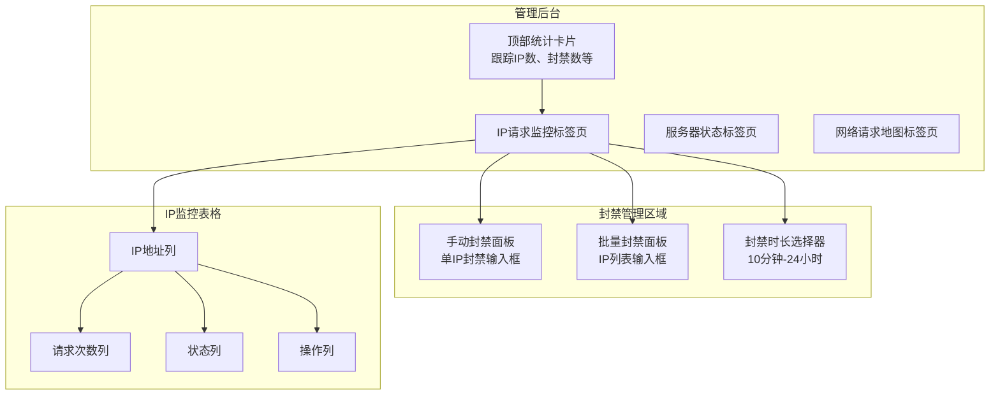
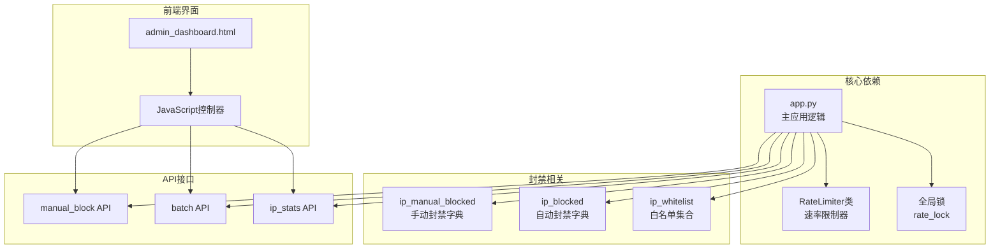

# 手动封禁管理系统

<cite>
**本文档引用的文件**
- [app.py](file://app.py)
- [admin_dashboard.html](file://templates/admin_dashboard.html)
- [rate_limiter.json](file://rate_limiter.json)
</cite>

## 目录
1. [简介](#简介)
2. [项目结构](#项目结构)
3. [核心组件](#核心组件)
4. [架构概览](#架构概览)
5. [详细组件分析](#详细组件分析)
6. [依赖关系分析](#依赖关系分析)
7. [性能考虑](#性能考虑)
8. [故障排除指南](#故障排除指南)
9. [结论](#结论)

## 简介

School_Web项目包含一个完整的手动封禁管理系统，用于实时阻止恶意IP地址的访问。该系统提供了管理员友好的界面，支持即时封禁、批量操作和可视化监控。系统采用双重封禁机制：手动封禁和自动封禁，确保对不同类型的威胁进行有效防护。

手动封禁系统的核心特点包括：
- 即时封禁响应机制
- 可配置的封禁时长
- 实时状态监控
- 批量操作支持
- 与自动封禁系统的无缝集成

## 项目结构

手动封禁管理系统主要分布在以下文件中：



**图表来源**
- [app.py:387](file://app.py#L387)
- [app.py:4190](file://app.py#L4190)
- [admin_dashboard.html:134](file://templates/admin_dashboard.html#L134)

**章节来源**
- [app.py:387](file://app.py#L387)
- [admin_dashboard.html:134](file://templates/admin_dashboard.html#L134)

## 核心组件

手动封禁管理系统由以下核心组件构成：

### 1. 手动封禁字典结构

系统使用`ip_manual_blocked`字典来存储手动封禁信息：
- **键**: IP地址字符串
- **值**: 封禁截止时间戳（time.time() + duration）

### 2. 封禁状态检查逻辑

在请求处理流程中，系统按照以下优先级检查封禁状态：



**图表来源**
- [app.py:513](file://app.py#L513)
- [app.py:525](file://app.py#L525)

### 3. 封禁期限计算机制

封禁期限采用绝对时间戳计算：
- **开始时间**: 当前时间（time.time()）
- **结束时间**: 开始时间 + 指定时长（秒）
- **检查条件**: 当前时间 < 封禁截止时间

### 4. 自动清理机制

系统通过以下方式实现自动清理：
- **惰性检查**: 在每次请求时检查封禁是否过期
- **内存管理**: 过期封禁记录自动从字典中移除
- **线程安全**: 使用全局锁保护封禁状态的并发访问

**章节来源**
- [app.py:387](file://app.py#L387)
- [app.py:513](file://app.py#L513)
- [app.py:525](file://app.py#L525)

## 架构概览

手动封禁系统采用分层架构设计，确保高可用性和可维护性：

```mermaid
graph TB
subgraph "管理层"
A[管理员界面<br/>admin_dashboard.html]
B[权限控制<br/>@admin_required]
end
subgraph "业务逻辑层"
C[请求拦截器<br/>check_rate_limit]
D[封禁管理API<br/>/api/admin/manual_block]
E[批量操作API<br/>/api/admin/batch]
end
subgraph "数据存储层"
F[内存字典<br/>ip_manual_blocked]
G[配置文件<br/>rate_config.json]
H[白名单文件<br/>ip_whitelist.json]
end
subgraph "监控层"
I[实时统计<br/>/api/admin/ip_stats]
J[状态监控<br/>/api/system_users]
end
A --> B
A --> D
A --> E
B --> C
C --> F
D --> F
E --> F
F --> G
F --> H
C --> I
C --> J
```

**图表来源**
- [app.py:4190](file://app.py#L4190)
- [app.py:4210](file://app.py#L4210)
- [app.py:4350](file://app.py#L4350)

## 详细组件分析

### 手动封禁API组件

手动封禁功能通过RESTful API提供服务：

#### API定义

| 组件 | 属性 | 说明 |
|------|------|------|
| **端点** | `/api/admin/manual_block` | 手动封禁IP地址 |
| **方法** | `POST` | 创建新的封禁记录 |
| **认证** | 管理员权限 | 需要管理员身份验证 |
| **请求体** | `{ip: string, duration: number}` | IP地址和封禁时长（秒） |
| **响应** | `{success: boolean, until: number}` | 操作结果和截止时间戳 |

#### 请求处理流程



**图表来源**
- [app.py:4190](file://app.py#L4190)
- [app.py:4200](file://app.py#L4200)

#### 批量操作组件

系统支持批量封禁和批量白名单操作：

| 组件 | 属性 | 说明 |
|------|------|------|
| **端点** | `/api/admin/batch` | 批量操作 |
| **方法** | `POST` | 执行批量封禁或白名单操作 |
| **请求体** | `{action: string, ips: string, duration: number}` | 操作类型、IP列表、时长 |
| **支持的操作** | `"block"` 或 `"whitelist"` | 封禁或添加白名单 |

**章节来源**
- [app.py:4190](file://app.py#L4190)
- [app.py:4210](file://app.py#L4210)

### 封禁状态检查组件

封禁状态检查是系统的核心逻辑，负责实时判断请求是否应该被阻止：

#### 检查优先级



**图表来源**
- [app.py:513](file://app.py#L513)
- [app.py:525](file://app.py#L525)

#### 状态计算逻辑

系统提供多种状态计算方式：

| 计算方式 | 用途 | 实现位置 |
|----------|------|----------|
| **实时封禁状态** | 检查单个IP是否被封禁 | `api_system_users` |
| **批量统计** | 获取所有活跃IP的状态 | `api_admin_ip_stats` |
| **剩余时间计算** | 显示封禁剩余时长 | 前端JavaScript |

**章节来源**
- [app.py:513](file://app.py#L513)
- [app.py:1890](file://app.py#L1890)

### 管理界面组件

管理界面提供了直观的可视化操作平台：

#### 界面布局



**图表来源**
- [admin_dashboard.html:107](file://templates/admin_dashboard.html#L107)
- [admin_dashboard.html:134](file://templates/admin_dashboard.html#L134)

#### 操作流程

管理员可以通过以下步骤执行手动封禁：

1. **输入IP地址**: 在单个IP输入框中输入目标IP
2. **选择时长**: 从下拉菜单选择封禁时长（10分钟-24小时）
3. **确认操作**: 点击"封禁"按钮确认
4. **等待响应**: 系统自动执行封禁并更新界面
5. **验证结果**: 查看IP监控表格中的状态变化

**章节来源**
- [admin_dashboard.html:134](file://templates/admin_dashboard.html#L134)
- [admin_dashboard.html:611](file://templates/admin_dashboard.html#L611)

## 依赖关系分析

手动封禁系统与其他组件的依赖关系如下：



**图表来源**
- [app.py:31](file://app.py#L31)
- [app.py:387](file://app.py#L387)
- [app.py:4190](file://app.py#L4190)

### 关键依赖特性

1. **线程安全性**: 使用全局锁保护封禁状态的并发访问
2. **内存存储**: 所有封禁状态存储在内存中，确保快速响应
3. **文件持久化**: 通过配置文件实现部分状态的持久化
4. **API隔离**: 封禁相关的API接口独立于其他业务逻辑

**章节来源**
- [app.py:31](file://app.py#L31)
- [app.py:387](file://app.py#L387)

## 性能考虑

手动封禁系统在设计时充分考虑了性能优化：

### 1. 内存效率

- **字典存储**: 使用Python字典实现O(1)的查找复杂度
- **惰性清理**: 仅在需要时清理过期封禁记录
- **内存限制**: 系统不会无限增长，过期记录自动移除

### 2. 并发处理

- **全局锁**: 使用单一锁保护所有封禁状态的修改
- **读写分离**: 读取操作不阻塞，写入操作通过锁同步
- **原子操作**: 封禁状态的设置和删除是原子性的

### 3. 网络优化

- **前端缓存**: 管理界面使用定时刷新机制减少API调用
- **批量操作**: 支持批量封禁和批量白名单操作
- **状态预计算**: 后端预先计算IP状态，减少前端计算负担

## 故障排除指南

### 常见问题及解决方案

#### 1. 封禁无效问题

**症状**: 输入IP后点击封禁，但目标IP仍然可以访问

**可能原因**:
- IP地址格式错误
- 目标IP在白名单中
- 管理员权限不足
- 系统时间异常

**解决步骤**:
1. 验证IP地址格式是否正确
2. 检查白名单文件中是否存在该IP
3. 确认当前用户具有管理员权限
4. 检查服务器时间设置

#### 2. 状态显示异常

**症状**: 管理界面显示的封禁状态与实际不符

**可能原因**:
- 前端缓存未更新
- 后端状态不同步
- 浏览器兼容性问题

**解决步骤**:
1. 手动刷新管理界面
2. 检查浏览器开发者工具中的网络请求
3. 清除浏览器缓存
4. 重启应用服务器

#### 3. 批量操作失败

**症状**: 批量封禁或批量白名单操作部分失败

**可能原因**:
- IP列表格式错误
- 包含重复IP
- 某些IP格式不合法
- 系统资源不足

**解决步骤**:
1. 检查IP列表格式（支持逗号、空格、换行分隔）
2. 移除重复IP地址
3. 验证每个IP地址的有效性
4. 减少批量操作的数量

**章节来源**
- [app.py:4190](file://app.py#L4190)
- [app.py:4210](file://app.py#L4210)

## 结论

School_Web项目的手动封禁管理系统是一个设计精良的安全防护组件，具有以下优势：

### 技术优势

1. **实时响应**: 手动封禁立即生效，无需重启服务
2. **灵活配置**: 支持多种封禁时长和批量操作
3. **可视化管理**: 提供直观的管理界面和实时监控
4. **性能优化**: 内存存储和高效算法确保快速响应

### 安全特性

1. **双重防护**: 手动封禁与自动封禁协同工作
2. **权限控制**: 严格的管理员权限验证
3. **审计日志**: 完整的操作记录便于追踪
4. **白名单机制**: 避免误封正常用户

### 扩展性

系统设计具有良好的扩展性，可以轻松添加新功能：
- 更复杂的封禁策略
- 多级封禁管理
- 智能威胁识别
- 集成外部威胁情报

手动封禁管理系统为School_Web提供了强大的安全防护能力，既保证了系统的安全性，又保持了良好的用户体验。