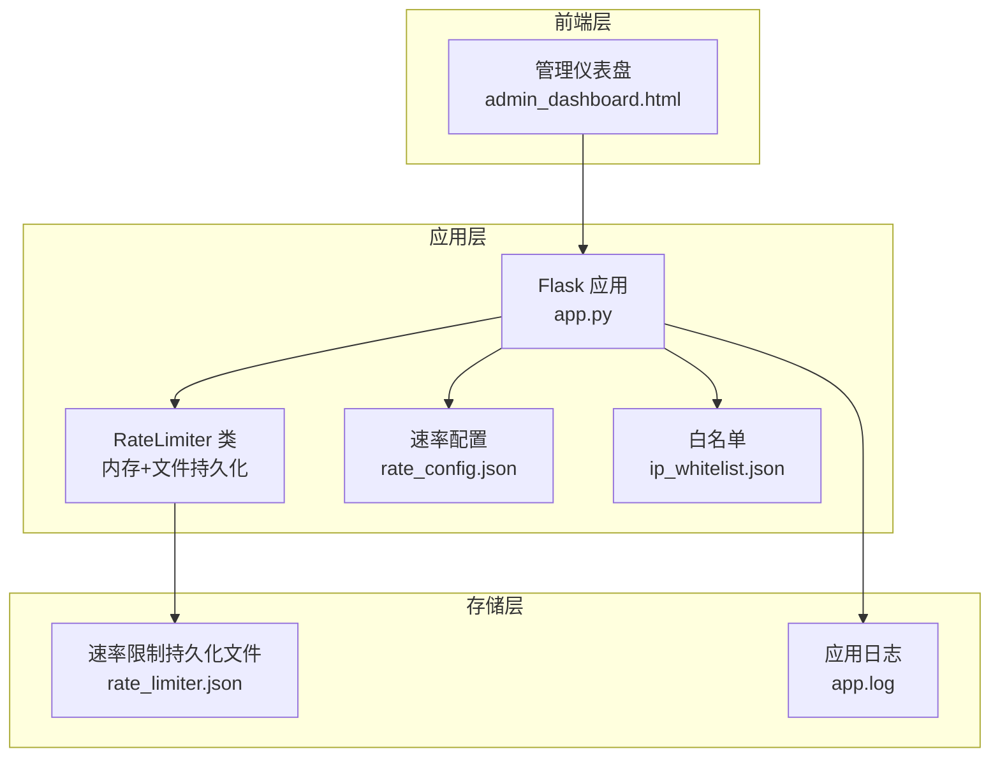
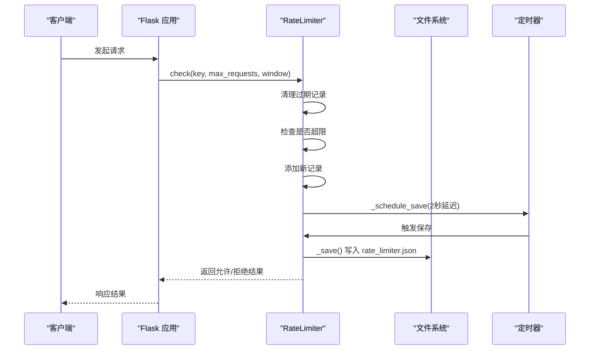
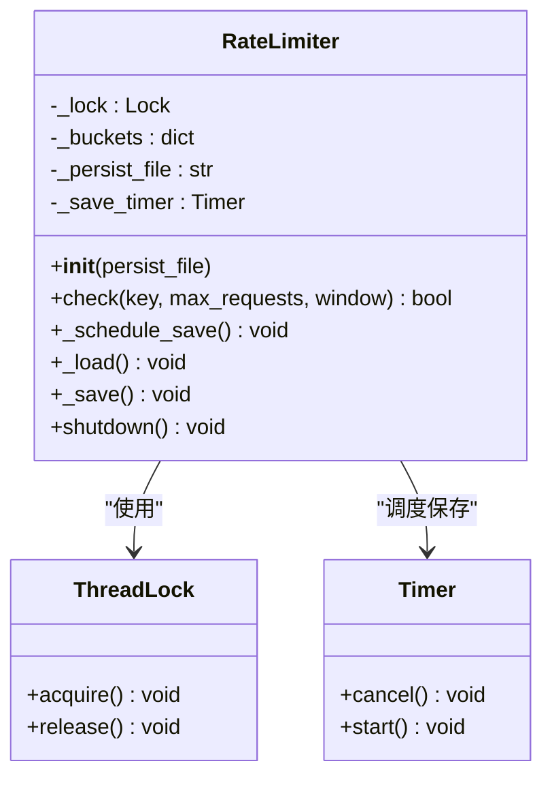
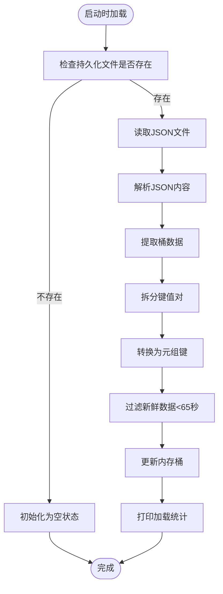
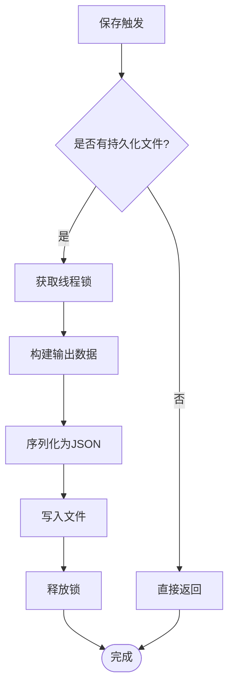
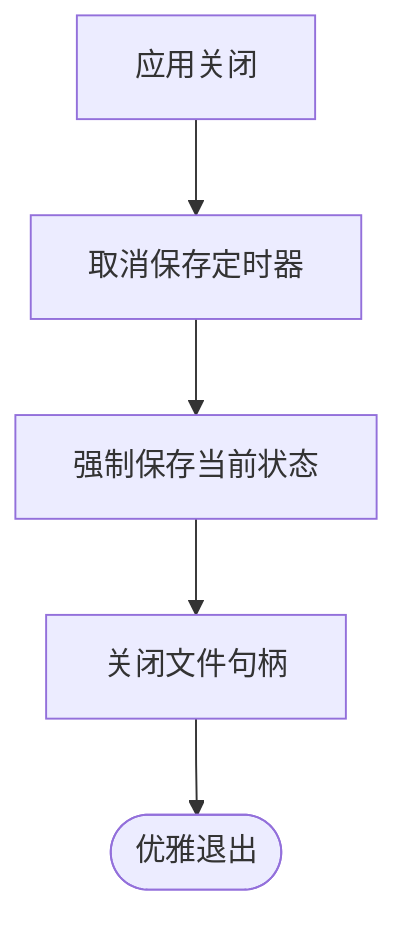
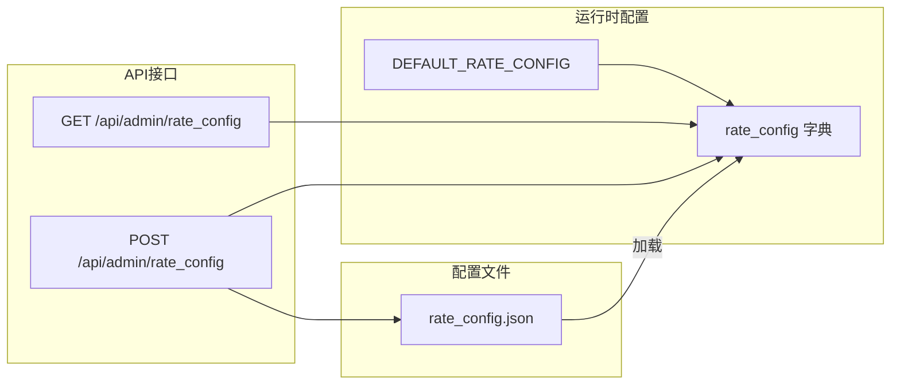
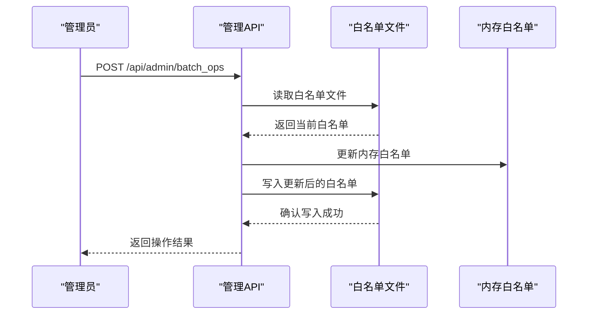
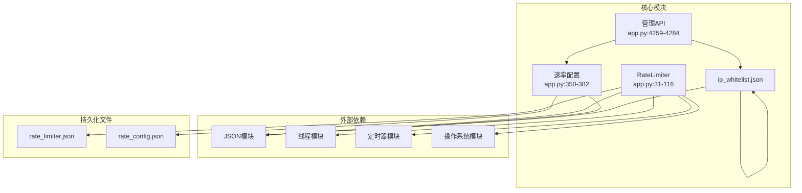

# 持久化速率限制机制

<cite>
**本文档引用的文件**
- [app.py](file://app.py)
- [rate_limiter.json](file://rate_limiter.json)
- [admin_dashboard.html](file://templates/admin_dashboard.html)
</cite>

## 目录
1. [简介](#简介)
2. [项目结构](#项目结构)
3. [核心组件](#核心组件)
4. [架构概览](#架构概览)
5. [详细组件分析](#详细组件分析)
6. [依赖关系分析](#依赖关系分析)
7. [性能考虑](#性能考虑)
8. [故障排查指南](#故障排查指南)
9. [结论](#结论)

## 简介
本文档深入解析School_Web项目的持久化速率限制机制，重点涵盖以下方面：
- 持久化存储的实现原理：文件存储格式、定时保存机制、优雅关闭处理
- `_load` 和 `_save` 方法的工作流程：JSON序列化、数据恢复、并发安全保护
- 去抖保存机制的设计思路：定时器取消、批量保存、性能优化策略
- 持久化配置的最佳实践与故障恢复方案

## 项目结构
该项目采用Flask框架构建，速率限制相关逻辑集中在主应用文件中，配合前端管理界面实现动态配置与监控。

**图表来源**
- [app.py:31-116](file://app.py#L31-L116)
- [app.py:350-412](file://app.py#L350-L412)
- [admin_dashboard.html:197-233](file://templates/admin_dashboard.html#L197-L233)

**章节来源**
- [app.py:31-116](file://app.py#L31-L116)
- [app.py:350-412](file://app.py#L350-L412)
- [admin_dashboard.html:197-233](file://templates/admin_dashboard.html#L197-L233)

## 核心组件
- RateLimiter类：提供内存中的滑动窗口速率限制，并通过文件持久化实现重启不丢失
- 速率配置系统：支持动态调整窗口大小、请求上限、封禁时长等参数
- 白名单系统：支持IP白名单的持久化管理
- 管理后台：提供前端界面用于实时查看和修改速率限制策略

**章节来源**
- [app.py:31-116](file://app.py#L31-L116)
- [app.py:350-412](file://app.py#L350-L412)

## 架构概览
持久化速率限制机制的整体架构如下：

**图表来源**
- [app.py:43-67](file://app.py#L43-L67)
- [app.py:94-107](file://app.py#L94-L107)

## 详细组件分析

### RateLimiter类设计
RateLimiter类实现了内存中的滑动窗口算法，并通过文件持久化确保重启后状态不丢失。

**图表来源**
- [app.py:31-116](file://app.py#L31-L116)

#### 核心数据结构
- `_buckets`: 内存中的桶结构，键为`(ip, route)`元组，值为时间戳列表
- `_lock`: 线程锁，确保并发安全
- `_save_timer`: 延迟保存定时器

#### 去抖保存机制
去抖保存通过`_schedule_save`方法实现，核心特点：
- 延迟2秒触发保存，避免频繁I/O操作
- 若在2秒内再次调用，先取消之前的定时器再创建新的定时器
- 有效合并短时间内多次写入请求

**章节来源**
- [app.py:59-66](file://app.py#L59-L66)

### 文件存储格式
持久化文件采用JSON格式存储，具体结构如下：

**图表来源**
- [app.py:68-93](file://app.py#L68-L93)

#### 数据恢复策略
- 只保留最近65秒内的记录（最大窗口60秒+5秒缓冲）
- 自动清理过期数据，避免内存泄漏
- 使用线程锁保护并发访问

**章节来源**
- [app.py:68-93](file://app.py#L68-L93)

### 保存机制实现
保存过程采用原子写入策略，确保数据一致性：

**图表来源**
- [app.py:94-107](file://app.py#L94-L107)

#### JSON序列化细节
- 将内存中的元组键转换为字符串键（使用"|"分隔）
- 保持时间戳数组的原始精度
- 异常处理：捕获所有异常但不中断应用运行

**章节来源**
- [app.py:94-107](file://app.py#L94-L107)

### 优雅关闭处理
应用关闭时的处理流程：

**图表来源**
- [app.py:109-114](file://app.py#L109-L114)

#### 关键特性
- 取消未触发的定时器，避免资源泄漏
- 强制执行最后一次保存，确保数据完整性
- 线程安全的关闭流程

**章节来源**
- [app.py:109-114](file://app.py#L109-L114)

### 速率配置系统
系统支持动态配置速率限制参数，配置文件位于`rate_config.json`：

**图表来源**
- [app.py:350-382](file://app.py#L350-L382)
- [app.py:4259-4284](file://app.py#L4259-L4284)

#### 默认配置参数
- `RATE_LIMIT`: 40次请求
- `RATE_WINDOW`: 10秒时间窗口
- `BLOCK_DURATION`: 240秒封禁时长
- `BLOCK_PROBE_LIMIT`: 50次试探阈值
- `BLOCK_EXTEND`: 240秒追加封禁

**章节来源**
- [app.py:352-358](file://app.py#L352-L358)
- [app.py:360-382](file://app.py#L360-L382)

### 白名单管理系统
支持IP白名单的持久化管理：

**图表来源**
- [app.py:4229-4255](file://app.py#L4229-L4255)
- [app.py:394-411](file://app.py#L394-L411)

**章节来源**
- [app.py:394-411](file://app.py#L394-L411)
- [app.py:4229-4255](file://app.py#L4229-L4255)

## 依赖关系分析

**图表来源**
- [app.py:31-116](file://app.py#L31-L116)
- [app.py:350-411](file://app.py#L350-L411)
- [app.py:4259-4284](file://app.py#L4259-L4284)

**章节来源**
- [app.py:31-116](file://app.py#L31-L116)
- [app.py:350-411](file://app.py#L350-L411)
- [app.py:4259-4284](file://app.py#L4259-L4284)

## 性能考虑
- **内存效率**：使用字典存储桶，O(1)查找和插入
- **I/O优化**：去抖保存减少磁盘写入频率
- **并发安全**：全局锁保护共享状态
- **内存清理**：自动清理过期记录防止内存泄漏
- **配置热更新**：支持运行时修改配置参数

## 故障排查指南

### 常见问题及解决方案

#### 1. 持久化文件损坏
**症状**：应用启动时报错，无法加载速率限制状态
**解决方法**：
- 检查`rate_limiter.json`文件格式是否正确
- 如文件损坏，删除后重启应用将自动生成新文件
- 查看应用日志获取详细错误信息

#### 2. 保存失败
**症状**：速率限制状态未持久化
**解决方法**：
- 检查文件权限，确保应用有写入权限
- 确认磁盘空间充足
- 查看异常日志，通常会被静默处理

#### 3. 配置不生效
**症状**：修改配置后仍按旧规则执行
**解决方法**：
- 确认`rate_config.json`文件已正确保存
- 检查配置参数范围（必须为正数）
- 重启应用使配置生效

#### 4. 并发冲突
**症状**：多线程环境下出现数据不一致
**解决方法**：
- 确认使用了线程锁保护
- 避免在高并发场景下频繁修改配置
- 检查定时器是否正确取消和重启

**章节来源**
- [app.py:68-93](file://app.py#L68-L93)
- [app.py:94-107](file://app.py#L94-L107)
- [app.py:4259-4284](file://app.py#L4259-L4284)

## 结论
School_Web项目的持久化速率限制机制通过以下关键设计实现了高效、可靠的防护：
- **内存+文件混合存储**：兼顾性能和持久性
- **智能去抖保存**：平衡I/O频率和数据一致性
- **完善的并发控制**：确保多线程环境下的数据安全
- **动态配置支持**：提供灵活的策略调整能力
- **优雅关闭处理**：保证应用停止时的数据完整性

这套机制为Web应用提供了坚实的安全基础，既满足了实际业务需求，又具备良好的可维护性和扩展性。