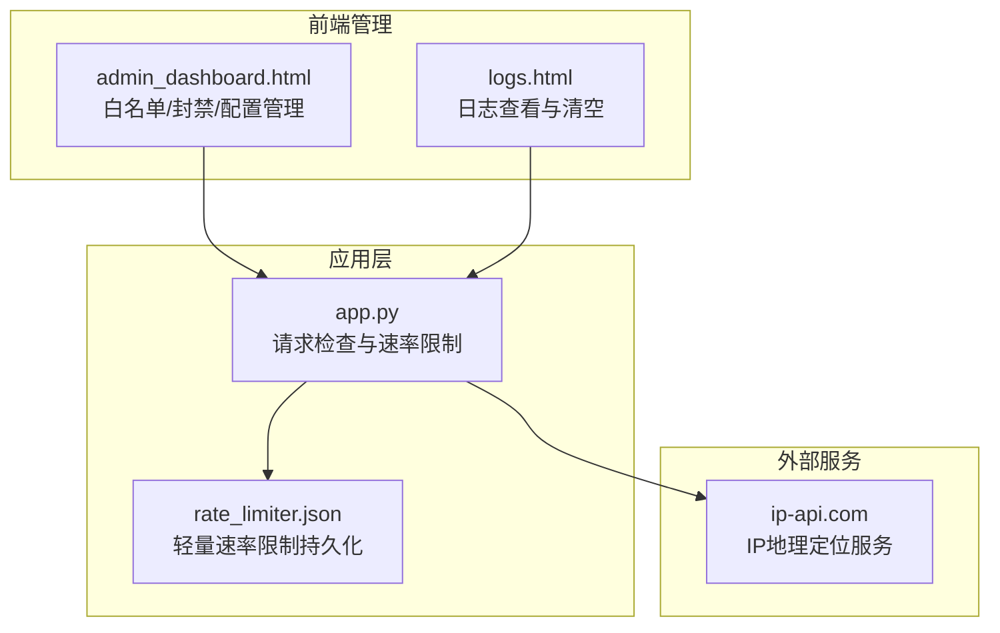
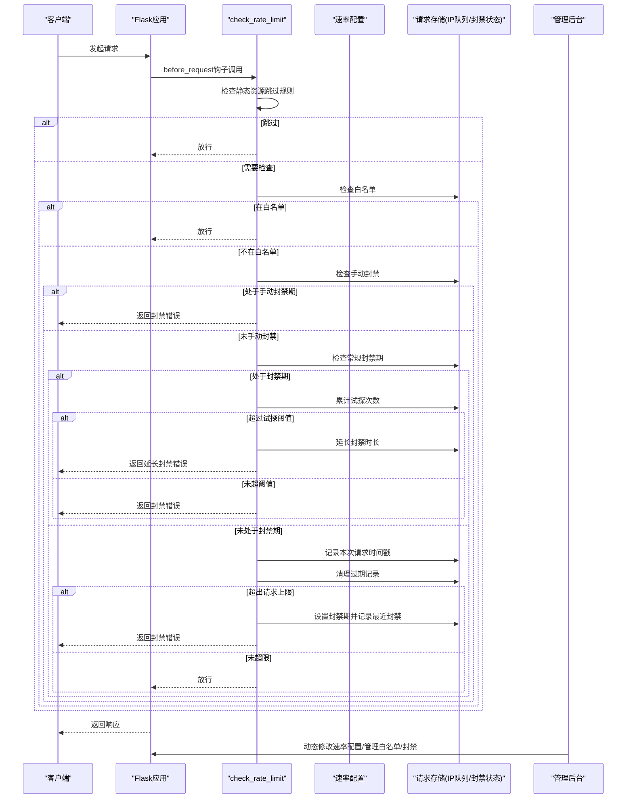
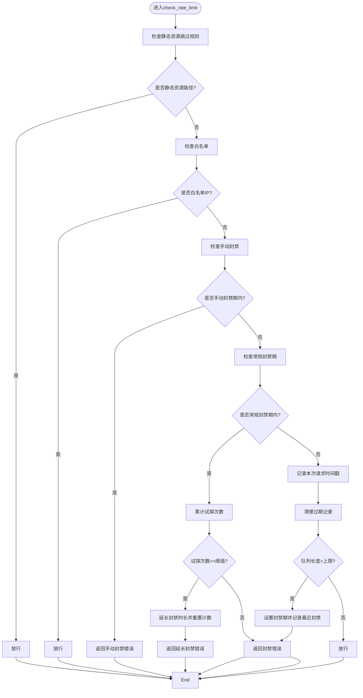
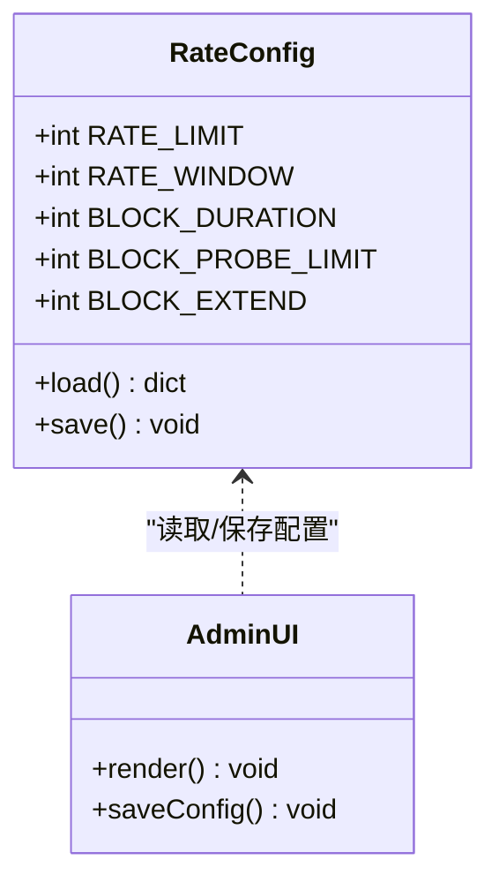
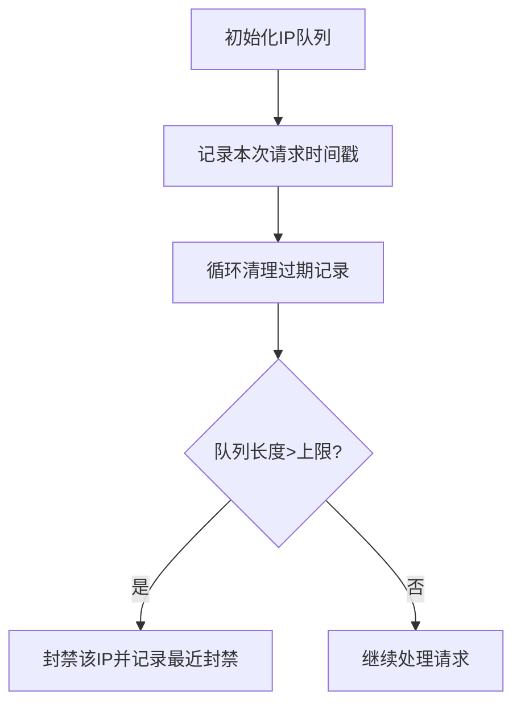
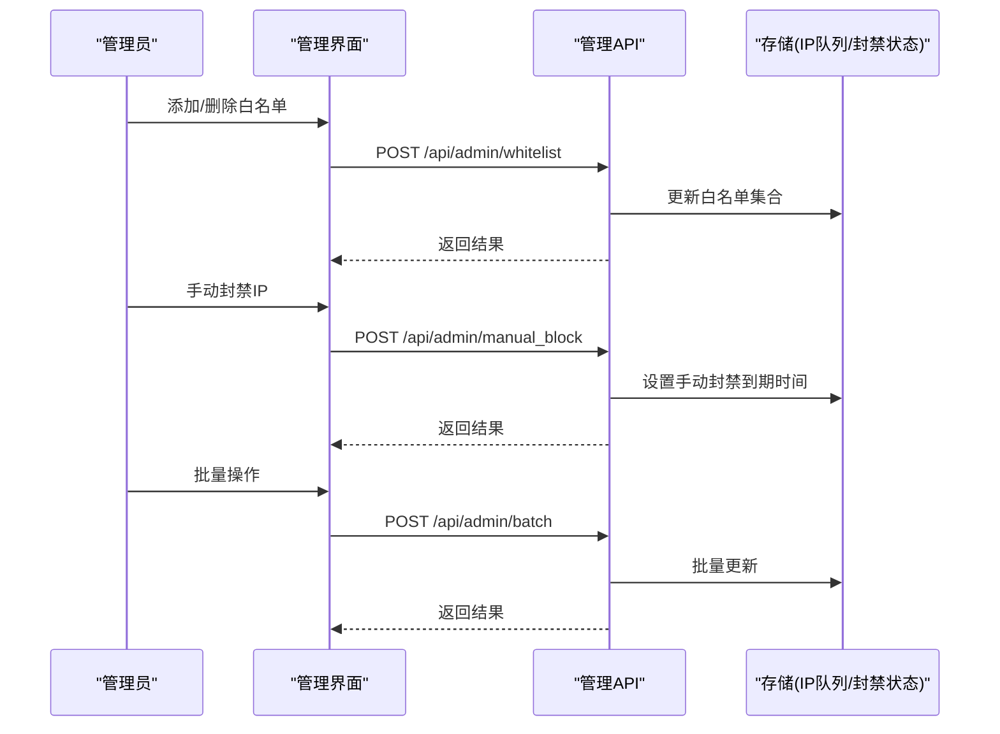
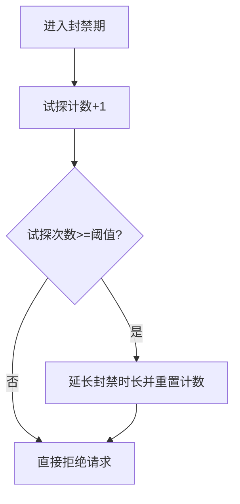
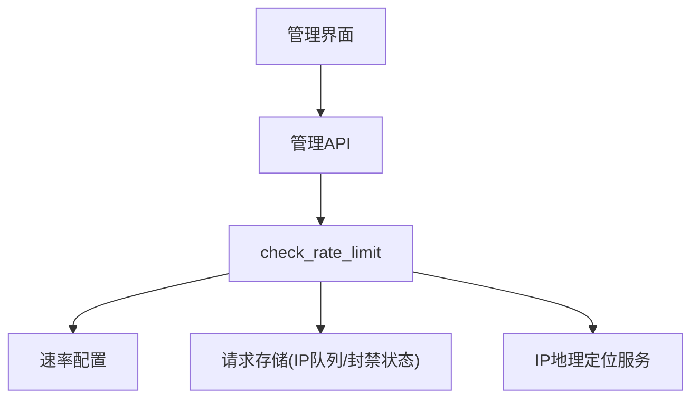

# 请求检查机制

<cite>
**本文档引用的文件**
- [app.py](file://app.py)
- [rate_limiter.json](file://rate_limiter.json)
- [templates/admin_dashboard.html](file://templates/admin_dashboard.html)
- [templates/logs.html](file://templates/logs.html)
</cite>

## 目录
1. [简介](#简介)
2. [项目结构](#项目结构)
3. [核心组件](#核心组件)
4. [架构概览](#架构概览)
5. [详细组件分析](#详细组件分析)
6. [依赖分析](#依赖分析)
7. [性能考虑](#性能考虑)
8. [故障排查指南](#故障排查指南)
9. [结论](#结论)

## 简介
本文档深入解析School_Web项目的请求检查机制，重点围绕`check_rate_limit`函数的完整实现进行技术剖析。内容涵盖白名单检查、手动封禁检查、封禁期检查、请求频率计算逻辑、静态资源跳过规则、封禁试探检测与延长机制、请求队列管理策略（双端队列使用、过期清理、封禁触发条件），以及性能优化建议和监控指标收集方法。文档旨在帮助开发者和运维人员全面理解并有效维护该系统的安全与稳定性。

## 项目结构
School_Web采用Flask框架构建，请求检查机制主要集中在应用入口文件中，配合前端管理界面实现动态配置与实时监控。关键文件与职责如下：
- app.py：包含请求检查逻辑、速率限制配置、白名单与手动封禁管理、IP地理定位、日志记录等核心功能。
- rate_limiter.json：轻量级内存速率限制的持久化存储文件，重启后可恢复部分状态。
- templates/admin_dashboard.html：管理后台界面，提供白名单管理、手动封禁、速率配置修改、IP统计等功能。
- templates/logs.html：日志查看与清空界面，便于审计与问题追踪。

**图表来源**
- [app.py:513-561](file://app.py#L513-L561)
- [app.py:352-388](file://app.py#L352-L388)
- [templates/admin_dashboard.html:197-233](file://templates/admin_dashboard.html#L197-L233)
- [templates/logs.html:1-18](file://templates/logs.html#L1-L18)

**章节来源**
- [app.py:513-561](file://app.py#L513-L561)
- [app.py:352-388](file://app.py#L352-L388)
- [templates/admin_dashboard.html:197-233](file://templates/admin_dashboard.html#L197-L233)

## 核心组件
本节概述请求检查机制的核心组件及其职责：
- 速率限制配置：支持动态调整请求上限、时间窗口、封禁时长、试探阈值与延长时长。
- 请求队列管理：基于双端队列（deque）记录每个IP在时间窗口内的请求时间戳，实现高效过期清理与频率计算。
- 白名单与手动封禁：提供白名单豁免与管理员手动封禁功能，二者均优先于常规速率限制检查。
- 封禁试探检测与延长：在封禁期内对试探行为进行累计，超过阈值将延长封禁时长。
- 静态资源跳过规则：对静态文件、分享链接等路径跳过速率限制，减少误伤。
- 日志与监控：记录封禁事件与配置变更，提供管理后台可视化监控。

**章节来源**
- [app.py:352-388](file://app.py#L352-L388)
- [app.py:513-561](file://app.py#L513-L561)
- [app.py:4145-4255](file://app.py#L4145-L4255)

## 架构概览
请求检查的整体流程如下：
1. 前置请求钩子在每次请求到达时执行。
2. 静态资源与分享链接路径直接放行。
3. 若IP在白名单中，直接放行。
4. 若IP处于手动封禁期，返回封禁错误。
5. 若IP处于常规封禁期，累计试探次数并根据阈值决定延长封禁或直接拒绝。
6. 记录本次请求的时间戳，清理过期记录，若超出上限则进入封禁流程并记录最近封禁事件。
7. 管理后台可动态调整配置、查看IP统计、执行白名单与封禁管理操作。

**图表来源**
- [app.py:513-561](file://app.py#L513-L561)
- [app.py:352-388](file://app.py#L352-L388)
- [app.py:4145-4255](file://app.py#L4145-L4255)

## 详细组件分析

### check_rate_limit函数实现详解
该函数位于应用的前置请求钩子中，负责执行完整的请求检查流程。其核心逻辑包括：
- 静态资源跳过规则：对`/static/`、`/assets/`、`/favicon.ico`、`/share/`等路径直接放行，避免对静态资源产生误伤。
- 白名单检查：若IP在白名单集合中，直接放行，不参与后续检查。
- 手动封禁检查：若IP处于管理员手动封禁期，返回剩余封禁时间并拒绝请求。
- 封禁期检查：若IP处于常规封禁期，累计试探次数；达到阈值则延长封禁时长并重置试探计数，否则直接拒绝请求。
- 请求频率计算：为每个IP维护一个双端队列，记录时间戳；清理过期记录后，若队列长度超过上限，则进入封禁流程。
- 封禁触发与记录：封禁时长由配置决定，同时记录最近封禁事件以便通知功能使用。

**图表来源**
- [app.py:513-561](file://app.py#L513-L561)

**章节来源**
- [app.py:513-561](file://app.py#L513-L561)

### 速率限制配置与持久化
- 默认配置：包含请求上限、时间窗口、封禁时长、试探阈值与延长时长等参数。
- 配置加载：从配置文件读取，若文件不存在则使用默认值；支持动态修改并通过API保存。
- 线程安全：配置修改与读取均在锁保护下进行，避免并发冲突。
- 管理界面：提供可视化配置面板，支持实时保存与预览策略说明。

**图表来源**
- [app.py:352-388](file://app.py#L352-L388)
- [app.py:4266-4284](file://app.py#L4266-L4284)
- [templates/admin_dashboard.html:197-233](file://templates/admin_dashboard.html#L197-L233)

**章节来源**
- [app.py:352-388](file://app.py#L352-L388)
- [app.py:4266-4284](file://app.py#L4266-L4284)
- [templates/admin_dashboard.html:197-233](file://templates/admin_dashboard.html#L197-L233)

### 请求队列管理策略
- 数据结构：每个IP对应一个双端队列，存储请求发生的时间戳。
- 过期清理：在记录新请求前，循环弹出队首早于时间窗口的过期时间戳，保证队列只保留有效期内的请求。
- 封禁触发：当队列长度超过请求上限时，将该IP加入封禁字典，封禁时长由配置决定。
- 双端队列优势：popleft与append操作均为O(1)，适合高频请求场景；清理过期记录时只需从队首移除元素。

**图表来源**
- [app.py:544-561](file://app.py#L544-L561)

**章节来源**
- [app.py:544-561](file://app.py#L544-L561)

### 白名单与手动封禁管理
- 白名单：管理员可通过管理界面添加、删除、批量导入导出白名单；白名单IP不受速率限制，且自动清除封禁状态。
- 手动封禁：管理员可对指定IP设置封禁时长，封禁期内直接拒绝请求；支持批量封禁与解封。
- 线程安全：所有操作均在全局锁保护下进行，避免竞态条件。
- 持久化：白名单状态保存至文件，重启后可恢复。

**图表来源**
- [app.py:4145-4255](file://app.py#L4145-L4255)
- [templates/admin_dashboard.html:106-165](file://templates/admin_dashboard.html#L106-L165)

**章节来源**
- [app.py:4145-4255](file://app.py#L4145-L4255)
- [templates/admin_dashboard.html:106-165](file://templates/admin_dashboard.html#L106-L165)

### 封禁试探检测与延长机制
- 试探累计：在封禁期内，每次请求都会增加试探计数；超过阈值后将延长封禁时长并重置计数。
- 延长策略：延长时长由配置决定，避免恶意用户通过间歇性请求绕过封禁。
- 透明反馈：向客户端返回剩余封禁时间与延长提示，提升用户体验与威慑效果。

**图表来源**
- [app.py:529-543](file://app.py#L529-L543)

**章节来源**
- [app.py:529-543](file://app.py#L529-L543)

### 静态资源跳过规则
- 路径匹配：对`/static/`、`/assets/`、`/favicon.ico`、`/share/`等路径直接放行，不参与速率限制。
- 目的：减少对静态资源的误伤，提高整体吞吐量与用户体验。

**章节来源**
- [app.py:515-518](file://app.py#L515-L518)

### 轻量速率限制（独立模块）
- 用途：针对特定敏感接口（如验证码、登录）的额外速率限制，避免被滥用。
- 实现：基于内存桶与定时去抖保存，支持文件持久化，重启后可恢复部分状态。
- 配置：可自定义窗口与上限，适用于高并发场景。

**章节来源**
- [app.py:31-116](file://app.py#L31-L116)
- [rate_limiter.json:1-1](file://rate_limiter.json#L1-L1)

## 依赖分析
请求检查机制的关键依赖关系如下：
- app.py中的前置请求钩子依赖全局配置、存储结构与锁对象。
- 管理后台通过API与app.py交互，实现配置修改、白名单与封禁管理。
- IP地理定位服务用于可视化展示活跃IP分布，辅助安全运营。

**图表来源**
- [app.py:513-561](file://app.py#L513-L561)
- [app.py:4145-4255](file://app.py#L4145-L4255)
- [app.py:4338-4457](file://app.py#L4338-L4457)

**章节来源**
- [app.py:513-561](file://app.py#L513-L561)
- [app.py:4145-4255](file://app.py#L4145-L4255)
- [app.py:4338-4457](file://app.py#L4338-L4457)

## 性能考虑
- 双端队列效率：使用deque进行O(1)的队首弹出与队尾插入，适合高频请求场景。
- 过期清理策略：在记录新请求前清理过期元素，避免队列无限增长。
- 线程安全：全局锁保护共享状态，防止并发写入导致的数据竞争。
- 配置持久化：速率配置与白名单状态持久化至文件，减少重启后的状态丢失。
- 轻量模块：独立的轻量速率限制模块用于敏感接口，避免影响整体性能。
- 监控与日志：记录封禁事件与配置变更，便于性能分析与问题定位。

[本节提供一般性指导，无需具体文件分析]

## 故障排查指南
- 封禁误判：检查静态资源跳过规则与白名单配置，确认IP是否被错误封禁。
- 配置异常：通过管理界面查看与修改速率配置，确认参数是否合理。
- 日志审计：通过日志界面查看封禁事件与配置变更记录，定位问题根因。
- 批量操作：使用管理界面的批量添加/封禁/解封功能，快速恢复服务。
- IP地理定位：检查IP地理定位服务的可用性，确保可视化监控正常。

**章节来源**
- [app.py:4287-4312](file://app.py#L4287-L4312)
- [templates/logs.html:1-18](file://templates/logs.html#L1-L18)
- [app.py:4145-4255](file://app.py#L4145-L4255)

## 结论
School_Web的请求检查机制通过白名单豁免、手动封禁、封禁试探检测与延长、静态资源跳过规则、双端队列管理与配置持久化等手段，实现了高效、灵活且易于管理的安全防护体系。结合管理后台的可视化监控与日志审计，能够有效应对各类滥用与攻击行为，保障系统的稳定与安全。