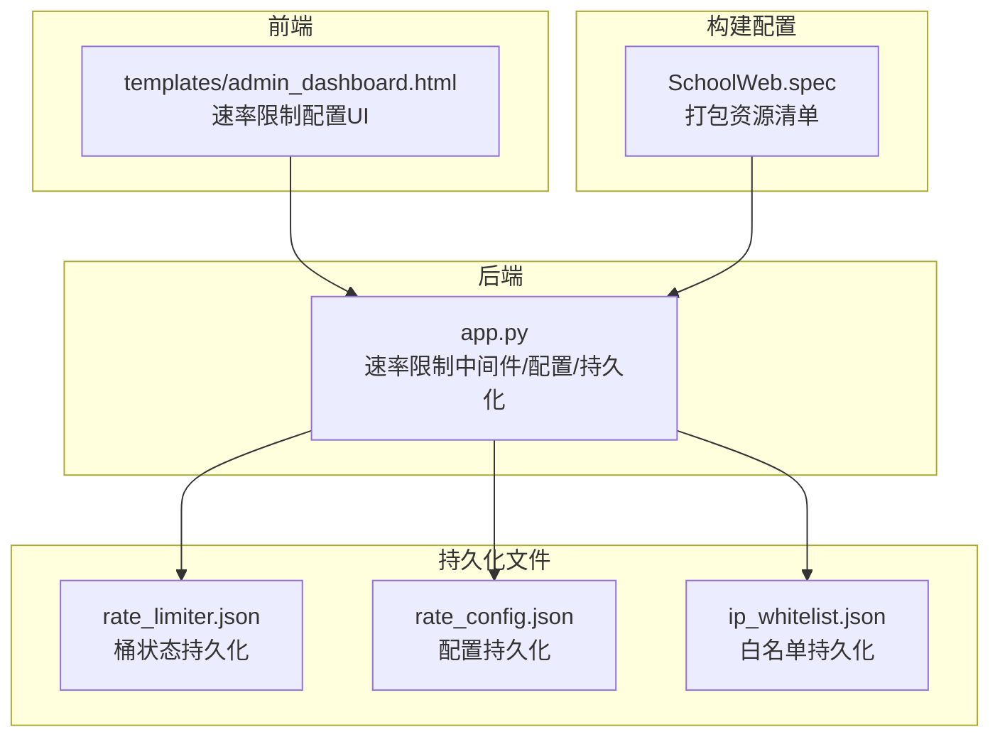
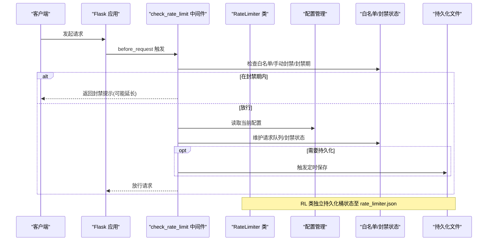
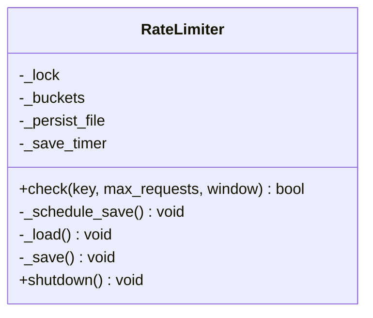
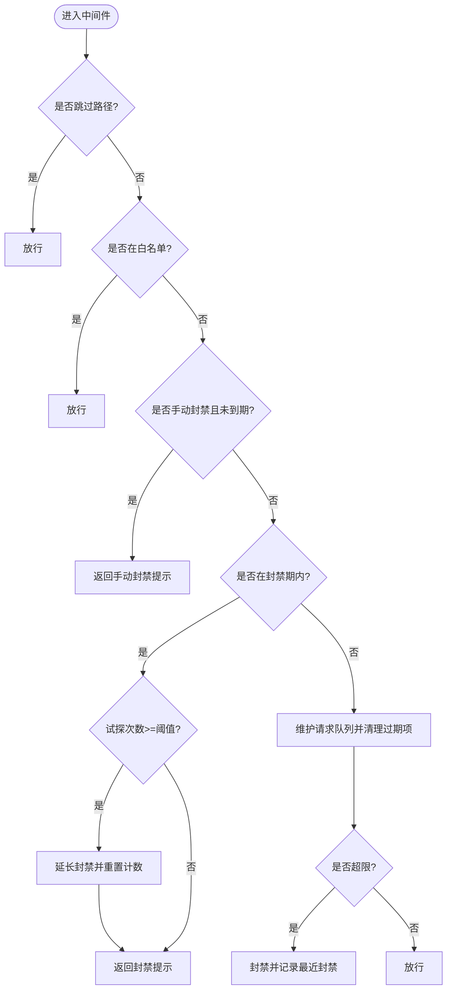
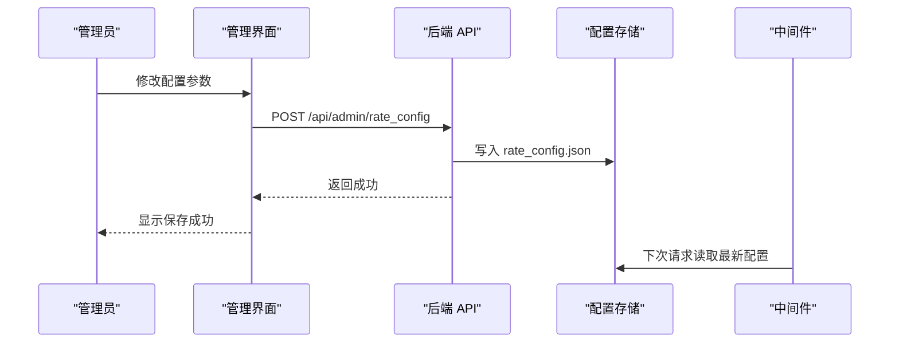
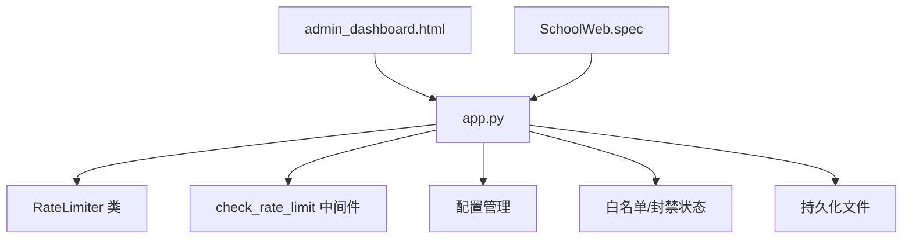

# 速率限制中间件

<cite>
**本文引用的文件**
- [app.py](file://app.py)
- [rate_limiter.json](file://rate_limiter.json)
- [rate_config.json](file://rate_config.json)
- [ip_whitelist.json](file://ip_whitelist.json)
- [admin_dashboard.html](file://templates/admin_dashboard.html)
- [SchoolWeb.spec](file://SchoolWeb.spec)
</cite>

## 目录
1. [简介](#简介)
2. [项目结构](#项目结构)
3. [核心组件](#核心组件)
4. [架构总览](#架构总览)
5. [详细组件分析](#详细组件分析)
6. [依赖分析](#依赖分析)
7. [性能考虑](#性能考虑)
8. [故障排查指南](#故障排查指南)
9. [结论](#结论)
10. [附录](#附录)

## 简介
本文件系统性梳理 School_Web 的速率限制中间件实现，重点围绕以下目标展开：
- 深入解释 RateLimiter 类的实现原理，包括内存存储、时间窗口计算与“桶”式计数机制。
- 详述 check_rate_limit 函数的执行流程，涵盖 IP 白名单、手动封禁、动态封禁策略与试探封禁延长逻辑。
- 阐明持久化速率限制的实现方式，包括文件存储、定时保存与优雅关闭。
- 解释速率限制配置的动态管理，包括配置文件读取、运行时修改与配置同步。
- 提供性能优化建议与监控指标收集方法。

## 项目结构
与速率限制直接相关的代码与资源分布如下：
- 后端核心：app.py 中包含速率限制中间件、配置管理、白名单与封禁状态维护、持久化与定时保存等。
- 前端管理界面：templates/admin_dashboard.html 提供速率限制配置的可视化与修改入口。
- 持久化文件：
  - rate_limiter.json：内存桶的文件持久化备份。
  - rate_config.json：速率限制配置文件。
  - ip_whitelist.json：IP 白名单文件。
- 构建配置：SchoolWeb.spec 指定打包时包含模板、静态资源与密钥文件，确保部署后能正确读写上述 JSON 文件。

图表来源
- [app.py](file://app.py)
- [admin_dashboard.html](file://templates/admin_dashboard.html)
- [rate_limiter.json](file://rate_limiter.json)
- [rate_config.json](file://rate_config.json)
- [ip_whitelist.json](file://ip_whitelist.json)
- [SchoolWeb.spec](file://SchoolWeb.spec)

章节来源
- [app.py](file://app.py)
- [admin_dashboard.html](file://templates/admin_dashboard.html)
- [rate_limiter.json](file://rate_limiter.json)
- [rate_config.json](file://rate_config.json)
- [ip_whitelist.json](file://ip_whitelist.json)
- [SchoolWeb.spec](file://SchoolWeb.spec)

## 核心组件
- RateLimiter 类：基于内存的轻量级速率限制器，采用“桶”式计数与时间窗口清理，支持文件持久化与定时保存。
- check_rate_limit 中间件：全局 before_request 中间件，负责白名单放行、手动封禁检查、封禁期内试探封禁延长、以及按配置进行动态封禁。
- 配置管理：默认配置与文件配置合并策略，提供运行时修改与持久化保存。
- 白名单与封禁：内存字典维护白名单、手动封禁与封禁期试探计数，支持持久化与管理界面操作。
- 前端管理界面：提供速率限制配置的可视化编辑与保存，调用后端 API 实现动态更新。

章节来源
- [app.py](file://app.py)
- [admin_dashboard.html](file://templates/admin_dashboard.html)

## 架构总览
整体架构由“中间件层 + 配置层 + 存储层 + 管理界面层”构成，数据与控制流如下：

图表来源
- [app.py](file://app.py)
- [rate_limiter.json](file://rate_limiter.json)

## 详细组件分析

### RateLimiter 类实现原理
- 内存存储
  - 使用字典存储桶，键为二元组 (ip, route)，值为时间戳列表，用于按路径区分不同接口的速率限制。
  - 使用锁保护并发访问，避免竞态条件。
- 时间窗口计算
  - 每次检查时计算截止时间 cutoff = now - window，过滤掉过期时间戳，仅保留窗口内的请求。
  - 若窗口内请求数达到阈值，则拒绝；否则允许并记录当前时间戳。
- “桶”算法机制
  - 本质为滑动窗口计数，窗口大小由配置决定；每次检查都会清理过期项，保证空间与时间复杂度可控。
- 文件持久化与定时保存
  - 初始化时尝试从 rate_limiter.json 加载历史桶状态，并仅保留最近 65 秒内的记录（窗口 60s + 5s 缓冲）。
  - 采用去抖保存策略：连续快速调用时，延迟 2 秒统一保存一次，减少磁盘 IO。
  - 优雅关闭：shutdown 时取消定时器并强制保存，确保进程退出前状态落盘。
- 关键路径参考
  - [check:43-57](file://app.py#L43-L57)
  - [_schedule_save:59-66](file://app.py#L59-L66)
  - [_load:68-92](file://app.py#L68-L92)
  - [_save:94-107](file://app.py#L94-L107)
  - [shutdown:109-113](file://app.py#L109-L113)
  - [实例化与持久化文件路径](file://app.py#L116)

图表来源
- [app.py](file://app.py)
- [rate_limiter.json](file://rate_limiter.json)

章节来源
- [app.py](file://app.py)
- [rate_limiter.json](file://rate_limiter.json)

### check_rate_limit 函数实现
- 路由跳过
  - 对静态资源、分享链接等路径直接放行，避免误伤正常访问。
- 白名单处理
  - 若请求 IP 在白名单集合中，直接放行，不参与后续封禁判断。
- 手动封禁检查
  - 若 IP 在手动封禁映射中且未到期，返回封禁提示与剩余秒数。
- 动态封禁策略
  - 若 IP 处于封禁期：
    - 累加试探次数；若超过 BLOCK_PROBE_LIMIT，则延长封禁 BLOCK_EXTEND 秒并重置试探计数。
    - 返回封禁提示与剩余秒数。
  - 若不在封禁期：
    - 使用双端队列维护该 IP 的请求时间戳，按 RATE_WINDOW 清理过期项。
    - 当队列长度超过 RATE_LIMIT 时，触发封禁，封禁时长为 BLOCK_DURATION，并记录最近封禁事件。
- 关键路径参考
  - [check_rate_limit 中间件:514-561](file://app.py#L514-L561)
  - [白名单/封禁状态定义:382-389](file://app.py#L382-L389)

图表来源
- [app.py](file://app.py)

章节来源
- [app.py](file://app.py)

### 持久化速率限制实现
- 文件存储
  - rate_limiter.json：保存桶状态（键为 "ip|route" 字符串，值为时间戳数组）。
  - rate_config.json：保存速率限制配置（如 RATE_LIMIT、RATE_WINDOW、BLOCK_DURATION 等）。
  - ip_whitelist.json：保存白名单 IP 列表。
- 定时保存
  - RateLimiter 类内部使用 Timer 延迟 2 秒保存，多次快速调用合并为一次落盘。
  - 配置修改通过 API 写入 rate_config.json。
- 优雅关闭
  - shutdown 取消定时器并立即保存，确保进程退出前状态完整。
- 关键路径参考
  - [RateLimiter._load/_save/shutdown:68-113](file://app.py#L68-L113)
  - [配置读取/保存:360-380](file://app.py#L360-L380)
  - [白名单读取/保存:394-410](file://app.py#L394-L410)

章节来源
- [app.py](file://app.py)
- [rate_limiter.json](file://rate_limiter.json)
- [rate_config.json](file://rate_config.json)
- [ip_whitelist.json](file://ip_whitelist.json)

### 速率限制配置的动态管理
- 配置文件读取
  - 默认配置与文件配置合并，文件缺失或异常时回退到默认值。
- 运行时修改
  - 管理端通过前端界面输入参数，调用 /api/admin/rate_config 接口提交修改。
  - 后端校验参数合法性并更新内存配置，随后持久化到 rate_config.json。
- 配置同步
  - 中间件在每次请求中读取最新配置，无需重启即可生效。
- 关键路径参考
  - [默认配置与合并:352-372](file://app.py#L352-L372)
  - [配置读取/保存函数:360-380](file://app.py#L360-L380)
  - [配置 API GET/POST:4259-4284](file://app.py#L4259-L4284)
  - [前端配置 UI:197-229](file://templates/admin_dashboard.html#L197-L229)
  - [前端保存配置调用:823-841](file://templates/admin_dashboard.html#L823-L841)

图表来源
- [app.py](file://app.py)
- [admin_dashboard.html](file://templates/admin_dashboard.html)
- [rate_config.json](file://rate_config.json)

章节来源
- [app.py](file://app.py)
- [admin_dashboard.html](file://templates/admin_dashboard.html)
- [rate_config.json](file://rate_config.json)

## 依赖分析
- 组件耦合
  - 中间件与配置模块强耦合：中间件直接读取 rate_config 并维护封禁状态。
  - RateLimiter 与持久化文件弱耦合：通过文件名传入，便于替换存储介质。
  - 管理界面与后端 API 强耦合：前端通过 AJAX 调用配置 API。
- 外部依赖
  - Python 标准库：threading、time、json、os。
  - Flask/Werkzeug：请求上下文、before_request、session 等。
  - 第三方库：pymysql、requests、PIL、psutil 等（与速率限制无直接关系）。
- 关键路径参考
  - [导入与依赖:1-28](file://app.py#L1-L28)
  - [构建配置包含的数据文件](file://SchoolWeb.spec#L8)

图表来源
- [app.py](file://app.py)
- [admin_dashboard.html](file://templates/admin_dashboard.html)
- [SchoolWeb.spec](file://SchoolWeb.spec)

章节来源
- [app.py](file://app.py)
- [SchoolWeb.spec](file://SchoolWeb.spec)

## 性能考虑
- 时间复杂度
  - 中间件每次请求清理过期项的时间复杂度为 O(n)，其中 n 为该 IP 的请求数；在高并发下应关注队列长度与窗口大小的平衡。
  - RateLimiter 的 check 操作为 O(n)（n 为窗口内请求数），但通过去抖保存降低磁盘写入频率。
- 空间复杂度
  - 内存占用主要来自 ip_requests、ip_blocked、ip_blocked_probes、ip_whitelist、ip_manual_blocked 等结构；可通过定期清理与合理窗口设置控制。
- 优化建议
  - 使用更高效的数据结构（如基于堆的最小堆或分段计数器）替代双端队列，减少清理成本。
  - 引入内存池或对象复用，降低频繁分配带来的 GC 压力。
  - 将封禁期与试探计数迁移到 Redis 等外部缓存，实现跨进程共享与持久化。
  - 对高频接口（如验证码）使用独立桶与更小窗口，避免影响全局策略。
  - 增加采样与聚合统计，减少实时计算开销。
- 监控指标
  - 请求速率（每 IP/每接口）、封禁次数、封禁延长次数、试探超限次数。
  - 内存使用、磁盘写入频率、平均响应时间、错误率。
  - 可通过管理界面展示与日志记录收集。

## 故障排查指南
- 速率限制未生效
  - 检查中间件是否被正确注册（before_request）。
  - 确认请求路径未被跳过（静态资源、分享链接等）。
- 配置修改无效
  - 确认 /api/admin/rate_config 接口返回成功，rate_config.json 已更新。
  - 检查中间件是否读取到最新配置（无需重启）。
- 白名单/封禁异常
  - 检查 ip_whitelist.json 与 ip_manual_blocked 状态是否一致。
  - 确认封禁到期后状态已清理。
- 持久化失败
  - 检查 rate_limiter.json/rate_config.json/ip_whitelist.json 的权限与磁盘空间。
  - 查看进程退出时是否调用 shutdown 导致强制保存。
- 关键路径参考
  - [check_rate_limit 中间件:514-561](file://app.py#L514-L561)
  - [配置读取/保存:360-380](file://app.py#L360-L380)
  - [白名单读取/保存:394-410](file://app.py#L394-L410)
  - [RateLimiter 持久化:68-113](file://app.py#L68-L113)

章节来源
- [app.py](file://app.py)
- [rate_limiter.json](file://rate_limiter.json)
- [rate_config.json](file://rate_config.json)
- [ip_whitelist.json](file://ip_whitelist.json)

## 结论
本速率限制中间件以轻量、易用为目标，在内存中维护滑动窗口计数，并通过文件持久化实现重启不丢失。配合动态配置与管理界面，实现了灵活的策略调整与可观测性。针对高并发场景，建议引入外部缓存与更高效的计数结构，并结合采样与聚合统计提升性能与稳定性。

## 附录
- 配置项说明
  - RATE_LIMIT：时间窗口内的最大请求数。
  - RATE_WINDOW：时间窗口（秒）。
  - BLOCK_DURATION：首次封禁时长（秒）。
  - BLOCK_PROBE_LIMIT：封禁期间试探次数阈值。
  - BLOCK_EXTEND：试探超限后追加封禁（秒）。
- 关键路径参考
  - [默认配置定义:352-358](file://app.py#L352-L358)
  - [配置文件示例:1-1](file://rate_config.json#L1-L1)
  - [白名单文件示例:1-1](file://ip_whitelist.json#L1-L1)