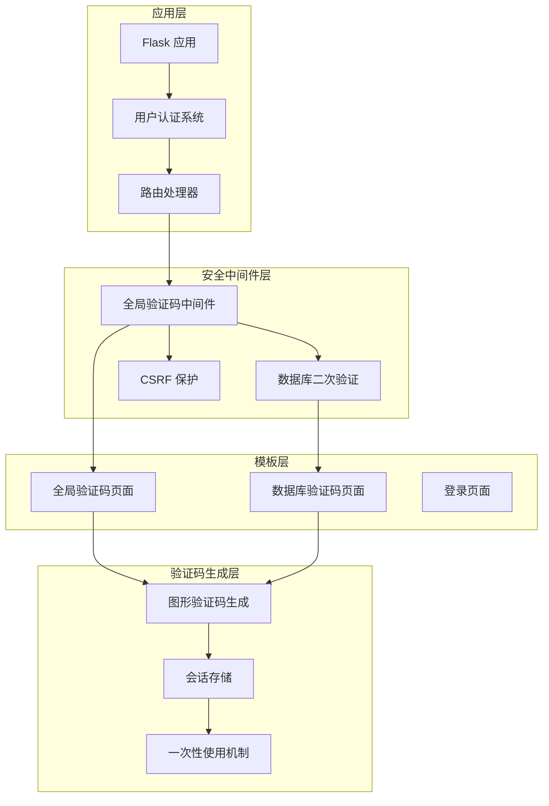
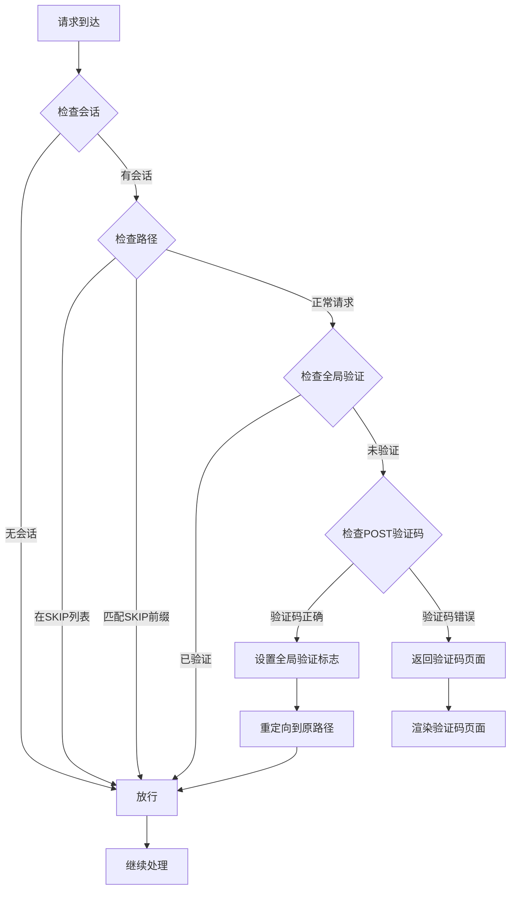
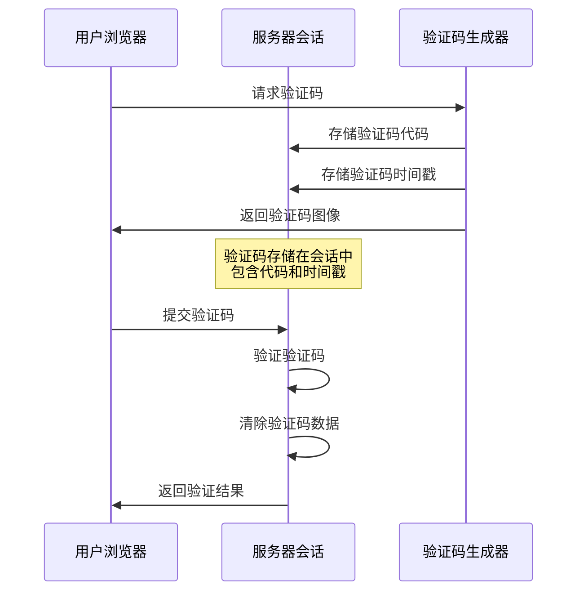
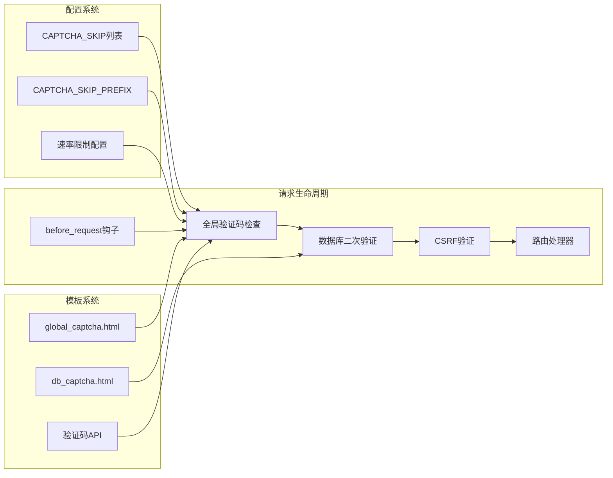
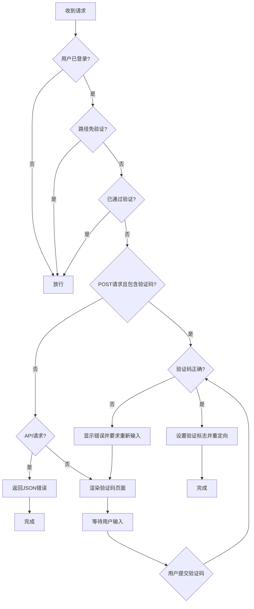
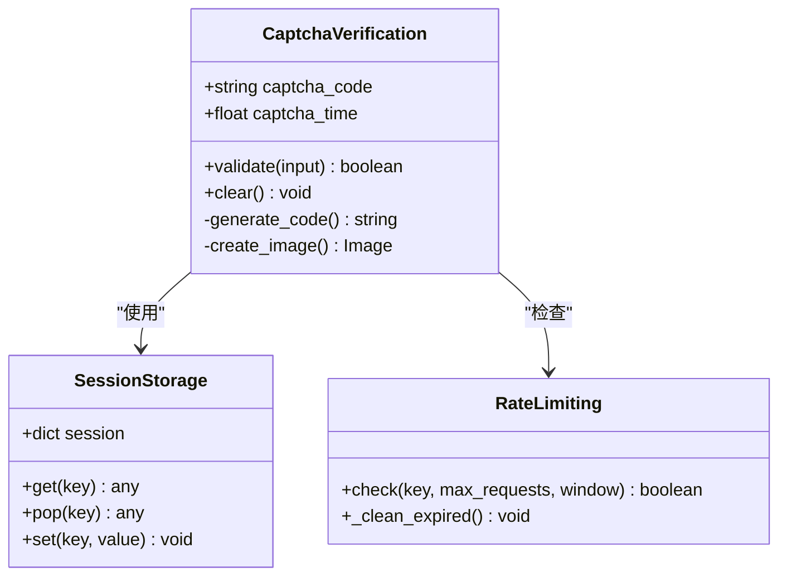
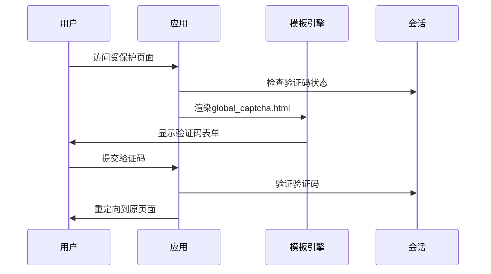
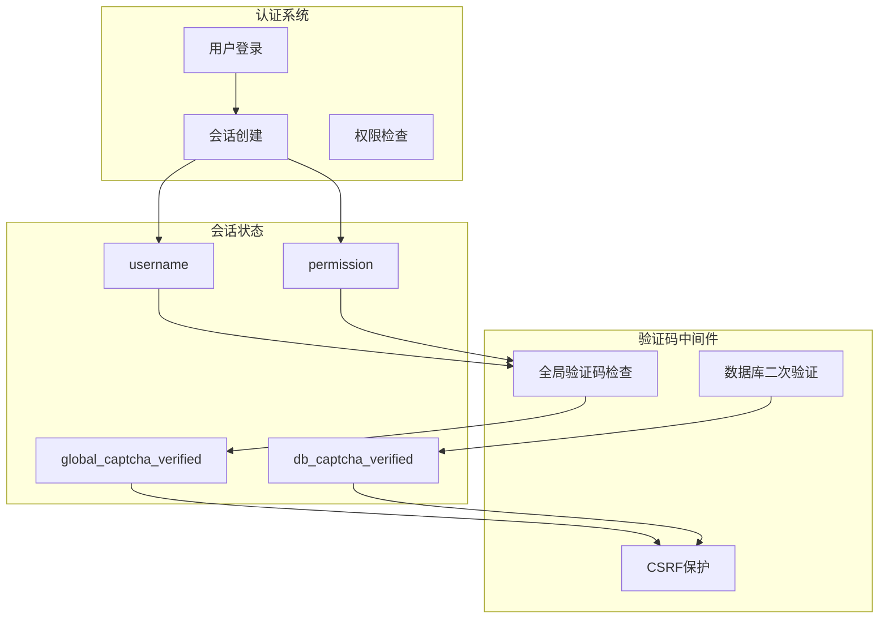
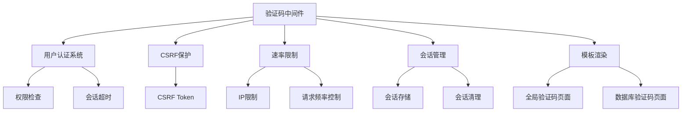

# 验证码中间件

<cite>
**本文档引用的文件**
- [app.py](file://app.py)
- [global_captcha.html](file://templates/global_captcha.html)
- [db_captcha.html](file://templates/db_captcha.html)
- [login.html](file://templates/login.html)
- [forgot_password.html](file://templates/forgot_password.html)
- [register.html](file://templates/register.html)
</cite>

## 目录
1. [简介](#简介)
2. [项目结构](#项目结构)
3. [核心组件](#核心组件)
4. [架构概览](#架构概览)
5. [详细组件分析](#详细组件分析)
6. [依赖关系分析](#依赖关系分析)
7. [性能考虑](#性能考虑)
8. [故障排除指南](#故障排除指南)
9. [结论](#结论)

## 简介

School_Web 的验证码中间件是一个全局安全机制，旨在防止自动化攻击和暴力破解。该系统通过 CAPTCHA_SKIP 列表、路径前缀匹配和验证码验证流程，为整个应用程序提供统一的安全保护。

验证码中间件的核心功能包括：
- 全局验证码门禁机制
- 已登录用户的验证码绕过
- API 接口的特殊处理
- 验证码页面的渲染逻辑
- 会话存储和一次性使用原则

## 项目结构

验证码中间件位于应用的核心安全层，与用户认证系统深度集成：

**图表来源**
- [app.py:596-622](file://app.py#L596-L622)
- [app.py:966-988](file://app.py#L966-L988)

## 核心组件

### 全局验证码门禁机制

验证码中间件通过 `CAPTCHA_SKIP` 列表和 `CAPTCHA_SKIP_PREFIX` 前缀来定义免验证的路由：

**图表来源**
- [app.py:600-622](file://app.py#L600-L622)

### 验证码生成系统

验证码生成采用图像处理技术，包含以下安全特性：

- **字符集限制**：排除易混淆字符（0, O, 1, l, I）
- **图像干扰**：背景噪点、曲线干扰、直线干扰
- **字符扭曲**：每个字符独立旋转和位置偏移
- **模糊处理**：轻微高斯模糊增强抗识别能力

**章节来源**
- [app.py:428-501](file://app.py#L428-L501)

### 会话存储机制

验证码数据通过 Flask 会话进行存储，确保一次性使用和安全性：

**图表来源**
- [app.py:414-425](file://app.py#L414-L425)
- [app.py:441-442](file://app.py#L441-L442)

**章节来源**
- [app.py:414-425](file://app.py#L414-L425)

## 架构概览

验证码中间件采用中间件模式，在请求到达路由处理器之前进行安全检查：

**图表来源**
- [app.py:596-598](file://app.py#L596-L598)
- [app.py:600-622](file://app.py#L600-L622)

## 详细组件分析

### check_global_captcha 函数工作原理

`check_global_captcha` 是验证码中间件的核心函数，负责全局安全验证：

#### 三重检查机制

1. **会话状态检查**
   - 检查用户是否已登录（session 中是否存在 username）
   - 未登录用户直接放行

2. **路径匹配检查**
   - 检查请求路径是否在 SKIP 列表中
   - 检查请求路径是否匹配 SKIP 前缀
   - 允许的路径包括静态资源、API 接口等

3. **验证状态检查**
   - 检查是否已通过全局验证码验证
   - 放行已验证的请求

#### 验证流程

**图表来源**
- [app.py:600-622](file://app.py#L600-L622)

**章节来源**
- [app.py:600-622](file://app.py#L600-L622)

### CAPTCHA_SKIP 列表详解

SKIP 列表定义了不需要验证码验证的路由：

#### 静态资源和公共页面
- `/` - 首页
- `/register` - 注册页面  
- `/logout` - 登出页面
- `/forgot_password` - 忘记密码页面
- `/reset_password` - 重置密码页面
- `/calculator*` - 计算器相关页面

#### 用户个人信息页面
- `/profile` - 个人资料
- `/change_password` - 更改密码
- `/dashboard` - 仪表盘
- `/author` - 关于作者

#### 功能页面
- `/chat` - 聊天室
- `/notes` - 笔记功能
- `/donate` - 打赏页面
- `/calendar` - 日历功能
- `/network_tools` - 网络工具
- `/system_monitor` - 系统监控

#### API 接口
- `/api/captcha` - 验证码 API
- `/api/marketplace*` - 市场相关 API

**章节来源**
- [app.py:597](file://app.py#L597)

### 路径前缀匹配机制

SKIP 前缀用于匹配具有特定前缀的路由：

#### 前缀类型
- `/static/` - 静态资源
- `/assets/` - 前端资源
- `/favicon.ico` - 网站图标
- `/share/` - 分享链接
- `/api/table/` - 数据库表格 API
- `/api/album/` - 相册相关 API
- `/api/admin/` - 管理员相关 API

#### 匹配策略
前缀匹配使用 `any(path.startswith(p) for p in CAPTCHA_SKIP_PREFIX)` 实现，确保所有以指定前缀开头的路由都被视为免验证。

**章节来源**
- [app.py:598](file://app.py#L598)

### 验证码生成和验证安全机制

#### 生成过程安全特性

1. **字符集设计**
   - 排除易混淆字符：0, O, 1, l, I
   - 使用 23456789ABCDEFGHJKLMNPQRSTUVWXYZ
   - 4 位随机验证码

2. **图像安全增强**
   - 背景噪点：15% 的像素点添加噪声
   - 曲线干扰：绘制 1 条曲线
   - 直线干扰：绘制 3 条短直线
   - 字符扭曲：每个字符独立旋转 -15° 到 15°

3. **会话存储安全**
   - 验证码代码存储在 session["captcha_code"]
   - 时间戳存储在 session["captcha_time"]
   - 一次性使用后立即清除

#### 验证过程安全特性

**图表来源**
- [app.py:414-425](file://app.py#L414-L425)
- [app.py:428-501](file://app.py#L428-L501)

**章节来源**
- [app.py:414-425](file://app.py#L414-L425)
- [app.py:428-501](file://app.py#L428-L501)

### 验证码页面渲染逻辑

#### 全局验证码页面

全局验证码页面用于保护非免验证路由：

**图表来源**
- [app.py:618-621](file://app.py#L618-L621)
- [global_captcha.html:1-22](file://templates/global_captcha.html#L1-L22)

#### 数据库验证码页面

数据库操作验证码页面用于保护敏感数据库操作：

**章节来源**
- [global_captcha.html:1-22](file://templates/global_captcha.html#L1-L22)
- [db_captcha.html:1-23](file://templates/db_captcha.html#L1-L23)

### 验证码中间件与用户认证系统集成

验证码中间件与用户认证系统通过会话状态进行深度集成：

**图表来源**
- [app.py:600-622](file://app.py#L600-L622)
- [app.py:966-988](file://app.py#L966-L988)

**章节来源**
- [app.py:600-622](file://app.py#L600-L622)
- [app.py:966-988](file://app.py#L966-L988)

## 依赖关系分析

验证码中间件与其他安全组件存在紧密的依赖关系：

**图表来源**
- [app.py:596-622](file://app.py#L596-L622)
- [app.py:919-932](file://app.py#L919-L932)

**章节来源**
- [app.py:596-622](file://app.py#L596-L622)
- [app.py:919-932](file://app.py#L919-L932)

## 性能考虑

### 会话存储优化

验证码中间件使用 Flask 会话存储，具有以下性能特点：

- **内存存储**：基于服务器内存的快速访问
- **自动清理**：会话过期后自动清理
- **并发安全**：使用线程锁保证多线程安全

### 验证码生成性能

验证码图像生成采用轻量级算法：

- **图像尺寸**：140x50 像素，减少计算开销
- **算法复杂度**：O(w×h) 的像素处理
- **缓存机制**：图像生成结果直接输出，无需额外缓存

### 速率限制优化

系统内置速率限制机制：

- **内存队列**：使用 deque 存储时间戳
- **自动清理**：过期记录自动清理
- **线程安全**：使用锁保证并发安全

## 故障排除指南

### 常见问题诊断

#### 验证码不显示
1. 检查 `/api/captcha` 路由是否正常工作
2. 验证会话是否正确创建
3. 检查浏览器 JavaScript 是否启用

#### 验证码验证失败
1. 检查验证码输入是否区分大小写
2. 验证会话存储是否正常
3. 检查验证码时间戳是否过期

#### 无限重定向循环
1. 检查 `global_captcha_verified` 标志是否正确设置
2. 验证会话状态是否持久化
3. 检查路由配置是否正确

#### 性能问题
1. 监控会话存储使用情况
2. 检查验证码生成性能
3. 验证速率限制配置

**章节来源**
- [app.py:414-425](file://app.py#L414-L425)
- [app.py:600-622](file://app.py#L600-L622)

## 结论

School_Web 的验证码中间件通过多层次的安全机制，为整个应用程序提供了全面的保护。其核心优势包括：

1. **灵活的配置系统**：通过 CAPTCHA_SKIP 列表和前缀匹配，精确控制验证范围
2. **高效的会话管理**：利用 Flask 会话实现快速、安全的状态存储
3. **强大的图像生成**：采用多种安全特性防止自动化识别
4. **深度的系统集成**：与用户认证、CSRF 保护等安全组件无缝协作

该验证码中间件不仅有效防止了暴力破解和自动化攻击，还保持了良好的用户体验，是 School_Web 安全架构的重要组成部分。