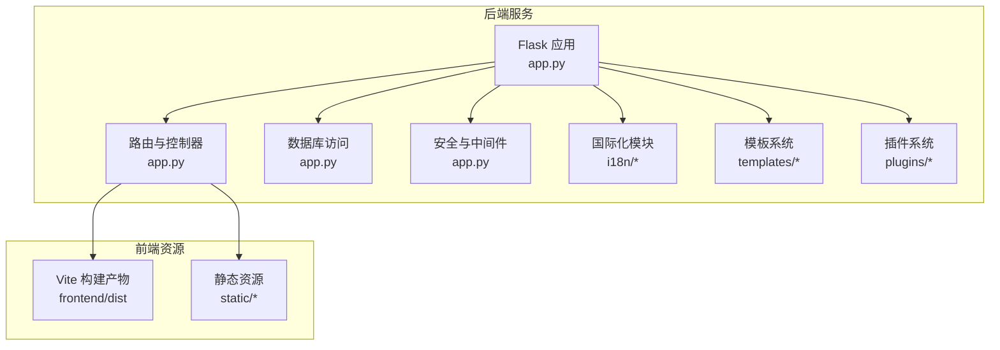
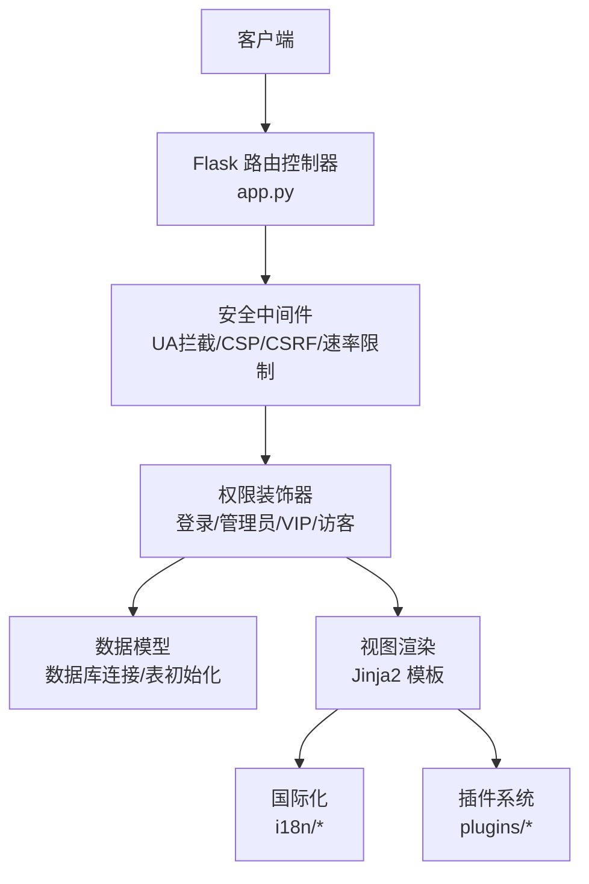
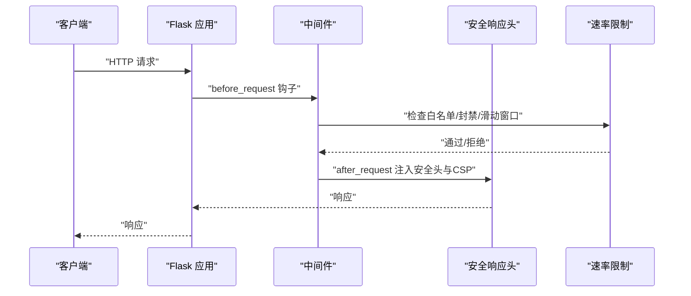
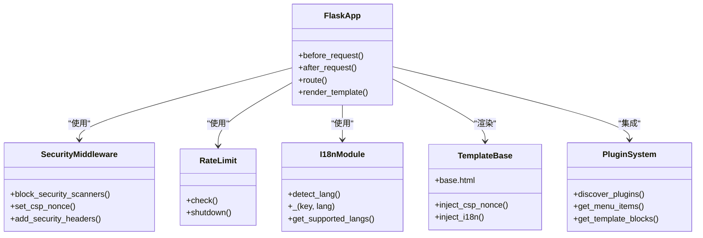
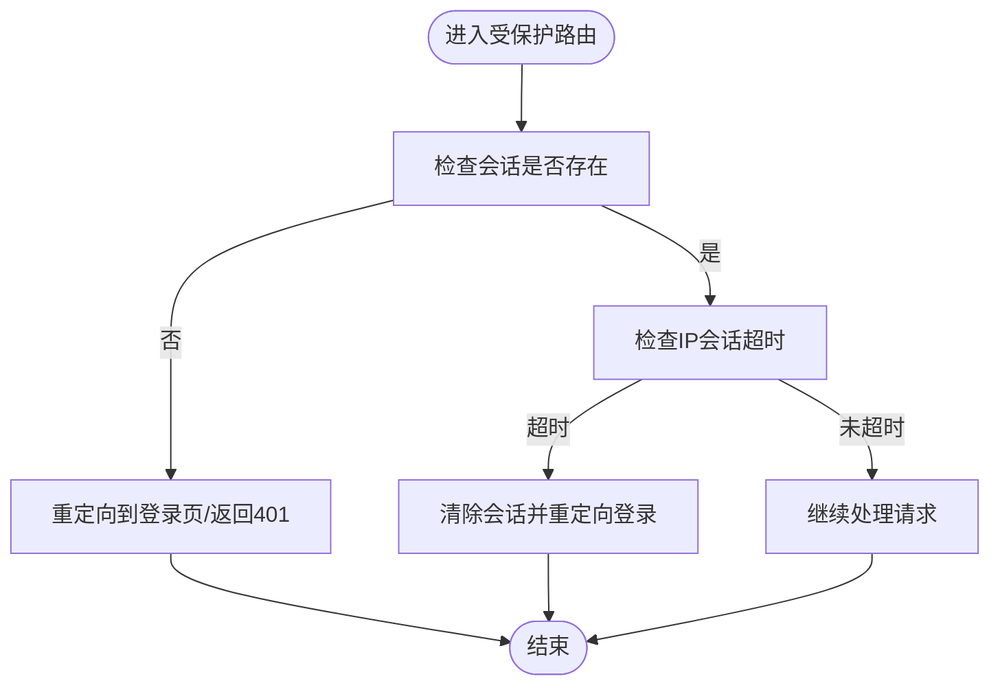
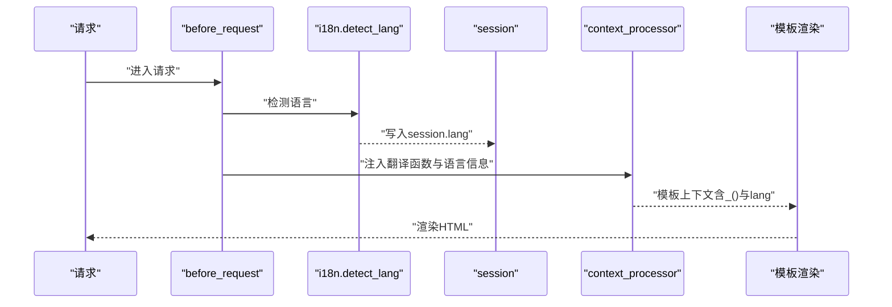
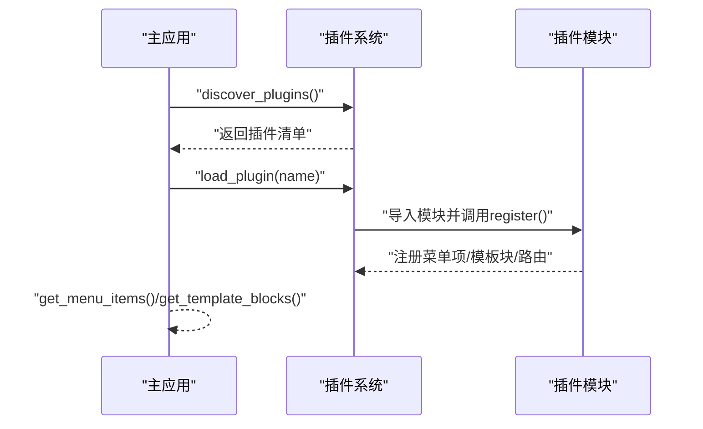
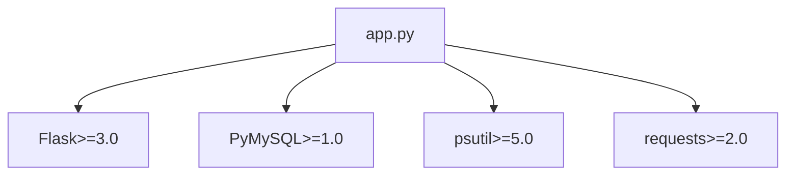

# 后端架构设计

<cite>
**本文档引用的文件**
- [app.py](file://app.py)
- [requirements.txt](file://requirements.txt)
- [templates/base.html](file://templates/base.html)
- [i18n/__init__.py](file://i18n/__init__.py)
- [i18n/zh-CN.json](file://i18n/zh-CN.json)
- [i18n/en.json](file://i18n/en.json)
- [plugins/__init__.py](file://plugins/__init__.py)
- [SchoolWeb.spec](file://SchoolWeb.spec)
</cite>

## 目录
1. [引言](#引言)
2. [项目结构](#项目结构)
3. [核心组件](#核心组件)
4. [架构总览](#架构总览)
5. [详细组件分析](#详细组件分析)
6. [依赖分析](#依赖分析)
7. [性能考虑](#性能考虑)
8. [故障排查指南](#故障排查指南)
9. [结论](#结论)
10. [附录](#附录)

## 引言
本文件面向School_Web后端，系统化梳理基于Flask的应用架构设计，涵盖应用初始化、路由体系、中间件机制、MVC实现、数据库连接与会话管理、安全机制、模板系统与国际化、API设计规范、错误处理与日志、以及部署与扩展性设计。文档旨在帮助开发者快速理解系统全貌，并为后续演进提供参考。

## 项目结构
项目采用前后端同构的单体后端架构，后端负责：
- Web路由与控制器逻辑
- 数据库访问与事务控制
- 会话与权限控制
- 安全防护与速率限制
- 国际化与模板渲染
- 插件系统扩展
- 日志与运维接口

图表来源
- [app.py](file://app.py)
- [templates/base.html](file://templates/base.html)
- [i18n/__init__.py](file://i18n/__init__.py)
- [plugins/__init__.py](file://plugins/__init__.py)

章节来源
- [app.py](file://app.py)
- [requirements.txt](file://requirements.txt)

## 核心组件
- 应用初始化与中间件
  - Flask实例创建、CORS跨域、会话安全配置、安全响应头注入、CSP nonce生成、多语言注入、插件菜单与模板块注入等。
- 路由与控制器
  - 登录/注册/登出、数据库管理、系统监控、网络工具、相册、聊天、文件管理、备份、插件市场等路由，配合装饰器实现权限与安全控制。
- 数据访问层
  - 基于PyMySQL的连接封装、数据库初始化与表结构管理、学习工具与相册扩展表初始化。
- 会话与权限
  - 基于Flask session的权限控制装饰器（登录、CSRF、管理员、VIP、访客）、IP会话超时、登录防爆破。
- 安全机制
  - UA黑名单拦截、CSP策略、安全响应头、速率限制（内存+持久化）、白名单与手动封禁、验证码门禁、全局二次验证。
- 模板系统
  - Jinja2模板、base.html基础模板、插件模板块注入、nonce安全脚本与样式。
- 国际化系统
  - 多语言JSON文件、语言检测与回退、模板上下文注入翻译函数与语言信息。
- 插件系统
  - 动态加载/卸载、菜单项注册、模板块注入、静态路由与API路由钩子。
- 日志与运维
  - 操作日志写入、错误处理、备份管理API、日志查看与清空。
- 部署与打包
  - PyInstaller规格文件，打包模板、静态资源与前端构建产物。

章节来源
- [app.py](file://app.py)
- [templates/base.html](file://templates/base.html)
- [i18n/__init__.py](file://i18n/__init__.py)
- [plugins/__init__.py](file://plugins/__init__.py)
- [SchoolWeb.spec](file://SchoolWeb.spec)

## 架构总览
后端采用“控制器-模型-视图”三层协作：
- 控制器：Flask路由处理请求，调用业务装饰器与辅助函数，组装响应。
- 模型：数据库连接与表结构初始化，提供数据访问能力。
- 视图：Jinja2模板渲染，结合国际化与插件注入，输出HTML。

图表来源
- [app.py](file://app.py)
- [i18n/__init__.py](file://i18n/__init__.py)
- [plugins/__init__.py](file://plugins/__init__.py)

## 详细组件分析

### 应用初始化与中间件
- Flask实例与CORS
  - 初始化Flask应用，启用CORS并限定来源，便于前端开发调试。
- 会话安全
  - 设置HttpOnly、SameSite、Secure（按HTTPS环境自动判断）、会话有效期。
- 安全响应头
  - 注入X-Content-Type-Options、X-Frame-Options、X-XSS-Protection、Referrer-Policy、Permissions-Policy；在生产环境注入Strict-Transport-Security；隐藏Server版本；敏感页面禁用缓存。
- CSP与nonce
  - 每请求生成唯一nonce，注入到模板上下文，CSP策略使用nonce保护脚本与样式。
- 多语言与插件注入
  - before_request中检测语言并持久化到数据库；context_processor向模板注入翻译函数、语言信息、插件菜单与模板块。
- 速率限制与白名单
  - 内存级滑动窗口+持久化配置文件，支持白名单与手动封禁；封禁期间试探次数超限追加封禁时长。

图表来源
- [app.py](file://app.py)

章节来源
- [app.py](file://app.py)

### MVC架构实现
- 模型层
  - 数据库连接封装与异常处理、数据库初始化与多表创建、相册扩展表初始化、学习工具表初始化。
- 视图层
  - 模板渲染与国际化注入，base.html提供导航、通知、主题切换、语言切换与插件注入点。
- 控制器层
  - 路由函数与装饰器组合，实现登录、权限、CSRF、二次验证等横切关注点。

图表来源
- [app.py](file://app.py)
- [templates/base.html](file://templates/base.html)
- [i18n/__init__.py](file://i18n/__init__.py)
- [plugins/__init__.py](file://plugins/__init__.py)

章节来源
- [app.py](file://app.py)
- [templates/base.html](file://templates/base.html)
- [i18n/__init__.py](file://i18n/__init__.py)
- [plugins/__init__.py](file://plugins/__init__.py)

### 数据库连接与会话管理
- 数据库连接
  - get_db()/get_album_db()封装连接参数与异常处理；首次访问时初始化相关表。
- 会话管理
  - 基于Flask session的权限标记与CSRF token；IP维度的会话超时检测，超时自动登出并提示。
- 登录防爆破
  - 用户名维度失败计数与锁定时间；登录成功/失败均写入日志。

图表来源
- [app.py](file://app.py)

章节来源
- [app.py](file://app.py)

### 安全机制
- UA黑名单拦截
  - 对常见安全扫描工具User-Agent直接返回403。
- CSP与nonce
  - 每请求生成nonce，CSP策略严格限制脚本与样式来源。
- CSRF防护
  - 非GET请求需携带CSRF token，服务端进行安全比较。
- 速率限制
  - 内存队列+持久化配置文件，支持白名单、手动封禁、试探封禁延长。
- 全局验证码门禁
  - 已登录用户访问特定路径需二次验证码，API路径返回JSON错误。
- 安全响应头
  - 统一注入安全头，生产环境启用HSTS。

章节来源
- [app.py](file://app.py)

### 模板系统与国际化
- 模板系统
  - base.html提供导航栏、通知、主题切换、语言切换与插件注入点；所有脚本与样式通过nonce注入，避免内联脚本与样式。
- 国际化
  - i18n模块加载多语言JSON，提供翻译函数与语言检测；模板上下文注入翻译函数与语言信息；支持查询参数、会话、Cookie与Accept-Language回退。

图表来源
- [app.py](file://app.py)
- [i18n/__init__.py](file://i18n/__init__.py)
- [templates/base.html](file://templates/base.html)

章节来源
- [app.py](file://app.py)
- [templates/base.html](file://templates/base.html)
- [i18n/__init__.py](file://i18n/__init__.py)
- [i18n/zh-CN.json](file://i18n/zh-CN.json)
- [i18n/en.json](file://i18n/en.json)

### 插件系统
- 动态加载
  - 扫描plugins/plugins目录，读取plugin.json与__init__.py，动态导入模块并调用register。
- 菜单项与模板块
  - 插件可通过注册接口向导航栏注入菜单项与模板块，支持权限过滤与排序。
- 静态路由与API路由钩子
  - 插件可注册静态文件路由与API路由，实现功能扩展。

图表来源
- [plugins/__init__.py](file://plugins/__init__.py)
- [app.py](file://app.py)

章节来源
- [plugins/__init__.py](file://plugins/__init__.py)
- [app.py](file://app.py)

### API接口设计规范
- REST风格
  - 路由以/api/开头，遵循资源化命名；统一返回JSON对象，包含状态字段与错误信息。
- 权限控制
  - 通过装饰器实现登录、管理员、VIP、访客等权限控制；API路径在权限不足时返回JSON错误与403/401。
- 响应格式
  - 成功响应包含业务字段；错误响应包含ok/error与状态码；部分路径返回简洁错误信息。
- 示例
  - 语言切换API、网络工具API、数据库管理API、备份管理API等均遵循上述规范。

章节来源
- [app.py](file://app.py)

### 错误处理、日志与性能监控
- 错误处理
  - 全局404/500/403处理器，API路径返回JSON错误，非API路径返回登录页。
- 日志
  - 操作日志写入文件，支持清空；日志查看与备份管理API。
- 性能监控
  - 系统监控页面展示CPU、内存、磁盘、网络等指标；网络工具提供端口扫描、Ping、DNS等。

章节来源
- [app.py](file://app.py)

## 依赖分析
- 运行时依赖
  - Flask、PyMySQL、psutil、requests等，满足Web框架、数据库、系统信息采集与网络请求需求。
- 打包依赖
  - PyInstaller规格文件包含模板、静态资源与前端构建产物，确保可执行文件包含完整资源。

图表来源
- [requirements.txt](file://requirements.txt)
- [app.py](file://app.py)

章节来源
- [requirements.txt](file://requirements.txt)
- [SchoolWeb.spec](file://SchoolWeb.spec)

## 性能考虑
- 速率限制
  - 内存滑动窗口+持久化配置，支持白名单与试探封禁，平衡安全与性能。
- 模板与CSP
  - nonce注入避免内联脚本与样式，减少浏览器解析负担；模板按需注入插件块。
- 数据库
  - 连接封装与异常处理，表初始化按需执行，避免重复DDL开销。
- 前端资源
  - 前端构建产物与静态资源打包，减少运行时I/O。

## 故障排查指南
- 登录失败/锁定
  - 检查登录防爆破记录与日志；确认密码哈希升级流程。
- 会话超时
  - 检查IP维度会话超时配置与最近活动时间更新。
- 速率限制触发
  - 查看封禁列表与试探次数；必要时加入白名单或调整配置。
- API权限错误
  - 确认用户权限与API装饰器；检查CSRF token与请求方法。
- 模板语言/插件问题
  - 检查i18n文件完整性与context_processor注入；确认插件加载状态。

章节来源
- [app.py](file://app.py)

## 结论
School_Web后端以Flask为核心，结合装饰器实现权限与安全控制，采用Jinja2模板与国际化模块提供多语言体验，通过插件系统实现功能扩展。系统在安全性、可维护性与可扩展性方面具备良好基础，适合进一步引入连接池、缓存与分布式部署策略以提升性能与可靠性。

## 附录
- 部署要点
  - 使用PyInstaller规格文件打包，确保模板、静态资源与前端构建产物齐全。
  - 生产环境启用HTTPS以激活安全响应头与Secure Cookie。
- 扩展建议
  - 引入连接池与连接复用；增加缓存层（Redis/Memcached）；拆分微服务或引入异步任务队列；完善监控与告警体系。