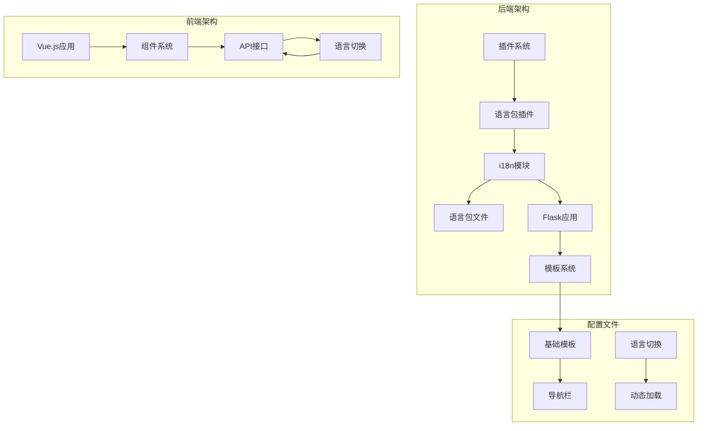
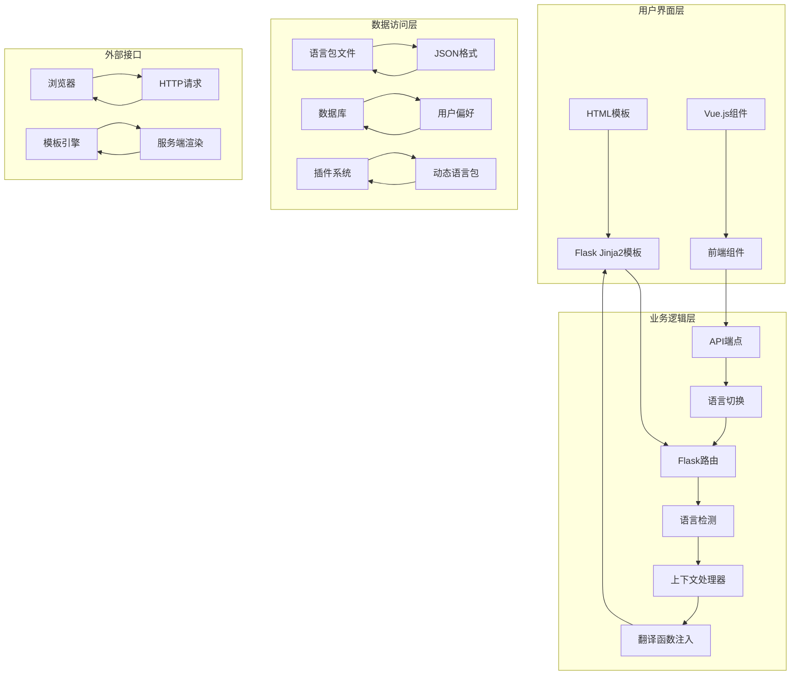
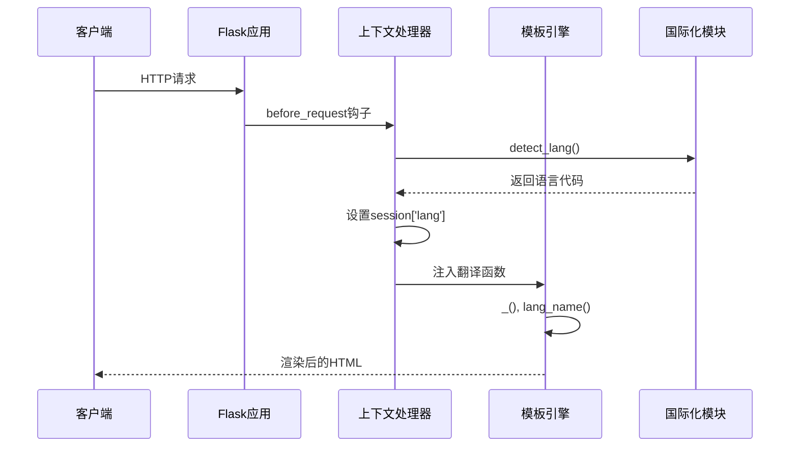
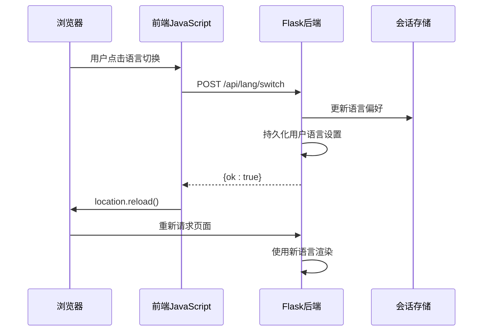
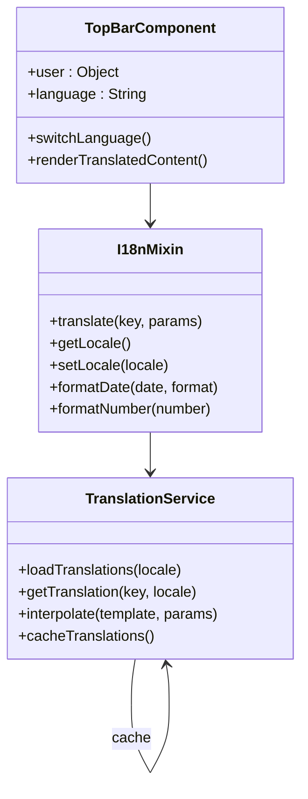
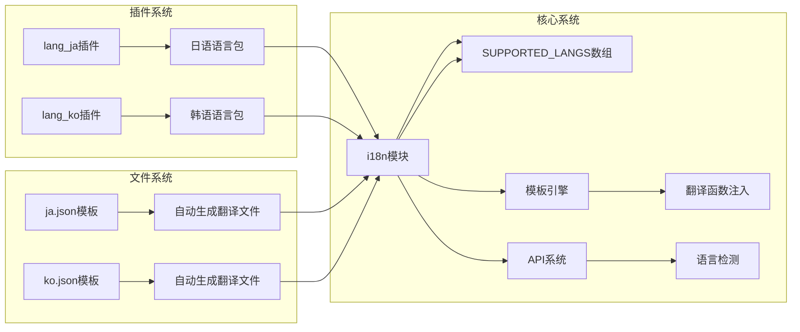
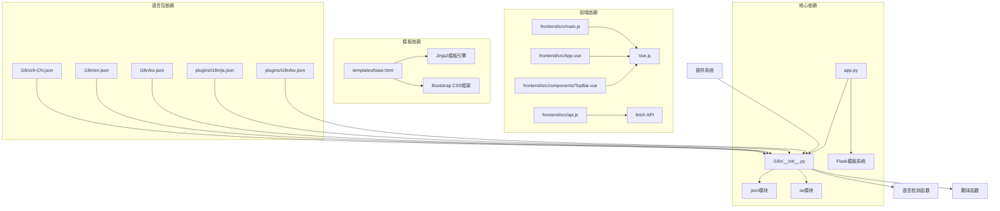

# 国际化系统

<cite>
**本文档引用的文件**
- [i18n/__init__.py](file://i18n/__init__.py)
- [i18n/en.json](file://i18n/en.json)
- [i18n/zh-CN.json](file://i18n/zh-CN.json)
- [i18n/ko.json](file://i18n/ko.json)
- [plugins/i18n/ko.json](file://plugins/i18n/ko.json)
- [plugins/i18n/ja.json](file://plugins/i18n/ja.json)
- [plugins/plugins/lang_ja/__init__.py](file://plugins/plugins/lang_ja/__init__.py)
- [plugins/plugins/lang_ko/__init__.py](file://plugins/plugins/lang_ko/__init__.py)
- [templates/base.html](file://templates/base.html)
- [app.py](file://app.py)
- [frontend/src/main.js](file://frontend/src/main.js)
- [frontend/src/App.vue](file://frontend/src/App.vue)
- [frontend/src/components/TopBar.vue](file://frontend/src/components/TopBar.vue)
- [frontend/src/api.js](file://frontend/src/api.js)
</cite>

## 目录
1. [简介](#简介)
2. [项目结构](#项目结构)
3. [核心组件](#核心组件)
4. [架构概览](#架构概览)
5. [详细组件分析](#详细组件分析)
6. [依赖分析](#依赖分析)
7. [性能考虑](#性能考虑)
8. [故障排除指南](#故障排除指南)
9. [结论](#结论)

## 简介

School_Web的国际化系统是一个完整的多语言支持解决方案，支持中文、英语、韩语和日语四种语言。该系统采用前后端分离的架构设计，后端使用Python实现，前端使用Vue.js框架，通过Flask模板引擎实现服务端渲染。

系统的核心特性包括：
- 动态语言检测机制
- 语言包管理和热更新
- 实时语言切换功能
- 支持插件化的语言包扩展
- 参数化翻译和占位符替换
- 用户语言偏好的持久化存储

## 项目结构

国际化系统主要分布在以下几个关键目录中：



**图表来源**
- [i18n/__init__.py:1-113](file://i18n/__init__.py#L1-L113)
- [app.py:164-211](file://app.py#L164-L211)
- [templates/base.html:158-267](file://templates/base.html#L158-L267)

**章节来源**
- [i18n/__init__.py:1-113](file://i18n/__init__.py#L1-L113)
- [app.py:119-211](file://app.py#L119-L211)

## 核心组件

### 语言检测引擎

语言检测是国际化系统的核心组件，负责根据多种因素确定用户的首选语言：

```mermaid
flowchart TD
A[用户请求到达] --> B{检查查询参数}
B --> |存在有效语言| C[使用查询参数语言]
B --> |不存在| D{检查会话存储}
D --> |存在有效语言| E[使用会话语言]
D --> |不存在| F{检查Cookie}
F --> |存在有效语言| G[使用Cookie语言]
F --> |不存在| H{检查Accept-Language头}
H --> |匹配语言| I[使用映射后的语言]
H --> |不匹配| J[使用默认语言(zh-CN)]
C --> K[设置语言偏好]
E --> K
G --> K
I --> K
J --> K
K --> L[返回检测结果]
```

**图表来源**
- [i18n/__init__.py:70-108](file://i18n/__init__.py#L70-L108)

### 翻译函数系统

翻译函数提供了统一的国际化接口，支持参数化替换和默认值处理：

| 函数特性 | 实现细节 | 使用示例 |
|---------|----------|----------|
| 基础翻译 | `_()`函数提供核心翻译功能 | `_("nav_dashboard")` |
| 参数化翻译 | 支持格式化占位符替换 | `_("backup_keep_n", n=5)` |
| 默认值处理 | 当翻译缺失时返回键名或自定义默认值 | `_("missing_key", default="默认文本")` |
| 语言切换 | 动态指定目标语言进行翻译 | `_("nav_dashboard", lang="en")` |

**章节来源**
- [i18n/__init__.py:50-67](file://i18n/__init__.py#L50-L67)

### 语言包管理系统

系统支持多种语言包格式和加载策略：

| 语言包类型 | 文件位置 | 加载方式 | 特殊功能 |
|-----------|----------|----------|----------|
| 核心语言包 | `i18n/*.json` | 模块导入时预加载 | 包含完整翻译键集合 |
| 插件语言包 | `plugins/i18n/*.json` | 插件注册时动态加载 | 支持插件特定翻译 |
| 用户语言包 | 数据库持久化 | 登录时自动加载 | 个性化语言偏好 |

**章节来源**
- [i18n/zh-CN.json:1-477](file://i18n/zh-CN.json#L1-L477)
- [i18n/en.json:1-477](file://i18n/en.json#L1-L477)
- [plugins/i18n/ko.json:1-17](file://plugins/i18n/ko.json#L1-L17)

## 架构概览

国际化系统采用分层架构设计，确保前后端的无缝集成：



**图表来源**
- [app.py:164-211](file://app.py#L164-L211)
- [templates/base.html:158-267](file://templates/base.html#L158-L267)
- [frontend/src/App.vue:1-99](file://frontend/src/App.vue#L1-L99)

## 详细组件分析

### 后端国际化实现

#### Flask上下文处理器

Flask的上下文处理器为所有模板注入了必要的国际化功能：



**图表来源**
- [app.py:164-211](file://app.py#L164-L211)
- [i18n/__init__.py:70-108](file://i18n/__init__.py#L70-L108)

#### 语言切换API

系统提供了完整的语言切换API，支持客户端实时切换语言：



**图表来源**
- [templates/base.html:253-266](file://templates/base.html#L253-L266)
- [app.py:213-230](file://app.py#L213-L230)

**章节来源**
- [app.py:164-211](file://app.py#L164-L211)
- [templates/base.html:253-266](file://templates/base.html#L253-L266)

### 前端国际化实现

#### Vue.js组件集成

前端Vue.js应用通过全局API和组件通信实现国际化：



**图表来源**
- [frontend/src/components/TopBar.vue:15-31](file://frontend/src/components/TopBar.vue#L15-L31)
- [frontend/src/App.vue:47-84](file://frontend/src/App.vue#L47-L84)

#### 模板中的国际化使用

在Flask模板中，国际化通过简单的语法实现：

| 模板语法 | 功能描述 | 示例 |
|---------|----------|------|
| `{{ _('key') }}` | 基础翻译 | `{{ _('app_brand') }}` |
| `{{ _('key', param=value) }}` | 参数化翻译 | `{{ _('backup_keep_n', n=count) }}` |
| `{{ lang_name(lang) }}` | 获取语言显示名称 | `{{ lang_name('en') }}` |
| `` | 遍历支持的语言列表 | 动态生成语言切换菜单 |

**章节来源**
- [templates/base.html:160-177](file://templates/base.html#L160-L177)
- [templates/base.html:227-229](file://templates/base.html#L227-L229)

### 插件化语言包系统

#### 语言包插件架构

系统支持通过插件扩展新的语言包，实现完全的模块化国际化：



**图表来源**
- [plugins/plugins/lang_ja/__init__.py:18-97](file://plugins/plugins/lang_ja/__init__.py#L18-L97)
- [plugins/plugins/lang_ko/__init__.py:17-88](file://plugins/plugins/lang_ko/__init__.py#L17-L88)

**章节来源**
- [plugins/plugins/lang_ja/__init__.py:18-97](file://plugins/plugins/lang_ja/__init__.py#L18-L97)
- [plugins/plugins/lang_ko/__init__.py:17-88](file://plugins/plugins/lang_ko/__init__.py#L17-L88)

## 依赖分析

国际化系统的关键依赖关系如下：



**图表来源**
- [i18n/__init__.py:4-28](file://i18n/__init__.py#L4-L28)
- [app.py:21-27](file://app.py#L21-L27)
- [templates/base.html:158-267](file://templates/base.html#L158-L267)

**章节来源**
- [i18n/__init__.py:4-28](file://i18n/__init__.py#L4-L28)
- [app.py:21-27](file://app.py#L21-L27)

## 性能考虑

### 缓存策略

国际化系统采用了多层次的缓存机制来优化性能：

1. **内存缓存**：已加载的语言包存储在内存字典中，避免重复文件I/O操作
2. **预加载机制**：应用启动时预加载所有支持语言包，减少首次请求延迟
3. **模板缓存**：Flask模板引擎自动缓存编译后的模板
4. **浏览器缓存**：静态资源和翻译文件利用浏览器缓存机制

### 优化建议

| 优化方向 | 实现方案 | 性能收益 |
|---------|----------|----------|
| 延迟加载 | 按需加载非当前语言包 | 减少初始内存占用 |
| 增量更新 | 支持部分语言包热更新 | 无需重启服务 |
| CDN加速 | 将语言包文件托管到CDN | 提高全球访问速度 |
| 压缩传输 | 启用Gzip压缩语言包文件 | 减少网络传输时间 |

## 故障排除指南

### 常见问题及解决方案

#### 语言包加载失败

**问题症状**：页面显示翻译键而非实际文本

**诊断步骤**：
1. 检查语言包文件是否存在且格式正确
2. 验证JSON文件编码是否为UTF-8
3. 确认语言代码与文件名匹配

**解决方法**：
```python
# 检查语言包完整性
def validate_translation_file(lang_code):
    file_path = os.path.join(I18N_DIR, f"{lang_code}.json")
    try:
        with open(file_path, 'r', encoding='utf-8') as f:
            data = json.load(f)
        return True
    except (FileNotFoundError, json.JSONDecodeError):
        return False
```

#### 语言切换不生效

**问题症状**：切换语言后页面文本未更新

**诊断步骤**：
1. 检查API响应状态码
2. 验证会话中语言偏好的更新
3. 确认页面是否正确重新加载

**解决方法**：
```javascript
// 前端语言切换验证
document.querySelectorAll('.lang-switch').forEach(element => {
    element.addEventListener('click', async function(e) {
        e.preventDefault();
        const lang = this.getAttribute('data-lang');
        
        try {
            const response = await fetch('/api/lang/switch', {
                method: 'POST',
                headers: {'Content-Type': 'application/json'},
                body: JSON.stringify({lang: lang})
            });
            
            const result = await response.json();
            if (result.ok) {
                location.reload();
            }
        } catch (error) {
            console.error('语言切换失败:', error);
        }
    });
});
```

#### 插件语言包冲突

**问题症状**：插件安装后出现翻译键重复或覆盖

**诊断步骤**：
1. 检查插件语言包的键名是否与核心语言包冲突
2. 验证插件注册顺序和优先级
3. 确认语言包合并逻辑

**解决方法**：
```python
# 插件语言包注册流程
def register_plugin_language(plugin_name, lang_code, lang_name):
    # 创建翻译文件
    ensure_translation_file(lang_code)
    
    # 扩展支持的语言列表
    extend_supported_langs(lang_code)
    
    # 注册模板块
    register_template_block(plugin_name, {
        'name': f'{plugin_name}_head',
        'template': '',
        'position': 'head',
        'order': 100
    })
```

**章节来源**
- [i18n/__init__.py:15-28](file://i18n/__init__.py#L15-L28)
- [templates/base.html:253-266](file://templates/base.html#L253-L266)

## 结论

School_Web的国际化系统展现了现代Web应用国际化设计的最佳实践。通过前后端分离的架构、插件化的语言包扩展机制以及完善的缓存策略，系统实现了高效、灵活且易于维护的多语言支持。

### 系统优势

1. **模块化设计**：清晰的职责分离使得系统易于扩展和维护
2. **性能优化**：多层次缓存和预加载机制确保良好的用户体验
3. **扩展性强**：插件化架构支持动态添加新语言包
4. **用户体验**：无缝的语言切换和实时反馈机制

### 发展建议

1. **增强复数形式支持**：引入更复杂的复数规则处理
2. **日期时间本地化**：集成更全面的本地化格式化功能
3. **语音合成支持**：为不同语言提供语音朗读功能
4. **机器翻译集成**：为缺失的翻译键提供智能翻译建议

该国际化系统为School_Web项目提供了坚实的基础，能够支持未来更多的语言扩展和功能增强需求。