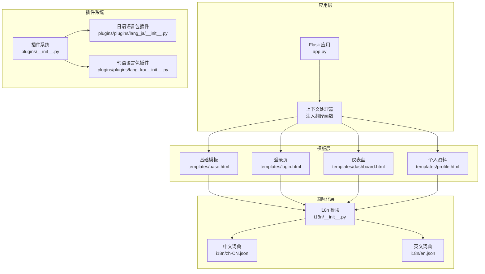
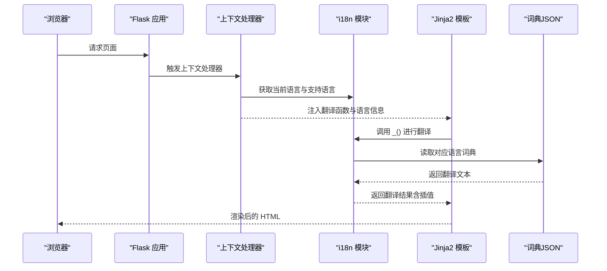
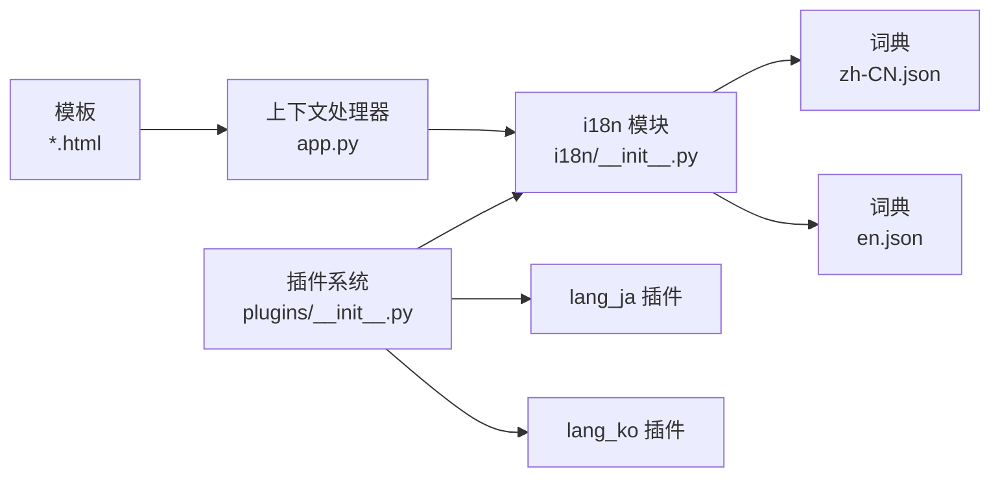

# 模板集成方案

<cite>
**本文档引用的文件**
- [app.py](file://app.py)
- [base.html](file://templates/base.html)
- [login.html](file://templates/login.html)
- [dashboard.html](file://templates/dashboard.html)
- [profile.html](file://templates/profile.html)
- [__init__.py](file://i18n/__init__.py)
- [zh-CN.json](file://i18n/zh-CN.json)
- [en.json](file://i18n/en.json)
- [plugins/__init__.py](file://plugins/__init__.py)
- [lang_ja/__init__.py](file://plugins/plugins/lang_ja/__init__.py)
- [lang_ko/__init__.py](file://plugins/plugins/lang_ko/__init__.py)
</cite>

## 目录
1. [引言](#引言)
2. [项目结构](#项目结构)
3. [核心组件](#核心组件)
4. [架构概览](#架构概览)
5. [详细组件分析](#详细组件分析)
6. [依赖分析](#依赖分析)
7. [性能考虑](#性能考虑)
8. [故障排查指南](#故障排查指南)
9. [结论](#结论)
10. [附录](#附录)

## 引言
本方案面向 School_Web 的模板国际化集成，围绕 Jinja2 模板中的翻译函数使用、翻译标记模式、变量插值与安全处理、模板继承中的国际化策略，以及最佳实践与常见问题进行系统化说明。读者无需深入技术背景即可理解并落地实施。

## 项目结构
School_Web 采用 Flask + Jinja2 的服务端渲染架构，国际化能力由 i18n 模块提供，并通过应用上下文处理器注入到所有模板中。模板继承以 base.html 为基础，各页面模板通过 extends 继承并在 block 中插入具体文案与交互逻辑。

**图表来源**
- [app.py](file://app.py)
- [base.html](file://templates/base.html)
- [login.html](file://templates/login.html)
- [dashboard.html](file://templates/dashboard.html)
- [profile.html](file://templates/profile.html)
- [__init__.py](file://i18n/__init__.py)
- [zh-CN.json](file://i18n/zh-CN.json)
- [en.json](file://i18n/en.json)
- [plugins/__init__.py](file://plugins/__init__.py)
- [lang_ja/__init__.py](file://plugins/plugins/lang_ja/__init__.py)
- [lang_ko/__init__.py](file://plugins/plugins/lang_ko/__init__.py)

**章节来源**
- [app.py](file://app.py)
- [base.html](file://templates/base.html)
- [__init__.py](file://i18n/__init__.py)

## 核心组件
- 翻译函数与上下文注入
  - 应用通过上下文处理器将翻译函数 "_" 注入模板全局，支持按当前会话语言进行翻译。
  - 同时提供语言名称映射与支持语言列表，便于前端语言切换 UI。
- 国际化词典
  - 词典以 JSON 形式存放，键为固定文案标识，值为对应语言的翻译文本。
  - 支持变量插值占位符，模板中可传入关键字参数进行替换。
- 模板继承与区块
  - base.html 定义通用头部、导航、脚注与通知区域；子模板通过 block 覆盖标题与内容。
- 插件语言包
  - 通过插件系统动态加载语言包，扩展支持语言集合与词典文件。

**章节来源**
- [app.py](file://app.py)
- [__init__.py](file://i18n/__init__.py)
- [base.html](file://templates/base.html)

## 架构概览
模板国际化在运行时的调用链如下：

**图表来源**
- [app.py](file://app.py)
- [__init__.py](file://i18n/__init__.py)
- [base.html](file://templates/base.html)

## 详细组件分析

### 翻译函数在模板中的使用
- 调用语法
  - 在模板中以 "{{ _('键', default='默认值', 可选参数=值) }}" 的形式调用。
  - 若未显式传入语言，将使用当前会话语言。
- 参数传递
  - 支持传入默认值与关键字参数，用于动态替换占位符。
- 实战示例（路径参考）
  - 登录页标题与字段文案：[login.html](file://templates/login.html)
  - 仪表盘欢迎语与权限徽章文案：[dashboard.html](file://templates/dashboard.html)
  - 个人资料页表单标签：[profile.html](file://templates/profile.html)

**章节来源**
- [login.html](file://templates/login.html)
- [dashboard.html](file://templates/dashboard.html)
- [profile.html](file://templates/profile.html)
- [__init__.py](file://i18n/__init__.py)

### 翻译标记与静态/动态处理
- 静态文本翻译
  - 使用固定键进行翻译，如导航项、按钮文案、页面标题等。
  - 示例：导航品牌、登录标题、注册链接等。
- 动态内容处理
  - 通过关键字参数进行插值，如“保留最近 {n} 个”、“{count} 个文件”等。
  - 词典中定义占位符，模板中传参，实现动态文案。
- 实战示例（路径参考）
  - 备份功能文案与插值：[zh-CN.json](file://i18n/zh-CN.json)
  - 英文对照与插值键：[en.json](file://i18n/en.json)

**章节来源**
- [zh-CN.json](file://i18n/zh-CN.json)
- [en.json](file://i18n/en.json)

### 模板继承中的国际化处理
- 基础模板国际化
  - base.html 中的标题、导航、页脚免责声明等均通过翻译函数输出。
  - 语言切换 UI 与通知区域文案同样来自词典。
- 子模板覆盖机制
  - 子模板通过 block 覆盖 title 与 content，内部可继续使用翻译函数。
  - 例如 login.html 覆盖标题与内容区块，dashboard.html 覆盖内容区块并嵌套大量翻译键。
- 实战示例（路径参考）
  - 基础模板与语言切换 UI：[base.html](file://templates/base.html)
  - 登录页继承与覆盖：[login.html](file://templates/login.html)
  - 仪表盘继承与覆盖：[dashboard.html](file://templates/dashboard.html)

**章节来源**
- [base.html](file://templates/base.html)
- [login.html](file://templates/login.html)
- [dashboard.html](file://templates/dashboard.html)

### 变量插值与安全处理
- 变量插值
  - 通过翻译函数的关键字参数实现插值，模板中无需手动拼接。
  - 词典中使用格式化占位符，确保跨语言一致性。
- 用户输入安全
  - 服务端对用户输入进行清洗与长度限制，避免注入与越界。
  - 模板渲染时遵循 Jinja2 自动转义规则，避免 XSS。
- 实战示例（路径参考）
  - 输入清洗函数与正则过滤：[app.py](file://app.py)
  - 模板自动转义与 CSP nonce 注入：[app.py](file://app.py)
  - 模板中使用翻译函数与插值：[dashboard.html](file://templates/dashboard.html)

**章节来源**
- [app.py](file://app.py)
- [dashboard.html](file://templates/dashboard.html)

### 模板国际化最佳实践
- 键设计规范
  - 使用语义化键名，避免硬编码文本；同一功能域键名前缀统一。
- 词典维护
  - 新增语言时同步补充词典文件；优先从现有词典复制再增量修改。
- 模板编写
  - 所有可见文案统一走翻译函数；避免在模板中直接写死语言。
  - 对动态文案使用插值，保证不同语言下的语法正确性。
- 上下文注入
  - 通过上下文处理器集中注入翻译函数与语言信息，避免重复代码。
- 插件语言包
  - 通过插件系统扩展语言，避免修改主程序；插件负责词典生成与语言注册。

**章节来源**
- [__init__.py](file://i18n/__init__.py)
- [plugins/__init__.py](file://plugins/__init__.py)
- [lang_ja/__init__.py](file://plugins/plugins/lang_ja/__init__.py)
- [lang_ko/__init__.py](file://plugins/plugins/lang_ko/__init__.py)

## 依赖分析
- 组件耦合
  - 模板依赖上下文处理器提供的翻译函数；翻译函数依赖 i18n 模块与词典文件。
  - 插件系统与 i18n 模块松耦合，通过扩展支持语言集合与词典文件实现国际化增强。
- 外部依赖
  - Flask 上下文处理器、Jinja2 渲染引擎、JSON 词典文件。
- 潜在循环依赖
  - 当前结构清晰，无明显循环依赖；插件加载在应用启动阶段完成。

**图表来源**
- [app.py](file://app.py)
- [__init__.py](file://i18n/__init__.py)
- [plugins/__init__.py](file://plugins/__init__.py)
- [lang_ja/__init__.py](file://plugins/plugins/lang_ja/__init__.py)
- [lang_ko/__init__.py](file://plugins/plugins/lang_ko/__init__.py)

**章节来源**
- [app.py](file://app.py)
- [__init__.py](file://i18n/__init__.py)
- [plugins/__init__.py](file://plugins/__init__.py)

## 性能考虑
- 词典预加载
  - i18n 模块在导入时预加载支持语言词典，减少运行时 IO 开销。
- 缓存策略
  - 词典加载结果在内存中缓存，避免重复读取。
- 渲染效率
  - 翻译函数仅做键查找与插值，开销极低；建议将高频文案放入词典，避免在模板中重复计算。

**章节来源**
- [__init__.py](file://i18n/__init__.py)

## 故障排查指南
- 症状：页面出现键名而非翻译文本
  - 检查词典中是否存在该键；确认键名大小写与拼写一致。
  - 确认模板中调用语法正确，且未遗漏语言参数。
- 症状：插值不生效
  - 检查词典中占位符格式是否正确；模板中传入的参数名需与占位符一致。
- 症状：新增语言不生效
  - 确认插件已加载并扩展了支持语言集合；检查词典文件是否生成。
- 症状：语言切换无效
  - 检查会话语言设置与 Cookie；确认 API 接口返回状态正常。

**章节来源**
- [__init__.py](file://i18n/__init__.py)
- [plugins/__init__.py](file://plugins/__init__.py)
- [lang_ja/__init__.py](file://plugins/plugins/lang_ja/__init__.py)
- [lang_ko/__init__.py](file://plugins/plugins/lang_ko/__init__.py)

## 结论
通过上下文处理器集中注入翻译函数、以 JSON 词典承载多语言文案、配合插件系统扩展语言支持，School_Web 实现了稳定、可扩展的模板国际化方案。遵循键设计规范与插值约定，结合安全处理与性能优化，可确保多语言体验的一致性与可靠性。

## 附录
- 快速参考
  - 模板中调用翻译函数：[login.html](file://templates/login.html)
  - 词典键与插值示例：[zh-CN.json](file://i18n/zh-CN.json)
  - 插件语言包扩展：[plugins/__init__.py](file://plugins/__init__.py)