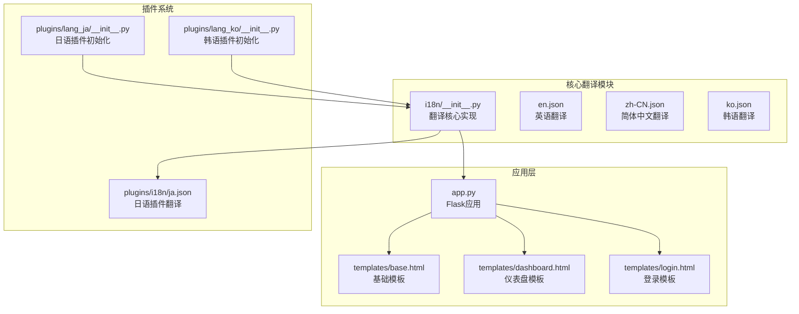
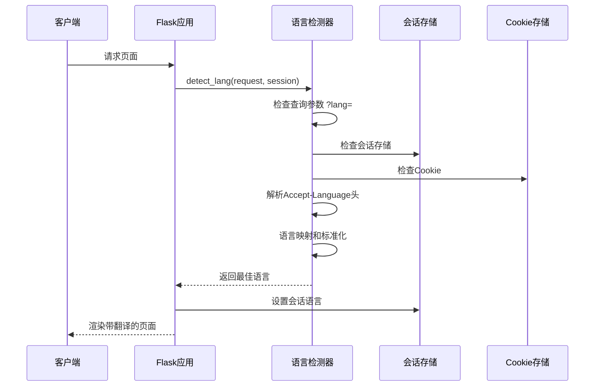
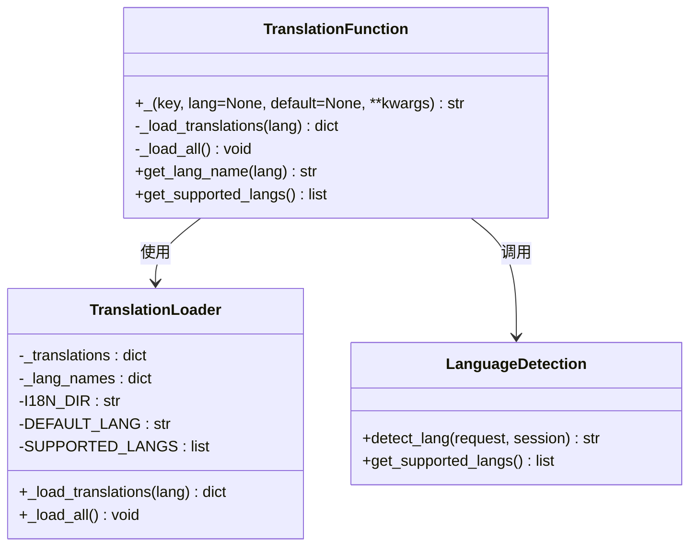
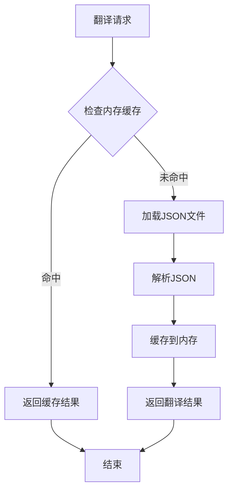
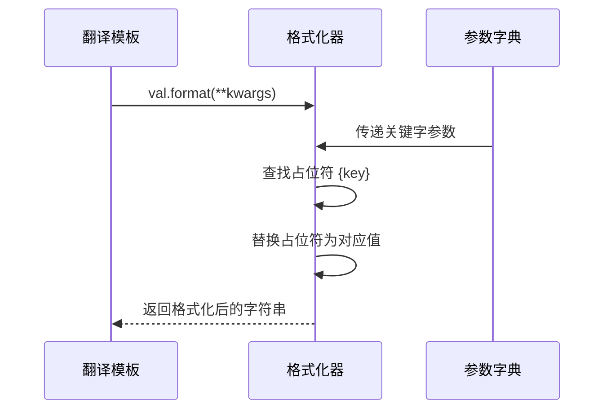
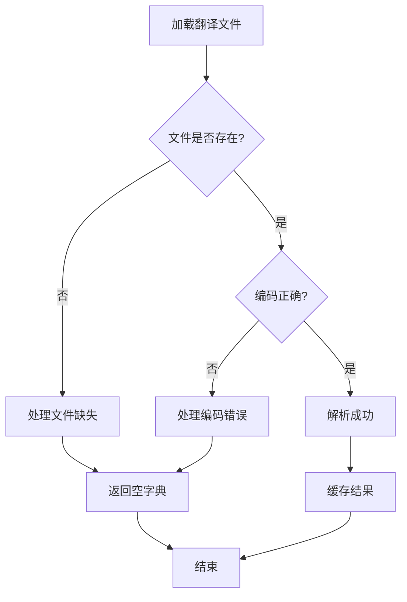
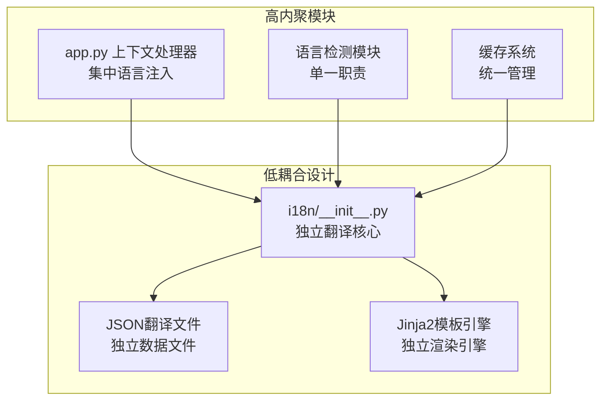

# 翻译函数实现

<cite>
**本文档引用的文件**
- [i18n/__init__.py](file://i18n/__init__.py)
- [app.py](file://app.py)
- [templates/base.html](file://templates/base.html)
- [templates/dashboard.html](file://templates/dashboard.html)
- [templates/login.html](file://templates/login.html)
- [i18n/en.json](file://i18n/en.json)
- [i18n/zh-CN.json](file://i18n/zh-CN.json)
- [i18n/ko.json](file://i18n/ko.json)
- [plugins/i18n/ja.json](file://plugins/i18n/ja.json)
- [plugins/plugins/lang_ja/__init__.py](file://plugins/plugins/lang_ja/__init__.py)
- [plugins/plugins/lang_ko/__init__.py](file://plugins/plugins/lang_ko/__init__.py)
</cite>

## 目录
1. [简介](#简介)
2. [项目结构](#项目结构)
3. [核心组件](#核心组件)
4. [架构概览](#架构概览)
5. [详细组件分析](#详细组件分析)
6. [依赖关系分析](#依赖关系分析)
7. [性能考虑](#性能考虑)
8. [故障排除指南](#故障排除指南)
9. [结论](#结论)
10. [附录](#附录)

## 简介

School_Web 的翻译函数实现是一个完整的多语言支持系统，基于 Python 的 i18n 模块和 Jinja2 模板引擎。该系统提供了灵活的翻译机制，支持多种语言切换、参数化翻译、缓存优化和错误处理。

## 项目结构

School_Web 采用模块化的项目结构，翻译功能分布在多个关键位置：



**图表来源**
- [i18n/__init__.py:1-113](file://i18n/__init__.py#L1-L113)
- [app.py:175-211](file://app.py#L175-L211)

**章节来源**
- [i18n/__init__.py:1-113](file://i18n/__init__.py#L1-L113)
- [app.py:164-211](file://app.py#L164-L211)

## 核心组件

### 翻译函数核心实现

翻译函数 `_()` 是整个系统的核心，提供了完整的翻译功能：

```mermaid
flowchart TD
START[调用 _() 函数] --> CHECK_LANG{是否指定语言?}
CHECK_LANG --> |否| SET_DEFAULT[设置默认语言 zh-CN]
CHECK_LANG --> |是| USE_SPECIFIED[使用指定语言]
SET_DEFAULT --> LOAD_CHECK{语言文件是否已加载?}
USE_SPECIFIED --> LOAD_CHECK
LOAD_CHECK --> |否| LOAD_FILE[加载翻译文件]
LOAD_CHECK --> |是| GET_TRANSLATION[获取翻译内容]
LOAD_FILE --> CACHE_TRANSLATION[缓存翻译内容]
CACHE_TRANSLATION --> GET_TRANSLATION
GET_TRANSLATION --> CHECK_PARAMS{是否有参数?}
CHECK_PARAMS --> |否| RETURN_RESULT[返回翻译结果]
CHECK_PARAMS --> |是| FORMAT_STRING[格式化字符串]
FORMAT_STRING --> RETURN_RESULT
RETURN_RESULT --> END[结束]
```

**图表来源**
- [i18n/__init__.py:50-67](file://i18n/__init__.py#L50-L67)

### 支持的语言列表

系统支持四种主要语言：
- 中文（简体）- zh-CN
- 英语 - en  
- 日语 - ja
- 韩语 - ko

**章节来源**
- [i18n/__init__.py:8-9](file://i18n/__init__.py#L8-L9)
- [i18n/__init__.py:31-34](file://i18n/__init__.py#L31-L34)

## 架构概览

### 系统架构图

```mermaid
graph TB
subgraph "用户界面层"
WEB[Web浏览器]
VUE[Vue.js前端]
JINJA[Jinja2模板引擎]
end
subgraph "应用服务层"
FLASK[Flask应用]
CONTEXT_PROCESSOR[上下文处理器]
LANGUAGE_DETECTION[语言检测]
end
subgraph "翻译服务层"
TRANSLATION_FUNCTION[翻译函数 _()]
CACHE_MANAGER[缓存管理器]
FILE_LOADER[文件加载器]
end
subgraph "数据存储层"
JSON_FILES[JSON翻译文件]
PLUGIN_FILES[插件翻译文件]
end
WEB --> FLASK
VUE --> FLASK
JINJA --> FLASK
FLASK --> CONTEXT_PROCESSOR
FLASK --> LANGUAGE_DETECTION
CONTEXT_PROCESSOR --> TRANSLATION_FUNCTION
LANGUAGE_DETECTION --> TRANSLATION_FUNCTION
TRANSLATION_FUNCTION --> CACHE_MANAGER
CACHE_MANAGER --> FILE_LOADER
FILE_LOADER --> JSON_FILES
FILE_LOADER --> PLUGIN_FILES
```

**图表来源**
- [app.py:175-211](file://app.py#L175-L211)
- [i18n/__init__.py:15-28](file://i18n/__init__.py#L15-L28)

### 语言检测流程



**图表来源**
- [i18n/__init__.py:70-108](file://i18n/__init__.py#L70-L108)

**章节来源**
- [app.py:164-173](file://app.py#L164-L173)
- [i18n/__init__.py:70-108](file://i18n/__init__.py#L70-L108)

## 详细组件分析

### 翻译函数实现分析

#### 参数处理机制

翻译函数 `_()` 提供了灵活的参数处理能力：



**图表来源**
- [i18n/__init__.py:50-67](file://i18n/__init__.py#L50-L67)
- [i18n/__init__.py:15-28](file://i18n/__init__.py#L15-L28)
- [i18n/__init__.py:70-108](file://i18n/__init__.py#L70-L108)

#### 语言选择逻辑

语言选择遵循以下优先级顺序：

1. **查询参数覆盖** - URL 中的 `?lang=` 参数
2. **会话存储偏好** - 用户的会话语言设置
3. **Cookie 回退** - 非登录用户的语言偏好
4. **Accept-Language 头** - 浏览器的语言首选项

**章节来源**
- [i18n/__init__.py:78-108](file://i18n/__init__.py#L78-L108)

#### 默认值机制

翻译函数提供了完善的默认值处理：

- **显式默认值** - 通过 `default` 参数指定
- **键名回退** - 当没有提供默认值时，直接返回键名
- **空值处理** - 翻译文件缺失时返回空字典

**章节来源**
- [i18n/__init__.py:60-67](file://i18n/__init__.py#L60-L67)

### 翻译键查找过程

#### 缓存机制

系统实现了多层次的缓存策略：



**图表来源**
- [i18n/__init__.py:15-28](file://i18n/__init__.py#L15-L28)

#### 回退策略

当翻译键不存在时，系统采用以下回退策略：

1. **显式默认值** - 使用传入的 `default` 参数
2. **键名回退** - 返回原始键名
3. **空字典回退** - 翻译文件加载失败时返回空字典

**章节来源**
- [i18n/__init__.py:15-28](file://i18n/__init__.py#L15-L28)
- [i18n/__init__.py:60-67](file://i18n/__init__.py#L60-L67)

### 参数化翻译实现

#### format 方法使用

翻译函数支持参数化替换，使用 Python 的 `str.format()` 方法：



**图表来源**
- [i18n/__init__.py:62-66](file://i18n/__init__.py#L62-L66)

#### 占位符替换机制

系统提供了健壮的占位符替换机制：

- **类型安全** - 使用 `try-except` 处理格式化异常
- **参数验证** - 检查必需参数是否存在
- **错误容忍** - 格式化失败时返回原始字符串

**章节来源**
- [i18n/__init__.py:62-66](file://i18n/__init__.py#L62-L66)

### 错误处理机制

#### 文件缺失处理

系统对文件缺失情况提供了完善的处理：



**图表来源**
- [i18n/__init__.py:21-28](file://i18n/__init__.py#L21-L28)

#### JSON解析失败处理

JSON解析错误采用容错设计：

- **FileNotFoundError** - 文件不存在时返回空字典
- **json.JSONDecodeError** - JSON格式错误时返回空字典
- **UnicodeDecodeError** - 编码错误时返回空字典

**章节来源**
- [i18n/__init__.py:27-28](file://i18n/__init__.py#L27-L28)

#### 参数不匹配处理

参数化翻译的错误处理：

- **KeyError** - 缺少必需参数时忽略格式化
- **ValueError** - 参数类型错误时忽略格式化
- **IndexError** - 位置参数索引越界时忽略格式化

**章节来源**
- [i18n/__init__.py:63-66](file://i18n/__init__.py#L63-L66)

## 依赖关系分析

### 组件耦合度



**图表来源**
- [app.py:175-211](file://app.py#L175-L211)
- [i18n/__init__.py:11-12](file://i18n/__init__.py#L11-L12)

### 外部依赖集成

系统与外部组件的集成点：

- **Flask框架** - 通过上下文处理器集成
- **Jinja2模板** - 通过全局函数注入
- **插件系统** - 动态扩展语言支持
- **会话存储** - 用户语言偏好持久化

**章节来源**
- [app.py:175-211](file://app.py#L175-L211)
- [plugins/plugins/lang_ja/__init__.py:89-96](file://plugins/plugins/lang_ja/__init__.py#L89-L96)

## 性能考虑

### 缓存优化策略

系统采用了多层缓存机制来提升性能：

1. **内存缓存** - `_translations` 字典缓存已加载的翻译
2. **预加载机制** - 应用启动时预加载所有支持语言
3. **懒加载策略** - 仅在首次访问时加载特定语言文件

### 性能指标

- **首次加载延迟** - 仅影响首次访问特定语言的用户
- **后续访问性能** - O(1) 时间复杂度的内存查找
- **内存占用** - 每个语言约占用几KB到几十KB内存

## 故障排除指南

### 常见问题诊断

#### 翻译键不存在

**症状**：页面显示原始键名而非翻译内容

**解决方案**：
1. 检查翻译文件中是否存在对应键
2. 验证JSON文件格式是否正确
3. 确认文件编码为UTF-8

#### 语言切换失效

**症状**：用户切换语言后页面仍显示原语言

**解决方案**：
1. 检查 `/api/lang/switch` 接口是否正常工作
2. 验证会话存储是否正确更新
3. 确认Cookie设置是否正确

#### 参数化翻译错误

**症状**：包含占位符的翻译显示不正确

**解决方案**：
1. 检查占位符语法是否正确
2. 验证传入的参数类型和数量
3. 确认JSON文件中的占位符格式

**章节来源**
- [app.py:214-228](file://app.py#L214-L228)
- [i18n/__init__.py:62-66](file://i18n/__init__.py#L62-L66)

## 结论

School_Web 的翻译函数实现展现了优秀的软件工程实践：

1. **模块化设计** - 清晰的职责分离和低耦合
2. **性能优化** - 多层缓存机制确保高效运行
3. **错误处理** - 完善的容错机制提升系统稳定性
4. **扩展性** - 插件系统支持动态语言扩展
5. **用户体验** - 无缝的语言切换和参数化翻译

该实现为类似项目提供了优秀的参考模板，展示了如何构建一个既强大又易于维护的多语言支持系统。

## 附录

### API参考

#### 翻译函数 API

| 参数 | 类型 | 必需 | 描述 |
|------|------|------|------|
| key | str | 是 | 翻译键名 |
| lang | str | 否 | 目标语言代码，默认为 zh-CN |
| default | str | 否 | 默认返回值 |
| **kwargs | dict | 否 | 参数化翻译的占位符 |

#### 返回值

- **成功**：翻译后的字符串
- **失败**：根据策略返回默认值或原始键名

#### 使用示例

```python
# 基础翻译
_("nav_dashboard")

# 指定语言
_("nav_dashboard", lang="en")

# 带默认值
_("nonexistent_key", default="默认文本")

# 参数化翻译
_("backup_keep_n", n=5)
```

**章节来源**
- [i18n/__init__.py:50-67](file://i18n/__init__.py#L50-L67)